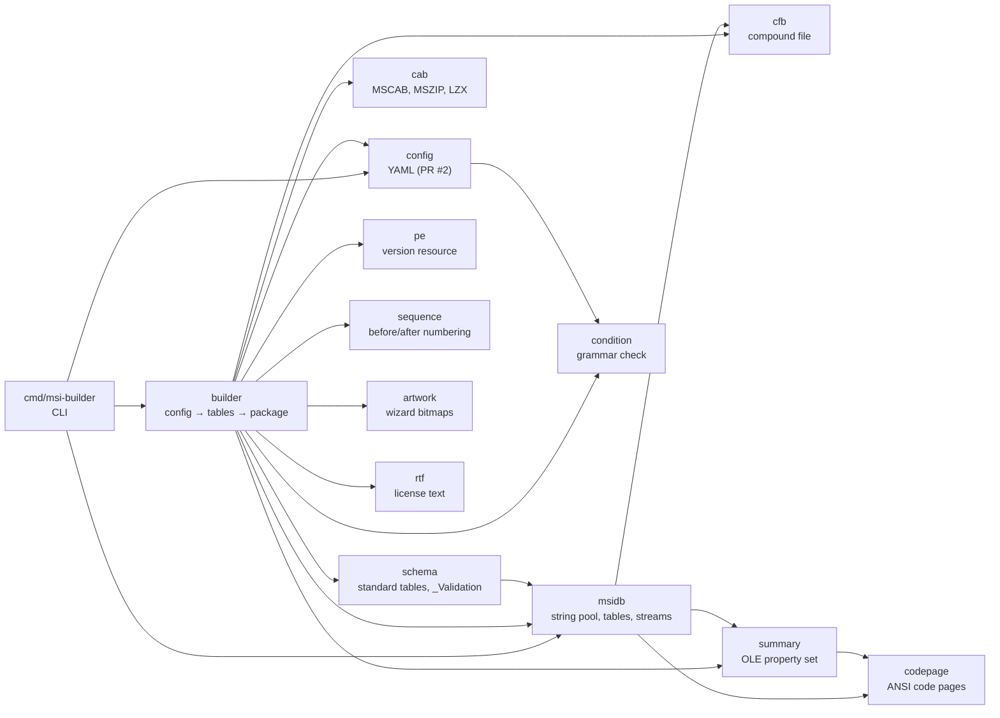

# msi-builder writer architecture and implementation plan

msi-builder turns one YAML file ([`yaml-schema.md`](yaml-schema.md)) into an
`.msi` package. It only builds packages and reads them back (`inspect`, the
self-check): it never installs or executes one. Only its tests do: the
Windows tests without `-short` (elevated). Everything is pure Go with no cgo
and builds and runs on Linux, macOS and Windows.

The rules come from [`docs/spec/MSISPEC.md`](../spec/MSISPEC.md) and the
Windows results in [`docs/spec/MSISPEC-RESULTS.md`](../spec/MSISPEC-RESULTS.md).
Section numbers below refer to the specification. WiX and Wine source code is
never consulted (both are LGPL).

## 1. Package map

Each format package (`cfb`, `cab`, `summary`, `msidb`) is self-contained and tested on its own; all of them are internal. Every package has no cgo,
no package the product uses has platform-specific code, and every package
except the test helpers is tested on its own. Arrows point from a package to what it imports. The
diagram leaves out the test helpers: `internal/testpe` (and its
`internal/testpe/cmd` generator) builds PE files for tests, `internal/ice`
runs the ICE suite through msi.dll (Windows only, used by tests only), and
`internal/builder/nativetest` holds only the Windows msi.dll, msiexec install and
ICE tests.



| Package | Responsibility | Spec | Depends on |
|---|---|---|---|
| `internal/cfb` | Compound File Binary v3/v4 writer and reader: sectors, FAT, DIFAT, mini stream, red-black directory tree, name comparison | §2 | stdlib |
| `internal/cab` | Cabinet writer and reader: one folder per cabinet unless identical files share bytes (the shared file and the file after it or after a copy start new folders), stored, MSZIP blocks with carried DEFLATE history or LZX frames (`internal/lzx`), checksums on every block | §5 | stdlib (`compress/flate`), `internal/lzx` |
| `internal/summary` | `\u0005SummaryInformation` property-set writer and reader (PIDs 1–19, VT_I2/I4/LPSTR/FILETIME) | §4 | `internal/codepage` |
| `internal/msidb` | The database: column types, typed rows, stream-name encoding, string pool with code pages, catalog, column-major table streams, binary streams, embedded streams; plus a reader that decodes a package back into tables | §3 | `cfb`, `summary`, `internal/codepage` |
| `internal/schema` | Column definitions and `_Validation` metadata of every standard table the builder can write | §6 | `msidb` |
| `internal/pe` | PE version resource reader: file version, translations, "is this a PE file", PE checksum presence | §11.5 | stdlib |
| `internal/condition` | Parser for the condition grammar, used to reject conditions the engine would ignore | §8.8 | stdlib |
| `internal/sequence` | Numbering of sequence tables: fixed standard actions plus before/after chains, overlap and window checks | §9.2, §11.7 | stdlib |
| `internal/builder` | The config-to-tables layer: identities, directories and short names, components and GUIDs, files, media and cabinets, registry, services, environment, upgrades, custom actions, helpers, `_Validation`, summary; then the package bytes and a verification pass | §6–§11 | everything above, plus `config`, `internal/artwork`, `internal/cadll`, `internal/rtf` and `go.yaml.in/yaml/v3` |
| `pkg/config` | YAML decoding, defaults and validation into a `*config.Config` | | `internal/condition`, `go.yaml.in/yaml/v3` |
| `internal/codepage` | ANSI code page encoders for the string pool and summary, from tables dumped from Windows | §3, §4 | none |
| `internal/cadll` | The custom action DLL of `run` actions and permission grants: freestanding C (`src/builderrun.c`), cross-built by `build.sh` (`go generate`) with clang 18 and lld for x86, x64 and arm64, committed, pinned by `SHA256SUMS` and embedded with `go:embed`; the builder copies the platform's DLL into the `Binary` table | §9.4 | stdlib |
| `internal/artwork` | Draws the wizard bitmaps (our own artwork, generated in code) and decodes a theme's BMP, PNG or JPEG pictures | | stdlib |
| `internal/rtf` | Converts a plain-text license to RTF and checks an RTF license for the ScrollableText control | | stdlib |
| `pkg/builder` | Public build API: `Build`, `Options`, `Result`, `File`, converted to and from `internal/builder` | | `internal/builder`, `config` |
| `cmd/msi-builder` | CLI: `build`, `validate`, `inspect`, `sign`, `verify`, `completion`, `version` | | `builder`, `config`, `msidb`, `cfb`, `sign`, `spf13/cobra` |

`pkg/config` (PR #2) stays as it is: the builder consumes a validated `*config.Config`
and never reads YAML.

Packages under `pkg/` are the importable Go API: `config`, `builder` and
`sign`. `pkg/builder` is a thin wrapper over `internal/builder` that exposes
`Build`, `Options`, `Result` and `File` only, so no format type (`msidb`,
`cfb`, `cab`, `summary`) is part of the API. Every other package lives under
`internal/` and may change without notice.

### 1.1 `cfb`

```go
type Stream struct { Name string; Data []byte }   // Name: 1–31 UTF-16 units
type Source struct { Name string; Size int64; Open func() (io.ReadCloser, error) }
type Options struct { Version int /* 3 or 4, default 4 */; CLSID [16]byte }
type Layout struct { Offsets map[string]int64; Size int64 } // where each stream landed
func Write(streams []Stream, o Options) ([]byte, error)
func WriteTo(dst io.Writer, sources []Source, o Options) (*Layout, error)
func Read(data []byte) (*File, error)              // File.Streams, File.Stream(name)
func Open(src io.ReaderAt, size int64) (*File, error) // lazy: directory only
func (f *File) Reader(name string) (*StreamReader, error) // io.ReaderAt/Reader/Seeker
```

- `WriteTo` streams: the whole layout (sector counts, FAT, DIFAT, directory,
  mini stream, large stream order) follows from the sizes alone, so the writer
  emits sectors in order and copies each large stream from its `Open` reader
  without holding it. `Write` is `WriteTo` into memory with byte-identical
  output. `Layout.Offsets` lets the builder patch a stream in place later.
- `Open` reads the header, FAT, MiniFAT and directory from an `io.ReaderAt`;
  stream bodies are read on demand through `Reader`, which walks the chain.

- Fixed writer choices from §2: sorted siblings, balanced red-black tree,
  SIDs in sorted order, sector order FAT → DIFAT → directory → MiniFAT →
  mini stream → large streams, zero timestamps, ENDOFCHAIN for empty streams.
- Default v4 like the native writer (CFB-01); v3 stays available.
- The reader walks the tree with visited sets, accepts both versions and any
  start sector for size-0 streams.
- Test vectors: A.2 v3 and v4 hashes, round trip of random stream sets,
  sibling order and uniqueness errors.

### 1.2 `cab`

```go
type File struct { Name string; Data []byte; Time time.Time; Attributes uint16 }
type Entry struct { Name string; Size int64; Time time.Time; Attributes uint16; Open func() (io.ReadCloser, error) }
type Options struct { Compression Compression /* None, MSZIP, LZX */; Level int; Window int; SetID uint16 }
func Write(files []File, o Options) ([]byte, error)
func WriteTo(dst io.WriteSeeker, entries []Entry, o Options) (int64, error)
func Read(data []byte) ([]File, error)
func Walk(src io.ReaderAt, size int64, visit func(File, io.Reader) error) error
func Entries(fsys fs.FS) ([]Entry, error)
```

- `WriteTo` streams: CFFILE records follow from names and sizes, the folder
  data is compressed block by block from the concatenated `Open` readers (an
  entry that is shorter or longer than its declared `Size` is an error), and
  the CFDATA count follows from the folder size; only `cbCabinet` is patched
  afterwards through the seeker. `Write` is `WriteTo` into memory with byte-identical output.
- `Options.SignatureReserve` writes the 20-byte per-cabinet reserve an
  Authenticode signature header fills (MSISPEC §12), 24 bytes more than
  `Bound`; `sign.SignCabinet` then fills it and appends the PKCS #7 after
  `cbCabinet`, so signing never moves cabinet data.
- MSZIP blocks are compressed up to four at a time (`Options.Workers`),
  each with the chunk before it as history, and written in order; the
  cabinet is the same for any number of workers.
- LZX frames come from `lzx.Encoder` a block (four frames) at a time;
  a block whose compressed frame would exceed 32768 + 6144 bytes is
  stored uncompressed instead. The encoder finds the next frame's matches
  while it parses the current one.
- `Walk` decodes one block at a time and hands every file's bytes to `visit`
  as a reader; it serves verification without materializing the cabinet.

- One folder, blocks of 32768 bytes, history carried across blocks, the
  stored fallback, "CK" prefix, checksum on every block (MSZIP-01, CAB-04).
- A file whose bytes later entries share (`Entry.Copy`: identical files of
  at least 32768 bytes, section 5) gets a folder of its own, and the entry
  after a copy starts a new one (CAB-14).
- Dates in UTC from the given instant, default 1980-01-01.
- Limits: 65535 files, 0x7FFFFFFF bytes, name ≤ 255 bytes.
- Test vectors: A.4 checksum and the 118-byte stored cabinet; a three-block
  folder with cross-block matches; stored fallback on random data.

### 1.3 `summary`

```go
type Property struct { ID int; Value any } // int16, int32, string, time.Time
func Marshal(props []Property, codepage int) ([]byte, error)
func Unmarshal(data []byte) ([]Property, error)
```

Writes PIDs in ascending order, `SystemIdentifier` `0x0002000A` (SUM-07), an
ANSI code page only, no padding after the last value. Test vector A.3.

### 1.4 `msidb`

```go
type Type struct { Kind Kind; Nullable, Key, Localizable bool; Width int }
func ParseType(idt string) (Type, error)         // "s72", "I2", "L0", "V0"
type Column struct { Name string; Type Type }
type Table struct { Name string; Columns []Column; Rows [][]any } // nil, string, int, []byte
type Database struct { Codepage int; Tables []*Table; Streams []Stream; Sources []cfb.Source; Summary []summary.Property }
func (db *Database) Marshal(o Options) ([]byte, error)
func (db *Database) MarshalTo(dst io.Writer, o Options) (*cfb.Layout, error)
func Unmarshal(data []byte) (*Database, error)
func Decode(file *cfb.File) (*Database, error)   // lazy; cabinets stay as Sources
func EncodeStreamName(name string, table bool) (string, error)
func DecodeStreamName(encoded string) (name string, table bool)
```

Marshal implements the canonical writer of §3: validate the schema (at most 31
columns, keys first, one binary column, encoded names ≤ 31 units), turn `""`
into NULL, collect strings, assign IDs sorted by encoded bytes, count
references including `_Tables` and `_Columns`, reject a count above 32767
(15-bit refcounts, MSIDB-05), pick 2- or 3-byte references when the highest ID
reaches 65535 (MSIDB-06), sort rows by stored keys, reject duplicate keys, then
emit `_StringPool`, `_StringData`, `_Tables`, `_Columns`, one stream per
non-empty table, one `Table.Key` stream per binary value, the summary stream
and the extra streams through `cfb`. `Streams` hold small extra streams in
memory; `Sources` (cabinets) are copied from their readers by `MarshalTo`, so
a package is never larger than its biggest table in memory. `Decode` reads an
opened `cfb.File` lazily and lists streams it did not consume as `Sources`
with a nil `Open`, so the inspector and the verifier see cabinets by name and
size without loading them.

Code pages: 0 (ASCII), 65001 (UTF-8) and the ANSI pages through
tables dumped from Windows' `MultiByteToWideChar` and
`WideCharToMultiByte` (`internal/codepage/tables`, compared with the
runner on every Windows CI run); unmappable text and bytes Windows refuses
are an error, never `?`.

### 1.5 `schema`

One Go definition per standard table: columns in `.idt` notation plus the
`_Validation` row values (nullable, min, max, key table, key column,
category, set, description). The builder asks for a table by name and gets
an empty `msidb.Table` with the right columns, and `schema.Validation(tables)`
produces the `_Validation` rows for every table present, including
`_Validation` itself. Custom tables from `tables:` carry their own metadata.

### 1.6 `pe`

```go
type Info struct {
    FileVersion, ProductVersion string // "1.2.3.4" or ""
    Languages                   []int
    Machine                     uint16
    Is64Bit, HasChecksum, HasVersion bool
}
func Parse(r io.ReaderAt) (*Info, error)
func IsPE(r io.ReaderAt) bool
```

Walks RT_VERSION → first name → first language, parses `VS_FIXEDFILEINFO`
and the `Translation` values. Tests use a synthetic PE written by the test
suite (also used by the Windows installation tests).

### 1.7 `condition`

`condition.Check(s string) error` parses with the grammar of §8.8 and
reports syntax errors with positions. No evaluation.

### 1.8 `sequence`

```go
type Action struct { Name string; Condition string; Sequence int; Before, After string }
func Number(actions []Action) ([]Numbered, error)
```

Standard actions are fixed nodes at the default sequence numbers of §9.2;
custom actions chain before or after an anchor and are expanded next to it
(§11.7). A chain that reaches another fixed number, a cycle, a missing anchor
and a number outside 1…32767 are errors. The builder then checks ICE77
(deferred actions inside InstallInitialize…InstallFinalize), ICE63 as the
engine applies it (RemoveExistingProducts anywhere from after
FindRelatedProducts up to InstallInitialize, right after InstallExecute or
after InstallFinalize, UPG-04), and ICE27 ordering.

### 1.9 `builder`

`internal/builder`:

```go
type Options struct { BuildTime time.Time; ToolName, Output string; CFBVersion int; SkipVerify bool }
type Result struct {
    Package     []byte
    Database    *msidb.Database
    Diagnostics config.Diagnostics
    ProductCode, PackageCode string
    Files       []File // payload files in File.Sequence order
    Size        int64
}
func Build(cfg *config.Config, o Options) (*Result, error)
```

`pkg/builder` has the same `Build`, `Options`, `File` and `Result`, without
`Result.Database`.

Pipeline, each step a file of its own:

1. **Inputs**: read every source file, `pe.Parse` it, derive `File.Version`,
   `Language`, `MsiFileHash` (zeros for an empty file, FILE-02), size and
   attributes. Missing files and unversioned PE files are errors. A relative
   source is opened from `File.FS`, else `Config.FS`, else `Config.BaseDir`
   ([Go API](../go-api.md)); `Config.AddTree` fills in a folder tree before
   the build.
2. **Identities**: GUIDs normalized; `productCode: auto` from UUIDv5 over the
   upgrade code, platform, version and a digest of every input (payload
   files, icons, binaries, binary cells of custom tables, and the wizard's
   licenses and theme pictures);
   `packageCode: auto` from the finished database bytes; component GUIDs
   from UUIDv5 over the key path's canonical location.
3. **Directories**: `TARGETDIR`/`SourceDir`, the standard folders, the tree,
   short names from the §11.3 hash, `DefaultDir` values. The configuration
   gives long names only; every short name is generated. Directories and
   files in one folder share one set of short names, also when several
   directory IDs name that folder; long names that are valid short names
   are taken before any is generated, once the files are read. Duplicates
   would break `SHORTFILENAMES=1` installs (FILE-07).
4. **Components, features, files, media**: attributes (64-bit bit 256,
   permanent, transitive, …), key paths (a component below a profile folder
   gets a generated HKCU value as key path after its ComponentId is
   derived, INST-04; `profile.go`, which also adds a marker to the automatic
   ProductCode), `CreateFolder` rows, file sequence
   order (canonical directory, name, key), one `Media` row and one embedded
   cabinet, `File.Attributes` (vital, checksum, read-only, hidden, system),
   and the `Shortcut` and `MsiShortcutProperty` rows with the generated component that carries them
   (HKCU key path, `RemoveFile` rows for profile folders; `shortcuts.go`),
   including a component's own shortcuts to files, folders and programs and
   its `.url` files as `IniFile` rows.
5. **Registry, event log, environment, services**: value encodings
   (`#`, `#x`, `#%`, `##`, `[~]`), `=-*`-style environment names with an
   explicit `-` (ENVVAR-01), `ServiceInstall`, `ServiceControl`,
   `MsiServiceConfig` (delayed start, failure actions on non-crash), and the
   `sc.exe failure` recovery action (SVC-01).
6. **Properties, launch conditions, upgrade**: `Property` rows, `ALLUSERS`,
   `SecureCustomProperties`, `MsiHiddenProperties`, `ARP*`, `Upgrade` rows
   from the policy, the downgrade launch condition, condition syntax checks.
7. **Custom actions and helpers**: type numbers and option bits from the
   typed kinds, firewall `netsh` actions with rollback, `ARPINSTALLLOCATION`.
8. **Sequences**: the standard actions each used table needs (§9.3), the
   chains, `sequence.Number`, the window checks.
9. **UI**: the wizard pages as table data (`internal/builder/ui*.go`): the flow of
   pages, `ui.dialogs` inserted after their anchor, the maintenance menu, the
   end, cancel, error, files-in-use and Restart Manager dialogs, the license
   page (RTF checked or converted by `rtf`), the install folder page, the
   finish page text and launch checkbox, the bitmaps drawn by `artwork`
   from a palette or decoded from the theme's pictures and re-encoded as
   24-bit BMP, and the ICE-style self-checks. Every built-in text comes from
   `config.UIStrings` through `UI.UIString`, so `ui.strings` can replace it.
10. **Finish**: `_Validation` from `schema`, summary information, then the
    streaming write: each cabinet is written with `cab.WriteTo` to a spool
    (memory when `Options.Output` is empty, otherwise a temporary file next to
    the output). The files were split into cabinets, in sequence order and at
    file boundaries, when the `Media` rows were written: a cabinet ends before
    the file that would take it above 65535 files, 65535 blocks or, by
    `cab.Bound` (every block at its compression's largest size), 2 GiB or
    `Options.CabinetSize`. Embedded cabinets become package streams and may
    add up to 2 GB; external ones (`package.embedCabinets: false`) stay
    files. With `Options.SignCabinets` (checked before the first cabinet),
    each external cabinet is signed with `sign.SignCabinet` right after it
    is written, and its signature value fills the Hash of its
    `MsiDigitalSignature` row beside the `MsiDigitalCertificate` row. Then the package with `msidb.MarshalTo` into a second temporary
    file, the package code (UUID v5 of the package's SHA-256) is patched into
    the summary stream at its `cfb.Layout` offset, then **verify**: `cfb.Open`
    the package, `msidb.Decode` it, compare every table column and every
    cell (rows as a set, NULL/empty and the integer types folded, binary
    cells by digest), `cab.Walk` each
    cabinet, stream or spool, and compare every file's SHA-256 (computed once while
    hashing the source for `MsiFileHash`) with its source; a signed cabinet
    must also pass `sign.VerifyCabinet` with the signature value its row holds. Memory stays
    bounded by the tables plus a few compression blocks, whatever the payload
    size. The external cabinets and the verified package are then renamed into
    place together by `spool.Commit`, which backs up what they replace and
    restores it when a later rename fails; a failed
    build leaves an existing package untouched and no temporary files behind.

Static ICE-style checks live next to the step that has the data (ICE03/06/32
through `schema`, ICE18/19/21, ICE04/71, ICE27/63/77, ICE80, ICE87, ICE105).

### 1.10 `cmd/msi-builder`

- `msi-builder build [--var NAME=value]... [--env] [-o out.msi] msi.yaml`
- `msi-builder validate msi.yaml` runs config validation.
- `msi-builder inspect [--table Name] pkg.msi` dumps tables and streams through
  `msidb.Decode`; this is the cross-OS debugging tool.
- `msi-builder sign` and `msi-builder verify` sign and check packages (`pkg/sign`).
  `build` with signing options also signs external cabinets (`builder.Options.SignCabinets`).

The commands are built with `spf13/cobra` (POSIX flags, shell completion).
Help goes to stdout, errors to stderr; the exit code is 0 on success, 1 when
the command failed and 2 for a usage error. [`docs/cli`](../cli/msi-builder.md) is
generated from the command tree.

### 1.11 Internal helpers

- `internal/spool`: the `Target` interface (`io.Writer`, `io.WriterAt`,
  `io.ReaderAt`, `io.Seeker`) that both an `*os.File` and the in-memory
  `Buffer` satisfy, so the builder writes, patches and verifies the same way
  for a file and for `Result.Package`.
- `internal/memtest`: a repeatable pattern reader and `PeakHeap`, which runs a
  function under `debug.SetMemoryLimit` and records the live heap each
  collection marked, for the bounded-memory tests in `cab`, `cfb` and
  `builder` (skipped with `-short`). The peak is the larger of the smaller
  of each two successive sampled collections, because one collection also counts
  what is allocated while it marks. The heap in use (`HeapAlloc`) includes
  garbage up to the collector's goal and was flaky as a limit; it is only
  logged.

## 2. Testing

- **Unit tests** per package with the specification's test vectors (A.1
  stream names, A.2 compound files, A.3 summary stream, A.4 cabinets,
  A.6 file hash) and round trips through the readers.
- **Builder tests** build `examples/minimal` and `examples/windows_exporter`
  with synthetic inputs (a generated PE with a version resource, an icon), then
  decode the package and assert on tables: key order, refcounts, sequence
  numbers, attribute bits, `_Validation` coverage, file-to-cabinet order.
  Golden hashes guard determinism: two builds with the same
  `SOURCE_DATE_EPOCH` are byte-identical.
- **Table snapshots** (`cmd/msi-builder`, every OS): `TestExampleTables` builds
  every example with the inputs from `internal/exampletest` and compares the
  `inspect` output with `cmd/msi-builder/testdata/tables/<name>.txt`, so a change
  to the generated tables shows up as a diff in the pull request.
- **Windows runner** (`.github/workflows/ci.yaml`, `windows-latest`): the
  same tests, plus `//go:build windows` tests in `internal/builder/nativetest` that open
  the built package with `msi.dll` (`MsiOpenDatabaseW`, views over every table,
  `MsiGetSummaryInformationW`, `MsiRecordReadStream` on the cabinet) and
  install and uninstall every example silently (`msiexec /i … /qn`, verify
  the payload and the service, `/x`, verify removal; the examples with a
  service install the test service from `docs/spec/msitest/testsvc`). The
  install test also records the machine state before, after `/i` and after
  `/x` and compares the entries the package can own (their names occur as
  a whole word in its strings, or they carry its product code) added under
  the watched places (files under the known folders, registry keys,
  services, event log sources, the ARP entry, shortcut targets) and the
  firewall rules with `internal/builder/nativetest/testdata/install/<name>.txt`.
  They also run the full ICE suite on the examples through
  `internal/ice`, with the `darice.cub` that CI installs from the Windows
  SDK (cached; its SHA-256 is logged). The install test needs elevation;
  all of them are skipped with `-short`. `TestScopeOwns`, the one test of
  the package that builds on every platform, checks the ownership rule and
  runs with `-short`.
- **Real experiments** on Joe's SERVER2025 dev box through Remote Control for
  anything a runner cannot answer (services, upgrades, comparing the ICE
  runner with `msival2.exe`).

`mise.toml` pins the Go version and names local tasks (`test`, `lint`,
`build`) that mirror the commands CI runs.

## 3. Implementation steps

| Step | Delivers | Status |
|---|---|---|
| 1 | `cfb` writer and reader with vectors | this PR |
| 2 | `cab` writer and reader with vectors | this PR |
| 3 | `summary`, `msidb` with stream names, pool, catalog, tables, reader | this PR |
| 4 | `schema` for the tables of §6.2 that the schema can produce | this PR |
| 5 | `pe`, `condition`, `sequence` | this PR |
| 6 | `builder` steps 1–8 and 10, `cmd/msi-builder`, example builds | this PR |
| 7 | CI: Linux, macOS and Windows runners, native tests, mise | this PR |
| 8 | `ui`: built-in wizard (`enabled`, `chooseFeatures`, `chooseDirectory`), generated dialogs, `artwork` bitmaps | PR 2 |
| 9 | ICE-style checks that still need the UI tables; `_Validation` for UI | PR 2 |
| 10 | External cabinets and several media (`package.embedCabinets`, packages above 2 GB) | done |
| 11 | `sign`: Authenticode signing, verification and RFC 3161 timestamps (MSISPEC §12) | done |
| 12 | Uncompressed files beside the package | later |

Out of scope for good: MSIX (nfpm), patches, standalone transforms (`.mst`),
merge modules, bundles, advertised installs and shortcuts, script custom
actions.

## 4. Decisions worth recording

- **v4 by default** because the native writer emits v4 for every size
  (CFB-01). v3 stays for tests and for tools that only know v3.
- **Every refcount in 1…32767.** A string used more often is a build error
  until a real package needs it; none does.
- **LZX:21 by default.** msi-builder's LZX cabinets of the target payloads are
  12 to 26 % smaller than MSZIP (MSISPEC section 5). `internal/lzx` streams: it
  keeps the last 512 KiB as match history and one 128 KiB block, so its
  memory does not grow with the window or the payload.
- **No klauspost/compress.** Go 1.27's `compress/flate` already ships
  klauspost/compress's DEFLATE encoder with byte-identical output; the
  package takes only 15 to 24 % less time at level 9. Speed comes from
  compressing MSZIP blocks in parallel instead (MSISPEC section 16,
  "Decisions not adopted").
- **No LZX folder splitting for speed.** A file cannot span folders inside a
  cabinet, so a package of one large binary would not get faster (MSISPEC
  section 16).
- **Identifiers are deterministic.** Generated keys hash their content
  (§11.2 identity), short names hash parent and long name (§11.3), GUIDs are
  UUIDv5. Nothing depends on map iteration order or time.
- **The builder verifies its own output** by re-reading it with the
  independent readers in `msidb` and `cab`, cell by cell. This catches the
  two silent failures of MSZIP-01 and CAB-04 and a string pool or integer
  encoding bug that keeps the row count, without any Windows machine.
- **Windows-only code is test-only** (`//go:build windows` in
  `internal/builder/nativetest`, `internal/cab/native_windows_test.go` and the ICE
  runner `internal/ice`, which only tests import), so the product stays cross-OS.
