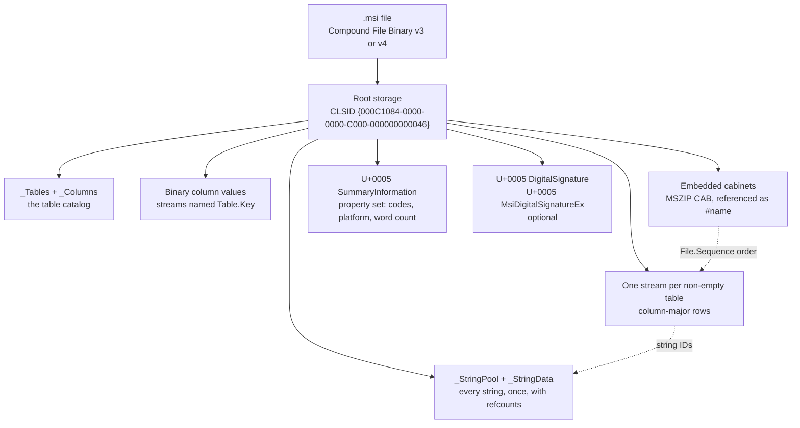

# Windows Installer format and interoperability specification

This document describes Windows Installer package formats, on-disk structures, database semantics, engine behavior and interoperability. Microsoft specifications, native Windows behavior, WiX observations and GNOME msitools observations are treated as separate kinds of evidence. The full
specification has 13 chapters, a test-vector appendix and machine-readable
schemas for the 97 standard tables and the UI tables. References such as
"ch. 05 §4" point into it.

As of 2026-10-25.

## Contents

- [Purpose and scope](#purpose-and-scope)
- [1. MSI package structure](#1-msi-package-structure)
- [2. Container: Compound File Binary](#2-container-compound-file-binary)
- [3. Database storage](#3-database-storage)
- [4. Summary information](#4-summary-information)
- [5. Cabinets](#5-cabinets)
- [6. Database schema](#6-database-schema)
- [7. User interface](#7-user-interface)
- [8. Installer runtime](#8-installer-runtime)
- [9. Actions and sequences](#9-actions-and-sequences)
- [10. WiX v3 authoring model](#10-wix-v3-authoring-model)
- [11. WiX v3 build semantics](#11-wix-v3-build-semantics)
- [12. Digital signatures](#12-digital-signatures)
- [13. WiX v4 and later](#13-wix-v4-and-later)
- [14. Conformance and verification](#14-conformance-and-verification)
- [15. Test vectors and verification](#15-test-vectors-and-verification)
- [16. Independent implementation comparison](#16-independent-implementation-comparison)
- [17. The engine without custom-action code](#17-the-engine-without-custom-action-code)
- [18. Reference chapters](#18-reference-chapters)
- [19. Microsoft documentation audit](#19-microsoft-documentation-audit)
- [Appendix B. Pitfalls and checks](#appendix-b-pitfalls-and-checks)
- [Appendix C. Windows validation test matrix](#appendix-c-windows-validation-test-matrix)

## Purpose and scope

This is a language- and tool-independent reference for reading, writing, validating and installing MSI packages. It does not prescribe an implementation, CLI, authoring syntax or compression library.

| Topic | Scope |
| --- | --- |
| Format | Compound File Binary, MSI relational storage, summary information, cabinets, tables and streams |
| Behavior | Windows Installer properties, actions, components, upgrades, UI and validation |
| Related formats | MSI, MSM, MST, MSP and PCP differences where supported by evidence |
| Interoperability | Native Windows Installer, WiX and GNOME msitools behavior |

### Evidence terminology

- **Normative:** grounded in a published Microsoft file-format specification ([MS-CFB], [MS-OLEPS], MS-CAB) or in a documented Windows Installer API contract that an Appendix C case or a section 14 experiment reproduced on Windows. A Windows Installer documentation page alone does not make a statement Normative.
- **Documented (unverified):** stated by Microsoft's documentation but not reproduced. Microsoft's pages are not assumed correct: several documented statements have already been contradicted on Windows (SUM-02, SUM-03, MSIDB-05, MSIDB-07, ENVVAR-01, UPG-04). A documented statement is a hypothesis for Appendix C, not a fact; an implementation MUST NOT present it as verified behaviour or let a conformance claim depend on it until a case confirms it.
- **Observed (Windows):** reproduced with the native Windows Installer API, installer runtime or analyzed binary behavior. The Appendix C runs are recorded in [MSISPEC-RESULTS.md](MSISPEC-RESULTS.md).
- **Observed (WiX / msitools):** reproduced for a named version of that producer or reader; not a universal MSI requirement.
- **Reported:** described by a third party (an issue, a log, a toolchain's documented behaviour or another project's published conformance results) but not independently reproduced; such facts carry **(reported)**.
- **Unverified:** needs a repeatable native compatibility test.
- **Recommended:** an optional interoperable or deterministic output profile, not a Windows Installer mandate.

MUST, SHOULD and MAY use RFC 2119 terminology only within the declared scope of a rule. Successful parsing, successful native API opening and successful installation are distinct conformance levels. A reference writer's deterministic bytes do not define the only valid encoding.

### Sources and limitations

- [Microsoft Windows Installer](https://learn.microsoft.com/en-us/windows/win32/msi/windows-installer-portal), [MS-CFB](https://learn.microsoft.com/en-us/openspecs/windows_protocols/ms-cfb/) and [MS-OLEPS](https://learn.microsoft.com/en-us/openspecs/windows_protocols/ms-oleps/).
- [GNOME msitools](https://wiki.gnome.org/msitools): portable MSI database reading and writing; used as a black-box reader and producer.
- [WiX Toolset](https://wixtoolset.org/): producer-specific MSI authoring, binding, validation and native MSI database interoperability; used as a black-box producer.
- No source code of WiX, msitools or Wine is referenced, quoted or required by this document. Behaviour attributed to other toolchains is marked **(reported)** and must be confirmed black-box before an implementation relies on it.
- Native Windows msi.dll, msiexec.exe and cabinet.dll: investigation targets; identifying exports does not prove internal algorithms.

Earlier reference hashes and toolchain output comparisons are retained as historical evidence, but should not be promoted to universal requirements without identifying sample hashes, versions and reproduction steps.
## 1. MSI package structure

An `.msi` file is a relational database stored as streams inside a Microsoft
Compound File, with the payload in embedded cabinets.



| Layer | What it holds | Section |
| --- | --- | --- |
| Container | Sectors, FAT, directory tree of named streams | 2 |
| Storage | Encoded stream names, string pool, catalog, table streams | 3 |
| Summary information | Package code, platform, languages, source flags | 4 |
| Payload | Cabinets with the files in `File.Sequence` order | 5 |
| Schema | What each table and column means | 6, 7 |
| Runtime | What the installer does with the tables | 8, 9 |
| Toolchain model | What WiX writes for each concept | 10, 11, 13 |
| Signing | Authenticode over the streams | 12 |

## 2. Container: Compound File Binary

Every `.msi`, `.msm`, `.mst`, `.msp` and `.pcp` file is a Compound File Binary (CFB) file, written here with every free choice fixed.

### Layout

| Offset | Header field (512 bytes) | Writer value |
|---|---|---|
| 0x00 / 0x08 | Signature / header CLSID (16 bytes) | `D0 CF 11 E0 A1 B1 1A E1` / zero |
| 0x18 / 0x1A / 0x1C | Minor version / major version / byte order | 0x003E / 3 or 4 / 0xFFFE |
| 0x1E / 0x20 / 0x22 | Sector shift / mini sector shift / reserved (6 bytes) | 9 or 12 / 6 / zero |
| 0x28 / 0x2C / 0x30 | Directory sector count / FAT sector count / first directory sector | 0 in v3, D in v4 / F (D, F: writer steps below) / sector |
| 0x34 / 0x38 | Transaction signature / mini stream cutoff | 0 / 4096 |
| 0x3C / 0x40 / 0x44 / 0x48 | First MiniFAT sector / count / first DIFAT sector / count | ENDOFCHAIN and 0 when absent |
| 0x4C | DIFAT[0..108] (436 bytes) | first 109 FAT sector numbers, rest FREESECT |

- Sector *n* starts at `(n + 1) × SS`. Version 3 uses SS = 512. Version 4 uses SS = 4096 and zero-fills header bytes 512–4095.
- Special values: MAXREGSECT 0xFFFFFFFA (never used), DIFSECT 0xFFFFFFFC, FATSECT 0xFFFFFFFD, ENDOFCHAIN 0xFFFFFFFE, FREESECT and NOSTREAM 0xFFFFFFFF.
- FAT: one u32 per sector, SS/4 per FAT sector; entries past end of file are FREESECT. DIFAT: FAT sector numbers in order, 109 in the header, then SS/4 − 1 per DIFAT sector plus a link.
- Mini stream: the root entry's chain, cut into 64-byte mini sectors chained by the MiniFAT. It holds every stream under 4096 bytes. Root size is `(highest mini sector + 1) × 64`.

| Offset | Directory entry field (128 bytes) | Rule |
|---|---|---|
| 0x00 / 0x40 | Name (64 bytes) / name length | UTF-16LE + U+0000, zero-filled / bytes incl. terminator |
| 0x42 / 0x43 | Object type / colour | 0 unused, 1 storage, 2 stream, 5 root / 0 red, 1 black |
| 0x44 / 0x48 / 0x4C | Left sibling / right sibling / child | SID or NOSTREAM |
| 0x50 / 0x60 / 0x64 / 0x6C | CLSID / state bits / creation time / modified time | CLSID on storages and root only; everything else 0 |
| 0x74 / 0x78 | Starting sector / size (u64) | sector or mini sector, ENDOFCHAIN if empty, 0 for storages / v3: upper 32 bits 0 |

A sector holds 4 entries in v3 and 32 in v4. Entry 0 is the root: `Root Entry` (length 0x16), no siblings, SHOULD be black. Unused entries are zero except the three links (NOSTREAM); they fill the last directory sector.

### Names, trees and writer

- Names are 1–31 UTF-16 units as stored, without `/ \ : !` or U+0000. Siblings MUST be unique ignoring case.
- `Compare`: the shorter name is smaller; at equal length, compare `Upper(unit)` as unsigned u16. `Upper` is Unicode 5.0 simple uppercase plus Vista overrides (chapter 01 §9.2).
- A writer with ASCII-only `Upper` MUST reject names with other cased units, in the whole BMP outside the surrogates: fullwidth letters (U+FF21–U+FF5A) are cased too. Surrogate units are never upper-cased, so supplementary characters are allowed. MSI names (ASCII, U+3800–U+4840, U+0005) never need more.
- Root CLSID for `.msi`, `.msm` and `.pcp`: `{000C1084-0000-0000-C000-000000000046}`, stored `84 10 0C 00 00 00 00 00 C0 00 00 00 00 00 00 46`. `.mst` uses `{000C1082-…}` and `.msp` `{000C1086-…}`. Sub-storages carry their content's CLSID.

Writer tree strategy (SHOULD; a valid red-black tree that reproduces the test vector):

1. Sort the n children ascending by `Compare`.
2. Make `A[floor(n/2)]` the top node; build the left and right subtrees from the lower and upper halves, recursively.
3. With `F = floor(log2(n + 1))`, colour nodes at depth `< F` black and deeper nodes red.

All-black trees are also valid. SIDs: root 0, then depth-first pre-order with children in `Compare` order, unused entries last. Writer steps:

1. Validate names and limits. Assign SIDs; use `D = ceil(E / (SS/128))` directory sectors for E entries.
2. Build the trees. A size-0 stream gets no sectors (start ENDOFCHAIN); under 4096 bytes is small; the rest is large.
3. Pack small streams in SID order into `ceil(size/64)` mini sectors each. `M = ceil(nMini / (SS/4))`, `S = ceil(nMini × 64 / SS)`, `L = Σ ceil(size / SS)` over large streams.
4. From F = X = 0, repeat to a fixed point: `T = F + X + D + M + S + L` (a v4 writer above 0x7FFFFF00 bytes would add 1 for the range-lock sector; this writer stops below that size, so it never does), `F = ceil(T / (SS/4))`, `X = F ≤ 109 ? 0 : ceil((F − 109) / (SS/4 − 1))`.
5. Order sectors: FAT, DIFAT, directory, MiniFAT, mini stream, then large streams contiguously in SID order. Zero-pad every sector and zero all timestamps and state bits; the file is `(T + 1) × SS` bytes.

- The writer emits v4 by default, like the native engine (CFB-01), and v3 on request. It MUST fail above 0x7FFFFE00 bytes. A v4 file above 0x7FFFFF00 bytes MUST reserve sector 0x7FFFE as an ENDOFCHAIN range-lock sector.
- Readers MUST accept both versions; two large packages written by the native engine were v4 (observed). They MUST reject a bad signature, byte order, or (major, shift) other than (3, 9) and (4, 12).
- Readers SHOULD look names up in a map from a full in-order walk, not by tree search. They ignore colours, keep visited sets, and never allocate from unchecked sizes. A FAT, DIFAT, MiniFAT or directory sector that reads short is an error, not zeros.
- Readers MUST accept a file whose last sector is cut short, as long as every stream byte lies inside the file: a 13 MB v4 package from another build tool ended 204 bytes into its last sector, the tail of `_StringData` (observed). A stream whose bytes reach past the end of the file is an error, never zero-filled. FAT, DIFAT, MiniFAT and directory sectors stay whole.
- Readers MUST treat a size-0 stream as empty whatever its starting sector, without following a chain. Other writers emit 0-byte `_StringData` and `_Tables` streams with a mini-stream start sector, and one CFB library has failed to open them (reported).
- Every directory entry the walk finds MUST be readable by name. One reader dropped embedded cabinets of current Windows SDK packages because it opened streams by index (reported).

### MS-CFB coverage

Audit of `internal/cfb` against [MS-CFB] v20261026 (sections 2.1–2.9 and 4), 2026-10-29. `TestConformance` (`internal/cfb/conformance_test.go`) checks every writer-side MUST and SHOULD below on v3 and v4 output with up to 69 streams, both colour strategies and a file with DIFAT sectors, independently of the reader. `TestConformanceCatchesFaults` checks that it detects each kind of fault without panicking on the broken file.

| MS-CFB rule | Status | Notes |
|---|---|---|
| 2.1 Sector numbers, ENDOFCHAIN/FREESECT/FATSECT/DIFSECT, no shared or cyclic chains, chain length matches size | Supported | Writer lays out disjoint contiguous chains. Reader rejects values ≥ 0xFFFFFFFA, cycles, chains shorter than the size, a chain through a sector that starts past the end of the file (the FAT can describe many more sectors than the file holds), and (since this audit) a sector or mini sector that two chains share, across the FAT, DIFAT, directory, MiniFAT, mini stream and streams. Shared chains would let a small file load each stream again from the same sectors |
| 2.2 Header: signature, zero CLSID, minor 0x3E, byte order, (3, 9) / (4, 12), mini shift 6, reserved, v3 directory count 0, transaction 0, cutoff 4096, v4 padding | Supported | Reader rejects a bad signature, byte order, version/shift pair, mini shift and (since this audit) a mini stream cutoff other than 4096, which would otherwise be read as 4096 and serve the wrong bytes. It also rejects a MiniFAT start without MiniFAT sectors or a MiniFAT sector count without a start, and a v4 header with 0 directory sectors, all of which `StgOpenStorage` refuses (0x80030109 for a count of 0, CFB-12). Header CLSID, minor version, reserved bytes, transaction signature, the v3 directory sector count, nonzero counts that differ from the chain length, and the v4 header padding are ignored on read |
| 2.3 FAT covering every sector, FATSECT/DIFSECT markers, FREESECT past end of file | Supported | Reader rejects a FAT sector count above the file's sector count, a FAT or DIFAT sector listed twice or outside the file, and a header and DIFAT that list fewer FAT sectors than the count. A repeated ID would expand one sector into a FAT of any size |
| 2.4 MiniFAT and mini stream, ENDOFCHAIN when absent, FREESECT past the used mini sectors | Supported | Reader rejects a MiniFAT chain that repeats a mini sector or does not end with ENDOFCHAIN after the sectors its size needs, a root entry whose chain holds less than its size, and stream bytes past the root entry's size |
| 2.5 DIFAT in header and sectors, FREESECT padding, ENDOFCHAIN link | Supported | `TestManyFATSectors`, `TestConformanceDIFAT` |
| 2.6.1 Entry fields: name ≤ 31 units + NUL, even name length ≤ 64, forbidden `/ \ : !`, object type, colour, NOSTREAM links, zero CLSID/state/times on streams, v3 size ≤ 2 GB | Supported | Reader rejects (since this audit) a tree entry whose name length is odd, empty or above 64, whose last unit is not the NUL terminator or that holds a NUL before it, or whose object type is not storage or stream. Windows does not find a stream by its name once the terminator is overwritten, and WinVerifyTrust then reports no signature for a signed package (CFB-11). It masks the upper 32 size bits in v3 as MS-CFB recommends |
| 2.6.1 Storage CLSID, state bits, creation and modified times | Not needed | MSI streams carry none; the root CLSID is written (CFB-02). Times stay zero for determinism; MS-CFB allows zero. The reader exposes them raw for the signature pre-hash (chapter 12) |
| 2.6.2 Root entry name, type 5, black, zero creation time, mini stream start/size | Supported | |
| 2.6.3 Unused entries zero with NOSTREAM links | Supported | |
| 2.6.4 Red-black tree: black top, no red-red, sorted by length then upper-cased units, unique names | Supported | Default trees also have equal black heights. `AllBlack` trees do not, which MS-CFB explicitly allows. Readers ignore colours (CFB-04) and look names up in a map. The reader rejects two children of one storage, streams or storages, whose decoded names are equal after case folding (next row); every unpaired surrogate decodes to U+FFFD, so names that differ only in which unpaired surrogate (or U+FFFD) sits at one position are rejected too |
| 2.6.4 Unicode 5.0 simple case folding with the Vista exceptions | Reader only, as a superset | The writer folds ASCII only and rejects every other cased BMP unit instead (above); MSI names never need it. The reader must still see the names Windows sees: `IStorage::OpenStream` resolves `Ébcd` and `ébcd` to one sibling (CFB-10). The reader maps each BMP unit but surrogates to the lowest unit of the Unicode simple case folding orbits of the unit and of its upper case (which joins U+0131 to `I`) and rejects siblings with equal keys. That is meant to relate every pair Windows can fold, and a few it may keep apart (such as U+212A and `K`), which are rejected too. The writer refuses units that share a folding orbit without a case mapping (U+FB05/FB06, U+0390/1FD3, U+03B0/1FE3), so it never writes two names the reader folds together |
| Storage objects (type 1), nested storages | Supported one level deep | The writer (`cfb.WriteStoragesTo`) emits root-level storages holding streams, which embedded language transforms need: each storage has its own sorted, balanced red-black tree, its CLSID, start sector and size 0, and SIDs number the root's children first and then each storage's children, so a file without storages is laid out as before. Storages inside storages are not written. Reader walks storages and loads their streams; `msidb.Unmarshal` and `Decode` return root-level storages in `Database.Storages`, so a read-modify-write keeps them, and refuse a storage inside a storage instead of dropping it, as well as a storage or stream whose stored name does not survive as text (a lone surrogate reads as U+FFFD). `pkg/sign` keeps root-level storages when it rewrites a package, leaves streams named like the signature streams out of them (section 12), and refuses a storage inside a storage instead of dropping it; its digest covers the storages' streams and CLSIDs (section 12), which SIG-05 checks against WinVerifyTrust. Windows reads a package with a storage from this writer: LANG-02 installs one whose storage `1031` holds a transform (SERVER2025). CFB-08 and CFB-09, which rewrite and read deeper trees, have not run |
| 2.7 Zero-filled tail of the last sector | Supported | Also for mini sectors and the mini stream's last sector (4.3) |
| 2.7 Short last sector of the file | Supported (reader) | Not allowed by 2.3, but written by other tools (observed, above) |
| 2.8 Range lock sector | Not needed | The writer stops at 0x7FFFFE00 bytes, below the range lock offset 0x7FFFFF00, so no sector is ever needed. Packages above 2 GB are unverified (CFB-07) |
| 2.9 Minimum three sectors, v3 ≤ 2 GB, v4 up to 16 TB | Supported up to 2 GB | Writer output is at least header, FAT and directory. v4 files above 2 GB are not written (2.8) |
| 1.5 Transactions, 4.1 full validation | Not needed | Packages are written once. The reader validates what it reads lazily, per 4.1, plus cycles, bounds and sizes against the file length |

Test vector (chapter 01 §15): `.msi` root, `Small` (`0123456789` × 10) and `Large` (5000 bytes, byte i = i mod 256). `Small` is the black top node; `Large` is its red left child. v3: 7680 bytes, SHA-256 `37d8668bf78bc6da2c9b3c6fa3da9c0ffb6824baee21bf13ff9b02dd74e08aed`. v4: 28672 bytes, SHA-256 `acb3c3db476f1d8aebfac49e89b86895756faa24288228a61f617d3c4d54956a`.

Unverified:

- The start sector Windows writes for empty streams; its uppercase table beyond the documented overrides; its reaction to unequal black height.
- The `.msm`/`.pcp` CLSID (from a Microsoft blog post); `msiexec` with a wrong root CLSID; what triggers v4; v4 packages above 2 GB.

## 3. Database storage

An MSI database is a flat set of root-level streams: string pool, catalog, one column-major stream per non-empty table, and data streams.

`_StringPool`, `_StringData`, `_Tables`, `_Columns` and every table stream are encoded with a U+4840 prefix. Binary-column streams and other `_Streams` entries, such as cabinets, are encoded without it. Summary information, signature streams and sub-storage names are literal.

Readers MUST locate objects by decoded name, never by position. Names starting with U+0005 are system streams, not `_Streams` rows. The encoding alphabet is `0`–`9` = 0–9, `A`–`Z` = 10–35, `a`–`z` = 36–61, `.` = 62, `_` = 63.

1. For a table stream, emit U+4840.
2. Scan left to right: two alphabet characters `a`, `b` become `0x3800 + a + (b << 6)`. An alphabet character not followed by one becomes `0x4800 + a`; other units are copied.
3. Fail, naming the row, if the result exceeds 31 units. Table names are limited to 31 characters.

Decoding drops a leading U+4840 and maps 0x3800–0x47FF to `alphabet[v & 0x3F]`, `alphabet[v >> 6]` (`v = u − 0x3800`), and 0x4800–0x483F to one character. Writers MUST NOT create decoded names containing 0x3800–0x4840. Vectors: `Property` (table) → `4840 4559 44F2 4568 4737`, `_Tables` (table) → `4840 3F7F 4164 422F 4836` (both observed), `cab1.cab` → `4126 3865 41BE 4164`, `My-File` → `4716 002D 430F 422F`.

### String pool

Every string in every table is stored as a string ID; ID 0 is NULL. `_StringPool` begins with a u32 whose bits 0–30 are the database code page and bit 31 the long-reference flag. Entries for IDs 1, 2, … follow without padding.

| Entry | Bytes | Layout |
|---|---|---|
| Free | 4 | `u16 0, u16 0` |
| Short | 4 | `u16 length (≥ 1), u16 refcount` |
| Long, exactly when length > 65535 | 8 | `u16 0, u16 refcount (≥ 1), u32 length`, still one ID |

- `_StringData` concatenates non-free strings in ID order, without terminators. Lengths are bytes in the database code page and MUST sum to its size.
- The long entry is exactly `0, refcount, low16(length), high16(length)` as u16 words. One open-source writer emitted `0, high16(length), low16(length), refcount` instead, and its packages with a string over 65535 bytes do not load (reported). A license RTF above 64 KiB is enough to need a long entry; a test vector MUST cover one.
- No empty strings (empty equals NULL) and no duplicates. Canonical writers SHOULD leave no free slots. Readers MUST accept them: WiX-built packages have free slots (reported), so a string added later can get an ID below existing keys.
- A refcount MUST equal the stored references in all table streams, `_Tables` and `_Columns` included (observed exact in native output). msi.dll keeps only 15 bits of it (observed, MSIDB-05), so fail above 32767 rather than saturate or wrap.
- IDs are 2 bytes, or 3 (u16 low, u8 high) with the flag. Writers set it when the highest ID is ≥ 65535; readers MUST honour it. On Windows the flag is set exactly when the highest ID, free slots included, reaches 65535 (observed, MSIDB-06).
- Code page 0 allows ASCII only; otherwise use an ANSI code page or 65001, which a WiX 5-built package used (observed). Never 1200/1201; fail rather than substitute `?`.
- An ANSI code page means the Windows mapping, as `MultiByteToWideChar` with `MB_ERR_INVALID_CHARS` and `WideCharToMultiByte` with `WC_NO_BEST_FIT_CHARS` return it, not a standard character set of the same name: the two differ in private-use rows (CP932 `F0 40` is U+E000), vendor rows (CP950 `F9 FE` is U+2593) and characters without a Windows mapping (U+01F9 in CP936, U+00CA in CP950, which generic tables write as bytes Windows reads as private-use characters). Several byte sequences can map to one character (CP932 `ED 40` and `FA 5C` are both U+7E8A, and Windows writes `FA 5C`); readers MUST accept each, and writers use the one `WideCharToMultiByte` chooses, failing when those bytes do not convert back with `MB_ERR_INVALID_CHARS` (CP874 writes U+F8C1 as `DB`, which it then refuses). The mappings of these two functions are observed: the Windows CI runners compare msi-builder's tables with them for every byte, byte pair and BMP character. That msi.dll reads the string pool through them is assumed, not verified.

### Columns and tables

| Bit | Mask | Meaning in the 16-bit type word |
|---|---|---|
| 0–7 | 0x00FF | strings: max length (0 = unlimited); integers: 2 or 4; binary: 0 |
| 8 / 9 | 0x0100 / 0x0200 | valid (always set) / localizable |
| 10 | 0x0400 | set for strings and 2-byte integers; clear for 4-byte integers and binary (observed) |
| 11 / 12 / 13 | 0x0800 / 0x1000 / 0x2000 | string IDs (also set for binary) / nullable / primary key |
| 14 / 15 | 0x4000 / 0x8000 | temporary / unused; never persisted |

String words: `sN` 0x0D00 + N, `SN` 0x1D00 + N, `lN` 0x0F00 + N, `LN` 0x1F00 + N. Others: `i2` 0x0502, `I2` 0x1502, `i4` 0x0104, `I4` 0x1104, `v0` 0x0900, `V0` 0x1900. Add 0x2000 for a key: `File.File` is 0x2D48.

- Readers test in order: `(t & ~0x1000) == 0x0900` binary, `t & 0x0800` string, low byte 4 int32, 1 or 2 int16, else reject. Widths: string 2 or 3, int16 2, int32 4, binary 2.
- `_Tables` (`Name`, string key) lists every persistent table, `_Validation` and empty tables included. It omits itself, `_Columns`, the pool, `_Streams` and `_Storages`.
- `_Columns` has the implicit schema `Table` (string key), `Number` (int16 key, 1-based), `Name` (string), `Type` (int16).
- Per table: `Number` 1..n contiguous, keys first in key order, at least one key, at most one binary column, and at most 32 columns: that is the engine's limit, and WiX refuses to write a real table with more (reported). Table names are at most 31 characters, counted as UTF-16 units, not UTF-8 bytes: a review's native probe reported that msi.dll creates and commits an 11-character Japanese table name (33 UTF-8 bytes). The encoded stream name limit of this section applies as well, so a name of characters outside the stream name alphabet has at most 30 (the table prefix takes one unit). msi-builder counts column names in UTF-16 units too; how msi.dll counts them was not tested.
- Readers meet catalogs that break these rules, and msi.dll reads them (observed, MSIDB-21): a column name twice, no key column, or a key column after a non-key column. `SELECT *` returns every row. A duplicated name means its first column, and a query naming the column whose name was taken fails with 1615. `MsiDatabaseGetPrimaryKeys` returns only the key columns before the first non-key column: it leaves out a later key column, and returns no key when the first column is not one. msi-builder's reader returns the same rows and counts the same leading keys (`Table.Keys`); how msi.dll sorts such rows or names their binary streams was not tested. It records what `Table.Validate` refuses as a problem, because `Marshal` cannot write the table back, and does not look up the binary streams of a table without a key or with a binary column among its leading keys, since such a key cannot name them.
- A table with rows has one stream under its encoded name. An empty table has no stream (observed); readers treat it as empty.
- Stream length MUST be a multiple of `rowSize`. Layout is column-major: `offset(c, r) = rowCount × Σ width(1..c−1) + r × width(c)`.
- Rows MUST be sorted ascending by key columns, comparing stored values: string IDs, and biased integers as unsigned (observed in all native tables). The engine needs it: a `Property` table with one row out of order fails to open with error 2211, so the install fails with 1605 for lack of a `ProductCode` (reported). A NULL key column (0) sorts first, as in multi-row `Upgrade` tables.
- Any edit of an existing package re-sorts every table it touches after assigning string IDs, because a new string's ID can fall anywhere in the order.
- 0 is NULL for every kind and MUST NOT appear in non-nullable columns. int16 stores `(v + 0x8000) & 0xFFFF` (−32767…32767); int32 stores `v XOR 0x80000000` (±2147483647). So `Media.DiskId = 1` is `01 80` and `LastSequence = 3` is `03 00 00 80`.
- A binary column stores 1; its bytes live in stream `Table.Key1[.Key2…]` (integer keys in signed decimal), e.g. `Icon.app.ico`. Write one per non-NULL value. The decoded name is limited to 62 characters (reported), which is the 31-unit encoded limit for names made of alphabet characters.

What the native database API does with these structures (reported):

- `_Tables`, `_Columns`, `_Streams` and `_Storages` cannot be created as tables; `_Properties` can. `_Streams` and `_Storages` present themselves as `Name s62`, `Data V0`; a row read from `_Storages` returns `ERROR_INVALID_DATA` for its data, and inserting into `_Storages` creates a sub-storage with that name. Deleting a `_Streams` row while a record still holds the stream leaves the record readable but empty.
- Rows of `_Tables` and `_Columns` come back in string-ID order, that is in the order the names were first created, not alphabetically; rows of other tables come back in the order of their stored keys, which for string keys is string-ID order, not alphabetical. Rows inserted as temporary are not persisted by a commit.
- A string of 0x10005 bytes round-trips through the pool, so the long-entry layout above is what the engine writes. Column declarations `SHORT`, `INT` and `INTEGER` persist as `i2`, `LONG` as `i4`; an empty string written into a non-nullable integer column fails with `ERROR_FUNCTION_FAILED`. Inserting a `Binary` row whose stream name exceeds the limit above succeeds in the transaction and fails at commit; inserting the same primary key twice fails with `ERROR_FUNCTION_FAILED`.
- A transform applied with `MSITRANSFORM_ERROR_VIEWTRANSFORM` exposes its changes as the temporary table `_TransformView` (`Table`, `Column`, `Row`, `Data`, `Current`, all `g0`/`G0`): one row per changed cell, `INSERT`/`DELETE`/`CREATE` pseudo-columns for whole rows and tables, and a column row carrying the new column's type word as `Data`. A transform can add a `Property` row that the package then sees as a property, which is how `TRANSFORMS=` on the command line changes a package.

Canonical writer:

1. Validate the schema; turn empty strings into NULL; check nullability, ranges and string widths.
2. Collect table names, column names and non-NULL strings. Assign IDs (RECOMMENDED: sorted by encoded bytes, numbered from 1).
3. Count references and choose the reference width. Sort every table's rows by stored keys; reject duplicates. Both steps include the catalog.
4. Serialize `_StringPool`, `_StringData`, `_Tables`, `_Columns`, each non-empty table and each binary stream.
5. Add summary information, cabinets and sub-storages; build the CFB (section 2); sign last. Identical inputs MUST give identical bytes.

### Text archives and transforms (informative)

Both toolchains write a database through `msi.dll` or libmsi by importing one text archive (`.idt`) per table (reported). A writer that emits streams directly SHOULD still read and write the same archives, because every other MSI tool does.

- An archive is CRLF lines of tab-separated fields: the column names, then the `.idt` types of section 6.1 (`s72`, `I2`, …), then the table name followed by its key columns, then one line per row. Column names and types are 32 characters at most.
- In a value, a tab is stored as 0x10, CR as 0x11 and LF as 0x19; libmsi turns the pair 0x11 0x19 back into CRLF and an embedded NUL into LF (reported). Non-ASCII text is in the database code page; a UTF-8 archive has no byte-order mark.
- The pseudo table `_ForceCodepage` sets the database code page: two empty lines, then `<codepage>\t_ForceCodepage`. It MUST be imported before any table, or the tables are stored in the wrong code page (reported).
- The pseudo table `_SummaryInformation` has columns `PropertyId i2` and `Value l255`; times are written as `yyyy/mm/dd hh:mm:ss`.
- Binary columns name a file in the archive's directory; WiX imports those rows through records instead, because `msi.dll` copies the files otherwise (reported).
- The native importer (reported): accepts integer widths `i0`, `i1`, `i2` and `i4` and rejects `i3`, `i5` and `i8`; stores a type line's `s0`/`S0` as unbounded and `l`/`L` as localizable; rejects a value that contains a raw LF, and turns the pair 0x11 0x19 into CRLF and 0x19 alone into LF on export; accepts CR inside a table name but not inside a column name; writes the `_ForceCodepage` export as `\r\n\r\n<cp>\t_ForceCodepage\r\n`, accepts code page 850 and rejects 9999 (`ERROR_FUNCTION_FAILED`); imports `_SummaryInformation` into the property set rather than as a table, with `PropertyId i2`, `Value l255`, times as `yyyy/mm/dd hh:mm:ss`, so that fourteen rows give fourteen summary properties of the right VT.

A transform (`.mst`) is a compound file with CLSID `{000C1082-…}`. It holds a stream for each table it changes, its own `_StringPool` and `_StringData`, and summary information. Unlike a database, its table streams are row-major: one record after another. Everything below was observed in transforms that `MsiDatabaseGenerateTransformW` wrote (MSIDB-12, Windows Server 2025 runner):

1. A record starts with a mask. If bit 0 is set, the record is an insert: the next byte up (bits 8–15) is the column count, and every column follows in order. `01 04` is an insert into a four-column table.
2. Otherwise the key columns always follow, and bit *n*−1 marks column *n* as present: a partial update. `08 00` changes column 4 of a row; `06 00` changes columns 2 and 3. A column set to NULL is present and stored as 0.
3. A mask of 0 carries only the keys and deletes the row.
4. The mask is a u16 for tables of up to 16 columns, and a u32 for wider ones, even when a change lies in the low columns. Column 18 of a 20-column table is `00 00 02 00`, and an insert into it is `01 14 00 00`. A table stream with u32 masks began with the extra u16 `07 00` in both runs; its meaning is not known.
5. Cells are stored as in a database (section 3): string IDs of the transform's own pool, biased integers. Records are sorted by their stored keys in the transform's pool, and a table that does not change has no stream.
6. The pool holds only the strings the records carry, one reference per use. Table names are not in it, since they are the stream names. Its header holds the variant database's code page: 0 for a neutral database, 65001 for a UTF-8 one. In the 65001 transform, the one non-ASCII string had bit 15 of its refcount set (`19 00 01 80`, refcount 0x8001), while the ASCII string and the 1252 transform's `Zurück` did not. The meaning of the bit is not known. In a database, a refcount of 32768 made the string disappear (MSIDB-05), which fits a flag in bit 15. LANG-02 checks a 65001 transform that does not set the bit.
7. A transform can set the code page of a neutral database only: one from a neutral (0) reference to a 65001 variant carried pool code page 65001, and applying it turned the reference into a 65001 database whose Cyrillic, German and Japanese texts read back unchanged. From a 1252 reference, transforms to 1251 and to 65001 were refused: `MsiDatabaseApplyTransform` failed with error 2222 (code page mismatch) and msiexec with 1624, on the CI runner and on SERVER2025 (MSIDB-12).
8. Schema changes go through `_Tables` and `_Columns` records, which the engine applies first. A new table is an insert into `_Tables` plus one `_Columns` insert per column, with `Number` NULL (0). The reader numbers those columns 1, 2, … per table. A dropped table is a delete in `_Tables`. An added column is a `_Columns` insert with its number and type word.
9. Summary information (`MsiCreateTransformSummaryInfoW`) copies PIDs 1–6 and 18 from the variant. Template (7) holds the reference's platform and language, and Last Saved By (8) the variant's. Revision Number (9) is `{reference ProductCode}version;{variant ProductCode}version;{UpgradeCode}`. Page Count (14) is 200. Character Count (16) holds the validation flags in the high word and the error-condition flags in the low word: `0x090B003F` for validation 0x90B and conditions 0x3F. Security (19) is 2, not the 4 the summary section below gives for transforms.

`msidb.MarshalTransform` writes this format between two databases with the same tables and columns. It refuses schema changes, tables wider than 16 columns, changed binary cells, inserted rows with a non-null binary cell (the record would mark the cell present, but the transform would carry no stream for it), a primary key held by two rows in either database (the diff would depend on row order) and a code page the database writer would refuse, even when no string changes, since the pool header carries it. LANG-02 applies its output with `msi.dll` and installs it as an embedded language transform.

Unverified:

- The oldest engine accepting a UTF-8 database code page (the observed package needs 5.0).
- The leading `07 00` of a transform table stream with u32 masks; whether a transform can change a 1252 database to 1251 or 65001 (MSIDB-12 has a case); transform records for binary cells; `MergeModule.CABinet` as a plain `_Streams` entry. (Sorted rows are required: "Columns and tables" above.) One writer sends a full row instead of a partial update when a changed column lies beyond the 16 bits of the mask (reported, digitalxero/go-msi commit message).

### Lossless database serialization

An MSI database declares its string encoding through the `_StringPool` code page. Stored string bytes MUST use that code page, not an implicit programming-language encoding. The long-reference flag, the string ID width (two or three bytes), extended string lengths, refcounts and physical row widths MUST agree everywhere, `_Tables` and `_Columns` included. An encoder either represents the requested value correctly or returns an explicit error: truncating lengths, saturating counts, wrapping IDs, replacing undecodable text or silently substituting another code page is not a successful serialization.

**Column-major layout also applies to the system catalogs.** A reader MUST NOT parse `_Columns` as row-major records. Unknown tables, empty catalog entries, binary payload streams, embedded sub-storages and signature streams must stay distinguishable. A read-modify-write implementation either preserves these objects or reports explicitly that it cannot; it never drops data while returning success.

msi-builder's reader follows both rules. ANSI code page text is read with the Windows tables described above, which refuse what `MultiByteToWideChar` with `MB_ERR_INVALID_CHARS` refuses and accept every byte sequence of a many-to-one row. A long string pool length is checked against the remaining `_StringData` before it is converted to a native integer, so a 32-bit build cannot wrap it. Column types that code builds directly are held to the limits `ParseType` applies, so a string width above 255 cannot be stored as `s0`. Two stored stream names that decode to the same name, such as the encoded and the literal form of `cab` (the name encoding is not canonical), are refused instead of one payload replacing the other, and so is a table stream that `_Tables` does not list, which a write would drop. Soft problems a reader reports instead of failing are capped in number and length, and a binary cell whose key makes a name longer than any stream name is reported without looking the stream up, so a crafted package cannot grow the report without bound. A NULL key is an empty segment of a binary stream name: msi.dll reads the stream of a NULL string or integer key as `T.`, not `T.<nil>` (reported by a review's native probes). The writer reserves the summary stream's name for `Database.Summary`: a stream of that name in `Streams` or `Sources` would be stored a second time under its encoded name. The transform writer matches rows by an encoding of their key cells in which strings are quoted, so key strings holding NUL characters cannot make two different composite keys equal.

These are format and integrity requirements for a conforming, lossless serializer, not claims that native Windows accepts every out-of-range or malformed variant. Native acceptance is a separate experiment (Appendix C, the `MSIDB-*` cases and the msi-rs regression cases).

## 4. Summary information

`\u0005SummaryInformation` (literal name) is a one-section property set from which the installer reads platform, language, package code, minimum version and source type.

| Stream offset | Field | Writer value |
|---|---|---|
| 0x00 / 0x02 / 0x04 | ByteOrder / Version / SystemIdentifier | 0xFFFE / 0 / 0x00020006 (constant; the engine ignores the field: 0, 0x00020005, 0x00020006 and 0xFFFFFFFF all install, and the native writer stores 0x0002000A, observed SUM-07) |
| 0x08 / 0x18 | CLSID / NumPropertySets | zero / 1 |
| 0x1C / 0x2C | FMTID / Offset0 | `{F29F85E0-4FF9-1068-AB91-08002B27B3D9}` = `E0 85 9F F2 F9 4F 68 10 AB 91 08 00 2B 27 B3 D9` / 0x30 |
| 0x30 | Section: Size, N, N × (PID u32, offset u32), values | offsets relative to 0x30, multiples of 4 |

- Writers emit entries and values in ascending PID order, values back to back from `8 + 8N`, with no trailing padding.
- No duplicate PIDs and no PID 0, 0x80000000 or 0x80000003. Fail above 262,144 bytes.
- Each value is `u16 type, u16 0`, then data padded to 4 bytes. VT_I2 (0x0002) is i16 plus 2 zero bytes; VT_I4 (0x0003) is i32.
- VT_LPSTR (0x001E) is a u32 byte count including the NUL, then the bytes. VT_FILETIME (0x0040) is low and high u32 of 100 ns since 1601 UTC.
- PID 1 (VT_I2) MUST be present and is read as unsigned (0xFDE9 = 65001). Readers treat VT_EMPTY and VT_NULL as absent.
- Readers check every value's VT against the PID table below and its byte count against the section size before copying. Crafted packages with a VT_LPSTR count of 0xFFFFFFFF, or a string where a FILETIME belongs, crashed one reader (reported).
- msi-builder's reader rejects a section that names a PID twice or whose values overlap each other or the entry list, before it decodes any value: each entry is decoded on its own, so 200 entries aliasing one 128 KiB string held 52 MB (deliberate strictness, no writer emits such a list).
- FILETIME is UTC. A text form such as `.idt`'s `yyyy/mm/dd hh:mm:ss` MUST state its zone or use UTC; converting through local time shifts the value by an hour across daylight saving (reported).
- Writers MUST use an ANSI code page (874, 932, 936, 949, 950, 1250–1258): the database code page when it is one, else 1252. The reason 65001 is out: the engine reads the summary code page as a 16-bit signed value and cannot open a database whose value exceeds 32767 (reported).
- Toolchains fill in what the author left out: a random package code, Created and Last Saved set to the build time, Creating Application set to the producer's name, and the product language appended to a Template that has none (reported).

| PID | Name | VT | Package value |
|---|---|---|---|
| 1 | Codepage | I2 | for example 1252 |
| 2 / 3 / 4 | Title / Subject / Author | LPSTR | `Installation Database` / ProductName / Manufacturer |
| 5 / 6 | Keywords / Comments | LPSTR | `Installer`… / `This installer database contains the logic and data required to install <product>.` |
| 7 | Template | LPSTR | **Required.** `platform;langid`, for example `x64;1033` |
| 9 | Revision Number | LPSTR | **Required.** Package code: braced uppercase GUID, new per build unless the user fixes one |
| 12 / 13 | Create / Last Saved Time | FILETIME | configured build time, else current UTC / omit or copy 12 |
| 14 | Page Count | I4 | **Required.** `major × 100 + minor` (3.1 → 301, 4.5 → 405); default 500 |
| 15 | Word Count | I4 | **Required.** 0x1 short names, 0x2 compressed, 0x8 no elevation; typically 2 |
| 18 / 19 | Creating Application / Security | LPSTR / I4 | tool name and version / 2 |

- Omit PIDs 8, 11 and 16 and empty strings; never write 10 or 17. Text the summary code page cannot represent is replaced by `?` with a warning rather than failing the build: the summary is informational, and a 65001 database with non-Latin product names would otherwise never build (deliberate deviation, unlike the string pool).
- Template platform is `Intel`, `x64`, `Intel64`, `Arm` or `Arm64`, spelled exactly; empty means Intel. The language list holds the base language first, then the language of each embedded transform (section 7.6); 0 is neutral.
- There is no architecture-neutral token: a package without 64-bit components uses `Intel`, which installs on every Windows platform. User-facing options SHOULD accept `x86`, `x64` and `arm64` in any case and map them to these tokens, since users repeatedly ask which spelling a tool wants (reported).
- Page Count: `x64` and `Intel64` need ≥ 200, `Arm64` ≥ 500, `Arm` uses 500; never below 100. Never set Word Count 0x4 (administrative image).
- Security is 2 for packages and modules, 4 for transforms and patches (documented; `MsiCreateTransformSummaryInfoW` wrote 2 into a transform, MSIDB-12). A merge module has Title `Merge Module`, its module GUID as Revision Number, and Word Count 0.

Test vector (chapter 03 §9): an x64 package with 14 properties, code page 1252, both times 2026-01-01T00:00:00Z (0x01DC7AB192810000). The stream is 520 bytes, SHA-256 `d7d1ae3fb5d0e6e3adba2ee946db5f6d3494d56cf9e089a8b7f39212e5c4a83e`. Other file kinds: chapter 03 §6–§7.

How the engine validates Template and Page Count when it opens a package (reported):

- Template `""`, `";"`, `"Intel"`, `"Intel;"` and `"Alpha,,Intel;"` all open on x86 and x64: the platform part is a comma list and the first recognised token wins, so unknown tokens before a known one are harmless. A list with no recognised token (`"0"`, `"Intel32"`, `"Intel64"` on x86 or x64, `"Alpha"`) fails with 1633 `ERROR_INSTALL_PLATFORM_UNSUPPORTED`. A missing Template property is accepted. Tokens are compared exactly: `X64`, `intel` and `arm64` fail with 1633 (observed, SUM-02).
- `"Intel,9999;1033"` opens; `"Intel;9999"` fails with 1623 `ERROR_INSTALL_LANGUAGE_UNSUPPORTED`; `"Intel;9"` and `"Intel;1024"` open on en-US: a language whose primary or sub-language is neutral is completed from the system default before the installed-locale check, and the first installed language of the list is enough.
- `"x64;0"` with Page Count 100 fails with 1620 `ERROR_INSTALL_PACKAGE_INVALID`; with 200 it opens on 64-bit Windows and fails with 1633 on 32-bit Windows. `x64` is accepted on Arm64 hosts (observed, CA-03, PROP-03) and `Intel64` is reported to be rejected everywhere (reported), consistent with the reports in section 8.2.
- The summary API refuses to set properties on a handle opened with update count 0 (`ERROR_FUNCTION_FAILED`), rejects a VT that does not match the PID (`ERROR_DATATYPE_MISMATCH`: `PID_CODEPAGE` takes VT_I2 only, string PIDs VT_LPSTR only, FILETIME PIDs VT_FILETIME only), and a package's own summary stream cannot be changed from a running custom action. Reading a PID the stream lacks succeeds with VT_EMPTY.

Unverified:

- Acceptance of summary code page 1200 and of VT_LPWSTR (65001 fails: above); minimum Page Count for `Arm`.
- Page Count for versions 1.0–1.2 and 4.0, and for values below 100; patch Word Count above 5.
- Transform and patch formats (Revision Number spacing, `:` in transform lists, absent Word or Page Count, platform flag 0x0004); merge-module GUID format.
- Transforms inside a patch (reported from Windows CI runs in digitalxero/go-msi commit messages, not run here, SUM-09): the patch sequencer rejects a transform without Page Count (PID 14) with 2758 "Transform doesn't contain an MSI version", and one without Last Saved By (PID 8) with 1648 ("last author info property is missing"); PID 8 of a transform holds the platform and language the database has after the transform. In Character Count (PID 16) the high word holds the validation flags and the low word the error-condition flags. Validation flags of 0 left a patch not applicable (1642); validating the product code (0x2) bound it. The metadata transform needs the error-condition flags for an existing table, an existing row and a missing row, or the engine stops with 2252 on the `Patch` table it creates itself. A patch's own Media rows need `DiskId` 100 or higher and its files `Sequence` 10000 or higher.

## 5. Cabinets

Files are stored in LZX- or MSZIP-compressed Microsoft cabinets, embedded as database streams or placed beside the `.msi`.

### Structure and checksum

| Record | Size | Fields (offset: field) |
|---|---|---|
| CFHEADER | 36 | 0x00 `MSCF`; 0x08 cbCabinet; 0x10 coffFiles; 0x18 minor 3, major 1; 0x1A cFolders; 0x1C cFiles; 0x1E flags; 0x20 setID; 0x22 iCabinet. 0x04, 0x0C, 0x14 are reserved 0 |
| CFFOLDER | 8 | +0 coffCabStart (u32); +4 cCFData (u16); +6 typeCompress (u16) |
| CFFILE | 16 + name | +0 cbFile; +4 uoffFolderStart; +8 iFolder (u16); +10 date; +12 time; +14 attribs; +16 NUL-terminated szName |
| CFDATA | 8 + cbData | +0 csum; +4 cbData (u16); +6 cbUncomp (u16); +8 payload `ab` |

- Writers emit header, folders, files and each folder's blocks contiguously, with no previous (0x1) or next (0x2) flag. The reserve flag (0x4) is set only for a cabinet that will be signed: a 20-byte per-cabinet reserve (`cbCFHeader` = 20, `cbCFFolder` = `cbCFData` = 0, `coffFiles` = 60 + 8·cFolders; section 12, "Signed external cabinets"). Readers follow the offsets; msi-builder's reader accepts a per-cabinet reserve and refuses per-folder and per-block reserves.
- With flags 0: `coffFiles = 36 + 8 × cFolders`, `dataStart = coffFiles + Σ (17 + len(name))` and `cbCabinet = dataStart + Σ (8 + cbData)`, the exact length.
- CFFILEs follow `File.Sequence` order, and the files a folder stores lie back to back from offset 0 in that order. A copy that shares another file's bytes repeats that file's `cbFile`, `uoffFolderStart` and `iFolder` ("Identical files" below). Each file lies in one folder; spanning `iFolder` values 0xFFFD–0xFFFF are never used.
- Readers MUST accept records sharing one `(iFolder, offset, size)`; a WiX 5-built package stores identical contents once that way (observed).
- Blocks hold exactly 32768 uncompressed bytes; a folder's last block holds 1–32768. An empty folder has `cCFData = 0`; never write `cbUncomp = 0`.
- `date = ((year − 1980) << 9) | (month << 5) | day`, `time = (hour << 11) | (minute << 5) | (second >> 1)`, clamped to 0x0021/0x0000 … 0xFF9F/0xBF7D.
- `attribs`: 0x01 read-only, 0x02 hidden, 0x04 system, 0x20 archive; never 0x40 (execute); 0x80 (UTF-8 name) only when a name byte is ≥ 0x80.
- A name without 0x80 is in an ANSI code page that the cabinet does not record: `makecab.exe` on a code page 1252 machine writes `résumé.txt` as `72 E9 73 75 6D E9 …`, and `expand.exe` on a code page 1252 machine extracts it as `résumé.txt` (CAB-15, `TestNativeReadMakecabLegacyName`, which runs only where the ANSI code page is 1252; that `expand.exe` uses the extracting machine's ANSI code page elsewhere is assumed, unverified). msi-builder's reader decodes such names as Windows-1252 (`cab.LegacyCodePage`), reads 0x81, 0x8D, 0x8F, 0x90 and 0x9D as the C1 controls of the same value, as the Windows tables of section 3 do (what `expand.exe` does with them is unverified), and refuses a name with 0x80 that is not valid UTF-8; the writer refuses names that are not valid UTF-8.
- Readers bound the file records by the `coffCabStart` of folders with `cCFData` > 0 only; an empty folder's offset is unused, and FDI extracts a cabinet whose empty folder has offset 0 (CAB-15, `TestNativeFDIEmptyFolderOffset`).
- A streaming reader verifies every block of a folder, also those after its last file, so that a corrupt or truncated block cannot pass because no file needed its bytes.
- `typeCompress` low nibble: 0 none, 1 MSZIP, 2 Quantum, 3 LZX (window 15–21 in bits 8–12). Writers use 3 (LZX, window 21 by default), 1 or 0; real packages used 0x0001 and 0x1503.
- Readers of other toolchains' packages MUST handle cabinet sets: flags 0x1/0x2 with the previous/next cabinet names, and `iFolder` 0xFFFD–0xFFFF for files continued across cabinets. Retail packages built by other toolchains use them with external LZX cabinets (reported); a reader that lacks them MUST fail with a clear message instead of extracting part of the set.

```
cabChecksum(B, seed): acc = seed XOR every whole 4-byte group of B (as LE32)
                      tail = leftover 0-3 bytes combined big-endian (first byte most significant)
                      return acc XOR tail
csum = cabChecksum(LE16(cbData) ‖ LE16(cbUncomp) ‖ reserve, cabChecksum(ab, 0))
```

Without a reserve, `csum = cabChecksum(ab, 0) XOR (cbData | cbUncomp << 16)`. `csum = 0` means "not computed": readers skip it, and writers SHOULD always compute it. Vectors: `Hello, cabinet!\r\nMSI\r\n` (22 bytes) gives 0x25411F35; Microsoft's sample cabinet gives 0x30A65ABD.

### MSZIP and DEFLATE compatibility

Each `ab` is `43 4B` ("CK") plus a raw RFC 1951 stream. Its last block has BFINAL = 1 and ends byte-aligned, with nothing after it. `cbData` MUST be ≤ 32780, and the 32 KiB history carries across a folder's blocks, resetting at each new folder.

1. Let S be the folder stream (files in CFFILE order). Block k has `chunk = S[32768k : min(32768(k+1), len(S))]` and `dict = S[max(0, 32768(k−1)) : 32768k]`.
2. Call `flate.NewWriterDict(&buf, level, dict)`, `Write(chunk)`, `Close()`; `Close` sets BFINAL. <!-- codespell:ignore flate -->
3. If the output exceeds `len(chunk) + 5`, use one stored block instead: `01`, `LE16(len)`, `LE16(len ^ 0xFFFF)`, chunk.
4. Prefix "CK" and emit the CFDATA.

- Use a fresh writer per block, because `Reset` re-applies the original dictionary. Blocks may be compressed in parallel with identical output.
- msi-builder uses `compress/flate` from the standard library, not a third-party encoder (section 16, "Decisions not adopted").
- Levels 0 and −2 ignore the dictionary, which is legal. A tested Go 1.27.3 encoder ends each stream with an empty fixed-Huffman final block, which is valid.
- Decode with `flate.NewReaderDict(ab[2:], last 32768 bytes of history)` and `io.ReadFull` of `cbUncomp` bytes, then check that the stream ends there: a stream that yields more than `cbUncomp` bytes, or has no block with BFINAL = 1, is corrupt, and `cabinet.dll` FDI refuses both (CAB-15, `TestNativeFDIRejectsBadMSZIPStreams`). <!-- codespell:ignore flate -->
- A wrong history shows up as scattered wrong bytes in otherwise plausible files, or as "invalid chunk" errors in later blocks; an extractor regression did both on a real package (reported). Test decoding on a folder of more than two blocks with matches that reach back across block boundaries, and compare every extracted file with its source.

### LZX

`typeCompress = 3 | window << 8` with a window of 2^15 to 2^21 bytes. The bitstream is the LZX DELTA format of [MS-PATCH] without reference data (Documented, unverified where the cabinet tests below do not cover it). It differs from MS-PATCH in a cabinet as follows:

- There is no chunk-size prefix: each CFDATA payload is one frame of 32768 uncompressed bytes (the last one shorter), and `cbData` gives its size. A frame ends padded with zero bits to a 16-bit boundary.
- Windows are 2^15 to 2^21 bytes, with 30, 32, 34, 36, 38, 42 and 50 position slots. MS-PATCH lists only 2^17 and up; 30 and 32 follow its two slots per window bit, and cabinet.dll reads msi-builder's LZX:15 and LZX:16 cabinets with them (Windows CI, 2026-10-26).
- The E8 header (1 bit, then the translation size as two 16-bit words when set) opens the folder's first frame. The window, the trees, the repeated offsets and the current block carry across the folder's frames. A new folder starts fresh: that is not in MS-PATCH, but cabinet.dll extracts, and Windows Installer installs, msi-builder's cabinets whose later LZX folders do so (observed, CAB-14).
- MS-PATCH's extra-length field for matches of 257 bytes and more is LZX DELTA only. msi-builder writes matches of at most 256 bytes, so that question never arises.

What msi-builder's writer does (`internal/lzx`):

- E8 translation on, with the folder's length as the translation size; it applies to every frame of more than 10 bytes below 1 GiB, as MS-PATCH 2.2.2 says.
- Verbatim or aligned offset blocks of 128 KiB, whichever is smaller. A block is written uncompressed instead when one of its compressed frames would exceed 32768 + 6144 bytes, the CFDATA limit; incompressible data whose byte distribution changes inside a block does that. Matches never cross a 32 KiB frame boundary (MS-PATCH 2.1.5). An aligned offset block codes the low 3 footer bits of every slot with 3 or more footer bits through the aligned tree: MS-PATCH 2.6.3 says so for the encoder, while the decoder pseudocode in 2.7 reads "more than 3". cabinet.dll follows 2.6.3: it extracts msi-builder's forced aligned offset blocks byte for byte (Windows CI, 2026-10-26).
- Path lengths are coded as deltas against the previous block (mod 17) and runs of zeros with codes 17 and 18; code 19, whose delta base MS-PATCH leaves open for runs, is never written (the reader accepts it, using the first element's previous length). Every tree has at least two codes (MS-PATCH 2.4) and is complete, and the reader rejects a tree that is not all zero and is incomplete, which includes a tree of one code (cabinet.dll rejects incomplete main and length trees, see below; Documented (unverified) for the pretree and the aligned offset tree; makecab's LZX:15 and LZX:21 cabinets of zeros and of data without long matches must still read, `TestNativeReadMakecabFewCodes` on Windows CI; other encoders are not covered).
- A cost-based parser picks each frame's tokens over a binary-tree match finder; from level 7 (9 by default) it parses every frame twice. Match finding for the next frame runs while the parser walks the current one, so two cores share the work; the matches depend only on the history, so the output is the same as one after the other. The match finder searches the last 512 KiB whatever the window, so the writer holds about 10 MB however large the folder is; against a 2 MiB search that costs 1.4 % on windows_exporter (13.29 MB) and 4 % on Alloy (75.76 MB).

Rejected options for the LZX writer (independent segments, a search beyond 512 KiB) are in section 16, "Decisions not adopted".

The reader follows the same rules and also reads uncompressed blocks: after the block header, 1 to 16 padding bits (16 when the stream is already aligned), R0, R1 and R2 as little-endian u32, the bytes, and a pad byte when the block size is odd. For layouts the writer never produces, the reader follows cabinet.dll (`TestNativeFDICraftedLZX` extracts the crafted streams of `internal/lzx/testdata/windows` with cabinet.dll and with the reader, Windows CI, 2026-10-31):

- The pad byte of an odd uncompressed block that ends at a frame's end opens the next frame, and that frame's bitstream starts after it (also after a block over three frames; a block that ends inside a frame keeps its pad byte in that frame). The writer never puts an odd uncompressed block anywhere but at the end of the stream.
- R0 to R2 from an uncompressed block header are any 32-bit values, and a match through them reaches as far back as the whole window, not only the window less 3 that position slots reach (window less 3 to the full window, LZX:15). A match that reaches before the stream's start inside the first window (offset 5 after 4 bytes) depends on the Windows version: cabinet.dll on the windows-latest CI runner fails it (2026-10-31), on Windows Server 2025 it extracts it (observed on SERVER2025, 2026-11-01, five runs). cabinet.dll reads the offset 2^15 + 1 in an LZX:15 window as offset 1, both after 2^15 bytes and after 2^16 bytes; what it does with other offsets beyond the window is unverified. The reader rejects every match beyond the window or before the stream's start, and checks offsets in 64 bits, so they also fail on 32-bit builds.
- The E8 translation size is an unsigned 32-bit value: from 2^31 up, a call operand in [-position, size) is still restored (an operand of 0 at position 1 under the size 2^31 becomes 0xFFFFFFFF). The writer's sizes, the folder length, stay below 2^31.
- A Huffman tree that is not all zero must be complete: cabinet.dll fails a block whose main tree, or whose length tree, has the path lengths 1 and 2, and so does the reader.

A bitstream is read in whole 16-bit words: a frame that ends in half a word fails as truncated when the decoder needs bits from that half, and bytes past the last word it needs are ignored.

Measured on Windows Server 2025 with makecab.exe 5.00 (2026-10-25, LZX:21 against MSZIP; the log is not yet under `msitest/results`): windows_exporter 0.32.0 (33.4 MB) 13.27 MB against 15.39 MB, Grafana Alloy 1.21.2 (414.6 MB) 75.28 MB against 106.86 MB; expand.exe was not slower on LZX. msi-builder's writer gave 13.47 MB and 78.74 MB for the same files, measured on Linux; cabinet.dll (FDI and expand.exe) extracts msi-builder's LZX cabinets byte for byte on Windows Server 2025: every window from 15 to 21, forced verbatim, aligned offset and uncompressed blocks, the uncompressed fallback, E8 translation with the folder length as translation size, matches 512 KiB back, history slides and system DLLs; msi-builder's reader reads makecab's LZX:15 and LZX:21 cabinets (`internal/cab/native_windows_test.go`, Windows CI, 2026-10-26). The native tests run on Windows Server 2025 only; whether Windows Server 2016 installs LZX:21 cabinets is unverified, since no 2016 machine is available for testing.

### Windows Installer usage

- `szName` MUST be the exact `File.File` key; `File.FileSize` equals `cbFile`. Cabinet order MUST follow `File.Sequence`, unique for compressed files.
- A Media row (DiskId, LastSequence L) covers `L_prev < Sequence ≤ L`. DiskId 1 MUST exist (ICE71); LastSequence MUST NOT decrease.
- Each cabinet has its own Media row covering all its files. `Media.Source` stays null, and so does `Cabinet` on rows of uncompressed files.
- Embedded: `Media.Cabinet = "#" + name`, case-sensitive, e.g. `#cab1.cab`. The cabinet is the whole stream, name-encoded without prefix (section 3).
- External: `Media.Cabinet` is the bare filename, never with `|`, at the source root. Long names with spaces work: three cabinets named `Cabinet Probe Long Name.cab`, `… Name2.cab` and `… Name3.cab` installed silently, without a disk prompt, from the folder of the `.msi` (observed, CAB-13); an 8.3 name, which Microsoft's documentation implies, is not needed. Above 80 Media rows, set Page Count ≥ 200 (reported).
- Word Count 0x2 makes cabinets the default; `File.Attributes` 0x4000 or 0x2000 overrides it per file. In a compressed package, uncompressed files must sit at the source root.
- To mix a cabinet with an uncompressed tree, clear 0x2 and mark cabinet files 0x4000. Never set both bits.
- Use one folder per cabinet, except for shared data ("Identical files" below), and split cabinets only at file boundaries: a folder holds at most 0x7FFF8000 bytes.
- Limits (reported): a cabinet is at most 0x7FFFFFFF bytes, the FCI default that WiX keeps, with a folder threshold 16 bytes below it "to make cabbing of uncompressed data larger than 2 GB work"; `cFiles` is a u16, so a cabinet holds at most 65535 files and FCI fails above that (cabinet.dll's FDI extracts a cabinet of exactly 65535 entries, CAB-09); a cabinet or `.msi` over 2 GB is not installable. The 2 GB limit is on the whole `.msi`: a package whose embedded cabinets add up to more fails with "The system cannot open the device or file specified" even when they are several, while the same cabinets work beside the `.msi` (reported, WiX issue 8601).
- A cabinet set that continues a file across cabinets needs consecutive `DiskId` values, in order, or the engine fails with error 2350, "FDI server error" (reported). A producer need never write such sets.
- msi-builder splits the payload into cabinets in `File.Sequence` order and only at file boundaries; `Media` gets one row per cabinet, `DiskId` from 1. A cabinet ends before the file that would take it above 65535 files, above 65535 blocks (0x7FFF8000 bytes of data) or above 0x7FFFFFFF bytes with every block at the largest size its compression allows (`cab.Bound`: 32768 bytes stored, 32780 MSZIP, 38912 LZX, plus 8 per CFDATA). That bound holds whatever the data, so a cabinet is never written and then found too large; a cabinet of data that compresses well holds less than it could. A file larger than the bound alone gets a cabinet of its own and fails only when its data really does not fit. The first cabinet takes `package.cabinet`, the n-th inserts n before the extension (`Hello2.cab`).
- Embedded cabinets may add up to 0x7FFFFE00 bytes, the compound file writer's limit (section 2); a payload above that needs external cabinets (`package.embedCabinets: false`), which msi-builder writes beside the `.msi`. A single file is therefore at most 0x7FFF8000 bytes (2 GiB − 32 KiB), not the 0x7FFFFFFF that `File.FileSize` (`i4`) would allow. A file whose data does not compress is smaller still, since its blocks carry their headers: about 2 GiB − 512 KiB stored and 2 GiB − 960 KiB with MSZIP's stored fallback (32775 bytes per block) fit in 0x7FFFFFFF bytes (computed, not run).
- "Smart cabbing" (reported): WiX adds a second copy of identical content as an empty entry, flushes the folder first, and then patches the cabinet header so the duplicate's `cbFile`, `uoffFolderStart` and `iFolder` equal the original's while its own date, time and attributes stay. Files count as identical when their sizes and `MsiFileHash` values match. Readers MUST accept such entries (section 5 above); a writer that does this MUST keep the two files' own metadata.
- A WiX 5.0.2 package seen from outside matches that: a port of the open-source Stubby installer with seven identical 2.7 MB files had a 1.5 MB cabinet of five LZX folders, the seven `CFFILE` records shared `iFolder` 1, offset 0 and `cbFile`, and Windows Installer installed every copy; the msi-builder build of the same files, one LZX:21 folder, was 10.6 MB (observed, real-world port on SERVER2025, 2026-10-29). The seven copies were one stand-in executable put in place of seven different binaries, so that gap came from the test; a port of the Git for Windows installer repeats a 2.7 MB file four times, and msi-builder's single folder stored it four times (6.08 MB cabinet for 10.8 MB of files; observed, real-world port on SERVER2025, 2026-10-31). msi-builder now shares such data (below).
Identical files (msi-builder, CAB-14):

- A payload file of at least 32768 bytes whose size and SHA-256 equal those of an earlier file of the same cabinet is a copy: its `CFFILE` takes the earlier file's `cbFile`, `uoffFolderStart` and `iFolder` and keeps its own `szName` (its File key), date and attributes, and the cabinet stores its bytes once. Its `File`, `MsiFileHash` and `File.Sequence` stay what they would be without sharing, so every copy is an ordinary file of its component. Sharing is per cabinet: a copy whose earlier file went into another cabinet stores the bytes again there.
- The earlier file gets a folder of its own, and the stored file after a copy starts a new folder; every other file goes on in the folder before it. So a cabinet has one folder when nothing is shared, and at most one per stored file. `cab.Bound` counts one possibly short block and 8 header bytes per folder, and the cabinet split counts a folder for every file whose content is shared anywhere in the package, which can only overestimate.
- Why folders: cabinet.dll's FDI extracts a record that points behind what it has decoded by decoding its folder again from the start, and then decodes forward to the next file (observed in a preliminary experiment, Windows CI run 41237366216, 2026-10-31, read bytes counted in the I/O callbacks; [results](MSISPEC-RESULTS.md#shared-cabinet-data-cab-14)). In one folder of an 11.5 MB cabinet, a copy of a 1 MiB file at the folder's start made FDI read 9.4 MB more when an 8 MiB file lay between the original and the copy, and 1 MB more when the copy came right after its original; a copy behind 9 MiB of other files cost 9.4 MB too. With the shared file as a folder of its own and a fresh folder after each copy, a copy costs one more decoding of the shared bytes and nothing else, however large the cabinet is (observed, CAB-14: FDI read at most the cabinet, twice the shared folder and 64 KiB for a cabinet with two copies); in one folder, many copies would cost decoding time that grows with the square of the folder.
- Why 32768 bytes: a smaller copy stored again costs at most one CFDATA block, about what the folder that sharing needs costs in records and in lost compression history; LZX:21 finds a small copy in its window anyway.
- Each folder starts a fresh MSZIP history and a fresh LZX state, whose E8 translation size is the folder's length. cabinet.dll extracts such folders with stored, MSZIP, LZX:21 and LZX:15 data, and Windows Installer installs packages with MSZIP and LZX copies that point back across folders and an empty last folder, embedded and external (observed, CAB-14).
- The writer never reads a copy's source again; `cab.Walk`, which verifies every cabinet after the build, decodes the shared folder again for each copy, as FDI does.

- WiX stores each file's last-write time converted to local DOS time, falls back to the creation time, and then to 1980-01-01 (reported). A package built that way differs between time zones; the UTC rule above avoids that.

How the engine picks and opens media (reported):

- The Media row for a file is the first row, in `DiskId` order, whose `LastSequence` is at least the file's `Sequence`. The `L_prev < Sequence ≤ L` rule above therefore holds only when `LastSequence` grows with `DiskId`; a row set `(1, 10), (2, 12), (3, 2)` puts sequence 2 on disk 1, not disk 3.
- `Media.Cabinet` names the cabinet file; the name inside the cabinet set is not consulted. A row naming `test2_.cab` while the file is `test2.cab` fails the install, and a file placed in a cabinet other than the one its Media row names, or out of sequence order inside its cabinet, fails with 1603 `ERROR_INSTALL_FAILURE`.
- A package may mix compressed files (attribute 16384) and uncompressed files (attribute 0 or 8192) under one Media row; `Media` columns are accepted as `i2 i4 L64 S255 S32 S72`. Two files sharing one `Sequence` both install.
- A cabinet is opened only when a file in it has to be installed: a missing cabinet whose files belong to components with a false condition does not fail the install. An external cabinet that cannot be found at the source, in the published source list or at the base URL fails with 1603; an embedded cabinet (`#`) needs no source check.
- A spanned cabinet set (a cabinet continued into the next) installs when the `DiskId` values are consecutive and in order, which is the rule stated above.

### Determinism and test vectors

- Dates come from an explicit instant in UTC fields, default 1980-01-01 (0x0021/0x0000). Use setID 0 or a derived value and fixed attribs 0x0020.
- Reference MSZIP bytes depend on the DEFLATE encoder and its version; different valid encoders may produce different byte streams.
- Stored cabinet (chapter 04 §16.2): `fil_a` (`Hello, cabinet!\r\n`), `fil_b` (`MSI\r\n`), setID 0x1234, 2024-06-15 13:45:30, attribs 0x20/0x21. 118 bytes, SHA-256 `81e6018c16afa762ca19768c9c3ce0eed5aa44b5ef26ea555da92a248bbe4ace`.
- MSZIP cabinet (§16.3): `fil_readme` (28 bytes) and `fil_data` (70000) give blocks of 32768, 32768 and 4492. Go 1.27.3 level 9: 3310 bytes, SHA-256 `d325dfc5a0f4310ee08bf54d8d7dfb98e4586cc601240574d8baf7be10f22cec`. Random data takes the stored fallback (`cbData` 32775).

Observed with `cabinet.dll` FDI and `expand.exe` on Windows Server 2025 (`internal/cab/native_windows_test.go`, run by CI on every change):

- FDI extracts the cabinets written by the rules above byte for byte and reports the written names, sizes, dates and attributes: stored and MSZIP folders, Go's DEFLATE streams with their empty final block, an empty folder (`cCFData = 0`) holding only empty files, empty files between and after other files, files ending on and crossing the 32 KiB block boundary, the stored fallback (`cbData` 32775), 2000 files, a 255-byte `szName`, a UTF-8 name with attribute 0x80, and the clamped dates 0x0021/0x0000 and 0xFF9F/0xBF7D.
- FDI verifies `csum`: a flipped payload byte fails the extraction. Checksums of blocks with 1, 2 and 3 trailing bytes match the big-endian tail rule above.
- `makecab.exe` writes MSZIP folders whose blocks this package reads with the cross-block history, and it records an odd second rounded *up* to the next even one, where the rule above truncates; both are valid.

Unverified:

- `cabinet.dll` handling of minor version ≠ 3, `cbCabinet` mismatches, short non-final blocks, and reserve bytes in checksums.
- Whether Windows Installer itself (as opposed to FDI) accepts type 0, installs empty files from empty folders, and ignores cabinet dates and attributes.
- The 2 GiB − 1 cabinet limit and files between 0x7FFF8000 bytes and 2 GiB; `Write` stops a folder at 0x7FFF8000 bytes because `cCFData` is a u16. A 2.0 GB stored cabinet (two files, 1.9 GB of data) installs (CAB-10); a single file near the limit was not run.
- Over-full cabinets and folder skipping (shared records are CAB-14). Long external cabinet names and prompt-free installs from several cabinets were observed in CAB-13, and a payload of 2.9 GB in two external cabinets in CAB-10; the reported failure of an embedded package above 2 GB was not run.

## 6. Database schema

An MSI producer creates each table from the standard schema and checks every value against it, as ICE validation would. Full detail: chapter 05.

### 6.1 Column types (`.idt` archive notation)

| Code | Kind | Null | Width and range |
|---|---|---|---|
| `s`n / `S`n | string | no / yes | n = 0..255 characters; 0 = unbounded |
| `l`n / `L`n | localizable string | no / yes | as `s`; never part of a primary key (ICE03) |
| `i2` / `I2` | 16-bit integer | no / yes | −32767..32767 |
| `i4` / `I4` | 32-bit integer | no / yes | −2147483647..2147483647 |
| `v0` / `V0` | binary stream | no / yes | width 0; at most one per table; never a key |

- Letter case is the only record of nullability. −32768 and −2147483648 are null markers and cannot be stored.
- Width is not enforced at runtime, but ICE32 requires a foreign key to match the referenced key's kind and width. Usual widths: identifier keys `s72`, Feature keys and GUIDs `s38`, table and column names `s32`.
- Where toolchain packages differ from Microsoft's schema, the toolchain wins (observed). `File.Sequence` and `Media.LastSequence` are `i4`, max 2147483647. The four `Shortcut` MUI columns are `S255`/`I2`, not `S100`/`I4`.

### 6.2 Table groups

| Group | Tables a typical package needs | What they hold |
|---|---|---|
| System | `_Validation` | one row per column of every table present (§6.3) |
| Core | `Property`, `Directory`, `Feature`, `FeatureComponents`, `Component`, `Binary` | properties, directory tree, feature tree, links, components, streams |
| Files | `File`, `Media`, `MsiFileHash`, `CreateFolder`, `RemoveFile` | files, cabinets, MD5 of unversioned files (observed), folders to create, files to delete |
| Registry | `Registry`, `RemoveRegistry`, `Environment` | values to write, old values to delete, environment variables |
| Shell | `Shortcut`, `Icon` | shortcuts; icon files for advertised shortcuts and ARP |
| Services | `ServiceInstall`, `ServiceControl` | services to create; start, stop and delete events |
| Search | `AppSearch`, `Signature`, `RegLocator` and the other locators | existing data, stored in properties |
| Upgrade, actions | `Upgrade`, `CustomAction`, `LaunchCondition` | related products; custom actions; conditions that must all hold |
| Sequences | `InstallUISequence`, `InstallExecuteSequence`, `AdminUISequence`, `AdminExecuteSequence`, `AdvtExecuteSequence` | action order per top-level action |
| Messages | `Error`, `ActionText` | message templates; action descriptions |

Other groups (COM, ODBC, security, signatures, patching, merge modules) are in chapter 05 §5.6. Never write rows into `AdvtUISequence`, and never emit both `LockPermissions` and `MsiLockPermissionsEx` (error 1941).

`MsiLockPermissionsEx(MsiLockPermissionsEx s72, LockObject s72, Table s32, SDDLText s0, Condition S255)` secures a `File`, `CreateFolder` (LockObject = `Directory_`), `Registry` or `ServiceInstall` row with an SDDL string. It has no action of its own: the action that creates the object applies it ([table](https://learn.microsoft.com/en-us/windows/win32/msi/msilockpermissionsex-table), [Securing Resources](https://learn.microsoft.com/en-us/windows/win32/msi/securing-resources-)). File rows unless stated:

- The authored DACL replaces the inherited one (for a service, the default one) on all four object kinds, and `PAI` reads back as `P`. `OICI` ACEs on a `CreateFolder` row are inherited by a file created in the folder later. Rights come back in canonical form (`FRFX` as `0x1200a9`), so compare SDDL semantically (observed, SEC-01).
- Without `O:`/`G:` files and keys keep owner and group SYSTEM, which a file also gets with no row applied; `O:BAG:BA` in the SDDL sets both (observed, SEC-01). A service keeps the SACL it is created with, `S:(AU;FA;…;;;WD)` (observed, SEC-01 baseline).
- `/fa` and `/fvomus` repairs both put the authored DACL back after it was reset. A false `Condition` leaves the inherited ACL (observed, SEC-01).
- Property references are not resolved: `[PERMSID]` and `[LogonUser]` stay literal and fail with 1943, as Microsoft documents. Account names in angle brackets are resolved, including `[%ENV]` references inside them: `<BUILTIN\Users>` becomes `BU`, and `<[%USERDOMAIN]\[%USERNAME]>` became `LA` in the one run, as the elevated built-in Administrator (observed, SEC-01). Writers MUST check SDDL syntax after replacing each `<…>` account with a placeholder SID, and SHOULD reject `[` other than `[%…]` inside `<…>`; `[%ENV]` outside angle brackets is untested.
- Invalid SDDL gives 1943, two true rows for one object 1942, and both permission tables in one package 1941; each fails in `InstallFiles` with 1603 (observed, SEC-01).
- A deny ACE for `BU` on a file makes uninstall log `Info 1321 … insufficient privileges … System Error 5`, exit 0 and leave the file behind (observed, SEC-01). Writers SHOULD warn on deny ACEs for broad groups (recommended; only `BU` was tested).
- The DACL replaces the inherited one, so one without an allow ACE for SYSTEM, Administrators or Everyone (whose SID every token holds, LocalSystem's included) locks out the engine, which runs as LocalSystem. A CreateFolder row with `D:AI(A;OICI;FA;;;NS)` (read back as `O:SYG:SYD:P(A;OICI;FA;;;NS)`) made a second CreateFolder row for that folder fail with 1603 ("Folder is not accessible"). In a major upgrade that failed the same way, rollback could not restore the old product's files (1310, system error 5): the old product stayed registered without its files (observed once in a real-world port on SERVER2025, 2026-10-29; no spec case, so a hypothesis beyond that run). Warning on such a DACL is recommended; msi-builder does.
- The `P` flag does not decide it. `D:(A;;FA;;;SY)(A;;FA;;;BA)(A;;FA;;;NS)` on a File row and `D:(A;OICI;…)…` on two CreateFolder rows, one for a folder the test had created with an explicit `(A;OICI;FR;;;BG)` ACE, all read back as `D:P(…)` with exactly the authored ACEs: no inherited ACE, and the existing folder lost its Guests ACE. A Registry row with `D:(A;CI;KA;;;SY)(A;CI;KA;;;BA)(A;CI;KR;;;NS)` gives its key the same protected DACL with exactly the authored ACEs when the key's parent exists before the install. When the install also creates the parent, the key it creates below the existing one gets that protected DACL and the Registry row's key inherits it: it reads back unprotected, as `(A;CIID;KA;;;SY)(A;CIID;KA;;;BA)(A;CIID;KR;;;NS)`, with none of the ACEs of the existing key above (observed, SEC-02, CI runner, with one created level; whether deeper created keys inherit or get their own DACL was not tested). Either way the key has the authored ACEs only. So `MsiLockPermissionsEx` always replaces the DACL; adding to the DACL an object has, or to a service's default one, needs code (section 17.7).

### 6.3 `_Validation` and the table definitions

Validators (ICE03, ICE06, ICE32) read `_Validation`, the installer does not (observed, MSIDB-10 and ENV-02), and a complete database SHOULD include it. Its key is `Table s32` + `Column s32`. The other columns are `Nullable s4`, `MinValue I4`, `MaxValue I4`, `KeyTable S255`, `KeyColumn I2`, `Category S32`, `Set S255` and `Description S255`.

- Write one row per column of every table present, including its own ten, and none for absent columns (ICE06). Toolchain packages add two rows for the pseudo-table `_SummaryInformation` (observed).
- `Nullable` is `Y` or `N`; `KeyTable` may name several tables, separated by `;`. `KeyColumn` is 1-based (1..32). `Category` is null for integers and `Binary` for streams.
- The Set of `_Validation.Category` MUST be the toolchain's 26 names. They include `DefaultDir`, `FormattedSDDLText`, `Integer`, `DoubleInteger` and `TimeDate`; Microsoft's current [Column Data Types](https://learn.microsoft.com/en-us/windows/win32/msi/column-data-types) page also lists 26 categories but a different set: it has neither `KeyFormatted` nor `URL` (section 19.4); where those two names come from is unverified.
- The table definitions are Go code: the `defs` map in `internal/schema/schema.go`, one `Name|Type|Key|Category|…` row per column. They cover the 40 standard tables the builder can write (199 columns), not every table of the reference.
- Each column carries its name, column type, primary-key flag, description and its exact `_Validation` values (`Category`, `MinValue`, `MaxValue`, `KeyTable`, `KeyColumn`, `Set`).
- System tables (`_Tables`, `_Columns`, `_Streams`, `_Storages`) are not in `defs`, and they are synthesized by the database storage layer.

### 6.4 Value syntaxes that trip builders up

| Category | Rule |
|---|---|
| `Identifier` | Documented (unverified): ASCII letters, digits, `_` and `.`, starting with a letter or `_` (section 19.4). Whether the engine rejects other keys is untested. |
| `Formatted` | Expanded at runtime: `[P]`, `[%ENV]`, `[#file]`, `[!file]`, `[$comp]`, `[\x]`, `[~]`, `{…}` (§8.9). |
| `Condition` | Boolean expression (§8.8). Null or empty means true. Not formatted: properties are bare names. |
| `Filename` | `short` or `short\|long`; the 8.3 short name is always required. No `\ / ? \| > < : * "`. Short names also exclude `+ , ; = [ ]` and space. |
| `DefaultDir` | `target[:source]`, each part `short\|long` or `.` (the parent itself). A root row names its source property, normally `SourceDir`. |
| `Version` | 1–4 decimal fields, each 0..65535. `File.Version` may hold a File key instead (companion file), so it is `S72`. |
| `Guid` | 38 characters, braced, upper-case hex. The category string is `Guid`, not `GUID`. |
| `RegPath` | Formatted registry key path. It MUST NOT start or end with `\`. |
| `KeyFormatted` | Listed in the schema, undocumented, used by no standard column. Builders MUST NOT use it. |
| `Cabinet` | `#name` is a stream in the package, case-sensitive. Otherwise an external file at the source root (a long name works, CAB-13), case-insensitive. |
| `Shortcut` | Contains `[`: a formatted, non-advertised target. Otherwise a Feature key: an advertised shortcut. |

### Unverified (chapter 05)

- The syntax of `KeyFormatted` and `URL`. (32 columns is the engine limit: section 3.)
- Whether the toolchain writes `Patch.Sequence` as `i4` (no sample).
- What to write when an `MsiFileHash` word is 0x80000000 (default: omit the row).
- Handling of malformed registry `#` values (builders SHOULD reject them; one reimplementation reads the digits it finds and stores 0 for none, reported).
- An `Environment` name with no prefix character behaves as `=-` (reported); not re-verified on current Windows.

### 6.5 `MsiFileHash` identity and hash provenance

The standard table is **`MsiFileHash`**, not `FileHash`; a table named `FileHash` is not interchangeable with it and the engine ignores it (observed, FILE-04: over an identical unmodified file, the correct `MsiFileHash` row gives "Won't Overwrite … hash matches source file", a wrong hash "Overwrite … hash doesn't match source file" and the same rows in a `FileHash` table "Overwrite … no source file hash provided to compare"). Its columns are `File_`, `Options`, `HashPart1` … `HashPart4`. A row applies to an unversioned file, `Options` is 0, and the four words are what the native `MsiGetFileHash` API (or the Installer object's `FileHash` method) returns. Toolchain packages hold the file's MD5 as four little-endian signed 32-bit words (observed; appendix A.6), and WiX fills the table from `MsiGetFileHash` (reported), so the two agree on every sample seen; a producer that computes MD5 itself SHOULD still confirm against the native API on at least an empty, an ASCII and a binary file (Appendix C, `FILE-02`, `FILE-05`). [Microsoft table specification](https://learn.microsoft.com/en-us/windows/win32/msi/msifilehash-table).

## 7. User interface

The internal UI is pure data: UI-sequence rows open dialogs, dialogs hold controls, and controls publish events that the installer handles. Full detail: chapter 06.

### 7.1 UI tables

| Table | Role |
|---|---|
| `Dialog` | Size in installer units (about 1/12 of the UI font height), centering 0..100, style bits, `Title`, `Control_First` (required), `Control_Default`, `Control_Cancel` |
| `Control` | `Type` (`s20`), rectangle, attribute bits, bound `Property` (`S72`), `Text` (`L0`), `Control_Next`, `Help` (`tooltip\|help`) |
| `ControlEvent` | Events a PushButton, CheckBox or SelectionTree publishes when activated |
| `EventMapping` | Subscriptions: which control attribute receives an event's data |
| `ControlCondition` | `Show`, `Hide`, `Enable`, `Disable` or `Default` when a condition is true |
| `TextStyle`, `UIText` | Fonts for `{\Name}` tags (no name may end in `_UL`); fixed strings such as `TimeRemaining` |
| `RadioButton`, `CheckBox`, `ComboBox`, `ListBox`, `ListView` | Item data, grouped by the bound property |
| `Billboard`, `BBControl` | Static content on the progress dialog while an action runs |
| `Binary`, `Property`, `Error`, `ActionText` | Chapter 05 tables the UI reads: pictures, `DefaultUIFont` and `ErrorDialog`, message texts |

### 7.2 How the pieces fit together

1. The UI sequence runs only at reduced (4) or full (5) UI level. Basic (3) and none (2) skip it, so the execute sequence must stand alone.
2. A UI-sequence row whose Action is a `Dialog` key shows that dialog. Dialogs MUST NOT appear in execute sequences.
3. A modal dialog runs until `EndDialog`. `Return` continues the sequence, `Exit` ends with user exit (−2), `Retry` suspends (−4).
4. Activating a control runs its `ControlEvent` rows in `Ordering` order. `NewDialog` replaces the page and `SpawnDialog` opens a modal child. Only the transition with the largest `Ordering` takes effect.
5. The modeless progress dialog sits just before `ExecuteAction`. The installer publishes `ActionText`, `ActionData`, `SetProgress`, `TimeRemaining` and `ScriptInProgress`; `EventMapping` routes them.
6. `ControlCondition` rows run when the dialog opens and when a property changes. A false row does nothing, so a toggle needs two complementary rows.

- Wizard pages MUST be modal. `Control_Next` MUST form one closed ring through `Control_First`; static controls may stay out. A broken ring fails at runtime with error 2834, "The next pointers on the dialog … do not form a single loop" (reported).
- Put every non-static control in the ring, including PathEdit and SelectionTree; leaving one out makes it a dead end for the keyboard. Static types are Billboard, Bitmap, GroupBox, Icon, Line, ProgressBar, Text and VolumeCostList. `Control_First` is the first control that takes focus, not the first control drawn.
- Every `UIText` key a control or the installer uses MUST exist; otherwise the dialog shows "… is missing from the UIText Table" (reported).
- Active controls (Edit, PathEdit, CheckBox, RadioButtonGroup, ListBox, SelectionTree, …) need a `Property` (error 2819). Bind public properties; make secure the ones the server needs.
- Write `0` as `ControlEvent.Argument` for events without one. Write condition `1` for "always"; toolchain packages never leave it blank (observed), and WiX substitutes `1` for an empty condition (reported).
- A control event that sets a property clears it with the argument `{}` (reported). It is the only way a dialog can unset a property.
- On a dialog with TrackDiskSpace, a Text control whose text is exactly `[Property]` and not FormatSize needs a trailing space; WiX appends one, calling it a Windows Installer quirk (reported). Emit the space in that case.
- A package with no components never gets `CostingComplete` set, so a "please wait for costing" page waits forever (reported, WiX issue 1790). Packages without components SHOULD skip that page or get a dummy component.
- The Restart Manager page (`MsiRMFilesInUse`) is a dialog with a ListBox bound to `FileInUseProcess`, a radio group on a property, and an OK button that publishes `RMShutdownAndRestart` (case-sensitive: `RmShutdownAndRestart` fails with error 2866, observed) with argument `0` under the condition that the property says so, then `EndDialog Return` (reported). It is shown when the engine finds files in use and `MSIRESTARTMANAGERCONTROL` has not disabled Restart Manager.
- A CheckBox MUST NOT sit on a Bitmap control: Windows draws the bitmap over it until the mouse hovers over it, and it then fills its rectangle with the button face colour (UI-01). Other opaque controls (Edit, PushButton, …) likely behave the same (unverified), so keep them off background pictures too; transparent Text is drawn correctly on one (UI-01). Put such controls off the picture, for example on the bottom strip.
- A style tag MUST start the text; otherwise `DefaultUIFont` applies. ScrollableText holds raw RTF and is never formatted.
- Dialog bits: Visible 1, Modal 2, Minimize 4, SysModal 8, KeepModeless 16, TrackDiskSpace 32. Then UseCustomPalette 64, RTLRO 128, RightAligned 256, LeftScroll 512, Error 65536 (mask 0x000103FF). Seen values: 7 and 3 for pages, 5 for progress, 23 for files in use, 39 for feature selection, 65543 for errors (observed).
- Control bits: Visible 1, Enabled 2, Sunken 4, Indirect 8, Integer 16, RTLRO 32, RightAligned 64, LeftScroll 128. Bits from 0x10000 up differ per type, such as NoPrefix 0x20000 on Text. On a PushButton, 0x800000 (ElevationShield) draws the UAC shield when the installation is not yet elevated (docs; not checked on screen).
- Event order on one control (reported): `SpawnDialog`, `NewDialog` and `EndDialog` run after every other event of the control whatever their `Ordering`, so a `DoAction` with a higher `Ordering` than a `SpawnDialog` still runs first; and when several dialog events are on one control, only the one with the highest `Ordering` happens, which is rule 4 above. A child dialog that ends with `EndDialog Exit` ends the whole sequence with 1602.

### 7.3 End dialogs

| Sequence | Flag | Shown when | Button publishes (observed) |
|---|---|---|---|
| −1 | `msiDoActionStatusSuccess` | the installation succeeded | `EndDialog Return` |
| −2 | `msiDoActionStatusUserExit` | the user cancelled | `EndDialog Exit` |
| −3 | `msiDoActionStatusFailure` | a fatal error occurred | `EndDialog Exit` |
| −4 | `msiDoActionStatusSuspend` | the installation was suspended | optional |

The client shows the matching one when the installation ends; each value may appear once per table. With a `Dialog` table, −1, −2 and −3 MUST exist in both `InstallUISequence` and `AdminUISequence` (ICE20). `/qf` shows them; `/qr` does not.

### 7.4 Minimal valid UI

**No UI.** Emit no UI table, not even an empty `Dialog`, which makes ICE20 demand the error, FilesInUse and end dialogs. Keep both UI sequences with their standard actions, and set `ARPNOMODIFY=1`. A full-level install then shows the built-in progress dialog and message boxes (observed, undocumented).

**Minimal wizard.** Nine dialogs, `DefaultUIFont` and `ErrorDialog` properties, two `TextStyle` rows, two `UIText` keys and an **empty** `ListBox` table (rows: chapter 06 §14.2).

| Dialog | Role | Reached by | Attributes |
|---|---|---|---|
| `SetupWelcome` | welcome page | `InstallUISequence` 1230, `NOT Installed` | 3 |
| `SetupFolder` | `SetTargetPath INSTALLDIR`, then `EndDialog Return` | `NewDialog` | 3 |
| `SetupProgress` | modeless progress; `ExecuteAction` follows at 1300 | both UI sequences, 1280 | 5 |
| `SetupDone`, `SetupAborted`, `SetupFailed` | end dialogs | −1, −2, −3 | 3 |
| `SetupCancelAsk` | Yes: `EndDialog Exit`; No: `EndDialog Return` | `SpawnDialog` from Cancel | 3 |
| `SetupError` | error dialog | `ErrorDialog` property | 65539 |
| `FilesInUse` | ListBox on `FileInUseProcess`; `EndDialog` `Retry`, `Ignore`, `Exit` | `InstallValidate` | 19 |

The error dialog needs the Error bit and a Text control `ErrorText` as `Control_First`. Seven unlinked PushButtons `A C I N O R Y` share Y, width and height. They publish `EndDialog` `ErrorAbort`, `ErrorCancel`, `ErrorIgnore`, `ErrorNo`, `ErrorOk`, `ErrorRetry`, `ErrorYes`. Without an Icon control named `ErrorIcon` the engine logs error 2835 each time it shows the dialog; the control's `Text` must name a real icon in the `Binary` table, because an empty or dangling `Text` fails with error 2888 (observed on Server 2025, 2026-10-26).

### 7.5 ICE checks for UI

| ICE | Rule |
|---|---|
| ICE13, ICE27, ICE78 | Dialogs only in UI sequences; every sequence Action exists; `AdvtUISequence` empty or absent |
| ICE17 | Every PushButton has an event; picture keys exist in `Binary`; Bitmap and Icon bits not both set |
| ICE20 | Error dialog, FilesInUse dialog with a `ListBox` table, and −1/−2/−3 in both UI sequences |
| ICE23 | `Control_First` exists; `Control_Next` forms one closed loop |
| ICE31, ICE45 | Style tags and `DefaultUIFont` name `TextStyle` rows; no reserved bits, checked per control type (chapter 06 §4.3) |
| ICE34, ICE44 | Radio groups have rows and a valid default; dialog-event arguments name existing dialogs |
| ICE79, ICE95, ICE103 | Conditions name existing features and components; billboards fit; `MsiPrint` needs a ScrollableText |

No ICE in the table above checks a control's rectangle against its dialog. The engine logs error 2826 for a control that extends beyond the dialog's right or bottom edge (reported, WiX issues 9058, 9247 and 9346; not tested). msi-builder's wizard check rejects a control that reaches past any edge, since no dialog needs one. The full control and control-event vocabulary is in section 19.3; the rules for icons and shortcuts (ICE36, ICE50, ICE59, ICE67, ICE90, ICE91) are summarised in section 19.5.

### 7.6 Languages

A database has one language and one code page: `ProductLanguage` holds the language, and every table string is stored in the database code page (section 3). msi-builder builds a multi-language package as one database in a base language plus one embedded language transform per further language. Each transform is a substorage named by its decimal language ID (`1031`), listed in `_Storages` and stored with the transform CLSID (sections 2 and 3). The Template (PID 7) lists the base language and every transform language. A transform carries the translated texts and `ProductLanguage`. It cannot change the code page of a database that has one (section 3 item 7, MSIDB-12), so a package whose languages need different code pages is built either as a 65001 database with 65001 transforms, or as a neutral (0) database whose base texts are ASCII and whose transforms each set their own code page. msi-builder takes the first way: without `package.codepage`, a package with further languages gets the ANSI code page all its languages share, and 65001 otherwise.

msi-builder builds the package once per further language and stores the difference to the base: `ProductLanguage` and the wizard rows whose texts differ (`Control`, `Dialog`, `RadioButton`, `UIText`). A language without a built-in translation and without its own texts changes only `ProductLanguage` (LANG-03). msi-builder's transform writer does not add tables (it refuses a table the base lacks, although the format allows one, section 3 item 8), so every table a language build writes is in the base too: when only a further language has a license, the base carries an empty `CheckBox` table for that language's license checkbox. Properties the files imply (`MSICHECKCRCS` for `checksum: true`, FILE-09) are set in every language build, or the transform would delete them from the base. The transform's summary information is the one msi.dll writes for a transform without validation (section 3): Template of the base, Last Author `<platform>;<language>`, Revision `<ProductCode><version>;<ProductCode><version>;<UpgradeCode>`, Page Count 200, Character Count 0 and Security 2. On the en-US CI runner, such a package installed with `ProductLanguage=1036` and `1031` and registered each, and its full UI showed the German wizard with the entry's own finish text (LANG-03, confirmed).

- The engine matches the Template against the user's default language ID (`GetUserDefaultLangID`), which follows the regional format, not the display language. On SERVER2025, with an en-US display language and a de-DE format (`Get-Culture`), it chose 1031. On the en-US CI runner it chose 1033 (LANG-01).
- The first language in the Template is the database's own. When the user's language is a later one, the engine applies the embedded transform of that name. When it is the first, the engine applies none. Either way the product registers that language, even if `ProductLanguage` in the database says otherwise: a 1033 database under Template `x64;1031,1033` registered 1031 on SERVER2025. A missing storage for the chosen language fails with 2203 ("Database: 1031") and 1624, so every listed language after the first needs its transform.
- The engine looks for an exact match first, then for an entry with the same primary language, and otherwise uses the first entry. On the en-US CI runner, `x64;1031,2057` applied `2057`, `x64;1031,1036` installed the base, and `x64;1036,1031` installed the base and registered `1036`, its first entry. On SERVER2025 (de-DE format), `x64;1036,1031` applied `1031` (LANG-01 v11 to v13).
- `ProductLanguage=1031` on the command line selects the `1031` transform, and the product registers language 1031. `TRANSFORMS=:1031` applies it as well, after any transform the Template already chose, but registers the Template's language and keeps `:1031` in the product's `Transforms`, so maintenance applies it again (LANG-01). A bootstrapper's language picker would pass one of these; the wizard cannot, since the engine applies the transform when it opens the package, before any dialog. msi-builder writes no bootstrapper.
- The engine's own action messages follow the package's `ProductLanguage`: the verbose log of a 1049 package read "Начало действия" and of a 1031 one "Aktion gestartet um" (UI-06, SERVER2025, whose display language is English). Its texts for the error and progress dialogs are documented to come from the engine as well, since msi-builder writes no `Error` rows and `ActionText` rows only for its own custom actions (17.8).
- `Dialog.Title`, `Control.Text` and `RadioButton.Text` are formatted, so `[ProductName]` and other properties resolve in them; `UIText.Text` is plain text (documented, unverified).
- Texts the configuration brings itself, the title, description and field labels of added dialogs (`ui.dialogs`), their radio button labels and the launch checkbox label, are translated by the same transform: the language build writes the same rows with other `Text` cells (`Control.Text`, `RadioButton.Text`), keyed by the same dialog, control and property names, so the transform updates cells; only a description that the base page lacks adds its `Control` row. A `ui.languages` entry addresses them by dialog ID, bound property and option value rather than repeating the dialog list. LANG-04 runs the German wizard of such a package through the full UI and picks an option by its translated label; the transform's title, label and option label showed and the option set `LOG_LEVEL` on the server (confirmed).
- UI-06 installed packages with translated wizard texts through the full UI on SERVER2025: German in code page 1252 with `ProductLanguage` 1031, and Russian and Japanese texts in a 65001 database with 1049. The translated buttons were pressed by name, and the 65001 package replaced the German one through the major upgrade (confirmed).

### 7.7 Pages on the remove path

A package that asks something before it is removed, typically whether to delete the configuration or the data the program wrote, needs a page between Remove in the maintenance menu and the page that confirms the removal. AdGuard DNS CLI asks "delete configuration" on its ready page; others only take a property on the command line (`msiexec /x … DELETE_DATA=1`) and show nothing (gap matrix, black-box). msi-builder's maintenance path is MaintenanceTypeDlg → (Remove) → VerifyRemoveDlg → (Remove: `Remove ALL`, `EndDialog Return`); `ui.dialogs[].flow: remove` inserts added pages after MaintenanceTypeDlg (the default `after`) or after another remove page, and Remove in the menu, Next and Back follow that list. Only an installed product reaches the maintenance menu, so no step depends on `Installed`.

- The value a page sets must reach the server, where the deferred purge's condition is evaluated in the execute sequence. Make the property secure: a `properties` entry with a public name is, and so is every public property a `purge.condition` reads (FILE-03). A checkbox that the user leaves clear does not set the property, so the purge does not run (the folder stays); checked, the client passes `DELETE_CONFIGURATION="1"` to the server and the purge deletes the folder (UI-09, confirmed).
- The wizard is the only place the page shows. `msiexec /x` with the full UI asks "Are you sure you want to uninstall this product?" and then removes the product at UI level 3 (basic) without creating any wizard dialog (UI-10, confirmed: the driver saw no other window, the log has no `Dialog created` line), while what the Uninstall button of Add or Remove Programs shows today is open: Microsoft's `ARPNOMODIFY` page says that with the property set, systems before Windows 2000 uninstalled from the single ARP button "rather than entering the maintenance mode wizard", and that RegisterProduct then (without `ARPNOREMOVE`) also writes an `UninstallString` that removes "rather than reconfiguring the product". Without `ARPNOMODIFY`, RegisterProduct writes no `NoModify` and both `ModifyPath` and `UninstallString` as `MsiExec.exe /I{ProductCode}` (UI-10), so if Uninstall runs `UninstallString` it opens the maintenance menu and with it the remove page (which command the button runs is unverified). Change is expected to run `ModifyPath`; that command with the full UI opens the maintenance welcome page and menu, and Remove leads to the remove page (UI-10; that ARP's button runs it is unverified), so a package with remove pages keeps `ARPNOMODIFY` unset unless `product.arp.noModify` asks for it, and the validator warns when it does or when `product.arp.noRemove` disables Remove in the menu. `msiexec /x … PROPERTY=1` stays the way to answer the question in a silent removal.

Rejected options:

- A checkbox on VerifyRemoveDlg itself: it would need a second layout of the confirmation page per package, and an added page keeps the confirmation page fixed while taking the same fields as install pages (text, password, checkbox, choice).
- A page on the `msiexec /x` path, for example by scheduling a dialog in `InstallUISequence` under `REMOVE~="ALL"`: `/x` and ARP's Uninstall are where users expect no questions, the answer would differ between the two entry points, and ARP's Uninstall may already open the maintenance menu (above), so a second way to the page is not worth a different design.
- A remove page that a custom action shows: msi-builder writes no UI code (section 17).

### Unverified (chapter 06)

- The pixel size of installer units (Microsoft defines the unit only as about 1/12 of the 10-point MS Sans Serif height, section 19.3) and the centering formula.
- Whether the engine treats a blank `ControlEvent.Condition` as true (toolchains never emit one), and whether transitions wait for later events.
- `Enable` vs `Enabled` as the attribute name (emit `Enabled`).
- Case of `ALL` in feature events: toolchain packages use `All` (observed); emit `ALL`.
- The per-type bit masks ICE45 really uses, and UIText `Bytes` vs `bytes` (emit both).

## 8. Installer runtime

Static package validation and Windows runtime tests verify different properties. Accepting a database does not by itself establish installation compatibility. Full detail: chapter 07.

### 8.1 Identity codes

| Value | Stored in | Small update | Minor upgrade | Major upgrade |
|---|---|---|---|---|
| Package code | Summary Revision Number (PID 9) | new | new | new |
| `ProductVersion` (first 3 fields) | Property | same | higher | SHOULD be higher |
| `ProductCode` | Property | same | same | new |
| `UpgradeCode` | Property | same | same | same |

- Every build gets a new random package code; GUIDs are upper-case and braced. `ProductVersion` max is 255.255.65535, and a fourth field is ignored.
- ProductCode MUST change when versions must coexist, the `.msi` name changes, a component code changes, a component leaves a feature, or features move. 32-bit and 64-bit builds also differ.

### 8.2 Install context and platform

- `ALLUSERS` unset means per-user and `1` per-machine. On Windows Installer 5.0, `2` means per-machine, or per-user when `MSIINSTALLPERUSER=1`.
- Emit only `1`, `2` or no row; the installer rewrites `2` to `1` or `""`. Major upgrades never cross contexts.
- Per-machine installs always run elevated. Never set Word Count bit 3 (8, no UAC prompt) with per-machine data, services, HKLM writes or no-impersonate actions.
- Per-user packages MUST pass ICE105: no no-impersonate deferred actions, `SystemFolder`-type Directory keys, GAC assemblies, ODBCDataSource, ServiceInstall or HKLM rows; in a dual-purpose package ICE105 only warned about HKLM rows in components conditioned `ALLUSERS=1` (section 8.2, ENVVAR-03), and, in one that starts per user, about a no-impersonate action whether or not its sequence condition holds `ALLUSERS=1` (CA-09).
- Platform `x64` or `Intel64` needs Page Count ≥ 200, `Arm64` ≥ 500. Component bit 256 does not move files: on 64-bit Windows `ProgramFilesFolder` is `C:\Program Files (x86)\`, so use `ProgramFiles64Folder` explicitly (ICE80).
- `Arm64` packages need bit 256 like `x64`: without it their files and registry values land in the 32-bit views (reported). An `x64` package also installs on Arm64 Windows, which runs x64 code under emulation (observed on the `windows-11-arm` runner, CA-03, PROP-03).
- `ProgramFiles6432Folder` is a WiX v4 alias, not a Windows Installer property. A WiX-aware producer resolves such aliases to `ProgramFilesFolder` or `ProgramFiles64Folder` from the platform and never emits them as Directory keys; otherwise the folder is created literally under `TARGETDIR`. WiX resolves the three aliases `ProgramFiles6432Folder`, `CommonFiles6432Folder` and `System6432Folder` to the 32-bit name on x86 and the 64-bit name otherwise (reported).
- A dual-purpose package (`ALLUSERS=2` in the `Property` table) installs per user when `MSIINSTALLPERUSER=1` and per machine otherwise, for an elevated administrator too; `ALLUSERS=1` on the command line also selects per machine (observed, INST-02). The engine then deletes `ALLUSERS` (per user) or sets it to `1` (per machine), in the client and in the server, before the sequences run. Per user, `ProgramFiles64Folder` is `%LOCALAPPDATA%\Programs\` and `ProgramMenuFolder` the user's Start menu; `Registry.Root` −1 and 0 write to `HKCU` and `HKCU\Software\Classes`, and the product is registered under the user's `Installer\Products`; per machine, all of them take the machine locations. The `HKLM\...\Uninstall\{ProductCode}` key exists in both contexts (observed).
- A standard user installs a dual-purpose package per user without elevation and without Word Count bit 3; a silent per-machine install by a standard user fails with 1925 (observed, INST-02, with `DisableMsi=0`). Whether the full UI asks for elevation then was not tested. `MSIINSTALLPERUSER` is not a restricted public property, so a scope page that sets it for a standard user's elevated install must list it in `SecureCustomProperties` (reported, Microsoft's "Restricted Public Properties"; msi-builder does).
- The client fixes its context and folder properties when the package opens. Setting `ALLUSERS` and `MSIINSTALLPERUSER` later in the UI sequence, as a scope page does, changes neither in the client, but the server picks its context from the values it receives and resolves system folders and private directories for it. A public directory property the client resolved, such as `INSTALLDIR`, arrives set and wins (section 8.3), so a switch without more installs per machine into `%LOCALAPPDATA%\Programs` or per user into `Program Files` (observed, INST-02). A scope page MUST therefore also set each public directory below a context-dependent folder to its path in the chosen context. The other context's folders are not properties in the client: per user they are `[LocalAppDataFolder]Programs\` and `Programs\Common\` (the first observed), per machine the `ProgramW6432`, `ProgramFiles(x86)`, `ProgramFiles`, `CommonProgramW6432`, `CommonProgramFiles(x86)` and `CommonProgramFiles` environment variables.
- A major upgrade finds only products of its own context: a per-machine 2.0 next to a per-user 1.0 leaves both installed, and because both use the same component codes, removing both leaves the per-user copy of shared registry values and shortcuts behind (observed, INST-02).
- `Environment` has no context-dependent scope like `Registry.Root` −1: a name with `*` is always a machine variable, one without always a user variable, and a machine variable written in a per-user install by a standard user would need elevation. A dual-purpose package that wants the machine `PATH` per machine and the user's `PATH` per user therefore puts each row into its own component, conditioned `ALLUSERS=1` and `NOT ALLUSERS`; HKLM values that only a per-machine install should write go into a component conditioned `ALLUSERS=1` the same way. Each installs only in its context, silently and after a switch on the scope page, a standard user's per-user install writes neither the machine variable nor the HKLM value, and a repair of transitive components keeps them, since the server's `ALLUSERS` is `1` or empty then too (observed, ENVVAR-03). ICE105 warns (not an error) about such conditioned HKLM `Registry` and `RemoveRegistry` rows in a package that starts per user (`MSIINSTALLPERUSER=1`), reported nothing for them in one that starts per machine, and nothing for a `*` `Environment` row in either (observed, ENVVAR-03); whether it reports an unconditioned HKLM row as an error was not tested.
- A dual-purpose package runs a custom action in one context only by testing `ALLUSERS` in its sequence condition, as a component does: the server's `ALLUSERS` is `1` per machine and empty per user on install, repair and uninstall, also when the context came from `MSIINSTALLPERUSER` on the command line (observed, CA-09). A no-impersonate action conditioned `ALLUSERS=1` ran as LocalSystem per machine and did not run per user; without the condition it ran per user as the installing user, whether the package started per user or was switched to per user from `perMachineOrUser`, and a standard user's per-user install neither needed elevation nor failed. An action written to change the machine would therefore run unelevated for a standard user, and with the rights of an administrator who installs per user with a full token, as on the CI runner (the account is observed, CA-09; that such an action fails for a standard user and changes the machine for that administrator is inferred, not tested). ICE105 reads only the `CustomAction` type: it warned about the no-impersonate action, with and without the condition, in a package that starts per user (`MSIINSTALLPERUSER=1`) and reported nothing in one that starts per machine (observed, CA-09). It treats a `System64Folder` Directory row, which an action's working directory adds, the same way: a warning in a package that starts per user, nothing in one that starts per machine (observed, CA-09); msi-builder refuses the ICE105 folders as an action directory in both dual scopes, as it does for components, and in per-user packages, which must pass ICE105. The scope page sets `ALLUSERS` back to `2` in the UI sequence, so a context condition belongs in the execute sequence only.
- A non-administrator's rollback cannot undo the product registration (observed, CA-01; WiX issue 8574). A per-user install by a non-administrator whose deferred action fails after `RegisterProduct` rolls back the files, but every registry undo of the registration fails with access denied (`Info 1403`, `Note: 1: 1402 … 3: 5`). A failure after `PublishProduct` in an install by an elevated administrator rolls back completely. Three cases; the failure after `PublishProduct` was seen with `ALLUSERS` unset and with `ALLUSERS=2` plus `MSIINSTALLPERUSER=1`, the one after `RegisterProduct` only with `ALLUSERS` unset:
  - Failure after `PublishProduct`: the `HKCU\Software\Microsoft\Installer` `Products`, `SourceList`, `Features` and `UpgradeCodes` keys and the `UserData\<SID>\Products` key stay, and `MsiQueryProductState` returns 5 (installed). A reinstall enters maintenance mode and fails with 1603. `msiexec /x` by the same user removes the registration. There is no Apps & features entry, because the package writes no per-user ARP entry.
  - Failure between `RegisterProduct` and `PublishProduct`: the `UserData\<SID>\Products\…\InstallProperties`, HKLM `Uninstall\{ProductCode}` and HKLM `UpgradeCodes` keys stay, pointing to a cached package that was already removed. `MsiQueryProductState` returns 2, the product shows in Apps & features for every user, and `msiexec /x` returns 1605. Only an administrator can delete the keys.
  - Failure after `InstallFiles`, before `RegisterProduct`: the rollback is clean.

  Schedule deferred actions that can fail before `RegisterProduct`. msi-builder warns when a per-user or dual-purpose package schedules a deferred action without `return: ignore` after it. A user's cancel or any other late failure after `RegisterProduct` hits the same gap, which no package can avoid.
- Windows Server refuses non-administrator installs by default: with no `DisableMsi` policy value, `msiexec` logs `Machine policy value 'DisableMsi' is 1` and fails with 1625 before it runs a single action, even for a package marked as needing no elevation (observed on Windows Server 2025, CA-01). Setting `HKLM\SOFTWARE\Policies\Microsoft\Windows\Installer` `DisableMsi=0` allows them. A per-user package aimed at servers is therefore installed by administrators.

What the engine sets and does at package open (reported):

- `ALLUSERS` unset, `1` or `2` all install in an elevated session; `2` is rewritten to `1` before the sequence starts, so a condition `ALLUSERS=1` is true for a package whose `Property` table says `2`. The install context is the one the product is already registered in, else per-machine for `1`/`2` and per-user otherwise; `Privileged`, `AdminUser` and `MsiRunningElevated` are then `1` (reported).
- `UILevel` is `2` for no UI, `3` basic, `4` reduced, `5` full; a component condition `UILevel=5` is false under `/qb`. `DATABASE` and `OriginalDatabase` hold the full path of the opened package; `VersionNT` is `major × 100 + minor`; `Installed` is set on every maintenance run, including those started through `MsiConfigureProductEx`, so a type-19 action under `Installed AND NOT REMOVE` fails only the second install.
- On 64-bit Windows, `Intel` is set (to `0` on native Arm64, reported; an x64 package on the Arm64 runner saw 15, observed, PROP-03, so the value may depend on the package platform, which was not tested with an Arm64 or Intel package), and `MsiAMD64`, `Msix64` and `VersionNT64` are set; `SystemFolder` is `SysWOW64`, `System64Folder` is `System32`, `ProgramFilesFolder` is the x86 folder. On 32-bit Windows the 64-bit variants are empty. An `x64` package resolves `SystemFolder` to the real `System32`.
- Component attribute 256 (64-bit) selects the 64-bit registry view and attribute 4 (registry key path, no 256) the 32-bit view, in a package with Template `x64` **and** in one with Template `Intel`: the bit, not the platform token, chooses the view. This settles the item left unverified in earlier versions.
- `RegisterProduct` writes `HKLM\Software\Microsoft\Windows\CurrentVersion\Uninstall\{ProductCode}` in the 32-bit view for an `Intel` package and in the 64-bit view for an `x64` package (never both), with `DisplayName`, `DisplayVersion`, `InstallDate` (`yyyymmdd`), `InstallSource` (the source directory), `ModifyPath` and `UninstallString` (`MsiExec.exe /X{ProductCode}`; both `/I{ProductCode}` and no `NoModify` when `ARPNOMODIFY` is unset, UI-10), `Publisher`, `Language`, `Version` (`major << 24 | minor << 16 | build`), `VersionMajor`, `VersionMinor`, `WindowsInstaller 1`, `NoModify 1` (with `ARPNOMODIFY`) and `EstimatedSize`, plus empty strings for the `ARP*` properties the package did not set; the same values go to `…\Installer\UserData\<SID or S-1-5-18>\Products\<squashed ProductCode>\InstallProperties` together with `LocalPackage`, the cached copy. The upgrade code is registered as value `<squashed ProductCode>` under `…\Installer\UpgradeCodes\<squashed UpgradeCode>` and removed on uninstall. GUIDs are "squashed" by reversing each hex group and dropping braces and dashes.
- `PublishProduct` writes `Installer\Products\<squashed>` with `ProductName`, `PackageCode` (squashed package GUID), `Language`, `Version`, `Assignment` (`0` per-user, `1` per-machine), `AdvertiseFlags 0x184`, `InstanceType 0`, `AuthorizedLUAApp 0`, `Clients` (`:`) and a `SourceList` with `LastUsedSource`, `PackageName`, `Net\1` (the source directory) and `Media\1` (`DISK1;`). An `Icon` row's stream is written to `%AppData%\Microsoft\Installer\{ProductCode}\<name>` per-user and `%WINDIR%\Installer\{ProductCode}\<name>` per-machine, and removed on uninstall.

### 8.3 Directory resolution (CostFinalize)

1. A row whose key names a set, non-empty property takes that value. This covers the 27 system folders and command-line values.
2. Otherwise the root takes `TARGETDIR`, or else `ROOTDRIVE`: the writable local drive with the most free space.
3. Otherwise the path is the parent path plus the target name from DefaultDir; `.` means the parent itself.
4. The result ends with `\` and is stored in the property named after the key.

- Source paths follow only the parent chain and the source part of DefaultDir. Short names apply when `SHORTFILENAMES` is set or the volume lacks long names. Word Count bit 1 does not change target directory paths: a short-name package installs a `short|long` directory to its long part unless `SHORTFILENAMES=1` is set, and its administrative image uses long names too (observed for a directory, FILE-06; a `short|long` filename was not tested). Per-user installs through `ALLUSERS=2` + `MSIINSTALLPERUSER=1` on Windows 7+ put both Program Files properties at `%LOCALAPPDATA%\Programs`; with `ALLUSERS` unset they stay at the machine folders (observed: a WiX v3 package without InstallScope installed into Program Files in the per-user context, real-world port on SERVER2025, 2026-10-30).
- Write `[INSTALLDIR]bin\app.exe`, never `[INSTALLDIR]\bin\app.exe`. A user-changeable directory key MUST be public and secure. Set it by type 51 before CostFinalize or type 35 after.

Resolution details (reported):

- `TARGETDIR` resolves, in order, to the location the product is already registered at, to the `TARGETDIR` property if set, else to `ROOTDRIVE`. Every other row takes its own property when set before CostFinalize, else parent path plus target name. A type-51 action before CostFinalize that sets a directory key to `[CommonFilesFolder]msitest\` moves the whole subtree there.
- `MsiSetTargetPath` normalizes: doubled backslashes collapse, leading and trailing spaces of each component go, a trailing backslash is added, and all children are re-resolved (`C:\\one\\two  ` → `C:\one\two\`, `C:\\ Program Files \\ ` → `C:\Program Files\`). A path on a drive that does not exist fails with `ERROR_DIRECTORY`; the target directory itself need not exist and is not created by the call.
- `SourceDir` and `SOURCEDIR` are both empty through CostInitialize, FileCost and CostFinalize. `ResolveSource` sets both to the directory of the package (`OriginalDatabase`), and so does any action that needs a source path, among them `ProcessComponents` and `InstallFiles`; calling `MsiGetSourcePath` after CostInitialize sets them too, while before CostInitialize it fails with `ERROR_DIRECTORY` and sets nothing. `SourceDir` is case-sensitive: `SoUrCeDiR` is a different, empty property. A type-51 action that sets `SourceDir` (for example to `[SRCDIR]` from the command line) redirects where files are read from. The execute sequence starts with `SourceDir` cleared (reported), which is why a UI-sequence value does not carry over.
- Source sub-directory names follow Word Count bit 0x1, not the disk: a package with long names uses the long part of `short|long` for its source path, a short-name package the short part, whichever of the two directories exists and whenever it is created. When the file is not at the resolved source path the install fails with 1603.
- `PrimaryVolumePath`, `PrimaryVolumeSpaceAvailable`, `PrimaryVolumeSpaceRequired` and `PrimaryVolumeSpaceRemaining` are unset before CostFinalize and set by it when `PRIMARYFOLDER` names a Directory key.

### 8.4 Components and key paths

The component code is machine-wide: one GUID is one component in every package. A null ComponentId is never registered, repaired or removed. The key path is a File key, a Registry key (bit 4), an ODBCDataSource key (bit 32) or null (the folder).

- The key path row belongs to the same component, and no two components share one. If the key file is kept, no other file of the component is copied.
- A resource lives in one component forever. Adding, removing or renaming a resource, or moving to 64-bit, needs a new code. Generated codes MUST be deterministic.
- Empty-folder components need `CreateFolder` (ICE18); advertised entry points need a file key path (ICE19). Profile data and non-advertised shortcuts need an HKCU key path (ICE38, ICE43).
- A component whose key path is a registry value still installs, repairs and removes all its files (INST-04). A component below a profile folder whose key path is an HKCU value `Software\[Manufacturer]\[ProductName]` added for ICE38 installs, restores deleted files on `msiexec /f` and removes files, folders and value at uninstall, in per-user, per-machine and both dual contexts (INST-04). An upgrade that changes the key path of a ComponentId from the key file to such a value kept the files with `RemoveExistingProducts` after `InstallInitialize` and lost every file of those components with it after `InstallExecute` (INST-04).
- msi-builder adds such a value when the configuration leaves the key path open (YAML schema section 4.4) and keeps the ComponentId the component would have had without it, so that the transition from a package built before keeps its codes. These keep their key path instead: components with `NeverOverwrite` or `SharedDllRefCount`, because the engine applies both to the key path (reported; UPG-05 observed `NeverOverwrite` only on components whose one resource was the key path); components that also write per-machine registry values (HKLM and HKU values and removals, event log sources, machine environment variables, and HKMU or HKCR values and removals and file types outside a per-user package), because an HKCU key path would mix per-user and per-machine data in one component (ICE57); and every component of a package whose `RemoveExistingProducts` runs after `InstallExecute` or `InstallFinalize`, because of the lost files above; there the value is still written as an ordinary resource of the component. A later version that turns on a late removal (for example by adding `preserve`) therefore changes the key paths back; that upgrade kept the files (INST-04). Without the value in the new version, its uninstall left the old version's HKCU values behind (INST-04), presumably because the old product's removal kept the resources of the ComponentIds the new product shares and the new product did not list them (inferred, no log kept); with the value written by the new version too, the uninstall removed them. An HKMU key path counts as HKCU only in a per-user package, where ICE38 accepts root −1 (INST-04).
- A `CompLocator` search for the ComponentId of a component whose key path is the added value is expected to find nothing rather than the key file (not tested for this HKCU value; for an HKLM registry key path neither `Type` 0 nor 1 found anything, SEARCH-08). In a per-machine install `DesktopFolder`, `ProgramMenuFolder`, `StartMenuFolder` and `StartupFolder` are the all-users folders; ICE38 still asks for the HKCU key path there, so it marks the installing user only, and another administrator's uninstall leaves that user's value behind (not tested).
- Rejected: making a configured HKCU value of the component the key path instead (its removal from a later version would change the key path; a dedicated value never changes); HKMU for the added value in dual packages (in a per-machine install it is HKLM, not the profile of the user whose files it marks; an HKCU value written by a per-machine install is installed and removed with the product, as the HKCU key path of the shortcut component in SHORTCUT-01 `hkcu-folder`); and a new ComponentId for the added key path. The component rules above ask for a new code when a resource is added; msi-builder keeps the old one because the files and folders of the component are unchanged and every upgrade it writes is a major upgrade, and because a new code does not help a late removal either: the old product's removal would delete the files of its own component, which the new one shares by path (reported, not tested).
- Attributes: LocalOnly 0, SourceOnly 1, Optional 2 (3 is invalid), SharedDllRefCount 8, Permanent 16, Transitive 64, NeverOverwrite 128, 64bit 256. Services MUST be LocalOnly.

Component behaviour (reported):

- A component with a null `ComponentId` installs but is never removed: at `REMOVE=ALL` its files stay, its `RemoveFile` rows for uninstall do not run, and its action state is "unknown" rather than absent. The engine only marks a component absent when a feature drops it **and** it has a GUID (reported). Such a component also reports installed state unknown rather than absent.
- A component shared by two products (same GUID) stays installed when the first product is removed and goes with the last; the engine keeps the client count in `Installer\UserData\…\Components`.
- `RemoveFile.InstallMode` 1 runs when the component is installed (local or source), 2 when it is removed, 3 both. A `SourceOnly` component's mode-2 and mode-3 rows run at uninstall even though it never was local. A row with a null `FileName` removes the directory named by `DirProperty` when it is empty; a directory with a leftover file survives and is removed by a later uninstall once empty. The `FileName` may carry a short name part, which is dropped.
- A component in no feature ("dangler") has installed state absent and action state unknown after CostFinalize; `MsiSetComponentState` on it succeeds. A component whose own condition is false (`Condition` column) is disabled before feature processing and never gets an action.
- Keeping a file or registry value the user edited across a major upgrade (observed, UPG-05, `RemoveExistingProducts` at 1401 and 6551): with an early removal only `NeverOverwrite` + `Permanent` in both versions keeps the edit, and the resource then stays after the later uninstall. `NeverOverwrite` alone loses the resource completely: the new product skips the component ("Disallowing installation of component … marked to never overwrite") and the removal of the old product then deletes it. The same happens when only the new version adds both flags, because the old product removes its copy by its own attributes. `Permanent` alone keeps the resource but the new product overwrites it. With a late removal (6551) `NeverOverwrite` alone keeps the edit, also when only the new version sets it, and the later uninstall removes the resource like any other. A permanent component leaves its machine registration under `UserData\S-1-5-18\Components` behind after uninstall (observed: the harness finds and deletes it after every permanent variant; which client value it holds was not logged); earlier harness runs that reused the GUIDs gave different results for the later variants (reported, logs not kept), so tests must not reuse such GUIDs.
- `RemoveFile` mode-2 rows also run on the uninstall half of a major upgrade (observed, FILE-03): a `*` row deletes the files of its folder during an upgrade with `RemoveExistingProducts` at 1401, and the rows have no condition. They also leave subfolders and therefore the folder itself. Data that must survive upgrades is removed by a deferred action conditioned on `REMOVE~="ALL" AND NOT UPGRADINGPRODUCTCODE` (section 17.3) instead.
- The key path recorded for a registry key path is `NN:\key\name` with the root as two digits (`02:\Software\...`); for a file key path it is the file's target path; for no key path the component's directory (reported).

### 8.5 Feature states

- A first install selects a feature when 0 < Level ≤ `INSTALLLEVEL` (default 1); Level 0 disables it, even against `ADDLOCAL=ALL`. The Condition table changes Level; the documentation says it is skipped once `Preselected` is 1, but `ADDLOCAL` and `msiexec /x` (`REMOVE=ALL`) did not stop it (INST-05, below).
- Condition table (observed, INST-05, CI runs 41076138963, 41079437345, 41083409657 and 41085596960). A row whose condition is true replaced the level also under `ADDLOCAL=ALL` and `ADDLOCAL=<feature>`: a level-3 feature with a true level-0 row stayed out of both, and an install that requested only that feature registered nothing and still returned 0. The rows were evaluated at `msiexec /x` and `/fa` as well: a feature installed with `ASSOC=1` whose row `ASSOC <> 1` sets level 0 was logged `Installed: Absent` at the uninstall without the property (and with `ASSOC=0`), and its file stayed on disk after the product was unregistered; the same happened to the old product's feature during a major upgrade. The documentation warns about this ("orphan the feature"). With `NOT Installed AND (…)` around every row, which msi-builder writes, the uninstall and the old product's removal during an upgrade removed the feature's file, `/fa` reinstalled it, and a later `ADDLOCAL=<feature>` installed a feature that the condition had disabled at the first install. When two rows of one feature were true (levels 0 and 2), level 2 won; rows are stored sorted by level, so whether the highest or the last row wins was not told apart. A major upgrade without the property drops a feature that a level-0 row disables, and the old product's copy is removed; a level-3 feature without a level-0 row, installed by the old product, was kept by the upgrade without the property, and one that the old product had left out stayed out of an upgrade with the property, logged `Request: Absent` over its true row (presumably `MigrateFeatureStates`; the log does not show which action set it), while a feature that the old product had disabled (level 0) followed its row. The documentation says that installed-state terms (`!Feature`) in a row are always false; not tested, and msi-builder rejects every state term there. The guard has a flip side for a feature whose own level is 0 and that a row enables (reported from a real-world run on Windows Server 2025, 2026-10-31, a port of a Salt package and a minimal package; the log is not in this repository): with `NOT Installed AND (…)` the row is false at `msiexec /x`, the feature falls back to level 0 and is logged `Installed: Local; Request: Null; Action: Null` (unlike the row-disabled level-3 feature above, logged `Installed: Absent`; why the two differ was not examined), and the uninstall returns 0 while the feature's resources stay and the product stays registered. msi-builder therefore writes such a row as `(Installed AND (REMOVE OR REINSTALL)) OR (…)`: removals and repairs keep the feature enabled, while `ADDLOCAL` in a later run still needs the condition (observed, INST-06, CI runs 41230441589 and 41230502028: `/fa`, `REMOVE=<feature>`, `/x` and the old product's removal in a major upgrade reached the feature, a change run without the property kept it installed, and `ADDLOCAL=<feature>` without the property left it out).
- Attributes: FavorLocal 0, FavorSource 1, FollowParent 2, FavorAdvertise 4, DisallowAdvertise 8, UIDisallowAbsent 16, NoUnsupportedAdvertise 32. Reject 4+8, 32+8 and 2+1.
- Requests apply in the order `ADDLOCAL`, `REMOVE`, `ADDSOURCE`, `ADDDEFAULT`, `REINSTALL`, `ADVERTISE`, `COMPADD*`, `FILEADD*`. Any of them sets `Preselected`; never author them in the Property table.
- Limits: key ≤ 38 characters (ICE101, section 19.1), depth ≤ 16, 1600 components per feature on legacy systems. Only warn: real packages exceed it (observed). WiX refuses a package with more than 65536 components or a feature deeper than 16 (reported).

How CostFinalize turns requests into states (reported):

1. Feature and component states are "unknown" until CostFinalize; `MsiGetFeatureState` before it returns unknown for both installed and action, and `MsiGetComponentState` before FileCost fails with `ERROR_UNKNOWN_COMPONENT`.
2. Component conditions are evaluated first; then installed states are read from the registry; then `ADDLOCAL`, `REMOVE`, `ADDSOURCE`, `REINSTALL` and `ADVERTISE` are applied in that order (`ALL` or a comma list of exact feature names), each later property overriding the earlier for a feature named in both; `REMOVE` sets absent only for installed features, `REINSTALL` keeps the installed state. If any of them was set, `Preselected` becomes `1` and the `Condition` table is not evaluated (reported; contradicted for `ADDLOCAL` and `msiexec /x` by INST-05, see above); otherwise `Condition` rows with a true condition replace the feature's level (reported: a `Condition` row `NOT Preselected AND NOT REMOVE` with level 0 switches a feature off on a plain install and on when a type-51 action sets `Preselected=1` before costing).
3. A feature is selectable when `0 < Level ≤ INSTALLLEVEL` (`INSTALLLEVEL` defaults to 1 and is set to `1` if absent). A selectable feature without a request defaults to local, or to source with FavorSource (1), or to advertised with FavorAdvertise (4). A feature whose parent is not selectable takes the parent's level and becomes unknown, recursively; FollowParent (2) copies the parent's action.
4. A component's action: with any local feature → local; else any source feature → source; else any advertised feature → advertised. A non-Optional component with a local or source feature is local, or source when it is SourceOnly. Optional (2) components follow the features: an Optional component shared by a local and a source feature is local, and becomes source when the local feature is set absent. A component with a compressed file forces its feature from source to local.
5. A component wanted by nobody becomes absent only if some feature of it is being removed and it has a `ComponentId`; otherwise unknown (section 8.4). A component already installed from source and requested from source again gets no action.

Observed consequences: `ADDLOCAL=One` installs only that feature's components; a request to advertise a feature with DisallowAdvertise (8) makes it absent, with attribute 0 it is advertised; a feature with `Level 101` and all its children are unknown at `INSTALLLEVEL 1`; a feature with `Level 0` stays unknown under every request property; `ADDLOCAL=ALL` on a product installed from source requests local for the FavorLocal and FavorSource features alike, and `ADDSOURCE=ALL` requests source for both, while a feature with a compressed file goes local in every case (the FavorAdvertise cases are reported for Windows only). A `File` row whose component is not in the `Component` table does not stop the install on most Windows versions, while some return 1603; a producer MUST NOT rely on either.

### 8.6 File versioning

1. With A the package file and B the file on disk: B absent, install A. A versioned and B not, install A. B versioned and A not, keep B.
2. Both versioned: the higher version wins. At equal versions the product language is favoured, and a language superset is kept.
3. Both unversioned: skip if `MsiFileHash` matches. Keep B if it was modified after creation; otherwise install A. Contradicted for files of different size (UPG-05, file times not logged): a config file the user rewrote after install was overwritten by a major upgrade with and without an `MsiFileHash` row, as the size rule of the per-file decision below says.

- The key file is decided first. The installer trusts the authored `File.Version` and `File.Language`, so copy them from the version resource. An MSI that leaves `Version` empty for an executable makes it unversioned, and an upgrade then keeps the old binary with "Disallowing installation of component … since the same component with higher versioned keyfile exists" (reported).
- Unversioned files get no version; fonts get a null Language. A companion file (Version = another File key) follows its parent and is never a key path. WiX reads version and language with `MsiGetFileVersion`, the engine's own routine, lets the file's values win over authored ones, treats an authored `Version` that is not another File key as a companion-file mistake, and hashes only files that report no version (reported).
- Version checks on files under `SystemFolder` are unreliable on Windows 10 and later: `msiexec` is not manifested for those versions, so the version API returns the compatibility-shimmed numbers for OS files (reported, WiX issue 5824). Consistent with that (observed, SEARCH-02, Windows Server 2025): a `MinVersion` search for `ucrtbase.dll` 10.0.26100.33648 in `System64Folder` at its real version found nothing and one with `MinVersion` 6.0 found it, while the same search for a copy in a private folder found it at its real version. Do not gate on the version of an OS DLL; `VersionNT` and `WindowsBuild` do not help either (603 and 9600 on Windows Server 2025, PROP-02). Search the registry value `CurrentBuildNumber` under `HKLM\SOFTWARE\Microsoft\Windows NT\CurrentVersion` and compare it with a number (`OS_BUILD >= 22000` is true on build 26100, PROP-02).
- A versioned file whose version goes down in a major upgrade is lost when the old product is removed early (observed, UPG-07, WiX issue 5774). Costing disallows the new component ("Disallowing installation of component … since the same component with higher versioned keyfile exists"), and `RemoveExistingProducts` at 1401 or 1501 then deletes the old file: the upgrade ends with 0 and the file is gone until a repair. At 6551 the old file stays. `REINSTALLMODE=amus` on the command line, or an authored `File.Version` above the installed file's version (asserted by `TestMsiexecDowngradedFile`, CI run 40885964831), installs the new file. The same mechanism deletes a file that lost its version (FILE-01).
- `File.Attributes` 0x400 (checksum) is checked at install only while `MSICHECKCRCS` is set (observed, FILE-09, WiX issue 7584): a wrong PE checksum installed with 0 without the property and failed with 1603 with `MSICHECKCRCS=1`; a correct one installed. A `/fc` repair after a plain install also returned 0. Those runs passed the property on the command line; with the builder's `Property` row (`checksum: true`) `TestMsiexecVerifiesChecksum` saw the same 1603 and 0 (CI run 40885964831).
- `REINSTALLMODE` (default `omus`): `p` missing, `o` older, `e` equal or older, `d` different, `a` all, `c` checksum. Then `u` user registry, `m` machine registry, `s` shortcuts, `v` re-cache the package.

The per-file decision for the common cases (reported):

1. A file of a component that is disabled or not going local is skipped. A file obsoleted by a patch is skipped.
2. Missing on disk → install.
3. The package file has a `Version`: read the disk file's version resource and compare all four fields; lower on disk → overwrite, else keep. A disk file without a version resource is tried as a font (`FontTitle`), whose version compares only its first two fields; otherwise fall through.
4. Different size → overwrite. Same size and an `MsiFileHash` row: equal hash → keep without touching the source media, different → overwrite. No hash row → keep ("assume present").
5. A component with NeverOverwrite (128) turns every "overwrite" into "skip".

- A read-only file on disk is overwritten. A file that is open for reading by another process is replaced through `PendingFileRenameOperations` and the install returns 3010 `ERROR_SUCCESS_REBOOT_REQUIRED` with `REBOOT=ReallySuppress`; the old bytes stay until the pending rename runs.
- `MsiGetFileVersion` fails with `ERROR_FILE_INVALID` for a file without a version resource and with `ERROR_FILE_NOT_FOUND` for a relative path on Windows; its language string is the decimal LCID list. `MsiGetFileHash` takes `dwOptions` 0 only and returns the four words the `MsiFileHash` table stores.

### 8.7 Properties

| Kind | Rule |
|---|---|
| Public | No lower-case letter. Settable on the command line; passed from client to server. |
| Private | Has a lower-case letter. Command-line values are ignored; lost at the UI→execute hand-off. |
| Secure | Public and in `SecureCustomProperties` or the default 28-name list (section 19.2). Only these pass in managed or elevated non-admin installs (observed for elevated non-admin installs, PROP-01). |
| Hidden | Listed in `MsiHiddenProperties`; values are not logged. |

Precedence, high to low: OS-set values, command line, AdminProperties, transforms, Property table. Values are never empty and never formatted. Required: `ProductCode`, `ProductLanguage` (listed in Template), `Manufacturer`, `ProductName` (≤ 63 characters), `ProductVersion`.

- `SecureCustomProperties`, `AdminProperties` and `MsiHiddenProperties` are `;`-joined sorted sets. `MsiHiddenProperties` also lists the names of deferred, rollback and commit actions marked HideTarget, because their `CustomActionData` arrives as a property of that name (reported).
- A raw registry search (`RegLocator.Type` 2) of a `REG_MULTI_SZ` value gives a property that begins and ends with a NUL. In a public property that value breaks the client-to-server hand-off, so later dialogs misbehave and the UI cannot uninstall (reported, WiX issue 1108). Search multi-strings only into private properties, or not at all. In a silent install the verbose log shows such a value as `[~]a[~]b[~]` and it reaches the server (observed, SEARCH-04; the full UI is SEARCH-01).
- A raw registry search returns a `REG_SZ` as it is (brackets and braces stay literal, they are not formatted), a `REG_DWORD` as `#` and the decimal number, and a `REG_EXPAND_SZ` already expanded and without the `#%` prefix that Microsoft documents (`%SystemRoot%\x` came back as `C:\Windows\x`). A null `Name` reads the key's default value. A directory search (`Type` 0) returns the folder with a trailing backslash, and nothing when the data names a file or a missing folder (observed, SEARCH-04). Data without a trailing backslash gives the same result with one appended (observed, SEARCH-09). A `DrLocator` row with a null `Path` whose `Parent` is a directory `RegLocator` returns the same as that search, so the folder only if it exists; under a raw `RegLocator` (`Type` 2) it returns the folder that contains the path in the data, for an existing and a missing folder alike, so it checks nothing (observed, SEARCH-09, [ci log](msitest/results/SEARCH-09/ci/log.md)). msi-builder's `registry` search with `type: directory` therefore covers a folder named in the registry that must exist, and needs no path-less `directory` search.
- A condition compares a searched `REG_DWORD` as a string: `P >= 394802` is false (string against integer), `P >= "#394802"` is true, and so is `P >= "#1000000"`, because `"#3…"` sorts after `"#1…"` (observed, SEARCH-04). Numeric comparisons of such values need the same number of digits on both sides.
- Folder, file and component searches (observed, SEARCH-05, [probe log](msitest/results/SEARCH-05/probe/log.md)). A signature without a `Signature` row is a folder search; its result always ends with a backslash, also when `DrLocator.Path` does not. A folder search finds nothing for a missing folder or a path that names a file. `DrLocator.Path` may name properties: the standard folder properties (`[WindowsFolder]`) are set before `AppSearch`, while the package's own `Directory` entries are resolved only by `CostFinalize`. `Parent` may name a `RegLocator`, `DrLocator` or `CompLocator` row that has no `AppSearch` row of its own; `Path` is then relative to that folder and may have several levels (`deep\a`). For a folder search `Depth` lets up to that many folders lie between the parent of `Path`'s last folder and that folder: `b` under the parent `C:\X` with `Depth` 2 found `C:\X\deep\a\b` (two folders between), with `Depth` 0 it did not, and `C:\X\b` with `Depth` 3 found the same folder. For a file search `Depth` is the number of subfolder levels searched below the folder; null counts as 0. A file search returns the folder plus `Signature.FileName` as authored (`APP.EXE` came back in upper case for `app.exe`); a plain long name with spaces works, and a `Path` that names the file itself finds nothing. ICE03 rejects a long name on its own, so msi-builder writes a generated `short|long` pair: the long part is matched and returned (`long file name.txt`, `settings.json`), and a missing long name finds nothing although the short part names no file either (observed, SEARCH-05 [ci](msitest/results/SEARCH-05/ci/log.md)). Whether the short part alone can match a file is not tested.
- `Signature` bounds are inclusive for versions, sizes and dates. A file whose version equals `MinVersion` is found only when `Languages` lists its languages: with `Languages` null neither a 1033 file nor a language-neutral (0) file matched, while a file without a translation did; a lower `MinVersion` matches in any language. A `MinVersion` of 0.0.0.1 ruled out an unversioned file in the probe, and so did 0.0.0.0, which msi-builder writes for `minVersion: 0.0.0.1` (SEARCH-05 ci); other bounds on unversioned files were not tested. `MinDate` and `MaxDate` compared with the modification time on a runner whose zone is UTC, so local versus UTC time is untested, and so is Microsoft's statement that `MaxDate` compares the creation date. A version-bounded search of `kernel32.dll` in `[System64Folder]` found nothing for `MinVersion` 10.0.0.0, 10.0.26100.0 or `MaxVersion` 6.3.0.0 on Windows Server 2025 (file version 10.0.26100.33648). A shimmed version between 6.3.0.0 and 10.0, such as Windows 8.1's 6.3.9600, explains both; SEARCH-02 saw the same pattern for `ucrtbase.dll` (found with `MinVersion` 6.0 but not at its real version, while a private copy was found at it), so the reported shim of section 8.6 is the likely cause, though the version the engine saw was not measured.
- `CompLocator` with `Type` 1 (or null) and no `Signature` row returns the folder of the component's key file; `Type` 0 returns nothing for a component whose key path is a file. For a component keyed on its folder `Type` 1 returns the folder's parent, as if the folder were a key file in it (first reported on SERVER2025 with a `removeFolders` package that then deleted the parent and a foreign file next to the install folder), and `Type` 0 returns that folder; for a component keyed on an HKLM registry value neither type finds anything (HKCU not tested) (observed, SEARCH-08 [ci](msitest/results/SEARCH-08/ci/log.md)). The locator type therefore has to match the key path, which the searching package knows only for its own components: msi-builder writes it from the component for those and from `keyPath` (default `file`) for another product's. The GUID is matched in any case. With a `Signature` row, `CompLocator` and `RegLocator` `Type` 1 return the key file or the file the value names even when `Signature.FileName` names another file: only the bounds are checked. `RegLocator` `Type` 1 without a `Signature` row returns the folder of the named file; `Type` 0 with a `Signature` row searches that file in the named folder.
- Several `AppSearch` rows for one property: each row that finds something overwrites the property, so the result is that of the last row that finds something in the engine's processing order (key order of `Signature_` in the probe). One signature in several locator tables: with a component that is not installed and a `DrLocator` row that finds the folder, the `DrLocator` result came back, as the documented order (component, registry, `.ini`, folder) expects; two hits were not tested. A value in the `Property` table is overwritten by a hit.
- A property set to `*` for `ProductCode` means "generate": toolchains replace it with a random GUID at build time (reported); section 11.1 has a reproducible alternative.

Property mechanics (reported):

- Names are case-sensitive and compared exactly; `=`, a single space and `'` are accepted as property names; an empty name with a value fails with `ERROR_FUNCTION_FAILED`. Setting a property to NULL or `""` removes it, so "set but empty" does not exist and a name alone in a condition means "non-empty". `_Property` is the engine's own table and cannot be created by a package.
- A type-51 action with an empty `Source` is a no-op, not an error; one whose `Target` is `[~]np` stores a value with an embedded NUL, while `MsiSetProperty` keeps `[~]` literal, so formatted text is evaluated only where the schema says `Formatted`.
- Command line: `P=`, `P=""`, `P=""""` (a literal quote), `P="one two"`, `P="""one"" two"` (doubled quotes inside a quoted value), `P="one=two"` and `P="one""two"` are accepted; a bare `one`, `=`, `=one`, `P="` or any unbalanced quote fails with 1639 `ERROR_INVALID_COMMAND_LINE`; `P=one"` passes on Windows. Spaces around `=` are ignored; the value ends at the first unquoted space. `MyProp=42` on the command line sets the private property `MyProp`, so the public/private rule above is about which properties the server receives, not about parsing.
- An administrative image's `AdminProperties` stream sets the listed properties at install; `ACTION=ADMIN` runs `AdminExecuteSequence` and copies the files to `[TARGETDIR]`.
- Inside a custom action, the A-suffixed getters report sizes in bytes rather than characters for `MsiGetProperty`, `MsiGetTargetPath`, `MsiGetSourcePath` and `MsiFormatRecord`, a remoting artefact; the W-suffixed ones are right. `INSTALLLEVEL` is readable as a property and `MsiSetInstallLevel` changes it.

### 8.8 Condition grammar

```
expr  = eqv { IMP eqv }    eqv = xor { EQV xor }    xor = or { XOR or }
or    = and { OR and }     and = not { AND not }    not = NOT not | term
term  = "(" expr ")" | value [ op value ]
op    = [ "~" ] ( "=" | "<>" | "<" | ">" | "<=" | ">=" | "><" | "<<" | ">>" )
value = name | "%"env | "$"comp | "?"comp | "&"feat | "!"feat | "string" | digits
```

- Keywords are case-insensitive, names case-sensitive; strings have no escape. A name alone is true when set; unset means `""`.
- `$`/`?` give a component's action/installed state, `&`/`!` a feature's: −1 no action, 1 advertised, 2 absent, 3 local, 4 source. They are valid after CostFinalize.
- On integers `><` is bitwise AND and `<<`/`>>` compare the high/low 16 bits. On strings they test contains, starts with, ends with. An integer against a non-numeric string is false, except for `<>`.
- Versions do not compare: `"1.10" > "1.9"` is false. Quote `REMOVE="ALL"`; it is reliable only after InstallValidate.

Evaluation rules (reported):

| Operands | Rule | Examples (true unless noted) |
|---|---|---|
| None | NULL, `""` and `" "` give "no condition", which a sequence treats as true | — |
| Integer literal alone | non-zero is true | `-1`, `1`; `0` false |
| String literal alone | non-empty is true, whatever it says | `"0"`, `"abc"`; `""` false |
| Property alone | set (non-empty) is true; `1 AND ""` is false | — |
| Integer vs integer | numeric | `3 >< 1` (bitwise AND) |
| Integer literal vs string literal | always false, except `<>` | `1 = "1"`, `0 < "100"`, `100 > "0"` all false; `0 <> ""` true |
| Property vs integer | the property's text is parsed as an optional `-` and digits; then numeric, else false except `<>` | `p=5`: `p = 5`, `p = "5"`; `p="0 "`, `"0asdf"`, `"--0"`, `"0x00"`, `"+0"`, `"0.0"` are strings; `"-0"` and `"0000000000000"` are 0 |
| Property vs string, string vs string | ordinal (`wcscmp`) comparison, case-sensitive; `~` makes it case-insensitive | `"1" > "12"` false, `"100" < "21"`, `"2" < "1.1"` false, `"02.1" < "2.11"`; `a` + U+030A is not equal to U+00E5 (no Unicode normalization) |
| Two properties or property vs literal, both all digits | numeric (`A="2"`, `X="50val"`: `A <= X` true as strings, `2 <= X` false) | — |
| Unset property vs anything | the property is `""`: `p = 0` false, `p <> 0` true, `p < 0`, `p > 0`, `p >= 0`, `p <= 0` all false; `p < "anything"` true, `p >= "x"` false | — |
| Substring operators on strings | empty right side → true; empty left side → false | `p >< ""` true; `"" << "a"` false |
| `&`, `!`, `$`, `?` on an unknown feature or component | the value is NULL: `&nofeature` false, `&nofeature = ""` true, likewise `!`, `$`, `?` | — |
| Syntax errors | `0 >=`, `~not`, `0 < > 0`, `==`, `IMP` alone, `!=`, unbalanced parentheses, an unterminated string | all `MSICONDITION_ERROR` |

- The lexer treats `-` and `.` as number characters and `#`, `.` and digits as identifier characters after a letter, so `1.1` is a number token and `a.b` one identifier (reported). Keywords `AND`, `OR`, `NOT`, `XOR`, `EQV`, `IMP` are case-insensitive; a `~` prefix is accepted before every relational operator.
- `MsiEvaluateCondition` from a custom action gives `MSICONDITION_NONE` for NULL and evaluates `condprop = 1` against properties the action just set.

### 8.9 Formatted-text grammar

1. In Template columns, `[n]` becomes record field n.
2. Brackets resolve inside out: `[[A]]` uses A's value as a property name.
3. A `{…}` group without references stays. If all its properties exist, only the braces go; otherwise the whole group goes.
4. An unmatched `[` or `{` stays literal. `{{…}}` in Error messages goes only to the log.

`[#file]` and `[$comp]` are empty before CostFinalize; `[!file]` is a short path only in `Registry.Value` and `IniFile.Value`. `[$comp]` is null for a component without an action, so cross-component references break (ICE69).

Substitutions (reported):

- `[prop]` of an unknown property, `[foo.$%}]` and `[100]` of a missing record field resolve to nothing; `[]` and `[-1]` stay literal. `[[1]]` resolves twice (`[1]` = `2`, field 2 = `hey` → `hey`); `[[3][1]]` concatenates the inner results (`1`, `2`) into the name `12` and then looks that field up.
- `[\[]` → `[` and `[\x]` → `x`: one escaped character per bracket pair; `[\xabcd]` gives `x` and `[abcd\xefgh]` nothing. `[~]` gives a NUL, so `x[~]x` reads as `x` through the A API. Without a session (`MsiFormatRecord` on a record alone) these escapes are left as they are.
- `[%ENV]` reads the process environment; `[%NOVAR]` is empty. `[#f]` and `[!f]` are empty before CostInitialize and the full target path after CostFinalize; `[$c]` is the component's directory, resolved against the source tree when the component's action is source (reported).
- Braces: `{text}` without a `[…]` inside stays, braces included (`{abcd}`, `{foo}`). `{[p]text}` becomes `vtext` when every property in it is set and nothing when one is missing; `{{[1]}}` is nothing and `{{a}}` is nothing. Nested groups and stray braces follow rules the tests pin down case by case (`{abc{d[one]ef}` keeps 14 characters, `{a{b}c}` stays, `{{a} }` stays); a producer SHOULD avoid nested braces altogether.
- A format string with a syntax error (`[`, `{` or `}` unbalanced, `[1]}`) is copied through with the stray character kept, never rejected.
- `MsiFormatRecord` without a session leaves `[prop]` and `{…}` with properties untouched, which is how the Template column is formatted for log messages; a numeric field whose value is itself `[2]` is not re-resolved (`[1]` with field 1 = `[2]` gives `[2]`).

### 8.10 Upgrades

1. FindRelatedProducts takes each Upgrade row and every installed product in the same context with that UpgradeCode.
2. It compares the first three version fields: VersionMin is exclusive unless bit 256 is set, VersionMax unless bit 512. Both MUST NOT be null.
3. It matches the language: null matches all, and bit 1024 excludes the listed ones. On a match it appends the product code to `ActionProperty`, separated by `;`.

- All three upgrade actions run only on a first-time install. Other bits: 1 MigrateFeatures, 2 OnlyDetect, 4 IgnoreRemoveFailure. A null `Remove` removes everything; an empty result removes nothing.
- IgnoreRemoveFailure (4) on the removing row lets the install go on when a removal fails (observed, UPG-10): without it (tested with `RemoveExistingProducts` right after InstallInitialize) a failed removal ends the action with return value 3 and the install fails with 1603 and rolls back; with it the action returns 1 and the install ends with 0 in every `RemoveExistingProducts` position (after InstallValidate, InstallInitialize, InstallExecute or InstallFinalize). The old product stays registered next to the new one. Its own uninstall presumably still fails the same way (not tested: the test removed it with a property that skips the failing action).
- A VersionMin on the row that removes older versions (msi-builder `upgrade.minVersion`) leaves an installed version below it alone: the new product installs with exit 0 and the old one stays registered next to it (observed, UPG-13). When both are msi-builder packages, their generated component codes hash the same upgrade code, bitness and key path location (section 8.4; a carrier's code comes from its component ID), so both products are clients of the same components, and uninstalling the new one leaves the shared files in place (observed, UPG-13, where both versions install the same file; a file the new version replaced presumably stays in its newer version under the component rules, not tested). An old version from another tool in the same folder has other component codes, so two products own one file under different codes and uninstalling either deletes it (inferred from section 8.4, not tested). A version equal to VersionMin is removed with bit 256 and stays without it (observed, UPG-13). A package that must not install next to such a version adds a detect-only row of its own UpgradeCode with VersionMax at the floor (exclusive for an inclusive floor, inclusive for an exclusive one) and a `LaunchCondition` on its property; FindRelatedProducts (25) runs before LaunchConditions (100), so the install fails with 1603 and the old version stays (observed, UPG-13).
- `ActionProperty` MUST be public, unique and secure; otherwise an elevated install keeps both versions. Versions that differ only in the fourth field also stay side by side.
- A custom install folder is not kept by a major upgrade by itself: the new product resolves the folder from the `Directory` table again (observed, SEARCH-03). Remembering it takes a registry value written with `[INSTALLDIR]` and an `AppSearch`/`RegLocator` read back at 50 (SEARCH-03 used a raw search, type 2 + 16 for the 64-bit view; msi-builder uses a directory search, type 0 + 16, see SEARCH-07 below). In the execute sequence of a silent install, `AppSearch` straight into `INSTALLDIR` overrides an `INSTALLDIR` given on the command line; searching into a public, secure property (`REMEMBERED`, listed in `SecureCustomProperties`) and applying it with a type-51 action conditioned `REMEMBERED AND NOT INSTALLDIR` before CostFinalize keeps the command-line value. `AppSearch` fails with 2228 and 1603 when the package has no `Signature` table, even for registry-only searches; an empty table is enough. A full-UI install runs `InstallUISequence` first and passes the folder it chose to the server, so the search and the guarded action belong in both sequences: the install folder page then shows the remembered folder, and in the server the guarded action is skipped because `INSTALLDIR` came from the client (observed, UI-08). The same recipe works per user (HKCU), for x86 packages and 32-bit folders of x64 packages (32-bit view of HKLM), on arm64 and in both contexts of a dual package (observed, SEARCH-06); `HKCU\Software` is shared by both views. A raw search returns the folder whether it exists or not: a folder on a drive that is not mounted then fails the install with 1327 (Invalid Drive) and 1603, while a directory search (`RegLocator.Type` 0, + 16) finds only an existing folder and leaves the property empty otherwise, so the package falls back to its default folder (observed, SEARCH-07). A deleted folder on an existing drive is recreated by the raw search and replaced by the default folder with the directory search.

| RemoveExistingProducts | Effect |
|---|---|
| A: InstallValidate–InstallInitialize | Old product removed first; tolerant, but every file is copied again |
| B: right after InstallInitialize | As A, inside the new transaction, so it rolls back too |
| C: InstallExecute–InstallFinalize | New first, then old, in one transaction; needs strict component rules |
| D: after InstallFinalize | Separate transaction; a failed removal leaves both installed |

Prefer A or B. With C, the removal of the old product deletes the resources of every ComponentId that the new product does not share, although the new product has just installed the same files at the same paths, because no client of that code remains (observed, UPG-11 with `RemoveExistingProducts` after InstallExecute: files, an HKLM value, a machine environment variable and a shortcut). A shortcut moved from its own component into a carrier with another code is lost the same way. D presumably behaves the same, since the old product is also removed after the new one installed (inferred, not tested). B removes the old product before the new one installs its resources (InstallFiles and the actions after it), so changed codes do no harm there (observed, UPG-11); A presumably too (inferred, not tested). `msi-builder convert --msi` therefore takes the codes WiX generated from the package WiX built, also for a WiX shortcut component, which keeps its shortcut in that component rather than in a generated carrier. That component gets msi-builder's HKCU key path instead of WiX's value; with a late removal the old value stays behind after the upgrade and the uninstall, since its code keeps a client and the new product does not list the value (reported: a real-world port of a WiX package with a shortcut component keyed on an HKCU value, 2026-10-30; consistent with INST-04; no spec case), so convert names it in a `# TODO`. Advertised shortcuts of the old product were lost the same way with every ComponentId pinned (reported: a real-world per-user port with three advertised shortcuts on the program file, 2026-10-30), presumably because the removal deletes an advertised shortcut with its feature, not its component (inferred, no spec case); convert notes them under a late removal and suggests the early one. A WiX `Files` glob gives every file a component and ComponentId of its own (observed in the packages WiX 5 builds, UPG-12); the folder source it becomes keeps those codes in `guids`, keyed by the path of each file below the folder, so a late removal keeps the files as it keeps a pinned component (UPG-12). `convert --msi` finds the files in the WiX package by walking the `Directory` table from each key file's folder up to the glob's target folder and applies the folder source's `include` and `exclude`, so a file another component lists, or one the folder leaves out, keeps no code there; when several globs add a file and the source folders next to the `.wxs` file show which of them hold it, only those count; of these the file goes to the one whose folder is nearest above it, and to none when two have the same folder (convert leaves a `# TODO` on both then).

Component codes that WiX generates (observed). WiX derives the ComponentId of a component with `Guid="*"` or without `Guid` from its key path alone, so the same source gives the same codes in every build, and `msi-builder convert` computes them from the `.wxs` file without the package WiX built:

- The code is a version 5 UUID (SHA-1) in the namespace `{3064E5C6-FB63-4FE9-AC49-E446A792EFA5}`, over the key path string encoded as UTF-16LE without a byte order mark, written in upper case with braces. Nothing else enters it: not the upgrade code, the product code, the component ID or the file's content.
- Only a component keyed on a file or a registry value gets a code; one keyed on its folder or an ODBC data source gets none.
- A key file gives `canonical folder + "\" + lower(long file name)`. The canonical folder of a folder with `ComponentGuidGenerationSeed` is the seed as `{UPPER-GUID}`; of a standard folder its ID with its case kept, where `ProgramFiles6432Folder`, `CommonFiles6432Folder` and `System6432Folder` become the 32-bit folder for `-arch x86` and the 64-bit one for x64 and arm64; of any other folder its parent's canonical folder, `\` and its lower-case long name. A name with several levels (`Name="Example Co\GuidProbe"`, `Subdirectory="a\b"`) adds each of them, and a `Directory` without `Name` adds a `.` segment. A `Files` glob makes one folder per subfolder below its target folder, named as on disk. WiX refuses a key file below `TARGETDIR`, so every path starts with a seed or a standard folder.
- A key registry value gives `lower(bitness + root + "\" + key + "\" + name)`. The bitness is `64` for a 64-bit component and empty otherwise; WiX 4 and later make a component 64-bit for `-arch x64` and `arm64` unless `Bitness="always32"`, and `always64` forces it; WiX 3 takes `Win64` or the `-arch` default. The root is `machineuser`, `classesroot`, `currentuser`, `localmachine` or `users` (HKMU, HKCR, HKCU, HKLM, HKU) in WiX 4 and later, and `-1`, `0`, `1`, `2`, `3` in a WiX 3 source (namespace `http://schemas.microsoft.com/wix/2006/wi`) and in WiX 6 and later built with `-bcgg`. The default value has an empty name, so the string ends in `\`. Key and name are taken after preprocessor variables are filled in; `[Property]` references stay as written.
- Lower case is the simple Unicode lower case of each character.

Verified on Windows: a GuidProbe sample with components keyed on files in a 6432 folder with a two-level name, in a folder without a name, in a seeded folder, in `CommonAppDataFolder` and from a `Files` glob, on a 32-bit HKLM value and on an HKCU default value, built by WiX 5.0.2 with `-arch x64` and `-arch x86`: all 16 component codes are the ones the rule gives (2026-11-01). The four codes of the UPG-12 package, which WiX 5.0.2 built on the CI runner and its log records, follow the rule too. The WiX 3, `-bcgg` and 64-bit HKLM and HKMU strings follow from the rule and were not built. UPG-14 confirmed it on the CI runner: the codes convert computes for x86 and x64 are those of the WiX package, and the converted package upgrades it with a late removal without losing a file or value.

`convert` computes a code only where it can repeat the key path: it leaves a `# TODO` for a name with an undefined preprocessor, localization or bind variable, a folder from another source file, a 6432 folder or a default bitness without `--arch` (the folders a source uses and a WiX 3 `Package Platform` set `package.platform`, but neither tells which `-arch` WiX built with, and WiX builds for x86 without one), a `Files` glob whose source folder is not next to the `.wxs` file, a component keyed on its folder, and a component without a file whose key path is not marked and that holds more than one registry value or anything else that could be a key path. Two components with the same computed code keep none. `--msi` takes the codes from the built package instead.

Minor upgrades install with `msiexec /i new.msi REINSTALL=ALL REINSTALLMODE=vomus`. Full detail: chapter 07 §10.

What the engine does with the `Upgrade` table (reported):

- `FindRelatedProducts` does nothing when `Installed` is set, and nothing in the execute sequence when it already ran in the UI sequence: a second install of the same package, which would otherwise find itself, sets no `ActionProperty`. It enumerates the registered `UpgradeCodes\<squashed>` key, skips products not registered in any context, compares the registered `Version` DWORD against `VersionMin`/`VersionMax` with the inclusive bits, checks `Language` against the registered language (bit 1024 inverts), appends the product code to `ActionProperty` with `;` and never appends a code twice. A null `VersionMin` or `VersionMax` disables that bound (reported). An `UpgradeCode` property that is not a GUID (`#UPGEADECODE#`) does not stop an install.
- `RemoveExistingProducts` skips rows with OnlyDetect (2) and rows whose `ActionProperty` is unset, formats the `Remove` column into `REMOVE=<features>` (`ALL` when null) and runs the removal of each listed product as a separate `msiexec /qn /i <product> REMOVE=…` and waits for it (reported). A product code listed in `ActionProperty` from the `Property` table is enough to trigger a removal, which the ICE61 rule about pre-set action properties guards against.
- `MigrateFeatureStates` only looks at rows with bit 1 and at the upgrade-code key of the install context (reported).

### 8.11 Custom actions and transactions

- Immediate actions run while the script is built and MUST NOT change the system. Deferred actions (bit 1024) run from the script, between InstallInitialize and InstallFinalize (ICE77).
- Deferred actions run as the user. No-impersonate (2048) runs them as LocalSystem in elevated installs; per-user packages MUST NOT use it. In a per-user install of a dual-purpose package a no-impersonate action ran as the installing user, for a standard user and for an administrator alike, not as LocalSystem (observed, CA-09).
- A deferred action sees only `CustomActionData`, `ProductCode` and `UserSID`. To pass data, a type 51 action sequenced before it sets a property named like the deferred action.
- On failure the rollback script restores the machine. Sequence a rollback action (1280) before the action it undoes; commit actions (1536) run after success. With `RollbackDisabled`, neither runs.

What the engine gives a custom action (reported):

- A deferred, rollback or commit action has no database: `MsiGetActiveDatabase` returns nothing, and only `CustomActionData`, `ProductCode` and `UserSID` are readable. An immediate action reads tables through views on the active database.
- To hand data to a deferred action, an immediate action sets a property with the deferred action's name and then calls `MsiDoAction` on it; the engine copies the value into the script at that moment. A library alternative to the type-51 row of section 8.11.
- Progress: a deferred action first sends `INSTALLMESSAGE_PROGRESS` with fields `1, 1, 0` to switch to explicit mode, then `2, ticks, 0` to advance; only an immediate action may extend the bar with `3, ticks, 0`. A return of `IDCANCEL` or `IDABORT` from any `MsiProcessMessage` means the user cancelled, and the action MUST return 1602.
- Return codes: 0 success, 1602 user exit, 1603 failure, and 259 (`ERROR_NO_MORE_ITEMS`) ends the whole install as a success without running later actions. WiX ships a one-line action returning 259 for packages that must silently succeed when a newer version is already installed, conditioned on the upgrade-detection property after FindRelatedProducts (reported).
- A reboot is requested with `MsiSetMode(MSIRUNMODE_REBOOTATEND)` from an immediate action. A deferred action cannot set it directly, so it leaves a marker that an immediate action after InstallFinalize reads (reported).
- The engine preserves no DLL state between calls, so every action starts from scratch (reported). `MsiViewModify` with `INSERT_TEMPORARY` reports only `ERROR_FUNCTION_FAILED`; `VALIDATE_NEW` on the same record gives the detailed `MSIDBERROR` (reported).
- Type-51 property setting cannot be deferred: the engine rejects it, and WiX does too with "MSI doesn't support in-script property setting" (reported). TS-aware actions MUST be deferred; async-no-wait is only for EXE actions (reported).

Custom-action mechanics (reported):

- Standard actions that change the machine (`InstallFiles`, `CreateFolders`, `WriteRegistryValues`, `RegisterProduct`, …) do not run at their sequence position. During the sequence they only append themselves to the install script; the script runs at `InstallExecute`, `InstallExecuteAgain` or `InstallFinalize`. An immediate custom action right after `InstallFiles` sees the file absent and the folder not created, while a deferred action at the same position sees both present; likewise for `RegisterProduct`, `PublishFeatures`, `PublishProduct`, `RegisterUser`, `ProcessComponents` and their undo actions. An immediate action that wants to see the installed state MUST be sequenced after `InstallFinalize`.
- A deferred, rollback or commit action is written into the script as its name plus a copy of `CustomActionData`, `UserSID` and `ProductCode` taken at that moment; when the script runs, those three are the only properties restored. `UserSID` is not the session property's value, though: after a type-51 action changed the property, a deferred action still read the account that started the session (FILE-12). The order: a deferred action at sequence 700 runs after an immediate action at 800, because it runs from the script at `InstallFinalize`; it reads `CustomActionData` from the property a type-51 action set under its own name, plus `ProductCode` and `UserSID`, and `MsiGetMode(MSIRUNMODE_SCHEDULED)` is false in the immediate action and true in the deferred one. Rollback actions are executed in reverse order of scheduling; commit actions in order, after the install script. The rollback script does not run when `RollbackDisabled` is set (`DISABLEROLLBACK=1` sets it).
- DLL return codes: 0, 1602, 1603, 259 and 1626 (`ERROR_FUNCTION_NOT_CALLED`, which a sequence treats as success) are passed through; 1604 (`ERROR_INSTALL_SUSPEND`) triggers an immediate `ForceReboot`; any other value is turned into 1603. An EXE action fails on any non-zero exit code unless Continue (64) is set. 259 is passed through as "no more items", which is how it ends an install successfully (section 9.4).
- Scheduling options for immediate actions: FirstSequence (256) skips the action in the execute sequence when it ran in the UI sequence, OncePerProcess (512) skips it when it ran in the same process, ClientRepeat (768) runs it only when the UI sequence ran in the same process.
- Type 19 fails the install with its formatted `Target` as the message; type 35 sets a directory through the same code as `MsiSetTargetPath`; a type-51 action that sets `SourceDir` also resets every resolved source folder; types 7 and 23 run a nested install and are deprecated.
- The engine runs one installation at a time (the `_MSIExecute` mutex): a program that an EXE action starts and that installs another package with `msiexec` while this install runs its execute sequence fails with 1618, `ERROR_INSTALL_ALREADY_RUNNING` (reported, not tested). A prerequisite that is itself an MSI belongs in a bundle or a separate install, not in an `exe` action.
- A custom action may run further actions with `MsiDoAction` and whole custom sequence tables with `MsiSequence`; actions nested that way see the properties set by their caller. `MsiSetMode(MSIRUNMODE_REBOOTATEND)` succeeds from an immediate action and makes the install return 3010.
- `ForceReboot` registers `MsiExec.exe /@ "<squashed ProductCode>"` under `RunOnce` and `/I "{ProductCode}" AFTERREBOOT=1 RUNONCEENTRY="…"` under `Installer\RunOnceEntries`, then ends the install with 1604 (reported).

### 8.12 Package consistency checklist (full list: chapter 07 §13)

1. Emit one root `TARGETDIR` with DefaultDir `SourceDir`, and an 8.3 short name for every long name.
2. Reject two components that install the same file or registry value.
3. Make a service executable its component's key path; warn when no ServiceControl row has 0x80.
4. Keep File `Sequence` order equal to cabinet order, with every file in exactly one Media row.
5. List every ActionProperty, AppSearch property and UI-changeable directory in `SecureCustomProperties`.
6. Write launch conditions as `Installed OR …`, and run AppSearch first when they use its results.
7. Use `*` in Environment rows of per-machine components, and extend `PATH` only with `[~]`.

### 8.13 Table-driven writes as the engine performs them

Registry, environment, service, folder and shortcut rows are applied by standard actions from the script (section 8.11). This is what they do (reported).

**Registry**: `Value` prefixes `#123` → `REG_DWORD` (a leading `-` negates), `#x01234567` → `REG_BINARY` (an odd digit count is padded in front), `#%text` → `REG_EXPAND_SZ`, `##` → a literal `#` in a `REG_SZ`; any `[~]` in the value makes it `REG_MULTI_SZ` with `[~]` as the separator. A null `Name` writes the key's default value. `Name` `+` with a null `Value` creates the key and leaves it at uninstall; `*` creates the key and deletes it at uninstall; `-` never creates and deletes the key at uninstall (observed per machine, REG-08: the install neither creates nor deletes the key, and one that existed before keeps its subkey and the subkey's value; a `/fomus` repair leaves a key that exists; the uninstall deletes it with its subkeys in the component's view only; the old product's removal in an early major upgrade, `RemoveExistingProducts` after `InstallInitialize`, deletes it too although the new version has the same row, while after a late one, after `InstallExecute`, it stayed, presumably because the new version keeps the components with the same ComponentId installed (inferred). Whether a repair creates a missing key, and per-user installs, were not tested). Any other `Name` with a null `Value` is undocumented: it writes an empty `REG_SZ` of that name (observed per machine under HKCR in a 64-bit component, REG-04), and uninstall removes only that value, then the key if it is now empty (Registry table remarks; observed for a key the package created, REG-04). Multi-string merging with an existing value: `[~]a[~]` replaces, `[~]a` appends, `a[~]` prepends, each without duplicating strings already present; `[~]` alone empties the value; a `REG_SZ` already there is discarded. At uninstall, Windows removes only the strings the package appended or prepended and keeps the rest. A very long key path with spaces in its components works. `RemoveRegistry` rows delete a value (or a whole key with `-`, subkeys included) when the component is installed, in the component's view only (attribute 256 selects the 64-bit view, section 8.2); HKMU in a per-machine install is HKLM. A repair (`/fomus`) deletes them again; an uninstall leaves them alone and removes only what the package's `Registry` rows wrote. `RemoveRegistryValues` runs before `WriteRegistryValues`, so a key the package also writes ends up without the values that were there before (observed, REG-02).

**Event log sources** are plain registry keys, `HKLM\SYSTEM\CurrentControlSet\Services\EventLog\<Log>\<Source>`, so `Registry` rows register them. On Windows Server 2025 (REG-03) a key there with `EventMessageFile` and `TypesSupported`, with or without `CustomSource=1`, was a registered source for `[EventLog]::SourceExists`, `Write-EventLog` and `Remove-EventLog`, which deleted the key; with `EventMessageFile` set to `%SystemRoot%\System32\EventCreate.exe` the event text read back as written. A key with only `TypesSupported` was a source for `SourceExists` and `Write-EventLog` too, but `Get-EventLog` showed "The description for Event ID … cannot be found" with the text appended, and `Get-WinEvent` an empty message. `CustomSource=1` changed none of these. `New-EventLog` wrote only `EventMessageFile` (an absolute path to .NET's `EventLogMessages.dll`), no `TypesSupported` and no `CustomSource`, and no `Sources` list under the log key existed. An empty key and a custom log were not tested.

**Environment**: the `Name` prefix characters are `=` set always, `+` set only when absent, `-` remove at uninstall, `!` remove at install (when the value matches, or unconditionally with no value), `*` machine scope (`HKLM\System\CurrentControlSet\Control\Session Manager\Environment`, which also implies removal at uninstall); several combine, `=-` is the usual pair and a name with no prefix behaves as `=-`. The value `[~];x` appends `x` after a `;`, `x;[~]` prepends, `[~]x` or `x[~]` without the `;` is treated as no value, and `[~]` alone unsets. Observed outcomes: `+-X [~];1` on an absent `X` creates `1`, a second `+-X [~];2` row gives `1;2`; `=X ;1;` and `=X ;;1;;` store those literals, `=X  1 ` keeps the spaces; a prepend keeps empty segments (`;;2;;` before `1` → `;;2;;1`); an append of a value already present as a whole `;`-segment is skipped; a `-X 1` row never creates `X`; a `-X value` row with no `-`-free setter leaves the variable at uninstall when the existing value differs (`1` ≠ `2`) and removes it when it matches; a formatted value that comes out empty (`[bogus_prop]`) creates nothing; rows without `-` (`=X …`) survive uninstall. At uninstall, Windows removes only the appended or prepended segment and keeps the rest of a `PATH`-style value (observed, ENVVAR-01). WriteEnvironmentStrings runs for components going local or source, RemoveEnvironmentStrings for components going absent. After an install, repair or uninstall that ran either action, the engine broadcasts `WM_SETTINGCHANGE` with `lParam` `"Environment"` once, for machine and user variables alike and also from a per-user package, and a package without `Environment` rows broadcasts nothing; the running Explorer then reloads its environment block (observed, ENVVAR-02), which programs started from the Start menu or Run inherit (inferred). Programs that are already running, such as an open command prompt, presumably keep their old block, since only Explorer was read (inferred). Microsoft's page names only Windows 2000 to Vista for the broadcast and says none is sent while a restart is pending (documented, unverified).

**Services** (reported): `InstallServices` creates each `ServiceInstall` row of a component going local with `CreateService`, image path = the component's key file plus a space and `Arguments`, `Description` through `ChangeServiceConfig2`; `Dependencies` is `[~]`-separated with a `+` prefix for a load-order group and ends with `[~][~]`; `ErrorControl` bit 0x8000 ("vital") is stripped before the call and decides whether a `CreateService` failure fails the install; a service that already exists is not left alone as reported: InstallServices reconfigured it, its binary path and display name became the package's while a description the package did not write stayed (observed, SVC-06), and a `ServiceControl` delete at install (event 8) removes it first so that nothing of it carries over (observed, SVC-06); rows with StartType boot (0) or system (1) are skipped (reported). An installed service is not deleted at uninstall by `InstallServices` alone; it needs a `ServiceControl` row with event 128. `ServiceControl` events: 1 start, 2 stop, 8 delete at install (component local); 16 start, 32 stop, 128 delete at uninstall (component absent); stop stops dependents first, delete stops first; `Wait=1` waits for `SERVICE_RUNNING` and fails the action if it is not reached (reported to wait at most 30 s; observed on Windows Server 2025, SVC-04: a service that briefly reports running and then exits with a usage error failed `StartServices` with error 1920 after about 247 s and the install rolled back; the System log shows 18 start-and-crash cycles 12–24 s apart in that time, more than the three 60 s recovery restarts configured, which suggests the installer retries the start (inferred, not seen in the verbose log)); with the start event in a row of its own with `Wait=0`, the same install succeeded within about 2 s and left the service stopped (observed, SVC-04). `Wait` is per row, so a package that waits for stop and delete but not for start needs two rows for the service. A service that is already running is a success. A `ServiceControl` row can stop, start and delete a service the package did not install, and stop and delete events for a service that does not exist do not fail the install or the uninstall (observed, SVC-07; a start event for one was not tested). A start row in a component of its own whose condition is a property starts the service only when the property is set (observed, SVC-08); ServiceControl has no condition column, so this is how a package makes the start optional. Such a component condition cannot ask for a feature's action state: component conditions are evaluated only in `CostFinalize` (reported, Component table) and action states are set by `CostFinalize` (reported, Conditional Statement Syntax), and a start row in a component whose condition asked for `&StartService=3` did not start the service at a first install although the feature's action was Local (observed, SVC-09); `$Component` was not tested, and installed states (`!`, `?`) are documented as allowed in this column (reported).

**Folders and files**: `CreateFolder` rows create their directory for components going local and `RemoveFolders` removes them when the component goes absent, the top directory included; `RemoveFiles` also removes the directories it emptied. `DuplicateFile` with a `DestFolder` that is not a known property creates the missing intermediate directories under the component's directory and copies the file there; `MoveFile` with a relative `SourceFolder` or `DestFolder` is treated as a network path and does nothing, wildcards move the first match in directory order, and a wildcard that matches a directory is not moved.

**Shortcuts and icons** (reported): a `Shortcut.Target` containing `[` is formatted into a path, otherwise the row is an advertised shortcut and the component's key path is the target; `WkDir` names a Directory key; `Icon_` names an `Icon` row whose stream is written under the product's installer folder (section 8.2) and `IconIndex` null means 0; the `.lnk` is written to `[Directory_]Name.lnk` and removed at uninstall. Observed on Windows Server 2025 (SHORTCUT-01): the `.lnk` holds the formatted target, `Arguments`, `Description`, `WkDir` with a trailing backslash and `ShowCmd`; the icon goes to `%SystemRoot%\Installer\{ProductCode}` per-machine and `%APPDATA%\Microsoft\Installer\{ProductCode}` per-user and is removed at uninstall; shortcuts in the file's own component (file key path, per-machine) install and uninstall like those in an HKCU-key-path component, and an empty Start menu subfolder the engine created is removed at uninstall without a `RemoveFile` row. ICE38, ICE43 and ICE64 still ask for the HKCU key path and the `RemoveFile` row (not tested).

**Shortcuts that do not point at a packaged file in their component.** A non-advertised `Shortcut.Target` may be any formatted path: `[DIRECTORY]` for a folder or `[SystemFolder]msiexec.exe` for a program outside the package. An internet shortcut is not a `Shortcut` row but an INI file, `Name.url` with `URL=` (and optionally `IconFile=` and `IconIndex=`) in its `[InternetShortcut]` section, which `IniFile` rows write through WriteIniValues. ICE69 reports a `[#file]` in `Shortcut.Target` or `IniFile.Value` whose file belongs to a component of another feature as an error, and one in the same feature as a warning. Observed on the GitHub `windows-latest` runner (SHORTCUT-03, SHORTCUT-04): WriteIniValues writes the `.url` as ANSI text with CRLF line ends, in a Start menu subfolder that a `CreateFolder` row of the same component creates; the shell's property handler reads the formatted address back as `System.Link.TargetUrl`; a `.lnk` with target `[DIRECTORY]` opens that folder (target without a trailing backslash, no working folder), and `[SystemFolder]` resolves to `SysWOW64` in an x64 package on 64-bit Windows; a `RemoveFile` row deletes the `.url` at uninstall also after another section was added to it. Whether WriteIniValues creates a missing folder by itself, and whether RemoveIniValues deletes a `.url` it emptied, are not tested; msi-builder writes the `CreateFolder` and `RemoveFile` rows so that it need not rely on either.

### Unverified (chapter 07)

- Error 1638 when an installed ProductCode meets a different package code.
- ALLUSERS values other than `""`, `1` and `2`; the result of Word Count bit 3 when elevation is needed.
- The MsiFileHash algorithm: Learn names none; toolchain packages match MD5 (chapter 05).
- `IMP` associativity and precedence (one reimplementation parses `OR`, `IMP`, `XOR` and `EQV` at one level, left to right; Microsoft documents `Imp` lowest).
- Whether placement A restores the old product when the new install fails, and the UAC token of impersonated deferred actions.
- The multi-string registry uninstall behaviour above, on current Windows (the environment case is observed in ENVVAR-01).

## 9. Actions and sequences

The installer runs actions in ascending sequence order; package sequences contain actions required by their tables and places custom actions relative to them.

### 9.1 Sequence tables

Install, administrative and advertise modes each have an execute table (IES, AES, AdvtES); install and admin also have UI tables (IUS, AUS). UI tables run on the client at full or reduced UI only, so execute tables must repeat launch conditions, searches and costing. `AdvtUISequence` must be absent or empty (ICE78).

- Columns are `Action` (`s72`, key), `Condition` (`S255`), `Sequence` (`I2`), so an action appears once per table. A custom action named like a standard action never runs (ICE93).
- `Sequence` 1 … 32767 runs in ascending order. Termination values −1, −2, −3 and −4 run on success, user exit, fatal error and suspend. 0, other negatives and NULL never run; do not emit them.
- Each termination value is used once per table at most, by a dialog or custom action in a UI table. With a UI, ICE20 needs −1, −2 and −3 in IUS and AUS.
- Positive numbers are unique per table (ICE82 warns) and at most 32767. By convention, standard actions use multiples of ten and custom actions do not.
- A NULL condition runs the action. A condition that does not parse is not a reliable stop: a `LaunchCondition` row with a syntactically invalid condition is ignored and only a false one fails the install with 1603 (reported), and an action whose condition fails to parse is reported to run. Validate conditions at build time. A deferred action's condition is evaluated once, while the script is built.
- Top-level flow (reported): `INSTALL` runs `InstallUISequence` when the UI level is reduced or higher and the table has rows, else `ExecuteAction` directly; `ExecuteAction` reads `EXECUTEACTION` (default `INSTALL`, `ADMIN` selects the admin tables) and runs the execute sequence once per process; the termination row −1…−4 is looked up in the table of the sequence that ran (UI table with a UI, else the execute table). `ACTION=custom` with an unknown action fails the install (reported). The execute sequence starts with `SourceDir` cleared.
- `REMOVE="ALL"` is reliable only after InstallValidate. Feature and component state tests belong after CostFinalize.
- ICE84: CostInitialize, FileCost, CostFinalize, InstallValidate, InstallInitialize, InstallFinalize, ProcessComponents, PublishFeatures, PublishProduct, RegisterProduct and UnpublishFeatures carry no condition in execute tables.
- AppSearch, CCPSearch, RMCCPSearch, FindRelatedProducts and MigrateFeatureStates are skipped in IES when they ran in IUS. Author them in both.
- InstallInitialize opens a transaction; script actions queue records until InstallExecute, InstallExecuteAgain or InstallFinalize runs them. Outside that span they fail with error 2762 (full detail: chapter 08 §1).

### 9.2 Default sequence numbers

Numbers are Microsoft's suggested ones; where the reference toolchain differs, the WiX reference producer uses its own defaults (chapter 08 §6). "Always" marks actions every package gets (chapter 08 §6.4, observed in every WiX package).

| Actions | IES | IUS | Note |
|---|---|---|---|
| FindRelatedProducts, AppSearch, LaunchConditions | 25, 50, 100 | 25, 50, 100 | WiX numbers; Microsoft has 200 and 400 for the first two. When the actions that apply search results do not fit between 50 and 100, msi-builder schedules LaunchConditions right after the last of them instead |
| CCPSearch, RMCCPSearch | 500, 600 | 500, 600 | `NOT Installed` |
| ValidateProductID, CostInitialize, FileCost, CostFinalize | 700, 800, 900, 1000 | same | Always |
| MigrateFeatureStates | 1200 | 1200 | Right after CostFinalize |
| ExecuteAction | — | 1300 | Always |
| InstallValidate, RemoveExistingProducts, InstallInitialize | 1400, 1401, 1500 | — | Always, except REP (WiX default, section 11.8) |
| ProcessComponents, UnpublishFeatures | 1600, 1800 | — | Always |
| StopServices, DeleteServices | 1900, 2000 | — | `VersionNT` |
| RemoveRegistryValues, RemoveIniValues, RemoveShortcuts, RemoveEnvironmentStrings | 2600, 3100, 3200, 3300 | — | |
| RemoveFiles, RemoveFolders, CreateFolders | 3500, 3600, 3700 | — | |
| InstallFiles, DuplicateFiles, BindImage, CreateShortcuts | 4000, 4210, 4300, 4500 | — | |
| WriteRegistryValues, WriteIniValues, WriteEnvironmentStrings | 5000, 5100, 5200 | — | |
| InstallServices, StartServices | 5800, 5900 | — | `VersionNT` |
| RegisterUser, RegisterProduct, PublishFeatures, PublishProduct | 6000, 6100, 6300, 6400 | — | Always (ICE82 group) |
| InstallFinalize | 6600 | — | Always |

- Admin tables, always: AUS has the costing actions and ExecuteAction 1300. AES has costing, InstallValidate 1400, InstallInitialize 1500, InstallAdminPackage 3900, InstallFiles 4000 and InstallFinalize 6600. WiX also knows LaunchConditions 100 and PatchFiles 4090 in AES and LaunchConditions 100 in AUS (reported).
- The complete WiX table for IES (reported), where Microsoft gives no number or a different one: IsolateComponents 950, SetODBCFolders 1100, AllocateRegistrySpace 1550, UnpublishComponents 1700, MsiUnpublishAssemblies 1750, UnregisterComPlus 2100, SelfUnregModules 2200, UnregisterTypeLibraries 2300, RemoveODBC 2400, UnregisterFonts 2500, UnregisterClassInfo 2700, UnregisterExtensionInfo 2800, UnregisterProgIdInfo 2900, UnregisterMIMEInfo 3000, RemoveDuplicateFiles 3400, MoveFiles 3800, PatchFiles 4090, RegisterFonts 5300, InstallODBC 5400, RegisterTypeLibraries 5500, SelfRegModules 5600, RegisterComPlus 5700, MsiConfigureServices 5850 with condition `VersionNT>=600`, PublishComponents 6200, MsiPublishAssemblies 6250, InstallExecute 6500 and InstallExecuteAgain 6550 with condition `NOT Installed`. msitools uses the same numbers and adds `NOT Installed` to AllocateRegistrySpace (reported). ResolveSource 1050, ForceReboot 6450 and ScheduleReboot 6610 have no WiX number and stay non-normative suggestions.
- AdvtES, always: CostInitialize 800, CostFinalize 1000, InstallValidate 1400, InstallInitialize 1500, PublishFeatures 6300, PublishProduct 6400 (ICE96), InstallFinalize 6600. Its tables may add CreateShortcuts 4500, Register…Info 4600–4900, PublishComponents 6200 and MsiPublishAssemblies 6250; nothing else is allowed.
- RemoveExistingProducts (REP) follows FindRelatedProducts in one of four windows (ICE63). Window 1: between InstallValidate and InstallInitialize (WiX 1401). Window 2: right after InstallInitialize, before any script action (WiX 1501).
- Window 3: right after InstallExecute(Again) (6550). Window 4: after InstallFinalize (WiX 6601, tutorial 6700).
- Window 1 removes the old product first and copies reused files again. If removal fails, window 3 rolls back both products and window 4 only the removal.
- REP anywhere else fails at runtime with error 2613, "RemoveExistingProducts action sequenced incorrectly". A relative-scheduling algorithm that appends after-chains wherever a graph walk ends has put REP between InstallServices and StartServices (reported). Section 11.7 keeps every chain next to its anchor; the builder MUST also check the REP window after numbering.

### 9.3 Table-driven actions

For each table with at least one row, emit the forward and the reverse action:

| Table with rows | Forward | Reverse | Tables |
|---|---|---|---|
| `AppSearch`, `CCPSearch`, `LaunchCondition` | AppSearch; CCPSearch, RMCCPSearch; LaunchConditions | — | IUS, IES |
| `Upgrade` | FindRelatedProducts; MigrateFeatureStates if a row migrates features | REP if a row is not detect-only | IUS, IES; REP in IES only |
| `File`, `RemoveFile`, `CreateFolder` | InstallFiles, RemoveFiles, CreateFolders | RemoveFiles, RemoveFolders | IES |
| `DuplicateFile`, `MoveFile` | DuplicateFiles, MoveFiles | RemoveDuplicateFiles | IES |
| `Registry`, `IniFile`, `Environment` | WriteRegistryValues, WriteIniValues, WriteEnvironmentStrings | RemoveRegistryValues, RemoveIniValues, RemoveEnvironmentStrings | IES |
| `RemoveRegistry`, `RemoveIniFile` | RemoveRegistryValues, RemoveIniValues | — | IES |
| `Shortcut`, `PublishComponent` | CreateShortcuts, PublishComponents | RemoveShortcuts, UnpublishComponents | IES; forward also AdvtES |
| `ServiceInstall`, `ServiceControl` | InstallServices; StartServices, StopServices, DeleteServices | the `ServiceControl` actions, by event bits | IES |
| `MsiServiceConfig*` | MsiConfigureServices | same | IES |
| `Class`, `ProgId`, `Extension`, `MIME` | Register…Info | Unregister…Info | IES; forward also AdvtES |
| `MsiAssembly` | MsiPublishAssemblies | MsiUnpublishAssemblies | IES, both (ICE83); forward also AdvtES |
| `Font`, `SelfReg`, `TypeLib`, `Complus` | RegisterFonts, SelfRegModules, RegisterTypeLibraries, RegisterComPlus | the matching Unregister… action | IES |
| `ODBC*`, `BindImage`, `IsolatedComponent`, `Patch` | InstallODBC + SetODBCFolders, BindImage, IsolateComponents (IUS too), PatchFiles | RemoveODBC | IES |
| `LockPermissions`, `MsiLockPermissionsEx`, `ReserveCost`, `MsiFileHash`, `Media`, `Icon` | none of their own | — | — |

The engine pairs each script action with the action that undoes it, and that pair is what rollback runs (reported): CreateFolders/RemoveFolders, CreateShortcuts/RemoveShortcuts, DuplicateFiles/RemoveDuplicateFiles, InstallFiles/RemoveFiles, InstallServices/DeleteServices, StartServices/StopServices, InstallODBC/RemoveODBC, PublishComponents/UnpublishComponents, PublishFeatures/UnpublishFeatures, PublishProduct/UnpublishProduct, the Register…/Unregister… pairs for class, extension, MIME, ProgId, type library, font and COM+ information, SelfRegModules/SelfUnregModules, WriteEnvironmentStrings/RemoveEnvironmentStrings, WriteIniValues/RemoveIniValues, WriteRegistryValues/RemoveRegistryValues, MsiPublishAssemblies/MsiUnpublishAssemblies, and ProcessComponents with itself. `UnpublishProduct` exists for rollback only and runs at `InstallFinalize` when every feature is being removed.

Refinements from WiX's own table-to-action rules (reported): any `Component` row at all brings CreateFolders and RemoveFolders; `Registry` or `RemoveRegistry` rows bring both WriteRegistryValues and RemoveRegistryValues; `DuplicateFile` rows require InstallFiles even without `File` rows; `Font` rows come from files with a font title, `SelfReg` and `BindImage` from file flags; `Upgrade` rows add MigrateFeatureStates only when one of them migrates features; an `AppSearch` row ensures the `Signature` table, a `ProgId` row the `Extension` table, and a `Dialog` row the `ListBox` table, all possibly empty.

Ordering checks after numbering (ICE27; full list in chapter 08 §2.3). Before/after numbering is in section 11.7.

- CostInitialize < FileCost < CostFinalize < InstallValidate < InstallInitialize. Script actions sit before InstallFinalize, which exists exactly when they do.
- Remove before write: RemoveFiles < InstallFiles, RemoveRegistryValues < WriteRegistryValues, RemoveShortcuts < CreateShortcuts.
- Services: StopServices < DeleteServices < file actions < InstallServices < MsiConfigureServices < StartServices. COM: the four Unregister…Info, then the four Register…Info.
- ForceReboot must not fall strictly inside the span of RegisterProduct, RegisterUser, PublishProduct, PublishFeatures, CreateShortcuts and Register…Info (ICE28).

### 9.4 Custom action types

`Type` is a 16-bit sum. The base type is `Type & 0x3F`; higher bits are options.

| Kind (`0x07`) | Binary `+0x00` | File `+0x10` | Directory `+0x20` | Property `+0x30` |
|---|---|---|---|---|
| DLL 1 | 1: Source = `Binary` key, Target = entry point | 17: installed DLL | — | — |
| EXE 2 | 2: Target = arguments | 18: installed EXE | 34: Source = working dir, Target = command line | 50: Source = property with the EXE path |
| Text 3 | — | 19: error; Source NULL, Target = text or `Error` number | 35: set directory | 51: set property |
| JScript 5 | 5: Target = optional function | 21 | 37: Target = code, Source NULL | 53: property holds the code |
| VBScript 6 | 6 | 22 | 38 | 54 |
| Nested install 7 | 7: substorage | 23: path relative to source | 39: ProductCode | — |

Only these 20 base types are valid (ICE68); sums such as 3, 33, 49 and 55 are not.

| Option | Value | Meaning |
|---|---|---|
| Continue | `0x40` 64 | Ignore the return code |
| Async | `0x80` 128 | Wait at sequence end; `0xC0` 192 = never wait, EXE types only |
| Scheduling | `0x100` 256, `0x200` 512, `0x300` 768 | Immediate: FirstSequence, OncePerProcess, ClientRepeat. With InScript: Rollback, Commit; `0x300` invalid |
| InScript | `0x400` 1024 | Deferred: runs from the script |
| NoImpersonate | `0x800` 2048 | System context; deferred only |
| 64BitScript | `0x1000` 4096 | 64-bit script host; script types only |
| HideTarget | `0x2000` 8192 | Do not log `Target` or `CustomActionData` |
| TSAware | `0x4000` 16384 | Impersonate on Terminal Server per-machine installs; deferred only |
| PatchUninstall | `ExtendedType` `0x8000` 32768 | Runs only when a patch is removed (Windows Installer 4.5+) |

Reference validation checks (profile-specific; chapter 08 §5.5, §5.10):

- `Type & 0x8008` is 0. Async is not allowed for script, nested-install or rollback actions.
- InScript is not allowed for types 7, 19, 23, 35, 39 and 51. NoImpersonate and TSAware need InScript. Type 19 takes no options; 35 and 51 take only `0x300` and HideTarget.
- Deferred, rollback and commit actions go only in IES or AES, between InstallInitialize and InstallFinalize (ICE77). A rollback action precedes its deferred action.
- AdvtES accepts only types 19, 35 and 51 (ICE72). Type 35 follows CostFinalize; a type 51 that sets a directory precedes it (ICE12).
- Immediate types 17, 18, 21 and 22 follow CostFinalize (ICE75), and InstallFinalize if the file is not yet installed. Nested installs are deprecated, conditioned and synchronous.
- A deferred action `X` reads `CustomActionData` from a property `X`, usually set by a type-51 action before it. Common sums: deferred 1024, rollback 1280, commit 1536, elevated deferred 3072.
- DLL return codes: 0 success, 1602 user exit, 1603 failure, 259 ends the install successfully without the remaining actions (reported). Any EXE exit code but 0 fails unless Continue is set. 1626 is reported to count as success, 1604 to force a reboot and every other value to become 1603 (reported). A type-51 action with a null `Source` is a no-op (reported).

### 9.5 ICE and consistency validation rules

- **Data:** every column matches `_Validation` (ICE03, 06, 32). `Property` holds `ProductCode` (braced upper-case GUID), `ProductVersion`, `ProductLanguage`, `ProductName` (≤ 63 chars) and `Manufacturer` (ICE05, 16, 24).
- **Components:** the key-path row belongs to its component (ICE02); `ComponentId` values are unique (ICE08); every component is in a feature (ICE21). A directory key path without files gets a `CreateFolder` row automatically (ICE18).
- **Files and media:** `max(File.Sequence)` ≤ `max(Media.LastSequence)` (ICE04); `Media` has `DiskId` 1 (ICE71). The only directory root is `TARGETDIR` with `SourceDir` (ICE56).
- **Sequences:** known names, order and sections (ICE27); ForceReboot group (ICE28); dialogs only in UI tables (ICE13); the ICE82 group of four; publishing actions in AdvtES (ICE96).
- **Custom actions:** valid types (ICE68) and placement (ICE12, 72, 75, 77).
- **Upgrades:** `Upgrade.ActionProperty` is upper case, unique, not in `Property` and listed in `SecureCustomProperties`; a package never removes itself (ICE61). REP windows (ICE63).
- **Platform:** 64-bit components or script actions need an `x64`, `Arm64` or `Intel64` template. The reference profile uses PID 14 ≥ 200 for x64 and Intel64 and ≥ 500 for Arm64; ICE80 itself accepts 150 for Intel64.
- **Properties:** `Property` defines none of the 11 command-line properties such as `ADDLOCAL`, `REMOVE`, `REINSTALL` (ICE87).
- **Running them (VAL-01, observed):** the ICEs are custom actions in a validation file such as `Darice.cub`. Merging it into a copy of the package (`MsiDatabaseMergeW`), opening that copy with `MsiOpenPackageExW` and running each `_ICESequence` action with `MsiDoActionW` gives the same warning and error findings as `msival2.exe -f` (which leaves out Info lines). Each finding is a user message `ICE<TAB>type<TAB>description<TAB>help<TAB>table<TAB>column<TAB>keys…`, with type 0 failure, 1 error, 2 warning and 3 info. `MSIOPENPACKAGEFLAGS_IGNOREMACHINESTATE` opens a restricted engine that refuses every ICE with 1626. The merge always reports conflicts in `Property` and `_Validation`, where the package's rows are kept, and the merge-error table has to be dropped before ICE03 runs.
- **Remaining rules:** section 19.5 lists the ICEs not cited here or in section 7.5, with their documented verdicts.
- **SHOULD:** one filename per directory across components (ICE30); HKCU key paths for per-user components and non-advertised shortcuts (ICE38, 43); no `Directory` key equal to a reserved property (ICE99). UI ICEs: chapter 06; full list: chapter 08 §7.

**Unverified (chapter 08):**

- Run order of equal numbers; whether termination actions in execute tables run; a name that is both a custom action and a dialog.
- ICE26's action lists are unpublished, so the minimal sets are derived. Unspecified sequence numbers are implementation choices.
- Rollback behaviour of REP windows 1 and 2; which action evaluates `MsiFileHash` and which caches `Icon` entries.
- Effect of DLL return codes other than 0, 259, 1602 and 1603; values of `ERROR_INSTALL_REBOOT(_NOW)`; HideTarget on every base type.

## 10. WiX v3 authoring model

Each WiX concept produces a fixed set of rows; these are WiX authoring concepts rather than Windows Installer file-format requirements.

"Observed v3" and "observed v5" mean confirmed on real packages built by WiX 3.11 and WiX 5.0.2.

### 10.1 Model-wide rules

- **Closure.** One entry exists: a product or a merge module. A library (WiX fragment) is included whole once any entity in it is referenced. Unreferenced entities are dropped; duplicate keys are errors, except identical `Property` rows (warning) and overridable library entities.
- **Features.** Each feature–component connection gives one `FeatureComponents` row; groups are flattened; a component without a feature is an error. The primary feature (marked, else the first) fills advertised `Shortcut.Target` and the `Feature_` columns of the advertising tables.
- **Platform.** x64, ia64 and arm64 set component bit 256, `RegLocator.Type` +16 and script action bit 4096 (observed for x64). x86 and arm do not.
- **Inheritance.** `Component.Directory_` comes from the enclosing directory, else the component group. A file's disk is the first set on file, component or directory, else 1.
- **Values.** Empty strings are NULL. GUIDs are stored upper-case and braced (observed). Formatted text is copied verbatim; conditions are trimmed, and each inner line break becomes one space (observed v3).
- **List properties.** Secure properties and every `Upgrade.ActionProperty` go to `SecureCustomProperties`; admin and hidden ones to `AdminProperties` and `MsiHiddenProperties`. Lists are `;`-joined, deduplicated and sorted ordinally (observed v5).

### 10.2 Concepts and the rows they produce

| Concept | Rows produced | Notable defaults |
|---|---|---|
| Product | `Property`: `ProductCode`, `ProductName`, `Manufacturer`, `ProductLanguage` (decimal), `ProductVersion`, `UpgradeCode` (if set) | "Generate" product code = new random GUID per build. Version has 1–4 fields, limits 255.255.65535. |
| Package | Summary information (section 11.1); `ALLUSERS=1` for per-machine scope (observed) | Per-user scope writes no `ALLUSERS` and adds Word Count 8. |
| Directory | `Directory(Directory, Directory_Parent, DefaultDir)` | No name → `.`. Root `TARGETDIR` / NULL / `SourceDir`. Long names → `short\|long` (section 11.3). |
| Component | `Component(Component, ComponentId, Directory_, Attributes, Condition, KeyPath)` | GUID default "generate" (section 11.4); empty → NULL, unmanaged. Attributes: local 0 / source 1 / either 2, SharedDllRefCount 8, Permanent 16, Transitive 64, NeverOverwrite 128, 64-bit 256, DisableRegistryReflection 512, UninstallWhenSuperseded 1024, Shared 2048, registry key path 4, ODBC key path 32. |
| File | `File(File, Component_, FileName, FileSize, Version, Language, Attributes, Sequence)`; `MsiFileHash` if unversioned; optional `SelfReg`, `BindImage`, `Font`, `MsiAssembly`, `MsiAssemblyName` | Key defaults to the filename. Attributes 512 (Vital). Companion file: `Version` = its key, `Language` NULL. |
| Feature | `Feature`; one `Condition(Feature_, Level, Condition)` per condition | Level 1. Display collapse = 2k for the k-th visible feature (observed 2, 4, 6, 8), expand 2k−1, hidden 0. Attributes FavorSource 1, FollowParent 2, FavorAdvertise 4, DisallowAdvertise 8, UIDisallowAbsent 16, NoUnsupportedAdvertise 32 (observed 24). Key ≤ 38 chars. |
| Registry key / value | `Registry(Registry, Root, Key, Name, Value, Component_)`; removals → `RemoveRegistry` | Root HKMU −1, HKCR 0, HKCU 1, HKLM 2, HKU 3. Integer `#n` (observed `#1`), expandable `#%…`, binary `#x…`, leading `#` in a string doubled, empty string → NULL (observed). Multi-string: write `[~]a[~]b[~]` (a value without `[~]` is wrapped in them), append `[~]…`, prepend `…[~]` (reported). Key create `+`, delete on uninstall `-`, both `*`; remove on install → `RemoveRegistry` `-`; a named value is removed on uninstall only when a `Registry` row wrote it (a row with a `Name` and a NULL `Value` writes an empty value, REG-04); a whole key removed on uninstall only is a `Registry` row named `-` with a NULL `Value` (observed, REG-08), msi-builder `removeRegistry` `on: uninstall`. |
| Environment | `Environment(Environment, Name, Value, Component_)` | Forms in section 11.9. |
| Shortcut | `Shortcut`; one `MsiShortcutProperty` per shell property | Target `[#FileKey]` under a file (observed), else authored or `[DirKey]`. Advertised → primary feature. Show normal 1, maximized 3, minimized 7. |
| ServiceInstall | `ServiceInstall` | Key defaults to the name. Type own 16, shared 32, +256 interactive. Start auto 2, demand 3, disabled 4. ErrorControl ignore 0, normal 1, critical 3, +32768 vital. Dependencies `Svc[~]+Group[~][~]`. |
| ServiceControl | `ServiceControl(…, Event, Arguments, Wait, …)` | Event start 1 / 16, stop 2 / 32, delete 8 / 128 (install / uninstall); stop both + delete on uninstall = 162. Arguments joined by `[~]`; `Wait` NULL when unset. |
| Property | `Property(Property, Value)` only when a value is set; one `AppSearch` row per search | Searched and secure properties must be upper case. |
| Searches | `AppSearch` + `RegLocator` / `DrLocator` / `CompLocator` / `IniLocator`; `Signature` for files | `RegLocator.Type` directory 0, file 1, raw 2, +16 on 64-bit (observed raw on x64 = 18). `CompLocator.Type` 1 for a file key path (SEARCH-05), 0 for a folder key path (SEARCH-08). |
| SetProperty, SetDirectory | `CustomAction(Set<Id>, 51, property, value)` + rows in IUS and/or IES | Both sequences by default; "first" adds 256 (type 307). SetDirectory is anchored after CostInitialize, so it precedes CostFinalize. |
| CustomAction | `CustomAction(Action, Type, Source, Target, ExtendedType)` | Base type from the source/target pair (section 9.4). Execute: immediate 0, firstSequence 256, oncePerProcess 512, secondSequence 768, deferred 1024, rollback 1280, commit 1536. Return: check 0, ignore 64, asyncWait 128, asyncNoWait 192. Observed: set-property 51; DLL with ignore 65. |
| Scheduling entries | `(Action, Condition, Sequence)` | One of before, after, number or exit code −1…−4. Standard actions keep their number and condition; suppress removes the row. |
| Upgrade versions | One `Upgrade` row per range | IncludeMinimum on by default (+256), IncludeMaximum +512, ExcludeLanguages +1024, MigrateFeatures +1, OnlyDetect +2, IgnoreRemoveFailure +4. WiX does not schedule REP for this form. |
| MajorUpgrade | `Upgrade`, `LaunchCondition`, REP | Section 11.8. |
| Media | `Media(DiskId, LastSequence, DiskPrompt, Cabinet, VolumeLabel, Source)` | Embedded → `#name` (observed `#product.cab`). MSZIP. `LastSequence` computed. |
| MediaTemplate | One `Media` row per cabinet | `cab{0}.cab`, 200 MB, not embedded (section 11.6). |
| RemoveFile, RemoveFolder, CreateFolder | `RemoveFile(…, FileName, DirProperty, InstallMode)`; `CreateFolder(Directory_, Component_)` | Install 1, uninstall 2, both 3. Folder removal → `FileName` NULL (observed). Directory defaults to the component's. |
| CopyFile | `DuplicateFile` for a package file; `MoveFile` for an existing file | `MoveFile.Options` 1 = move, 0 = copy. |
| Icon, Binary | `Icon(Name, Data)`, `Binary(Name, Data)` | Key ≤ 55 chars, ≤ 18 recommended. `ARPPRODUCTICON` is a plain property. |
| COM and file associations | Non-advertised (default): `Registry` rows with root 0 (HKCR) | `.ext` = ProgId; `ProgId\shell\verb` = text; `…\command` = `"[#File]" "%1"` (observed). A verb without arguments (DDE) gets `"[#File]"` alone, never a placeholder for the missing value (reported). Observed in five real WiX 5 packages with file associations (2026-10-29): no `ProgId`, `Extension`, `Verb` or `MIME` table at all, only these `Registry` rows plus `<ProgId>\DefaultIcon` = `"[#File]",n` and `.ext` `Content Type`; per-machine they land in `HKLM\SOFTWARE\Classes`, with `MSIINSTALLPERUSER=1` in `HKCU\Software\Classes`. msi-builder `fileTypes` writes the same rows (`TestMsiexecFileTypes`), plus the ProgID as an empty value in `.ext\OpenWithProgids` (Microsoft's shell documentation asks for it); the value is a `Registry` row with a `Name` and a Null `Value`, which gives an empty `REG_SZ` (observed, REG-04). An `openWithOnly` extension gets only that value, without the `.ext` default and `Content Type`. Uninstalling removes the values the package wrote, the `.ext` default and `Content Type` included, like the WiX packages (observed on SERVER2025, 2026-10-29: in the real-world ports, the five packages above and four more with file associations, a registry sweep after each WiX uninstall found no `.ext` default left). A survey of 52 WiX MSIs and two shipped vendor MSIs (2026-10-29) found `Registry` rows in 9 of the 10 packages with file associations and native `ProgId`/`Extension`/`Verb`/`MIME` rows only in an advertised one, and no package calling `SHChangeNotify`. With a foreign `PerceivedType`, `ShellNew` subkey and `OpenWithProgids` entry planted in an owned `.ext` and another program's default written after the install, uninstalling the `Registry`-row packages (WiX and msi-builder builds alike) removed the default, also the foreign one, and `Content Type`, and kept the key and the foreign value, subkey and entry; the advertised package's native tables deleted all of them (observed, REG-07). msi-builder `fileTypes` therefore writes `Registry` rows only and sends no shell notification (Joe's choice, 2026-10-29: follow what most packages do; the alternatives are in chapter 16). On SERVER2025 (REG-05, 2026-10-29) a listener window registered for `SHCNE_ASSOCCHANGED` received nothing from a package with plain `Registry` rows, and one notification on install and one on uninstall from a package with `ProgId`, `Extension` and `Verb` rows (WiX 5 with `Advertise="yes"`, installed locally with `/i`) while the engine's Register/Unregister{Extension,ProgId}Info actions ran (which action sends it was not isolated). |

Full detail: chapter 09 §9.2–§9.19.

### 10.3 UI sets

| Set (WiX name) | Flow |
|---|---|
| Minimal (`WixUI_Minimal`) | Welcome with license → progress → exit |
| InstallDir (`WixUI_InstallDir`) | Welcome → license → install folder → ready → progress → exit |
| FeatureTree (`WixUI_FeatureTree`) | Welcome → license → feature tree → ready → progress → exit |
| Mondo (`WixUI_Mondo`) | Welcome → license → setup type (Typical `INSTALLLEVEL=3`, Complete `INSTALLLEVEL=1000`, Custom → tree) → ready → progress → exit |
| Advanced (`WixUI_Advanced`) | One-click install, or choose scope (`ALLUSERS`, `MSIINSTALLPERUSER`), folder and features |

- IUS (observed): exit −1, user exit −2, fatal −3, prepare 49, maintenance welcome 1296, resume 1297, welcome 1298, progress 1299. AUS also gets −1/−2/−3.
- Conditions: 1296 `Installed AND NOT RESUME AND NOT Preselected AND NOT PATCH`; 1297 `Installed AND (RESUME OR Preselected)`; 1298 `NOT Installed OR PATCH`.
- Properties: `ErrorDialog`, `DefaultUIFont`, `WixUIRMOption=UseRM` (observed), `ARPNOMODIFY=1` without feature selection (observed). The editable folder property (WiX: `WIXUI_INSTALLDIR`) names a public directory key.
- No DLLs: path checks use `SetTargetPath` then `CheckTargetPath`; printing uses `MsiPrint`. Dialog layout and text are package-specific; keys reuse WiX names (`WelcomeDlg`, `InstallDirDlg`, `Next`, `Back`).
- WiX utility features done natively: event-log sources as `Registry` rows, `.url` files as `IniFile` rows, SDDL via `MsiLockPermissionsEx`, service settings via `MsiServiceConfig`. WiX's type-65 environment-broadcast action (observed) is not needed: the engine broadcasts by itself (ENVVAR-02, section 8).
- `MsiServiceConfig` works for delayed auto start (ConfigType 3) and the failure-actions flag (4), with `MsiConfigureServices` at 5850, condition `VersionNT>=600` (observed, SVC-01); the SID type (5) and the preshutdown timeout (7) are set at install and restored by a `/fa` repair (observed, SVC-10; section 19.1). `MsiServiceConfigFailureActions` with a restart action failed there with error 1939 (Win32 error 5) and rolled back (reported). WiX's tracker records the same: the restart and reboot actions of that table do not work, Microsoft's own documentation says the feature "is not working as expected", WiX warns about it at build time, and WiX's answer is a custom-action DLL calling `ChangeServiceConfig2` with the shutdown privilege enabled (reported, WiX issue 5964). Failure actions therefore use a deferred, no-impersonate EXE action running `[SystemFolder]sc.exe failure …` (section 17.3). In that table a NULL `RebootMessage` or `Command` is written as `[~]`, which means "leave unchanged" (reported); Microsoft documents the opposite, `""` unchanged and `[~]` delete (section 19.1, SVC-02).
- msi-builder writes types 3, 4, 5 and 7, each with `Event` 5 (install and reinstall) and a key of the type's prefix and the service name (`scd_`, `scf_`, `scsid_`, `scpre_`). Not adopted:
  - Type 6, required privileges, is left out until a package needs it: the real-world ports that asked for `MsiServiceConfig` need only types 3, 5 and 7: tcpTrigger's `.wxs` sets the SID type, and the WiX 5.0.2 build of the Datadog agent port has 17 rows over 8 services, all types 3, 5 and 7 (observed (WiX), SVC-10; Datadog's own package was not read), its `[~]`-list argument is untested (SVC-02), and a list that misses a privilege the service needs would presumably make the service fail at runtime, not at install, which a build cannot check (inferred).
  - Events 2 (uninstall) and a type with only one of install and reinstall: with `deleteOnUninstall` (the default) the service is deleted at uninstall anyway, and without it the settings stay as the last install or repair left them, and a setting that a repair did not restore would drift from the package.
  - An empty preshutdown argument for the default and a zero timeout: neither is tested, and leaving `preshutdownTimeout` out keeps the service's own value, so the key takes an explicit positive duration.
- Event-log source: under `HKLM\SYSTEM\CurrentControlSet\Services\EventLog\<Log>\<Source>`, write `EventMessageFile`, optional `CategoryMessageFile` with `CategoryCount` and `ParameterMessageFile` (expandable strings, count `#n`), and `TypesSupported` (`#n`). `Security` is not a valid log.

**Unverified (chapter 09):**

- Primary feature when none is marked; child kinds in automatic key-path selection; the file key other toolchains derive for non-identifier names (msi-builder's rule is below).
- Default code page without localization; x86 `InstallerVersion` default; `Arm`/`Arm64` tokens; PID 3/5 defaults in 3.11.
- Feature `expand` numbering and nested order; type 307 for "first"; the SetDirectory anchor.
- MajorUpgrade downgrade-row attributes, `LaunchCondition` blocking and `Disallow` bits (a producer policy rather than a file-format rule).
- Service dependency terminator, `Wait` NULL, `MsiServiceConfig` keys; non-advertised class, MIME and type-library layouts.
- Search chains other than a raw registry search; `MediaTemplate` with no files; merge-module details.

## 11. WiX v3 build semantics

At bind time WiX derives every value the author left out; any derived values described here are producer-specific, not universal on-disk requirements.

Producer-specific differences: WiX's generated identifiers (D2) come from internal hashes. Its component GUIDs (D1) and short names (D3) are known algorithms (reported), described in sections 11.3 and 11.4, so an independent producer can reproduce them and a product that moves away from WiX keeps its component GUIDs. A reference package may use MSZIP where WiX writes LZX (D4; observed v3: `high` → LZX, 2²¹ window; reported: `low`, `medium` and `high` are LZX with 2¹⁵, 2¹⁸ and 2²¹ windows). Validation strategy, bundled custom actions and PID 18 identity are producer-specific choices.

### 11.1 Identity and summary information

- Product code and package code: authored, else a new random version-4 GUID per build, upper-case braced.
- `SecureCustomProperties` is sorted ordinally (observed v5: `ARPNOMODIFY;ARPSYSTEMCOMPONENT;MSIRMSHUTDOWN;REINSTALLMODE;WIX_UPGRADE_DETECTED;…`).
- Database code page: culture, else product, else 1252 in v3 and 65001 in v5 (observed). Choosing 1252 when possible or 65001 otherwise is an optional encoding profile.

Reproducible mode (for example `SOURCE_DATE_EPOCH` set):

1. Product code = UUIDv5(`{65752A03-A1B0-4D1D-A49C-CD1AEEB2D2F8}`, `"product|" + UpgradeCode + "|" + ProductVersion + "|" + culture`). Reusing this deterministic code across builds is a producer-specific policy with identity implications.
2. Package code = UUIDv5(same namespace, SHA-256 of the final database bytes with the package-code field zeroed).
3. Every timestamp derives from `SOURCE_DATE_EPOCH`, so identical inputs give byte-identical packages, signatures aside.

| PID | Value |
|---|---|
| 1, 2 | 1252 (observed, even with a 65001 database); `Installation Database`, or `Merge Module` (observed) |
| 3, 4, 5 | Description (observed v3), else product name (observed v5); package or product manufacturer (observed); `Installer` (observed v5) |
| 6 | `This installer database contains the logic and data required to install <ProductName>.` (observed v3 and v5) |
| 7 | `<platform>;<languages>`: x86 `Intel`, x64 `x64`, ia64 `Intel64`, arm `Arm`, arm64 `Arm64`; e.g. `x64;1033` (observed) |
| 9, 12, 13 | Package code; build time, both equal (observed) |
| 14 | v3: 200 for 64-bit; v4+: 500. 500 is an optional reference-profile value. |
| 15 | 2 compressed (observed); +1 short names only; +8 no elevation; 4 administrative image |
| 18, 19 | The creating application's name and version (WiX v3: `Windows Installer XML Toolset (3.x.y.z)`, observed); 2 (observed), 0 or 4 on request |
| 8, 11, 16 | Not written for products (observed) |

### 11.2 Generated identifiers

1. `id = prefix + UPPERHEX(first 16 bytes of SHA-256(UTF-8(identity)))`, giving 32 hex digits.
2. `identity = tableName + U+001F + value₁ + U+001F + value₂ …`: the non-key columns in order, after defaults, before bind-time values, NULL as empty.
3. Rows with the same identity are duplicates: keep one and warn.

Prefixes: `reg` Registry, `rrg` RemoveRegistry, `cmp` Component, `fil` File, `dir` Directory, `rmf` RemoveFile, `ini` IniFile, `rif` RemoveIniFile, `env` Environment, `sc` ServiceControl, `scx` ServiceControl of a service the package does not install, `svi` ServiceInstall, `scp` MsiShortcutProperty, `dup` DuplicateFile, `mvf` MoveFile, `lpe` MsiLockPermissionsEx, `sig` Signature, `id` other.

- Observed v3: `reg`, `scp`, `fil`, `cmp`, `dir` + 32 upper-case hex. Observed v5: `reg`, `scp`, `fls`, `d` + 27 characters from `[A-Za-z0-9._]`. Hashes are not expected to match.
- A file key defaults to the filename if it is a legal identifier of at most 72 characters. msi-builder makes any other filename into one: characters outside `[A-Za-z0-9_.]` become `_`, a leading digit or `.` gets a `_` prefix, and a key over 60 characters is cut and ends in `_` plus eight hex digits of the SHA-256 of the replaced name. This is a producer convention: the engine only needs a unique identifier. A component key defaults to its key-path resource's key.
- Harvesting uses the identity `"cmp|"`, `"fil|"` or `"dir|"` + path below the harvest root (forward slashes, lower case). It makes one component per file, ordered by name.
- Normalize harvest paths first: drop empty, `.` and trailing-slash segments. A harvester that kept them emitted directories with an empty name, which broke the build (reported). Identities never use random numbers, so a rebuild gives the same keys (reported).
- A file without an explicit key whose default key collides with another file's (the same name in two directories) is an error naming both sources, never a silent drop. One reported producer that lost such File rows wrote components with empty key paths and still exited 0 (reported).

### 11.3 Directory names and short names

`DefaultDir = target[":" source]`; each part is the long name if that is a valid short name, else `short|long`. `TARGETDIR` is `SourceDir` with a NULL parent (observed). Unnamed standard folders are `.` in v3 and fixed names such as `PFiles64` in v5 (observed).

A valid short name has 1–8 characters, optionally `.` and 1–3 more, with at most one `.`, not first. Characters are printable ASCII 0x21–0x7E except `\ / : * ? " < > | + , ; = [ ]` and space; lower case is allowed (observed).

1. For n = 0, 1, 2, …: `h = SHA-256(UTF-8(lower(parentKey) + U+001F + lower(longName) + U+001F + decimal(n)))`.
2. `base` = 8 characters, character i = `alphabet[h[i] mod 38]`, alphabet `abcdefghijklmnopqrstuvwxyz0123456789_-`.
3. `ext` = text after the last `.`, filtered to valid characters, cut to 3, lower-cased. Omit it if empty, absent, or for a directory (observed v3 and v5).
4. `short = base` + `"." + ext` if any. Stop at the first value unique in the scope.

- `parentKey`: a file's component directory, a directory's parent, a shortcut's `Directory_`, or a `RemoveFile`/`IniFile` directory.
- Scope: all names in the same directory, case-insensitive, including long names that are valid short names. msi-builder generates every short name; its configuration takes long names only and rejects a hand-written `short|long` (section 16, "Decisions not adopted"). It takes the long names of a directory that are valid short names before it generates any, so a generated name never takes one whatever the row order, and draws directories and files from one set per folder (canonical path), also when several directory IDs name that folder; such IDs share the short name generated for the first of them, and so do files of one long name in that folder (whether two short names for one folder split it under `SHORTFILENAMES=1` is inferred, not tested). That uniqueness matters: two different names with the same short name break with `SHORTFILENAMES=1`, where one file overwrites the other and the folder is left behind at uninstall, two directories merge, and a directory beside a file of its short name fails with 1312; ICE30 reports only the file case (observed, FILE-07, with hand-written names). Shortcuts keep a set of their own per directory, filled in row order as before, because a shortcut is written as `name.lnk` (reported, section 8.13) and so presumably does not compete with a folder; neither that nor two shortcuts, or a shortcut and a file `NAME.LNK`, with one short name was tested. Not checked either: a top-level directory against the fixed names of the standard folders, a file and a directory with the same long name, and two shortcuts of one name in two directory IDs that name one folder (shortcut sets are per directory ID).
- Observed shapes: `ab3x9_qz.go|averylongname.go`, `k2-fm0qw|Uninstall App`, `h7xq0d4m.dll|LongLibraryName.dll`. `FileSearch` names never get one.
- WiX's algorithm (reported), which a producer that must reproduce WiX's names byte for byte would use instead of steps 1–4; msi-builder does not (section 16, "Decisions not adopted"): `data = lower(longName) + "|" + arg₁ + "|" + arg₂ …` with the arguments `File` and the directory key for a file, `Directory` and the parent key for a directory, `Shortcut`, the component and the directory for a shortcut, and `RemoveFile`, `IniFile`, `MoveFile` or `CopyFile` plus their component (and file) keys. `short = base64(SHA-1(UTF-8(data)))[0:8]` with `+` → `-` and `/` → `_`, lower-cased, plus the long name's extension cut to a dot and 3 characters; the extension is dropped when the result is not a valid short name, and never added for directories. Two files hashing to one short name only produce a warning.
- The example reference profile gives every standard folder a fixed, distinct 8.3 name, so administrative layouts cannot collide. WiX's names (reported): `Admin`, `AppData`, `CommApp`, `CFiles`, `CFiles64`, `Desktop`, `Favs`, `Fonts`, `LocalApp`, `Pictures`, `NetHood`, `Personal`, `Programs` (PerUserProgramFilesFolder), `Printers`, `PFiles`, `PFiles64`, `PMenu`, `Recent`, `SendTo`, `StrtMenu`, `StartUp`, `System`, `System16`, `System64`, `Temp`, `Template`, `Windows`; the three `…6432Folder` aliases are `.`.
- With Word Count bit 1 only short names are stored; each long name must be valid or have an explicit short name. msi-builder keeps a generated `short|long` for directories and shortcuts there instead, because the installed folder takes the long part (observed, FILE-06; section 16, "Decisions not adopted"), and requires filenames that are valid short names themselves.

### 11.4 Key paths and component GUIDs

1. Explicit "directory is key path" → `KeyPath` NULL.
2. Else the marked child: file, registry value (+0x4) or ODBC data source (+0x20). Two marked children are an error.
3. Else the first file or registry value in definition order, else the directory. Automatically choosing a key path should be recorded as a producer decision.

Bit 0x100 marks components of 64-bit packages (observed v3 x64: 256 file, 260 registry; v5 also 1280 and 1792 from explicit options). GUID generation applies when no GUID is set. It fails for a directory or ODBC key path. WiX's algorithm (reported), which a producer can follow so that GUIDs match a WiX-built predecessor:

1. Canonical directory path: a standard directory is its key, after resolving the `…6432Folder` aliases for the platform (so `ProgramFiles64Folder`, never `PFiles64`); any other directory is its parent's canonical path, `\`, and its long target name lower-cased, a nameless directory adding nothing. A directory may carry an explicit GUID-generation seed that replaces its path.
2. File key path: `name = canonicalDir + "\" + lower(longFileName)`. Paths that start with `PersonalFolder\my pictures`, `ProgramFilesFolder\common files`, `ProgramMenuFolder\startup`, `TARGETDIR`, `StartMenuFolder\programs` or `WindowsFolder\fonts` are rejected, because the same folder has another standard name and the GUID would not be stable.
3. Registry key path: `name = lower(("64" if 64-bit else "") + RootName + "\" + Key + "\" + ValueName)`, where RootName is `MachineUser` (root −1), `ClassesRoot`, `CurrentUser`, `LocalMachine` or `Users`, the names of WiX's `RegistryRootType` enumeration (the root's integer in WiX's backward-compatible mode, which reproduces v3 GUIDs).
4. `GUID = UUID5({3064E5C6-FB63-4FE9-AC49-E446A792EFA5}, name)`: SHA-1 over the namespace in network byte order followed by the UTF-16LE bytes of `name`, version 5 and RFC 4122 variant bits set, upper-case braced. Note the UTF-16LE input: a UUIDv5 over UTF-8 gives a different value.
5. With more than one file in the component, the key file MUST be versioned and the others MUST be unversioned, or generation fails. Two components with one GUID are an error unless both have conditions, which is a warning.

Extra files in the component only warn. Carry-over: a reference migration process reads `Component(Component, ComponentId)` from a previous release and reuses each matching key's GUID. Previous-versus-new key-path differences require an explicit compatibility assessment.

### 11.5 File metadata

- Source paths resolve against search paths in order, then the working directory, with `\` or `/`. A missing file is an error listing every path tried.
- `FileSize` < 2³¹. `Attributes`: ReadOnly 0x1, Hidden 0x2, System 0x4, Vital 0x200 by default (observed 512 on every file), Checksum 0x400 on request. Compressed 0x4000 or Uncompressed 0x2000 only when differing from the package.

1. PE check: `MZ` at 0, and the 32-bit value at 0x3C points to `PE\0\0`. Resources are data directory 2, at optional-header offset 96 (magic 0x10B) or 112 (0x20B), and only when `NumberOfRvaAndSizes` (the 32-bit field before the directories) is at least 3: with fewer, the slot's bytes are ignored and the file has no version.
2. Map the RVA through the sections and walk type 16 (RT_VERSION) → name ID 1 (`VS_VERSION_INFO`; another ID, such as 0 or 2, is never read) → its language entries. IDs are matched only among a directory's numeric entries, which follow its `NumberOfNamedEntries` named ones: an entry counted as named is never found by its ID, at any level. The headers are mapped at RVA 0 up to `SizeOfHeaders`; a version resource placed there gave the version but no languages. Windows picks the language entry by the user's UI language (an English one won over a German one on an English system). msi-builder uses the entry an English system is expected to pick, language-neutral (0), then 1033, then the first, for the version; the languages are those of all entries, in directory order, without duplicates, last first (German `[1031]` and English `[1033]` gave `1033,1031`); entries whose fixed file versions differ make the version machine-dependent (a differing product version alone is accepted: `MsiGetFileVersionW` reports none), so msi-builder refuses such a file instead of picking one, which the builder reports as an unreadable version (FILE-01). Entries with the same version but other translations are accepted, and 65 entries sharing one block gave the version. msi-builder checks each language entry's own data size, reads each distinct block (RVA and `wLength`) once, keeps at most one copy of each language while it goes, and refuses a file whose entries claim more than 256 × 65535 bytes in total, a bound of its own to keep hostile input cheap, far above any real file, and likewise a file whose language entries times sections pass 2^26, since each entry costs a few section lookups (expected). A language entry other than the picked one must be readable too, also when it shares its block with another entry, and must hold a `VS_FIXEDFILEINFO` exactly when the picked one does (a file whose entries all lack one stays unversioned, not an error): a system with another UI language would pick it and read no version, so msi-builder refuses such a file like disagreeing versions (expected; whether Windows falls back to another entry was not observed). Each record is checked against the section that holds it; the resource directory's declared size is ignored, also when 0, and the data entry's size only has to hold the `VS_VERSIONINFO` block (a size of 512 past the section still gave the version). Only the first `SizeOfRawData` bytes of a section, rounded up to `FileAlignment`, come from the file; the rest of its `VirtualSize` reads as zeros, never as the bytes that follow in the file (raw size 0 gave no version; version data past the rounded raw size gave none either, with its bytes in the file). When the version data starts at or past the unrounded `SizeOfRawData`, inside the rounded part, Windows still reports the version but no languages (raw sizes 1, 2, 4, 8, 0x10, 0x20, 0x40 and 0x58 with the data at 0x58; 0x60 and every larger size tried gave the languages). Parse `VS_VERSIONINFO` with `VS_FIXEDFILEINFO` (signature 0xFEEF04BD). The root block's `wType` must be 0 (binary), its `wLength` must fit the resource data (65535 is refused, not clamped), and its value (`wValueLength` bytes after the aligned key) must lie inside `wLength`; otherwise the file has no readable version. Every key and value is read within its own block's `wLength`; a `Translation` value that runs past its `Var` block yields no languages at all, not the ones that fit, while a value length that is not a multiple of 4 counts its last, partial entry once that entry's language word fits (lengths 6 and 7 gave two languages and 5 one with msi.dll 5.0.26100.33648 on the `windows-latest` runner; msi.dll 5.0.26100.1742, also build 26100, gave two for length 5, counting an entry whose language word only starts inside the value; msi-builder follows the newer msi.dll, and FILE-15 accepts either answer for length 5). Only the first `VarFileInfo` block and its first `Translation` count: a second one, in the same block or another, is ignored. All observed with `MsiGetFileVersionW`, FILE-15.
3. Version = `HIWORD(MS).LOWORD(MS).HIWORD(LS).LOWORD(LS)` of the file version (observed: matches Windows).
4. Language = low words of `VarFileInfo` `Translation`, decimal, comma-joined, no duplicates, last stored first: `MsiGetFileVersionW` returned stored `1033,1031,2057` as `2057,1031,1033` and `2057,1033,1031` as `1031,1033,2057` (observed, FILE-15; msi-builder used stored order until 2026-10-31). Observed `2057`; observed v5: 17 entries unsorted (`1028,2052,1053,…`).
5. No translations → NULL, which is what `MsiGetFileVersion` returns and WiX stores (reported); fonts → NULL. No version resource → `Version` and `Language` NULL unless configured.

FILE-15 compares `pe.Parse` with `MsiGetFileVersionW` on each of these cases. `MsiGetFileVersionW` reports a malformed version resource as `ERROR_INVALID_DATA` (13) and a missing one as `ERROR_FILE_INVALID` (1006) (observed, FILE-15). A version Windows would not read must not reach `File.Version`: the builder then treats the file as unversioned (FILE-01). Rejected: refusing a section range past `SizeOfRawData` as an error. Windows reads the rounded raw data and treats the rest as absent (FILE-15), so zeros are what Windows sees; an error would only turn a file Windows reads into a build failure.

`MsiFileHash(File_, Options = 0, HashPart1..4)` holds the MD5 of each unversioned file as four little-endian signed int32 (observed on every unversioned file of a real package). Versioned files get no row (observed v3 and v5). Authoring may use bind-time values: file version and language, final properties, and `ProductVersion.Major/Minor/Build/Revision` (missing fields 0).

### 11.6 File sequence, media and cabinets

Observed v3: by File key case-insensitively within a disk (`Apple`, `banana`, `Cherry`, `date`). Observed v5: by directory path case-insensitively, then filename ordinally, then key (`README.txt, Setup.dll, Zeta.dll, app.exe`; every file of a WiX 5-built package).

1. Group files by `DiskId`.
2. Sort by the component's canonical directory path (section 11.4: standard keys as they are, other names lower-cased, joined with `\`), ordinal; then by filename, ordinal; then by key, ordinal (reported).
3. Number from 1 across disks in ascending `DiskId`; `LastSequence` = the disk's highest number, 0 if empty (reported). A merge module has no `Media` rows and numbers its files from 1 into `#MergeModule.CABinet` (reported).

- Explicit media: `Cabinet` = name, or `#` + name when embedded; NULL without compressed files.
- `MediaTemplate`: `cab{0}.cab` from 1 (observed v3 and v5), `DiskId` = cabinet number. A new cabinet starts when the running total would exceed 200 × 2²⁰ uncompressed bytes, strictly greater (observed v5). At most 999 cabinets: the 999th takes every remaining file (reported).
- A larger file gets its own cabinet (observed v5: `cab2.cab`, `LastSequence` 9 → 10). The limit is configurable, also via `WIX_MUMS`. Cabinet embedding is a producer option, not a general MSI requirement.
- Default compression: `mszip` in v3 (observed), `medium` in v4+.
- One cabinet per `Media` row, files in sequence order, named by File key, one folder (observed v3). WiX v5 shares identical data (observed); Independent readers should account for identical content represented through shared cabinet storage.
- `none` → stored; `mszip` → MSZIP; `low`/`medium`/`high` → MSZIP at deflate 3/6/9, or LZX. Entry time = source mtime in DOS local time or `SOURCE_DATE_EPOCH`; attributes 0x20 (observed).
- Embedded cabinets go to `_Streams` without the `#`. Uncompressed files go to `<outputdir>/<source path>`, where `.` adds nothing.

### 11.7 Sequence tables and before/after numbering

Products get all five tables (observed v3 and v5) with the actions of sections 9.2–9.3. `LaunchConditions` is absent without rows, and a package with both service tables has all four service actions with `VersionNT` (observed v5). A standard action used only as an anchor is added at its default (observed v5: BindImage 4300).

1. Every action with an absolute number, standard or explicit, is a fixed node.
2. Each node keeps `before(n)` and `after(n)` in definition order.
3. `expand(n) = concat(expand(b) for b in before(n)) + [n] + concat(expand(a) for a in after(n))`.
4. For fixed F at s: the k actions before F in `expand(F)` get s−k … s−1; the m after get s+1 … s+m.
5. Errors: a chain that never reaches a fixed node (missing or suppressed anchor), and a cycle. Also errors: a number ≤ 0 other than −1…−4, a number > 32767, and a block overlapping another fixed number.

Before-lists expand depth-first, and generated entries such as the upgrade removal take part in definition order (observed v5).

WiX's build behaviour (reported): a chain that runs into the previous or next fixed number is an error, not a shift; an action scheduled relative to a termination action (−1 … −4) is an error; a missing standard anchor is added at its default number; two fixed actions with one number are a warning; `DuplicateFiles` pulls in `InstallFiles`. In a merge module, standard actions MUST have numbers and custom actions MUST NOT, because `mergemod.dll` re-sequences them.

- v3: before InstallFinalize → 6599; after InstallFinalize → 6601; after InstallValidate → 1401.
- v5: `PrepA` before WriteRegistryValues, `PrepA2` after `PrepA`, `PrepB` before it, `PostA` after it → 4997, 4998, 4999, 5000, 5001.
- v5: `X1` before `X2`, `X2` before StopServices (1900) → 1898, 1899. Seven actions after BindImage (4300) → 4301 … 4307.

### 11.8 Upgrade rows from MajorUpgrade

Columns are `Upgrade(UpgradeCode, VersionMin, VersionMax, Language, Attributes, Remove, ActionProperty)`, with U = `UpgradeCode` (required) and V = `ProductVersion`.

| Setting | Rows |
|---|---|
| Downgrades allowed | `(U, "0", NULL, NULL, 257, NULL, WIX_UPGRADE_DETECTED)`: 257 = 0x100 VersionMinInclusive + 0x1 MigrateFeatures (observed v3 and v5). v5 writes `ProductLanguage` as `Language`. |
| Default | `(U, NULL, V, NULL, a, Remove, WIX_UPGRADE_DETECTED)`, a = 1 (MigrateFeatures, on by default) + 512 for same-version upgrades + 4 to ignore removal failure. |
| Default, downgrade block | `(U, V, NULL, NULL, 2, NULL, WIX_DOWNGRADE_DETECTED)` + `LaunchCondition("NOT WIX_DOWNGRADE_DETECTED", message)` |
| Disallow | a +2 (OnlyDetect) + `LaunchCondition("NOT WIX_UPGRADE_DETECTED", message)` |

- Both detection properties join `SecureCustomProperties` (observed for the first). FindRelatedProducts 25 and MigrateFeatureStates 1200 go into both install sequences (observed).
- REP: afterInstallValidate (default) 1401 (observed v3), afterInstallInitialize 1501 (observed v5), afterInstallExecute(Again) with the anchor added if absent, afterInstallFinalize 6601.
- Errors: downgrades with same-version upgrades; no downgrade message unless downgrades are allowed; Disallow without its message.

### 11.9 Environment values

1. Prefix: create `+`, set `=`, remove `!`, or none.
2. Then `-` unless permanent, then `*` for the machine environment. Observed: `=-*PATH`, `+-MYHOME`, `=-PATH`.
3. Value: whole → value; append → `[~]` + separator + value (observed `[~];[INSTALLDIR]bin`); prepend → value + separator + `[~]`; none → NULL.

The separator defaults to `;`. Create cannot combine with `[~]`, so append or prepend with create is rejected.

### 11.10 `_Validation`, modules and validation

- `_Validation` has a row for every column of every output table, including itself and empty tables (observed: always). Values come from `internal/schema` (`schema.go`); custom tables use their declared metadata.
- Output tables: those with rows, those ensured, and those a used library defines (observed v3: empty `ListBox` and `Signature`). Empty tables have no data stream. msi-builder also keeps the empty tables it creates, standard or custom (section 16, "Decisions not adopted").
- Merge modules: modularizable keys get `.` + module GUID with `-` → `_`, formatted references are rewritten, files go in `MergeModule.CABinet`. Consuming modules is rejected.
- A built-in static validator runs after binding; errors fail the build, and checks can be skipped. Full detail: chapter 10 §8–§15.

**Unverified (chapter 10):**

- PID 14 default for 32-bit v3. (A versioned file without translations gets a NULL `Language`, the cabinet limit compares with `>`, and a numbering collision is an error: reported.)
- Downgrade-row attributes (for example 0x100), and `LaunchCondition` versus a type-19 block; the modularization exclusion list.

## 12. Digital signatures

An MSI signature is a standard Authenticode PKCS#7 over a digest of the file's logical content, stored in a root stream.

Signing is optional and MUST be the last build step. Microsoft does not document the hashed bytes, so these rules were reverse-engineered and then validated on real packages. Full detail: chapter 11.

### Streams and digests

| Root stream (literal name) | Present | Content |
|---|---|---|
| `\u0005DigitalSignature` | every signed file | DER `ContentInfo` (`signedData`); no header or padding |
| `\u0005MsiDigitalSignatureEx` (DSE) | extended mode only | raw pre-hash P: 20, 32, 48 or 64 bytes (SHA-1/256/384/512) |

The content digest D = H(Content(root)) covers stream data and storage CLSIDs only, never names, sizes, times or layout:

1. Sort the streams and storages inside storage S by SigOrder.
2. In the root only, skip `\u0005DigitalSignature`. The DSE stream is hashed like any other.
3. Emit each stream's Stream Size bytes (v3: low 32 bits), and recurse into each storage.
4. After the children, emit S's 16-byte CLSID (entry offset 0x50). The root CLSID is the last 16 bytes.

**SigOrder** compares names as UTF-16LE bytes, unsigned, with no length rule or case mapping. Table streams (first unit U+4840) sort after `\u0005…` names; names whose first unit has low byte 0x00–0x04 (e.g. `10.cab`) sort before.

The pre-hash P = H(Meta(root)) walks the tree pre-order in SigOrder and skips both signature streams at the root. Each record holds raw directory-entry fields:

- root: CLSID + State Bits (20 bytes);
- storage: name (UTF-16LE, no terminator) + CLSID + State Bits + Creation Time + Modified Time ((Name Length − 2) + 36);
- stream: name + low 32 bits of Stream Size + State Bits + both times ((Name Length − 2) + 24).

Basic mode (MUST, default) signs D over the file without either stream. Extended mode (MAY) signs D over the file containing DSE = P, hashed at its SigOrder position. If a root child other than `\u0005DigitalSignature` sorts before DSE, the writer SHOULD fall back to basic mode with a warning.

An older model hashes P first; a public 2026 report on a Microsoft-signed package supports the sorted position. Re-layout and adding a signing timestamp keep both modes valid. Extended mode also breaks on added empty streams, renames, and changed entry times or state bits.

### PKCS#7 structure

| Element | Value |
|---|---|
| ContentInfo / SignedData | `signedData` 1.2.840.113549.1.7.2; version 1; one digest algorithm; signer + intermediate certificates; no CRLs; one SignerInfo |
| Inner content | `SPC_INDIRECT_DATA_OBJID` 1.3.6.1.4.1.311.2.1.4, as `[0] EXPLICIT` |
| `SpcIndirectDataContent` | data = `SPC_SIPINFO_OBJID` 1.3.6.1.4.1.311.2.1.30 + SpcSipInfo { 1, SIP GUID as 16-byte OCTET STRING, 0, 0, 0, 0, 0 }; messageDigest = DigestInfo { algorithm with NULL parameters, D } |
| SignerInfo | version 1; issuerAndSerialNumber; `rsaEncryption` 1.2.840.113549.1.1.1 (NULL); RSA PKCS #1 v1.5 over the authenticated attributes re-tagged as SET OF (0x31) |
| Authenticated attributes | contentType 1.2.840.113549.1.9.3 = 1.3.6.1.4.1.311.2.1.4; messageDigest 1.2.840.113549.1.9.4; SHOULD: SpcSpOpusInfo 1.3.6.1.4.1.311.2.1.12 (`30 00` is valid), SpcStatementType 1.3.6.1.4.1.311.2.1.11 = { 1.3.6.1.4.1.311.2.1.21 } |
| Digest algorithm | SHA-256 2.16.840.1.101.3.4.2.1 (MUST, default); SHA-1 1.3.14.3.2.26 (legacy); SHA-384 2.16.840.1.101.3.4.2.2 and SHA-512 2.16.840.1.101.3.4.2.3 (Windows 11, or Windows 10 with the November 2022 update). One algorithm serves D, P, messageDigest and the signature. |

- The Windows Installer SIP GUID is `{000C10F1-0000-0000-C000-000000000046}`, stored as `F1 10 0C 00 00 00 00 00 C0 00 00 00 00 00 00 46`.
- messageDigest hashes the DER `SpcIndirectDataContent` without its outer tag and length. For SHA-256 it is 105 bytes, with D at 0x49–0x68.
- Strict DER with sorted `SET OF`; RSA keys ≥ 2048 bits; signer EKU 1.3.6.1.5.5.7.3.3; no nested signatures (1.3.6.1.4.1.311.2.4.1).

### Timestamping and signing flow

Timestamps are RFC 3161 only: `messageImprint` = H(encryptedDigest), and the token goes in unauthenticated attribute 1.3.6.1.4.1.311.3.3.1. Legacy countersignatures (1.2.840.113549.1.9.6) may be read, never written. A timestamp touches only the excluded stream, so it can be added later.

To sign: finalize all streams, drop old signatures, add P (extended mode), compute D, build the PKCS#7, add `\u0005DigitalSignature`. A split mode SHOULD export D for HSM or cloud signers; an external PKCS#7 must carry D and the SIP GUID. Verification recomputes P and D, checks messageDigest and the signature, and leaves trust to Windows. The SignerInfo's digestEncryptionAlgorithm must fit the signer's key and digest: `rsaEncryption` or the `sha*WithRSAEncryption` of the digest for RSA, `id-ecPublicKey` (optionally naming its curve) or the `ecdsa-with-SHA*` of the digest for ECDSA, with absent or NULL parameters. Any other identifier fails, although the signature scheme is chosen from the key: accepting an unknown identifier would report a malformed signature as valid.

### Validation

Worked example: the chapter 01 vector (`Large` 5000 bytes, `Small` 100 bytes, package CLSID, zero times) with SHA-256.

| Value | SHA-256 |
|---|---|
| D over 5116 bytes (`Large`, `Small`, CLSID `84 10 0C 00 … 46`) | `7a45b1cc8e2cf7cdb5c2e3d5e6ce141e6b0d42b4adaf1b79daf55def67ee3653` |
| P over 88 record bytes | `88116bedc271b4e0dbdf9e2dc6a14ed8ca7395a2389940f515eda8810aed53b6` |
| D_ext (P sorts before `Large`) | `3bce8833b4f6d3abebe06385f7a8e42a48ac4732f3b88b96109d57ef6a344e7e` |
| messageDigest of the basic 105-byte structure | `698288472286219a09b436458cc3ce51b4ab37c88a3042e67ac67d7e638a985a` |

An independent implementation recomputed the signed digest of three real vendor-signed packages that Windows accepts (observed):

| Package | Container | Digest | DSE | D matches | P equals stored DSE |
|---|---|---|---|---|---|
| A | v3 | SHA-1 | absent | yes | — |
| B, root Modified Time ≠ 0 | v4 | SHA-256 | present | yes | yes |
| C, root Modified Time ≠ 0 | v4 | SHA-256 | present | yes | yes |

This confirms SigOrder for ordinary names, the CLSID-last walk, the v4 pre-hash, and that root times are not hashed. No package has sub-storages, prefix names or a root name sorting before DSE.

A Windows CI job with a self-signed test certificate settles the rest (chapter 11 §11). On the Windows Server 2025 runner (observed, SIG-01…06): `signtool` writes DSE by default for SHA-1 and SHA-256; a proper prefix sorts first; DSE is hashed at its sorted position; the `SpcSipInfo` layout above is accepted; RSA with SHA-1/256/384/512, ECDSA P-256 and P-384, and RFC 3161 timestamps verify; a changed root CLSID gives `0x800B0003`. The independently calculated digest can be compared to that of `signtool sign /fd SHA256`, and `signtool verify /pa /v` must pass. `Get-AuthenticodeSignature` must report `Valid`, and `HashMismatch` once a single byte is flipped.

### Signed external cabinets

A package can require that its external cabinets are signed: Windows Installer then checks each cabinet's Authenticode signature before it extracts files from it (observed, SIG-09). The cabinet signature is an ordinary Authenticode PKCS#7, the same `SignerInfo` and attributes as above, embedded in the cabinet itself (observed with `signtool` and WinVerifyTrust, SIG-08):

| Item | Value |
|---|---|
| Header | flag `0x0004` (reserve present); after the 36-byte header `cbCFHeader` = 20, `cbCFFolder` = 0, `cbCFData` = 0; the CFFOLDER records start at offset 60 |
| Signature header (offset 40, 20 bytes) | `0x00100000`; `cbCabinet`; the signature size, padded to 8; 0; 0 (u32 each). Zero in an unsigned cabinet with the reserve |
| Signature | the DER PKCS#7 at offset `cbCabinet`, zero-padded to 8 bytes; `cbCabinet` does not count it |
| Digest | H(bytes 0–3 ‖ bytes 8–33 ‖ bytes 56–59 ‖ bytes 60 to `cbCabinet`): the header without `reserved1` (0x04) and `iCabinet` (0x22), the last signature-header field, then everything from the folder records on |
| `SpcIndirectDataContent` | msi-builder writes `SpcCabImageData` 1.3.6.1.4.1.311.2.1.25 with an empty `SpcPeImageData` (BIT STRING with no bits, `[0] { [2] { [0] "" } }`), which WinVerifyTrust accepts. `signtool` writes `SpcLink` 1.3.6.1.4.1.311.2.1.28 with an `SpcSerializedObject` (class `a6b586d5-b4a1-2466-ae05-a217da8e60d6`) that carries a page hash (1.3.6.1.4.1.311.2.5.1); both verify |

- The digest needs the CFFILE records right after the folders (`coffFiles` = 60 + 8·cFolders) and no per-folder or per-data reserve.
- `signtool sign` on a cabinet without the reserve inserts the 24 bytes and shifts the rest of the file (observed, SIG-08: a 337-byte cabinet became 361 bytes before the signature). msi-builder writes the reserve when it writes the cabinet, so signing a 2 GB cabinet only appends the PKCS#7.
- WinVerifyTrust rejects a changed data byte with `0x80096010` (TRUST_E_BAD_DIGEST) and accepts a changed `reserved1`. It also rejects an `iCabinet` other than 0 with `0x80096010`, although the digest leaves `iCabinet` out (it matches `signtool`'s digest only without those two bytes), so a signed cabinet is always the first of its set; `sign.VerifyCabinet` refuses it too (SIG-08).

The package lists the cabinets to check in two tables:

| Table | Row msi-builder writes |
|---|---|
| `MsiDigitalCertificate` (DigitalCertificate s72 key, CertData v0) | `CabinetSigner`, the DER signing certificate |
| `MsiDigitalSignature` (Table s32 key, SignObject s72 key, DigitalCertificate_ s72, Hash V0 nullable) | `Media`, the cabinet's DiskId as text, `CabinetSigner`, the signer's signature value |

What Windows Installer does (observed, Windows Server 2025, SIG-09): it logs "Validating digital signature of file", checks the cabinet's signature with WinVerifyTrust, compares the signing certificate with `CertData`, and, when Hash is not null, compares Hash with what `MsiGetFileSignatureInformation` returns for the cabinet. That function returns the signer's **signature value** (the `SignerInfo` encryptedDigest, 256 bytes for RSA-2048), not the content digest; a call without a buffer returns 0 and leaves the size at 0. A Hash of another size fails with "Hash of signed file … differs in size with the hash of the file authored in the installation package" and error 1330, exit 1603.

| Second cabinet | Hash = signature value | Hash null | Hash = content digest |
|---|---|---|---|
| as built | installs | installs | refused (1330) |
| one data byte changed | refused | refused | refused |
| another build signed with the same certificate | refused | **installs** (other files) | refused |
| the same content signed by another certificate | refused | refused | refused |
| unsigned | refused | refused | refused |

Trust is not part of the check: cabinets signed with a self-signed certificate that no store trusts install (exit 0) when `CertData` holds that certificate. The tables pin the certificate and the signature, so they protect the cabinets only as far as the package itself is protected: sign the package too, or an attacker who replaces the cabinets can replace the tables as well. A null Hash only binds the cabinet to the signer, so msi-builder always writes the signature value. A timestamp lives in the unauthenticated attributes and leaves the signature value unchanged. Embedded cabinets are covered by the package signature and are not listed in `MsiDigitalSignature`; ICE81 checks the tables (clean, SIG-09).

### Unverified

- Whether `rsaEncryption`, SpcSpOpusInfo and SpcStatementType are required; UAC display of programName; nested signatures with DSE.
- ECDSA keys and SHA-384/512 on Windows Server 2016 (they pass on Server 2025, SIG-06).
- Signature-stream exclusion at the root only or at every level (conflict). The writer strips them from sub-storages, so both rules agree.
- Low-dword sizes for streams ≥ 4 GiB; layout independence on Windows.
- Signed external cabinets on Windows Server 2016 and from a network share (SIG-09 installed RSA-2048 with SHA-1, SHA-256 and SHA-384, ECDSA P-256 and an RFC 3161 timestamp on Server 2025).

### Signatures and edit or rewrite operations

An MSI can stay structurally readable while its Authenticode signature becomes invalid after an edit or a repack. An editor either preserves the signature streams and **reverifies** them after the change, or removes or replaces the stale signature and reports the changed signing status. Signature streams are never treated as payload cabinets, and a successful self-round-trip is not signature verification (Appendix C, `SIG-03`, `SIG-07`).

## 13. WiX v4 and later

These are WiX producer-specific output comparisons. R1–R26 are optional reference-profile choices, not normative Windows Installer format requirements.

Evidence: WiX documentation (no source code), WiX 3.11 packages, and a WiX 5.0.2-built package (x64, per-machine, several embedded cabinets). "(obs)" marks facts seen in that package; "(docs)" marks documentation only. Full detail: chapter 13.

### Releases and licensing

- Releases: 4.0.0 (5 April 2023), 5.0.0 (5 April 2024), 6.0.0 (7 April 2025), 7.0.0 (6 April 2026). There is no v8.
- v3 is maintenance-only since v4; its last patch is 3.14.1 (March 2024).
- v6 makes use subject to the Open Source Maintenance Fee: organizations earning revenue with WiX must sponsor it.
- v7 adopts OSMF EULA 1.1: no fee below US$10,000 annual revenue, and builds need explicit EULA acceptance.
- These comparisons describe producer output, not a required implementation architecture.

### Output deltas

| Area | v3 | v4+ |
|---|---|---|
| Code page: database / PID 1 | 1252 / 1252 (observed v3) | 65001 even for all-ASCII text / 1252 (obs) |
| Page Count PID 14; Compressed bit 0x2 | 200 for 64-bit; off unless requested | 500 (docs); on (obs) |
| Media and compression | no default template; `mszip` | automatic `cab{0}.cab`, 200 MB, `medium`, not embedded (docs); the v5 package used LZX 2²¹, `typeCompress` 0x1503 (obs) |
| Cabinet split | 200 MB | 200 × 2²⁰ = 209,715,200 bytes; split when the next file would exceed it (obs) |
| Identical file content | "smart cabbing" documented | stored once per cabinet; the first copy starts a new folder (obs) |
| Default scope | none: no `ALLUSERS`, Word Count 0x8 clear | per-machine `ALLUSERS=1`; v4 `perUserOrMachine` (`ALLUSERS=2`, `MSIINSTALLPERUSER=1`); v7 `perMachineOrUser` (`ALLUSERS=2`) (docs) |
| Architecture and bitness | per-component 64-bit flag | `x86`/`x64`/`arm64`, default `x86`; bitness `default`/`always32`/`always64` (docs). v7's platform set is `Intel`, `x64` and `Arm64` only, so `Intel64` packages can no longer be built (reported) |
| Component GUID | generated | RFC 4122 version-5 form (obs); registry key-path GUIDs changed, v6 option restores v3 ones (docs) |
| `TARGETDIR`, standard folders | authored; `DefaultDir` `.` or a name | implicit, even when only referenced; `PFiles64`, `PMenu` (obs) |
| Generated keys | prefix + 32 hex digits | prefix + 27 chars of `[A-Za-z0-9._]` (`reg`, `fls`, `d`, `scp`); harvested component key = file key (obs) |
| Short names | 8 chars `[a-z0-9_-]` + extension | same; directories never get an extension (both) |
| File sequence | File key, case-insensitive | directory path case-insensitive, then filename ordinal, then key (obs) |
| Major upgrade | none by default; `Upgrade.Language` NULL | added automatically, downgrades blocked (v5, docs); `Upgrade` rows and a downgrade `LaunchCondition` present in 5.0.2 without any upgrade element (observed, ENV-02; blocking not tested); `Language` = ProductLanguage (obs) |
| Sequencing | unverified | LaunchConditions omitted without rows; anchor-only standard actions added (BindImage 4300); `SecureCustomProperties` sorted (obs) |
| Codes | ProductCode authored (`*` = new); UpgradeCode a GUID | random version-4 ProductCode and package code per build (obs); v6 may derive UpgradeCode from a package ID (docs) |
| PID 3 / 5 / 18 | authored / unverified / `Windows Installer XML Toolset (3.x.y.z)` | product name / `Installer` / `WiX Toolset (5.0.2.0)` (obs) |
| Defaults filled in | none (empty-component `CreateFolder` unverified) | `CreateFolder` for an empty component (obs); default feature and `INSTALLFOLDER` (v5); per-user root (v6) (docs) |
| WixUI custom actions | DLL path check and license print | platform-suffixed in v4; off by default in v5–v6, native events instead (docs) |

Unchanged (obs): `_Validation` rows (four descriptions differ only in whitespace), `MsiFileHash` for every unversioned file, the PID 6 sentence, automatic key paths and registry encoding. Relative scheduling matches v3 plus the anchor rule; full detail: chapter 13 §6.

### Optional reference output profile R1–R26

| # | Reference profile choice | # | Reference profile choice |
|---|---|---|---|
| R1 | Database code page 1252 if all text fits, else 65001 | R14 | Directory short names without extension |
| R2 | Summary code page 1252, never 65001 | R15 | File order: directory path (case-insensitive), name (ordinal), File key |
| R3 | Minimum installer version 500 | R16 | `Upgrade.Language` NULL; offer "same language only" |
| R4 | Compressed | R17 | Downgrade-blocking major upgrade when an upgrade code exists, unless opted out |
| R5 | Automatic media; cabinets embedded (deliberate deviation) | R18 | `SecureCustomProperties` sorted ordinally |
| R6 | Split at MB × 2²⁰ (default 200); an oversized file gets its own cabinet | R19 | Omit LaunchConditions when there are no rows |
| R7 | MAY store identical files once per cabinet; msi-builder does from 32768 bytes (section 5, CAB-14) | R20 | Add anchor-only standard actions at their default number |
| R8 | Per-machine `ALLUSERS=1`; never v3's "no scope" state | R21 | New random ProductCode and package code per build; reproducible mode per chapter 10 §8.1 |
| R9 | Offer per-user and both dual-purpose scopes; dual-purpose needs version ≥ 500 | R22 | MAY derive UpgradeCode from a name, with a producer-defined namespace |
| R10 | Generate component GUIDs; support carry-over | R23 | Subject = product name, Keywords = `Installer`, Comments = the fixed sentence |
| R11 | 0x100 from the package architecture, with 32/64 overrides | R24 | `CreateFolder` for a component without resources |
| R12 | A fixed, distinct 8.3 `DefaultDir` per standard folder | R25 | MAY add a default feature and `INSTALLFOLDER` (`<Manufacturer> <ProductName>`) |
| R13 | Add `TARGETDIR` and referenced standard folders automatically | R26 | Require an explicit architecture; if unavoidable, default x86 |

### Unverified

- Code pages: build-host dependence of the summary default; the v4.0.x database default.
- Cabinets: smart cabbing in v3. (`>` at the limit, LZX windows per level and the smart-cabbing mechanics: sections 5 and 11.6, reported.)
- Rows: Word Count 0x8 for dual-purpose scopes; the default downgrade block; per-user program-files rows; empty harvested directories; default feature key and install-folder short name.
- Names: other standard-folder `DefaultDir` names, key prefixes and relative-subdirectory keys; short-name collisions; v4 file order; `SecureCustomProperties` case rule.
- Summary and v3: PID 19 and multi-language PID 7 in v4+; v3 defaults for PID 3 and 5; v3 `CreateFolder` for empty components.
- Other: the v4+ Restart Manager dialog; branching after-lists and collisions in scheduling; whether the observed package matches its authoring.

## 14. Conformance and verification

### Conformance levels

1. **Structural:** validate CFB sectors and trees, MSI table catalog, string pool, summary information and cabinets with independent readers.
2. **Native API:** verify MsiOpenDatabase, MsiDatabaseOpenView, MsiViewExecute and MsiDatabaseCommit results and capture errors. Opening a database is not evidence it installs.
3. **Runtime:** exercise msiexec install, repair, uninstall, upgrades and policy-dependent behavior on specified Windows builds and architectures.

### Cross-implementation matrix

| Implementation | Value as evidence | Limitation |
| --- | --- | --- |
| Microsoft specifications | Normative file-format and documented API definitions | Does not specify every undocumented runtime choice |
| Windows msi.dll / msiexec.exe | Native database and installation behavior | Depends on version, context and policy |
| cabinet.dll FCI / FDI | Cabinet compression and decompression interoperability | CAB acceptance does not establish valid MSI media sequencing |
| GNOME msitools / libmsi | Portable independent MSI reader/writer and negative fixtures | Not authoritative Windows runtime |
| WiX Toolset | Real producer output and Windows MSI interop | Default values and algorithms may be toolchain-specific |

### Native experiments

- W1: CFB v4 files above 2 GiB and the Windows-native writer threshold.
- W2: UTF-8 database code page across installer versions and summary PID 1 alternatives.
- W3: String-pool refcounts exceeding 65535.
- W4: Multiple language IDs in the Template Summary property: API acceptance versus installability.
- W5: Native major-upgrade and downgrade sequences.
- W6: MSI Authenticode signature ordering, DSE placement and nested storages.
- W7: Installation, repair and removal of the minimal test package.
- W8: A custom table with 33 columns: create, commit, reopen and runtime.
- W9: Stored and MSZIP CAB edge cases including continuation folders.
- W10: Empty streams, unsorted table rows and varied CFB directory trees.
- W11: Summary code pages, VT_LPWSTR values and architecture tokens.
- W12: Versioned file replacement and component key-path behavior.
- W13: Arm64 component flags and registry redirection.

- W14: Summary SystemIdentifier 0x00020005 versus 0x00020006, and a summary code page of 65001 (section 4).
- W15: 65535 and 65536 entries in one cabinet; an `.msi` above 2 GB made of several embedded cabinets (sections 5, 11.6).
- W16: Whether `WriteEnvironmentStrings` broadcasts `WM_SETTINGCHANGE` for `Environment` (section 17.1). Answered by ENVVAR-02: the engine broadcasts once after a run of WriteEnvironmentStrings or RemoveEnvironmentStrings; which action sends it was not isolated.
- W17: Per-user rollback of a failing deferred action scheduled after `PublishProduct`, after `RegisterProduct` and after `InstallFiles`, installed by an elevated administrator and by a non-administrator (section 8.2).
- W18: A TrackDiskSpace dialog whose Text control reads `[INSTALLDIR]`, with and without a trailing space (section 7.2).

Each experiment should record binary SHA-256, Windows build, architecture, exact input, command/API, error status, MSI verbose log, serialized output and independent-reader comparison. Negative results must be preserved, not reinterpreted as proof of an unrelated format rule.

### Security

All parsers should bound allocations and offsets, detect CFB chain cycles, validate field types and reject unsafe extraction paths. Fuzz fixtures may demonstrate reader defects, but not necessarily a Windows Installer incompatibility.

### Independence

This document prescribes no language, build tool, CLI, encoder, XML dialect or custom-action policy. Implementation recipes and example project architectures belong outside the shared format specification.

Statements marked **(reported)** describe behaviour that third parties document or observe; this document references no third-party source code. An implementation that wants to stay independent of other toolchains' licences MUST NOT copy, translate or paraphrase code from WiX, msitools, Wine, libgsf or libgcab; the algorithms in sections 11.3, 11.4 and 11.7 are behaviour descriptions to be implemented from this text. Comparing packages black-box and running independent readers over them is fine; copying another toolchain's dialogs, texts, bitmaps, binaries or custom-action DLLs is not.

## 15. Test vectors and verification

Every vector fixes complete inputs and exact outputs, and an implementation passes only by reproducing them exactly.

**Cross-checked**: two independent implementations of the text agree. **Reader-checked**: an unrelated open-source MSI reader also decoded it. Files: `test-vectors/minimal.msi` and `test-vectors/minimal.json`; full detail: appendix A.

### Index

| § | Proves | Expected | Status |
|---|---|---|---|
| A.1 | stream-name encoding | `Property` → `4840 4559 44F2 4568 4737`; `_StringPool` → `4840 3F3F 4577 446C 3E6A 44B2 482F`; `Binary.WixCA` → `430B 4131 4735 403E 46EC 3A8C`; `cab1.cab` → `4126 3865 41BE 4164`; `My-File` → `4716 002D 430F 422F` | matches native-engine names |
| A.2 | compound file: CLSID `{000C1084-0000-0000-C000-000000000046}`, `Small` = `0123456789` × 10, `Large` = 5000 bytes, byte i = i mod 256 | v3: 7680 bytes, SHA-256 `37d8668bf78bc6da2c9b3c6fa3da9c0ffb6824baee21bf13ff9b02dd74e08aed`; v4: 28672 bytes, `acb3c3db476f1d8aebfac49e89b86895756faa24288228a61f617d3c4d54956a` | v3 cross-checked; both read by an independent reader |
| A.3 | summary information | 520-byte x64 stream; SHA-256 and dump in chapter 03 §9 | reader-checked |
| A.4 | cabinets | `"Hello, cabinet!\r\n" ‖ "MSI\r\n"`, cbData = cbUncomp = 22 → `0x25411F35`; Microsoft's sample cabinet → `0x30A65ABD`; stored and MSZIP vectors in chapter 04 §16 | checksum cross-checked |
| A.5 | complete minimal package | 7168 bytes, SHA-256 `818d9366b4b0d9fad5dc6520184ba215229294c8ffaa5adfbe8df8968458c7c0` | container cross-checked; tables reader-checked |
| A.6 | `MsiFileHash` | `Hello from a clean-room MSI.\r\n` (30 bytes): MD5 `ac2025f3a42b00c524e28a850d37a90e` → −215670612, −989844572, −2054495708, 245970701; Options 0 | matches toolchain packages |
| A.7 | signature digest and pre-hash | the worked example in section 12 | matches three vendor-signed packages |
| A.8 | IDs, GUIDs, short names, codes | table below | computed from the text |
| A.9 | relative sequence numbers | PrepA/PrepA2/PrepB before WriteRegistryValues → 4997/4998/4999, PostA after → 5001; X1 before X2 before StopServices → 1898/1899; seven-action chain after BindImage → BindImage added at 4300, chain 4301…4307; before/after InstallFinalize → 6599/6601; upgrade removal after InstallValidate → 1401 | matches toolchain packages |

### Minimal package (A.5)

Inputs: code page 1252, package CLSID, `Property` (7 rows) and `Directory` (TARGETDIR → ProgramFilesFolder `.` → INSTALLDIR `Demo`). `Component`, `File` (`readme.txt`, 30 bytes, one stored cabinet folder), `Feature`, `FeatureComponents`, `Media` and `Binary` (`Blob`, 15 bytes) have one row each. `ListBox` is empty and `InstallExecuteSequence` has 12 actions.

Summary PIDs are 1–5, 7, 9, 12–15, 18 and 19, with both FILETIMEs `0x01DB0A8E9F1C8000` and PID 14 = 200. The cabinet entry has date 0x0021, time 0x0000, attribs 0x0020 and setID 0. `_Validation` is omitted on purpose, because the vector tests the storage layer.

| Stream | Bytes | SHA-256 |
|---|---|---|
| `_StringPool` | 316 | `9ffa91c3ce8e5810dbc28ca7a0f03704e9f3162d00834ff693908e81c0806b38` |
| `_StringData` | 815 | `5852fe698a67c98462cf07922c71ddd912fb12bfc7b2911be79fb782f77fa516` |
| `_Tables` | 20 | `e06278321d852881a5a32aa49c6d1b61c8a94765b5d7a76bf0b354bf3d6d98be` |
| `_Columns` | 352 | `58165e71b06d70ce92ac11e6c545db213abe267e89eab775f94cccb50fe5dee3` |
| `Property` | 28 | `9db3669fc3e22433979ddf19aaaaa46094f9541c04f4b965ec808154eca20350` |
| `Directory` | 18 | `2a45087f9a8831ef6f1ef3876c9beb7bb120bd81135695a3124eca2d433d3bf4` |
| `Component` | 12 | `660de862424b3e9358b158b0ba0016fc53b71ac6c03a8c0c73fd819f7c690dda` |
| `File` | 20 | `09c2658a7cd1f1a0ff89539f9ee1871d57a35d7fc4aba0d99afadb935c8574f3` |
| `Feature` | 16 | `4bc6b45bc0e9055df19c48d83d75de02e59143b9e9980693c094808875ec6390` |
| `FeatureComponents` | 4 | `7c636d9a1379ca10b7d14790cac85ef382ace3efa2252e22126cbe126a5dd73a` |
| `Media` | 14 | `bec692b1cf46d2d350751a9a89b4bb3468735c9673bdbd6190b93d84e746bc8c` |
| `Binary` | 4 | `199ef7c84450ff1d1df9a9ca42add325d5ad67f1a1b5ff952d61a309397dfc1e` |
| `InstallExecuteSequence` | 72 | `0ccc5d807c141eeca98d94380dbb6cfa11201e09b775844acf551be321a7b246` |
| `Binary.Blob` | 15 | `cdef9705e803e943e47bf30f412f847d23d8712ad56565b5f54e34b2e25430df` |
| `demo.cab` | 109 | `2111cb31555c70c7d0afa738ee781632b00b44e09be4fde9f4c191dd6066d0e6` |
| `\u0005SummaryInformation` | 388 | `f81ed9948111a242cf2f11f6e59255c0098bdfecf85b70bbacdda63b93ea8199` |

- String IDs follow sorted code-page bytes (1 `#demo.cab`, 2 `.`, …, 78 `{ABCDEF01-…}`); refcounts include `_Tables` and `_Columns`.
- `Media` = `01 80 01 00 00 80 00 00 01 00 00 00 00 00` (bias, NULL = 0); `Binary` = `0a 00 01 00`.
- `ListBox` is in the catalog without a stream; the root has 16 children, one red, all in the mini stream.

A reader MUST decode tables equal to `minimal.json` and extract `Program Files/Demo/readme.txt`. A writer MUST reproduce every stream and the whole file.

### Generator algorithms (A.8)

Inputs are exact strings; ␟ is U+001F and hex is upper case.

| Algorithm | Input | Expected |
|---|---|---|
| Generated ID, Registry | `"Registry"␟"2"␟"Software\Example\Demo"␟"InstallDir"␟"[INSTALLDIR]"␟"MainComponent"` | `regACB8D9C291D74FFC95A56B6749EF85D3` |
| Generated ID, RemoveFile | `"RemoveFile"␟"MainComponent"␟""␟"INSTALLDIR"␟"2"` | `rmf075233CA558936A081917F5B524D485E` |
| Component GUID, file (superseded) | `file\|64\|ProgramFiles64Folder\Example\bin\tool.exe`, lower-cased, UTF-8 UUIDv5 with the former namespace `{D95C3988-…}` | `{14F51D5B-FA36-578D-96E5-FBFE0CDCFB5A}`; section 11.4 now uses WiX's scheme, and its vectors MUST be taken from a WiX-built package |
| Component GUID, registry (superseded) | `registry\|64\|HKCU\Software\Example\Demo\Installed`, lower-cased, as above | `{B1B43A9D-78C8-5312-A1B3-7527E742B531}`; same note |
| Short name | `INSTALLDIR`, `Uninstall App` | `c7b1kcnl` (n = 0) |
| Short name | `INSTALLDIR`, `averylongname.go` | `bmy3tsvy.go` |
| Short name | `ProgramMenuFolder`, `Example Application.lnk` | `1njilign.lnk` |
| Reproducible ProductCode | UUIDv5(`{65752A03-A1B0-4D1D-A49C-CD1AEEB2D2F8}`, `product\|{66666666-7777-8888-9999-AAAAAAAAAAAA}\|1.0.0\|en-us`), UTF-8, not lower-cased | `{09F56C5A-010E-5DE8-98D8-362A66C906DD}` |

### How the spec was verified

- Every vector came from code written from the text. Key vectors were reproduced by a second, independent implementation and decoded by an unrelated open-source reader.
- Generation rules were checked black-box against WiX 3.11 packages and a WiX 5-built package, compared with their inputs.
- The digest and pre-hash match three real vendor-signed packages (section 12); the checksum matches Microsoft's sample cabinet.

### Unverified

- That `minimal.msi` installs into `C:\Program Files (x86)\Demo` on Windows and uninstalls (W7). A missing `_Validation` should not block it.

## 16. Independent implementation comparison

GNOME msitools and WiX are comparative implementations, not authorities for all Windows Installer semantics. Compare them black-box (Appendix C, `ENV-02` and `INT-*`) with pinned versions before promoting a difference to a format assertion. ENV-02 compared WiX 5.0.2 and wixl 0.106 one-file packages on 2026-10-29: `msiexec` accepted every difference; wixl's string refcounts and its `DefaultDir` without a short name break rules of sections 3 and 6.4 that msi-builder keeps ([results](MSISPEC-RESULTS.md#wix-and-msitools-one-file-packages-env-02)).

### Interoperability reports

Historical [GNOME msitools reports](https://gitlab.gnome.org/GNOME/msitools/-/issues) provide candidate tests for out-of-order table rows (#99), long-string encoding (#60), CAB continuation (#68), malformed FAT entries (#33) and UI control cycles (#63). These are **reported** cases until minimized fixtures are validated with native Windows Installer APIs and runtime. [WiX issues](https://github.com/wixtoolset/issues) add candidates for a raw `REG_MULTI_SZ` search (1108), costing without components (1790), OS-file version checks on Windows 10+ (5824), service failure actions (5964), per-user rollback (8574) and media above 2 GB (8601). The whole tracker was reviewed later ("Reviewed WiX issues" below).

### Reviewed msitools fixes (2026-10-28)

The GNOME msitools commits whose message mentions a fix were reviewed on 2026-10-28, from their commit messages and linked issues only; no diff or source was read. Each was checked against this spec and msi-builder. Most are build-system, translation or `.wxi` package-list changes. The rest:

| msitools fix (commit subject, abridged) | msi-builder |
| --- | --- |
| Long string table load and save format (#60) | Already covered: section 3 gives the long-entry layout; `internal/msidb` has a test for it. |
| Save table rows sorted by their primary key (#99); don't corrupt a table with temporary rows | Already covered: section 3 requires sorted rows and msi-builder sorts every table; it never writes temporary rows or edits existing packages. |
| Open 0-byte streams; allocate decoded stream names; reject zero-length properties; fix string table loading | Reader robustness. Already covered by the rules for untrusted input (`AGENTS.md`) and the `cfb`, `msidb` and `summary` fuzz tests. |
| Inverted `Environment/@Permanent` | Already covered: removal is a separate field (`removeOnUninstall`), and the `-` prefix is written explicitly whenever removal is wanted, never left to `*` (section 11.9, ENVVAR-01). |
| Include all generated `Environment` ID parts, reject duplicates | Adopted: the key already covers name, action and scope; a second entry with all three equal now fails validation instead of the database writer. |
| Default `Win64` for arm64 packages | Already covered: arm64 is a 64-bit platform for components and registry searches (section 8.2). |
| Clamp cabinet file times to 1980–2107 | Already covered (`cab.DOSTime`). |
| Reject a File ID over 72 characters; default and sanitize File IDs; validate `DefaultLanguage`; harden PE version parsing | Already covered: configured identifiers are checked against 72 characters and generated keys fit by construction (a prefix and 32 hexadecimal digits), `language` is validated, and `internal/pe` is fuzzed. The WiX-style ID defaulting has no counterpart in the YAML schema. |
| Firewall: keep port and protocol with a program; warn about a `Target` over 255 characters | Already covered: a rule writes program, protocol and port together, and any `Target` over 255 characters warns (section 17.3). |
| Firewall: treat a `RemoteAddress` of `*` as any | Adopted differently: netsh itself treats `*` alone as any, so nothing is translated; `any` or `*` combined with other entries is now a build error (section 17.3, CA-04). |
| Firewall: validate IDs | Already covered for names (unique, no quote); the description now gets the same quote check (CA-04). |
| ServiceConfig failure actions compared case-insensitively | Not adopted: the YAML values are enums checked by validation, and an unknown spelling is an error rather than a guess. |
| UI: dialogs opened only by events, tab order, `UIText` rows, `Publish` ordering | Already covered by msi-builder's own wizard (section 7, ICE runs in CI); it does not consume WiX UI libraries. |
| Place Before/After actions next to their anchor; topological sort (RemoveExistingProducts, error 2613) | Already covered: section 11.7 numbering, and section 11.8 placement of `RemoveExistingProducts`. |
| Database code page from `Product/@Codepage`; crash on an invalid string conversion | Already covered: the code page is written to the pool and characters outside it are an error (section 3). |
| `Upgrade` VersionMin/VersionMax NULL handling; crash without `Feature/@Level` | Already covered: NULL columns are written as NULL, and `Level` has a default. |
| Summary information date parsing | Already covered: FILETIME is written from `SOURCE_DATE_EPOCH` and checked by the summary test vectors (section 4). |
| Stable component GUIDs | Already covered: GUIDs are derived from the upgrade code and stable names (section 11.4). |

### Reviewed digitalxero/go-msi fixes (2026-10-29)

digitalxero/go-msi is an MIT-licensed Go library that writes packages, transforms and patches. Its source cites projects the clean-room rule (`AGENTS.md`) excludes, so only its commit messages were read: all 27 commits up to 2026-10-26, no diff and no source. Its issue tracker was not reachable from the review environment. Numbers in the table are its pull requests; the issues they close are #4 (shortcut working directory, closed by pull request #5) and #8 to #11, which this project reported from MSIDB-05, MSIDB-07 and FILE-01 (closed by pull requests #13, #14, #15 and #17). Each fix was checked against this spec and msi-builder:

| digitalxero/go-msi fix (commit subject, abridged) | msi-builder |
| --- | --- |
| Count only stored string references (#13); keep refcounts within 15 bits (#14) | Already covered (section 3, MSIDB-05). That library saturates a count at 32767; msi-builder fails the build instead, because a saturated count is not the stored count section 3 requires ("Lossless database serialization"). |
| Enforce the 31-column limit (#15) | Already covered (section 3, MSIDB-07, `msidb.MaxColumns`). Its fallback for wide transform updates concerns transforms, which msi-builder does not write; recorded in section 3 as reported. |
| Detect file versions and languages from PE resources; a PE without a version resource fails (#17) | Already covered (section 11.5, FILE-01): `version: auto` reads `VS_FIXEDFILEINFO`, `language: auto` the translations, and a PE without a version resource is an error unless `allowUnversionedExecutable` is set. |
| ICE03 mistook numeric versions for companion-file keys | Not applicable: that is its own ICE code. msi-builder runs Microsoft's suite (VAL-01), treats a value that parses as a version as a version, and file IDs are identifiers, which cannot start with a digit. |
| `Shortcut.Name` in `short\|long` form; shortcuts in any directory; default working directory (#5) | Already covered (section 11.3, the short part is generated; `directory`, default `ProgramMenuFolder`; `workingDirectory`, default the file's directory; SHORTCUT-01). |
| Release-stable component GUIDs, distinct for x86 and x64 | Already covered (section 11.4): the GUID hashes the upgrade code, the bitness and the location, never the ProductCode. |
| Registry key path without the registry key path bit | Already covered: a registry key path sets 0x4 (section 11.4). |
| ICE18, ICE92 and ICE80 rule fixes | Not applicable to msi-builder's code: Microsoft's suite runs in CI. A 64-bit component in `ProgramFilesFolder`, `CommonFilesFolder` or `SystemFolder` already warns (ICE80). |
| Sibling directories got the same short name; shortcuts and files share one namer per directory | **Adopted** for the gap that remained here. Generated short names were already unique per kind, but files and directories in one directory had separate sets, a generated name could take a literal short name written later, and two explicit `short\|long` names with the same short part were accepted. msi-builder now uses one set per folder for both (canonical path, section 11.3) and takes literal names first (section 11.3, FILE-07); hand-written short names, and with them the duplicate check this review added, were removed afterwards (section 16, "Decisions not adopted"). Shortcuts keep their own set: a shortcut is written as `name.lnk` (reported), so it presumably does not compete with a folder or with a file of that short name without `.lnk` (not tested). |
| Properties that collide with builder-owned rows fail with the key named | Already covered: those properties are a validation error. |
| Reject bad versions; let the platform be set | Already covered: `product.version` is checked against the ProductVersion limits; `package.platform`. |
| Authenticode: `SpcSipInfo` without an `[0] EXPLICIT` wrapper; ECDSA `signatureAlgorithm` as `ecdsa-with-SHA*` (#3) | Already covered (section 12): the bare form, whose digest SIG-01 recomputes for a `signtool` package, and ECDSA P-256 and P-384, which pass WinVerifyTrust (SIG-06). |
| Patch fixes: product validation (1642), PID 14 (2758) and PID 8 (1648) in transform summaries, PID 16 word order, error-condition flags (2252), patch `DiskId` and `Sequence` ranges | Not applicable to patches, which msi-builder does not write; the claims stay recorded as reported in section 4 (SUM-09). Its language transforms (section 7.6) carry the summary msi.dll writes for a transform without validation: Page Count 200, Last Author `<platform>;<language>` and Character Count 0, so no validation or error-condition flags are set. |
| Set the install directory; CI and MSIX tooling; the ICE job (#6, #18) | Nothing to compare: the install-directory commit has no message body, the rest is their CI. |

### Reviewed WiX issues (2026-10-29)

The [WiX issue tracker](https://github.com/wixtoolset/issues/issues) was reviewed on 2026-10-29 from issue text and comments only: all 7479 issues (658 open, 6821 closed) and their 18982 comments were exported, and no linked commit, pull request diff or source file was opened. Issues about Burn, bootstrapper applications, Heat, Visual Studio or HeatWave, MSBuild, DTF, patches, merge modules, extensions msi-builder has no counterpart for, and support questions were filtered out by label and title; the remaining 266 candidates were read. Each was judged on what this spec says and what Windows did, not on what WiX does. Issues about the WiX compiler's own authoring model (for example `KeyPath` inference, `StandardDirectory` rows or localization files) have no counterpart in the YAML schema and are left out of the table. "Affected" means msi-builder had the defect; each such row says what changed.

| WiX issue (abridged) | msi-builder |
| --- | --- |
| A file whose version goes down in a major upgrade disappears (5774) | **Affected**, as engine behavior (observed, UPG-07): costing disallows the new component against the installed file with the higher version, and a removal before `InstallFinalize` then deletes the old file, so the upgrade ends with exit 0 and no file. The default `removeOld: afterInstallInitialize` and `afterInstallValidate` both do it; `afterInstallExecute` keeps the old file instead; `REINSTALLMODE=amus` and an authored `version:` above the installed one install the new file, and a repair restores it. The builder cannot know which version a previous release shipped, so nothing changes in the code. Section 8.6 and the design's pitfall table now describe it and name `files[].version` as the fix. `REINSTALLMODE` is not set by the builder: it applies to every file, also on repair, and ICE40 warns about it. |
| `checksum: true` has no effect without `MSICHECKCRCS` (7584) | **Affected** (observed, FILE-09): with only `File.Attributes` 0x400 a file with a wrong PE checksum installed with exit 0; with `MSICHECKCRCS=1` it failed with 1603 and a correct checksum installed. The design documented the option as "verifies the PE checksum at install". The builder now sets `MSICHECKCRCS=1` whenever a file gets the attribute; a non-empty value from `properties` still wins. |
| A `.git` directory gives ICE03 (7313) | Not affected (observed, FILE-10): folders and files whose names start with a dot (`.git`, `.config\.x`, `.gitignore`, `.a.b.c`) get generated short names such as `468tuqbf\|.git` and `oj08q4vn.git\|.gitignore`, pass the ICE suite and install and uninstall as written. |
| A disabled service is started and fails the install (1820) | **Affected** (observed, SVC-05): `startOnInstall` defaulted to `true` for every service, so a `start: disabled` service got a start event; StartServices waited 30 seconds, failed with 1920 and rolled the install back (1603). `startOnInstall` now defaults to `false` for a disabled service, and `true` there is a validation error. |
| The progress text shows `File: [1], Directory: [9], Size: [6]` (5423, 5605, 5697, 5789) | Not affected as far as tested: msi-builder writes no `ActionText` rows for standard actions, and the engine supplies its own descriptions and templates (observed in every install log: `ActionStart(Name=InstallFiles,Description=Copying new files File: [1],  Directory: [9],  Size: [6],)`, the script operation with its unformatted template). WiX closed the reports as a Windows build issue. What the progress dialog shows was not checked; that needs the full UI. |
| Truncated text on the progress page (9290, 9291) | Not applicable: these concern WiX's dialog layout. msi-builder's progress page is its own (section 7), and its texts were not checked for truncation with long filenames. |
| Firewall rules when the firewall service is stopped (1723, 1736, 4483) | Not tested: an elevated administrator cannot stop the Windows Defender Firewall service (`MpsSvc`) without changing its security descriptor, which was not tried. `Stop-Service` fails with "Cannot open MpsSvc service" and `sc.exe stop mpssvc` with error 5, on the CI runner (CI run 40881913820) and on SERVER2025 (Windows Server 2025 10.0.26100.1742, 2026-10-29), because the service's security descriptor (`sc sdshow mpssvc`: `D:(A;;CCLCLORC;;;AU)(A;;CCDCLCSWRPLORCWDWO;;;SY)(A;;CCLCSWRPLORCWDWO;;;BA)(A;;CCLCLO;;;BU)`) grants the stop right (`WP`) to nobody, SYSTEM included; SYSTEM and Administrators hold `WD` and could grant it to themselves with `sc sdset` ([results](MSISPEC-RESULTS.md#firewall-service-stopped)). A control install on SERVER2025 added and removed the rule (type 3106 add, 3170 delete, exit 0). Adding a rule is not marked "continue on error", so a failing `netsh`, for example with the service disabled by policy (not tested), would end the install with 1603. That is deliberate: the package asked for the rule. |
| Error 2826 "control extends beyond the boundaries of the dialog" for lines one pixel too wide (9058, 9247, 9346) | **Affected in principle, not in practice**: no generated dialog had a control past its edge, but nothing checked it. The wizard check (section 7) now fails the build for any control that reaches past an edge of its dialog (section 7.5). |
| Version fields above 255.255.65535, a fourth field above 65535, a leading `v` (4443, 6737, 6779) | Already covered: `product.version` is checked against the ProductVersion limits and a field must be a number. **Adopted** for a gap: a field may now hold only digits, so `1.-0.0` and `1.+1.0`, which `strconv.Atoi` took as numbers, are errors. Leading zeros (1645) are kept verbatim, and the engine compares the fields as numbers: 1.010.0 upgrades 1.9.0 and 1.9.0 is refused as a downgrade of 1.010.0 (UPG-08). |
| More than 32767 files or `File.Sequence` overflow; a file above 2 GB; media above 2 GB (89, 1163, 1246, 1155, 4674, 8601) | Already covered: `File.Sequence`, `FileSize` and `Media.LastSequence` are `i4`, a source file above 0x7FFF8000 bytes (2 GiB − 32 KiB, one cabinet folder) is a build error, and packages above 2 GB use external cabinets (CAB-10, CAB-13). |
| Spanned cabinets, "Cabinet 1 not provided" (6368, 9345) | Not applicable: msi-builder writes no spanned cabinets ("Decisions not adopted"). |
| Two media with the same cabinet name lose files; files not sorted by media (1309, 399) | Already covered: cabinet names are generated and unique, and `File.Sequence` follows the cabinet order (CAB-12). |
| Page Count of 64-bit and Arm64 packages (2189, 2266, 6137) | Already covered: x64 needs at least 200 and Arm64 500 (section 4). |
| Non-ASCII product names in the summary, summary code page 65001, localization and code page (2183, 2219, 2223, 2225, 3613, 5801) | Already covered: the summary code page is the database code page when it is ANSI, else 1252, never 65001, and unrepresentable characters are replaced with a warning (section 4). |
| Error 1311 for an external cabinet on a Thai system with a Thai username (5682) | Not tested: engine behavior with a non-ASCII source path. It concerns packages with `package.embedCabinets: false`; the embedded default has no separate cabinet path. |
| `FindRelatedProducts` after `LaunchConditions`; `LaunchConditions` missing from the UI sequence (2005, 782) | Already covered: `FindRelatedProducts` runs at 25 and, when the package has launch conditions, `LaunchConditions` at 100 in both sequences (section 9.2), so the downgrade check sees the related products. |
| `RemoveRegistryValues` missing when only `RemoveRegistry` rows exist (2238) | Already covered: either table schedules the action. |
| `MsiServiceConfig` "not working", ICE27 (2051, 2182, 5306) | Already covered: `MsiConfigureServices` is scheduled at 5850 with `VersionNT>=600` (SVC-02); failure actions use `sc.exe` because `MsiServiceConfigFailureActions` failed (SVC-03, 5964). |
| Repair button shown with `ARPNOREPAIR` (943, 952) | Already covered: the maintenance page disables Repair when `ARPNOREPAIR` is set. |
| QWORD registry values (1562) | Not adopted: the `Registry` table has no QWORD prefix (section 8.13), so such a value would need a custom action; no target package needs one. |
| Extra `#x` on binary values, `#%` on `EventMessageFile`, values made only of spaces (502, 7108, 3679, 3681) | Already covered: `registryValue` writes each prefix once and doubles a leading `#` (section 8.13), and `messageFile` is written as an expandable string with a single `#%` (REG-03). Spaces are kept as written; YAML trims unquoted scalars, so a value of spaces needs quotes. |
| Raw `REG_MULTI_SZ` search, costing without components, OS-file versions on Windows 10+, per-user rollback (1108, 1790, 5824, 8574) | Already covered: these were the interoperability candidates above and are handled in sections 7, 8 and 17 (SEARCH-01, SEARCH-04, CA-01). |
| Same component GUID for 32- and 64-bit components; registry GUIDs not stable; duplicate generated GUIDs for conditional components (1377, 6341, 2245) | Already covered: the GUID hashes the upgrade code, the bitness and the key path's canonical location (design: `components`; section 11.4 is the WiX scheme it differs from); two conditional components with one key path need a pinned `guid`. |
| Empty custom tables dropped (7480) | Already covered: empty tables are written ("Decisions not adopted"). |
| Reproducible builds (8978) | Already covered: `SOURCE_DATE_EPOCH`, derived PackageCode and sorted tables (BUILD-02). |
| Multi-language packages (7544) | Covered: `ui.languages` builds one MSI with an embedded language transform per further language (section 7.6, LANG-02, LANG-03). |
| `IncludeMaximum` written as `VersionMinInclusive`; `Upgrade.Language`; same-version upgrades and ICE61 (2832, 4663, 3025, 3179, 7680) | Already covered: the default row is `(UpgradeCode, NULL, ProductVersion, NULL, attributes)` with `VersionMaxInclusive` only for `allowSameVersion` and no language restriction (design: `upgrade`; attribute bits in section 8.10), and ICE61 runs in CI. Versions with a major field of 128 or more were not tried. |
| Upgrading a 64-bit product with a 32-bit one (2775) | Already covered: the upgrade code ties the two, and the platform changes only the folders and component bits. An x86 package upgrades an x64 product of the same upgrade code and the reverse, removing the old product from its Program Files folder (UPG-09). |
| Elevation shield on per-user installs; per-user and dual-purpose packages (1649, 2433, 3941, 3948, 5196, 7137, 9175, 9323) | Covered: `package.scope` `perUserOrMachine` and `perMachineOrUser` write `ALLUSERS=2` (and `MSIINSTALLPERUSER=1`), are checked for ICE105 like `perUser` (HKCR and Program Files are allowed, since they follow the context; HKLM data and machine variables are allowed in components with `scope: perMachine` and in the carriers of `environment[].scope: auto`, ENVVAR-03, and no-impersonate actions in custom actions with `scope: perMachine`, CA-09), and get a scope page whose "all users" choice shows Install with the elevation shield; the page moves public folders with the context (INST-02, section 8.2). Whether the Install button shows a shield in a per-user wizard was not checked. |
| Per-user or per-machine install folder lands in the wrong place (7617, 8101, 8887, 2674, 5908) | Already covered: the install dir is under `ProgramFiles64Folder` on x64 and arm64, `ProgramFilesFolder` on x86 and `LocalAppDataFolder\Programs` for `perUser` (design: `installDir`). |
| Shortcut in a subfolder fails ICE64; ICE38 for per-user folders (7846, 8633, 8842) | Already covered: a shortcut folder gets a `RemoveFile` row and an HKCU key path (SHORTCUT-01), and the ICE suite runs on every example in CI. |
| Launch checkbox ignores an unchecked default (2693) | Already covered: `launch.checked: false` leaves the property unset. |
| License blank with short RTF; 8-bit bitmaps; font names over 32 characters; hyperlink colors; texts for uninstall (3910, 3504, 5909, 5256, 5907, 4004, 3105) | Not applicable: msi-builder's own wizard (section 7) converts plain-text licenses to RTF, ships its own 24-bit bitmaps and uses Tahoma. A very short RTF license and the finish texts after an uninstall were not checked. |
| `RemoveFile` install modes; wildcard names getting a short name (214, 8832) | Not applicable: `purge` uses a deferred `rmdir` on a real uninstall (section 17.3, FILE-03), and the only generated `RemoveFile` rows remove a shortcut folder with no filename. |
| A key path on a `RemoveRegistry` row (250, 518) | Not applicable: `keyPath` names a file, a `registry` entry or the directory; `removeRegistry` entries cannot be key paths. |
| `MsiFileHash` rows for versioned files (675, 1075, 2586) | Already covered: only unversioned files get a hash (section 11.5, FILE-04). |
| Source name always written to `DefaultDir`; `SourceName="."` (6418, 7384) | Already covered: `DefaultDir` holds only the target name, as `short\|long` when needed. |
| A component in no feature (6499) | Already covered: a component that no feature lists is a validation error (ICE21). |
| ICE80 and the `Template` summary property (7570) | Already covered: the template platform follows `package.platform`, and ICE80 runs in CI. |
| File and directory searches with names longer than 8.3 (9114) | Not applicable: msi-builder writes registry searches only. |
| Close-applications across sessions; case-sensitive process names (6194, 1747) | Adopted in `close` (17.9): processes match by the file their image path names (the path without regard to case, else the file ID), and the deferred action that ends them runs as LocalSystem in a per-machine install and so reaches every session (not tested); only `WM_CLOSE` is limited to the installing user's desktop. |
| `ProductSearch` breaks the default major upgrade (8125) | Not applicable: there is no product search. |
| Firewall rule removed on uninstall only for its port; port lists and ranges; port changes on repair (3831, 4206, 5869) | Already covered: rules are deleted by name, so the port does not matter for removal, and install and repair delete every rule before adding it again with the current properties (section 17.3). `port` is passed to `netsh` as `localport=`, which takes lists and ranges: `80,443,8000-8010` is stored as written, from the package and from a property, and uninstall removes the rule (CA-07). |
| Firewall profiles combined; outbound rules (3161, 4009) | Already covered for profiles (`profiles` accepts any combination). Outbound rules are not supported: no target package needs one. |
| Two firewall exceptions, or a rule with a name another rule already has (3187, 6450) | Already covered: names are unique within the package, and delete-before-add replaces a foreign rule of the same name. |
| Service description not set; failure flag; per-user service types; start parameters; two services sharing failure settings (5667, 5269, 7067, 5261, 5617) | Already covered for the description (`ServiceInstall.Description`, SVC-01) and the failure flag (`MsiServiceConfig`, SVC-02). Per-user services are not supported (ICE105 bars services in per-user packages). Start parameters have no column in `ServiceInstall`. Failure settings belong to each service entry. |
| Unquoted service path flagged by Nessus, reported for windows_exporter (6966) | Not affected: the engine writes `ImagePath` with the executable in quotes (observed in the windows_exporter install golden: `"C:\Program Files\windows_exporter\windows_exporter.exe" --config.file=…`). |
| Start menu not refreshed after uninstall (2892) | Not applicable: Explorer behavior. |
| Fonts not registered (7593) | Not applicable: msi-builder writes no `Font` rows, so a file placed in `FontsFolder` is not registered as a font. |

### Decisions not adopted

Behavior seen in other toolchains is not adopted just because another toolchain does it, and an implementation option is not adopted just because it is available. Either is adopted only when it helps an msi-builder package and agrees with this spec. These were considered and not adopted:

- **Leaving empty tables out.** Some toolchains drop tables without rows: msi-rs drops empty tables when it rewrites a package (section 16, "Further implementation audit: SamuelMarks/msi-rs"; source inspection, MSIDB-22 not run), and WiX v3 keeps only tables with rows, ensured tables and those a used library defines (section 11.10). msi-builder also writes the empty tables it creates, standard or custom. An empty table is valid: it is listed in `_Tables` and `_Columns`, has no data stream (section 3; observed, MSIDB-09), and has `_Validation` rows (section 11.10). Leaving it out saves only its `_Tables`, `_Columns` and `_Validation` rows and the strings only they use. With 4096-byte sectors (CFB v4, the default) the package size usually does not change; with 512-byte sectors (v3) it shrinks by a few sectors (measured with `msidb.Marshal`: a database holding one `Property` row and its `_Validation` table, without summary information or cabinet, is 20480 bytes on v4 with and without empty `Signature` and `ListBox`, and on v3 4608 bytes without them and 5632 bytes with them). A missing table is a known failure class, though: `AppSearch` fails with 2228 and 1603 without a `Signature` table, and an empty one is enough (observed, SEARCH-03). The same may hit a standard action scheduled by hand, a custom action that queries the table, and a transform or patch that adds rows to it (not tested). The small gain does not justify that risk.
- **Reproducing WiX's short names.** The format requires only a valid 8.3 short name, written as `short|long` whenever the long name is not one (section 6.4, `Filename`), and section 11.3 keeps it unique in its directory. msi-builder derives that short name with its own steps 1–4 of section 11.3. Matching another toolchain's short names byte for byte (the algorithm 11.3 reports) brings no benefit to a package built only by msi-builder. It does not help a product that moves away from WiX either: short names are not part of component identity (section 11.4), and, in a package with long names, the installer uses them only when `SHORTFILENAMES` is set (for the target folder, `SHORTFILENAMES=1` switched a short-name package to the short part, FILE-06) or the volume lacks long names (section 8.3), and in `[!file]` references in `Registry.Value` and `IniFile.Value` (section 8.9); the long-name case, the volume case, the `[!file]` rule and whether the list is complete are not tested. Whether those values change between packages with different short names, and whether a major upgrade between them behaves differently, is not tested.
- **Storing only short names in a short-name package.** With Word Count bit 1 (msi-builder `longFileNames: false`) section 11.3 says only short names are stored. msi-builder still writes a generated `short|long` for directories and shortcuts, and requires each filename to be a valid 8.3 name itself. A normal install and an administrative image still use the long part, and only `SHORTFILENAMES=1` installs to the short one (observed, FILE-06, for a directory only; a `short|long` filename was not tested). That bit 1 changes source paths instead is reported (section 8.3). Dropping the long part would presumably rename the installed folders, for example to `owyyokav` instead of `Short Name Probe` (inferred from the `SHORTFILENAMES=1` case; not run).
- **Hand-written short names.** msi-builder used to accept `short|long` in a directory, file or shortcut name, so a package could pin its short names, for example to keep those of an older build. It no longer does (2026-10-29): every short name is generated (section 11.3), and a name with `|` is a validation error. The installer uses short names only when `SHORTFILENAMES` is set or the volume lacks long names (section 8.3), which presumably no volume a current Windows installs to does (not tested), and in `[!file]` references (section 8.9; reported, not tested). They are not part of component identity (section 11.4), and the generated ones are stable across builds as long as the names in the folder stay the same (steps 1–4 hash only the parent key and the long name; only a collision moves `n`). Hand-written names, on the other hand, are how two names in one folder end up with the same short name, which breaks a `SHORTFILENAMES=1` install (FILE-07), and how a folder's short name can be another folder's 8.3 alias, which purge had to reject (the same alias risk applies to a long name such as `PROGRA~1`, so purge still rejects a `~` in a folder name; alias resolution itself was not tested). The option therefore cost more than it gave. A short-name package (`longFileNames: false`) now needs filenames that are valid 8.3 names themselves, since a generated short name for a file in such a package was never tested.
- **klauspost/compress for DEFLATE.** Go 1.27's `compress/flate` already contains klauspost/compress's encoder: on windows_exporter 0.32.0 and Grafana Alloy 1.21.2, klauspost/compress v1.20.3 wrote byte-identical MSZIP blocks at levels 1, 6 and 9 (observed, 2026-10-26). Its own package took 15 to 24 % less time at level 9, saving about 0.2 s (windows_exporter) and 3.6 s (Alloy) with four blocks compressed in parallel (section 5). That gain does not justify another large third-party module in a tool that signs packages, nor the updates and supply-chain review it needs.
- **Independent LZX segments for speed.** Compressing a folder's data as independent LZX streams in parallel needs one CFFOLDER per stream (each starting a fresh LZX state, which cabinet.dll accepts, CAB-14), and inside one cabinet a file cannot span folders. A package whose bulk is one large binary, such as windows_exporter or Alloy, gains nothing. Measured without that restriction, four segments made windows_exporter 3.4 times faster at 0.4 % more size (2026-10-26). The writer instead overlaps match finding with parsing (section 5).
- **A Go custom action DLL (`-buildmode=c-shared`).** The DLL of section 17.6 could be Go: the same language, `golang.org/x/sys/windows` for the calls. It was not adopted because a Go DLL carries the Go runtime (about 2 MB per platform, three platforms embedded in every msi-builder binary and written into every package with a `run` action, against 25 to 31 KB for the C one), starts that runtime with its threads and exception handlers inside `msiexec`'s custom action server, and needs cgo and a C cross-compiler to build on every platform anyway, since `c-shared` on Windows requires external linking. The freestanding C file has no runtime to initialise and nothing to license.
- **A Go DLL without cgo.** Go cannot emit a Windows DLL without cgo: `-buildmode=c-shared` refuses to link internally on Windows. Patching the linker output or writing the PE by hand would be a second toolchain to maintain for no gain over the C file.
- **Using the custom action DLLs of another toolkit.** WiX's `wixca.dll` and its `QuietExec` would do the same work, but WiX is under a reciprocal licence (MS-RL) and shipping its DLLs would make every msi-builder package a derived work; the clean-room rule (`AGENTS.md`) also forbids reading its source. Nothing in section 17.6 needed it: the custom action contract (entry point signature, `CustomActionData`, `MsiProcessMessage`) is Microsoft's documented API.
- **`MsiBuilderRun` as the name of the `run` DLL.** After the rename from go-msi to msi-builder, the entry point, `Binary` key, property and log prefix `GoMsiRun` (section 17.6) would naturally become `MsiBuilderRun`. Microsoft reserves names with the prefix `Msi`, in any case, for the engine (section 17.6), and an `MsiBuilderRun:` line in a verbose log would read as the engine's own. The name is `BuilderRun` instead.
- **Keeping the go-msi names after the rename.** Before 1.0 nothing installed depends on them: every package carries its own DLL and `Binary` row, so a package built with the new names upgrades one built with the old ones like any other major upgrade, and component GUIDs do not contain the project name. The automatic ProductCode and PackageCode do change once, even when nothing else in the configuration changes: the ProductCode hashes the configuration, schema identifier included, and the PackageCode the package; the default `Upgrade` row includes the maximum version (section 11.8), so the new package still upgrades an old one of the same version. The schema identifier became `msi-builder/v1` (`go-msi/v1` is rejected with an error that names the new one), the summary information Creating Application (PID 18) `msi-builder`, the temporary files `.msi-builder-*` and the test environment variables `MSI_BUILDER_*`. [MSISPEC-RESULTS.md](MSISPEC-RESULTS.md) and `msitest/results` keep the old names, because they record what ran.
- **Running a `Binary` program through the `run` DLL.** A type-2 action (`exe`) shows a console program's window and keeps none of its output, like types 34 and 50, so routing it through `BuilderRun` (section 17.6) was considered. A deferred action has no database (section 8.11), so the DLL could not read the stream itself; an immediate action would have to write it to a temporary file and hand the path to the deferred one, and msi-builder would then own deleting that file on success, failure and rollback, which the engine already does for type 2. The programs this is for are installers and helpers that are silent with their own switches, so `exe` stays a plain type-2 row.
- **Hiding the window and keeping the output without a DLL.** `cmd.exe /c … >> "[TempFolder]name.log"` (section 17.1) keeps the output in a file nobody reads and still flashes a console window; a type-19 action cannot show it later because the log file is not a property. The DLL route puts the output where the person looking at a failed install already looks, the verbose log.
- **A `CustomSource` option for event log sources.** Some installers write `CustomSource=1` beside `EventMessageFile` when they register an event log source, and the use-case review asked for it (Grafana Alloy). Microsoft's list of event source values (`EventMessageFile`, `CategoryMessageFile`, `CategoryCount`, `ParameterMessageFile`, `TypesSupported`) does not name it. In REG-03 `New-EventLog` did not write it, and `[EventLog]::SourceExists`, `Write-EventLog`, the event text and `Remove-EventLog` behaved the same with and without it, so an option would only add a value with no observed effect. A package that needs it for a tool not tested here writes it as a plain registry value.
- **Spanned cabinets.** A cabinet set may continue a folder, and so a file, into the next cabinet (`iFolder` 0xFFFD–0xFFFF, header flags 0x1 and 0x2, section 5); it exists to fill removable media of a fixed size. It does not raise any limit an msi-builder package meets: a file is at most 0x7FFFFFFF bytes by `File.FileSize` (`i4`) whether or not it spans, and splitting at file boundaries already lifts the 2 GiB and 65535-file limits per cabinet. The one gain is a file between 0x7FFF8000 and 0x7FFFFFFF bytes, 32 KiB of range, which no target package has. The cost is real: the engine needs consecutive `DiskId` values in order or fails with 2350 (reported, section 5), the writer and the reader would need the continuation records and a folder whose blocks are counted per cabinet, and none of it would be tested by the packages msi-builder builds. Packages above 2 GB use several external cabinets with no file split instead (CAB-10).
- **`DuplicateFile` rows for identical files.** The engine can copy an installed file to a second place (`DuplicateFile`, `DuplicateFiles`), so a copy would need no cabinet entry at all. It was not adopted: the second file would no longer be a `File` row, so it could not be a key path, a shortcut or `run` target by File key, a versioned file the engine compares on upgrade or repair, or carry its own attributes, and it would install only when the component of the first file is installed too. Sharing cabinet bytes keeps every file a `File` row and changes nothing but the cabinet (section 5, "Identical files"). The WiX 5 packages seen from outside share cabinet bytes as well and have no `DuplicateFile` rows (observed, 2026-10-29).
- **Sharing data inside one folder.** Pointing a copy at its original's bytes in the one folder the cabinet otherwise has would keep the compression history going, but cabinet.dll decodes the folder from its start for every copy and then again up to the next file (section 5; observed in the preliminary experiment of Windows CI run 41237366216), so a package with many copies in a large folder would extract in time that grows with the square of the folder. A folder per shared file bounds that at one more decoding of the shared bytes (CAB-14).
- **Sharing data across cabinets.** A file in a later cabinet cannot point into an earlier one without the cabinet sets of spanned cabinets ("Spanned cabinets" above), so a copy whose original went into another cabinet stores its bytes again.
- **Sharing files below 32768 bytes.** A small copy costs at most one block stored again, about what its own folder would cost (section 5).
- **`DiskPrompt` and per-disk prompts.** The `DiskPrompt` property and the `Media.DiskPrompt` and `Media.VolumeLabel` columns describe removable media: the engine uses them to ask for a missing volume and to recognise it (reported, section 19 and Microsoft's `DiskPrompt` property documentation; not tested). An msi-builder package is one `.msi` with embedded cabinets, or with external ones in the same folder, and both install under `/qn` without needing a disk (observed, CAB-13; `/qn` fails rather than prompting, CAB-05). msi-builder therefore writes neither the property nor the two columns on its own (the two columns stay null and no `DiskPrompt` row is written); an author can still set a `DiskPrompt` property under `properties`. It would only matter for multi-volume media, which no msi-builder package targets (see also "Spanned cabinets").
- **Embedding more than 2 GB.** A compound file above 2 GB needs v4 with the range lock sector (section 2), and a package whose embedded cabinets add up to more than 2 GB is reported not to install, even when it holds several of them (section 5; CAB-10's embedded variant was not run). Building it would cost a writer path that no installable package uses, so the builder refuses such a package and names `package.embedCabinets: false` instead.
- **Choosing external cabinets automatically.** The builder could write cabinets beside the package whenever the embedded ones would exceed 2 GB. A build whose output changes from one file to several when the payload grows would break a release pipeline that uploads only the `.msi`, without any error, so the choice stays explicit and the error says which key to set.
- **Signing a cabinet that has no reserve.** `signtool` inserts the 24-byte reserve into a finished cabinet and moves everything after the header (section 12, SIG-08). For a 2 GB cabinet that is a second copy of the whole file. msi-builder writes the reserve when it writes the cabinet instead, and `sign.SignCabinet` refuses a cabinet without one.
- **A null `MsiDigitalSignature.Hash`.** Hash is optional, and without it Windows Installer only checks that the cabinet is signed by the listed certificate, so a cabinet of another build signed with the same certificate installs (SIG-09). The signature value binds each cabinet to this package, and costs one row value.
- **Repairs that always grant to the remembered account.** Instead of leaving the grant properties out of `SecureCustomProperties` (section 17.7), the deferred grant action could ignore the formatted account in every maintenance install and use the one remembered at the first install, so no command line, an administrator's included, could change it. An administrator could then no longer move a grant to another service account with a repair (`REINSTALL=ALL SVC_ACCOUNT=...`) and would have to remove and reinstall the product or build a major upgrade; it would also not cover a folder grant, whose folder no account record holds. Keeping the properties out of `SecureCustomProperties` closes the standard user's route where Windows does not refuse the repair itself (SEC-03) and keeps the administrator's (PROP-01).
- **Only warning about secure grant properties.** The builder could keep every public property secure and only warn when a grant's account or folder comes from one. Every package with `account: '[SVC_ACCOUNT]'` would then stay open to a standard user's repair unless its author read the warning and wrote `secure: false`; not secure by default with a `secure: true` opt-in is safe without that step, and an administrator's command line, the usual way to pass a service account, still works.
- **An immediate action that builds the grant data.** Until 2026-10-30, `BuilderGrantSchedule`, an immediate action on the DLL, evaluated each grant's condition, formatted account and object and set the `CustomActionData` of the deferred grant actions (section 17.7), which kept the number of actions at four for any number of grants. An immediate action runs in a custom action server whose process token is the installing user's (observed for an administrator, CA-03), and so, presumably, does a standard user's repair of a per-machine product (inferred): the user owns that process and can change what it sets, and LocalSystem would then grant them rights on any folder or service (found in review, not exploited in a test). The engine's own type-51 actions build the data instead, right before the deferred actions as `close` does (section 17.9), so that no impersonated action runs between them; a count of the grants guards against line breaks in formatted values, which the schedule action rejected field by field. The cost is two actions per grant in the gap after `InstallServices` or `InstallFiles`: at most 44 grants after `InstallServices`, fewer when other actions share the gap (17.7).
- **An immediate action that checks and hands over the folders to remove.** Until 2026-10-30, `BuilderRemoveFolders`, an immediate action on the DLL right after RemoveFiles, evaluated each entry's condition, checked the folders and set the `CustomActionData` of the rollback, deferred and commit actions, with the token of the backup folder (section 17.10). It ran in a custom action server under the installing user's token (CA-03); the deferred side's `UserSID` check (FILE-12) already kept a standard user from steering LocalSystem with it, but the guards (standard folders, profiles, the package's directories) ran only there, with data and in a process the user owns, and the rollback and commit trusted the folders and token in that data. The engine's type-51 actions build the data instead, as for grants (17.7) and `close` (17.9), with a line count against injected line breaks; the guards run in the deferred action as LocalSystem right before the move, and the rollback and commit take the token and the folders from a record in LocalSystem's hive that the deferred action writes. The cost is two actions per entry after RemoveFiles and the fixed lines in the data.
- **Signing embedded cabinets.** An embedded cabinet is a stream of the package, so the package signature already covers it; a signature of its own would only add bytes, and `MsiDigitalSignature` would list a cabinet that cannot be replaced. Cabinets are signed only with `embedCabinets: false`.
- **Signing the cabinets in `msi-builder sign`.** Cabinet signatures change `MsiDigitalSignature.Hash`, so they must exist before the package is signed. `msi-builder sign` signs a finished package and leaves it otherwise unchanged; the cabinets are signed while building (`msi-builder build` with signing options, or `builder.Options.SignCabinets`).
- **`signtool`'s `SpcLink` indirect data with page hashes.** WinVerifyTrust and Windows Installer accept the shorter `SpcCabImageData` form (SIG-08, SIG-09), so the page hash would be a second structure to keep right without a check that needs it.
- **A cabinet size option in YAML.** WiX's media template starts a new cabinet every 200 MB (section 11.6). Smaller cabinets bring nothing to an embedded package and only more files to an external one, so the YAML has no such key. Go callers can set `builder.Options.CabinetSize`, which the tests use to split small payloads.
- **One package per language as the only way to localize.** The same configuration built once per language, with its own `product.language`, code page and texts, needs no transform writer, no substorages and no signature over nested storages. It was the first proposal; it was not adopted because users then pick the right file themselves, a product ships N files that each have their own ProductCode, and switching language means a major upgrade. One file with embedded transforms (section 7.6) is the project's requirement. Building a single-language package stays possible: a package without `ui.languages` is one database without transforms.
- **One package that switches its texts at install time.** Every dialog text could name a property (`[WelcomeTitle]`) that type-51 actions set from `UserLanguageID` before the first dialog. `UIText` is documented as not formatted (unverified, section 7.6), so the feature tree, disk cost and time remaining texts would stay in one language; texts in several scripts need a 65001 database; `UserLanguageID` is documented as the user's default language ID, which follows the regional format rather than the display language (unverified); and every text would be held once per language. Embedded transforms (section 7.6) change every table, including `UIText`, and leave the engine to pick the language.
- **User-defined string IDs that texts reference.** Other installer toolkits keep a string table per language and let any text name an entry with a placeholder, so one table translates built-in and own texts alike. msi-builder's texts are formatted text already, where `[name]` is a property, so a second placeholder syntax would need its own escaping, its own "unknown ID" errors and a rule for which fields expand it. Every text the configuration brings has a stable address in the YAML (a `ui.dialogs` ID, the property a field binds, a choice value, `ui.launch`), and the built-in texts have their `ui.strings` keys, so a `ui.languages` entry keys its texts by those addresses instead (section 7.6).
- **Repeating `ui.dialogs` in each language.** A full copy of the dialog list per language would depend on the order of the fields and could change properties, values or page order per language, which a language transform should not do. The entry holds only texts.
- **A language picker inside the wizard.** The engine applies a transform when it opens the package, before the first dialog (documented, unverified), so a dialog cannot choose one. Installers that offer a picker run it in a bootstrapper (`setup.exe`) that then starts `msiexec` with `TRANSFORMS=:<language>`. msi-builder builds MSI files only; a bootstrapper is out of scope.
- **An LZX search beyond 512 KiB.** A 2 MiB search is 1.4 % (windows_exporter) and 4 % (Alloy) smaller, but the writer's memory would grow with the window instead of staying at about 10 MB (section 5).
- **Converting a WiX `Files` glob into one component per file with `--msi`.** `convert --msi` could list each file of the WiX package in a component of its own with the pinned `guid`, which needs no new key. The converted file would then name every file of the build output, hundreds for a Heat harvest, and stop picking up files added later, which is what the glob was for. `guids` on the folder source keeps the glob and pins only the files the WiX package had; a new file gets its generated code, which the next msi-builder build keeps (section 8.4, FILE-08).
- **Dropping a launch condition that repeats the downgrade block.** `Condition` is the only primary key column of `LaunchCondition`, so a `launchConditions` entry `NOT <newerProperty>` next to `upgrade.downgrade: error`, which writes that row itself, cannot be a second row. The builder could keep one of the two silently, but then one of two messages the configuration names is lost without a word, so validation refuses the entry and points to `upgrade.downgradeMessage` instead; two `launchConditions` entries with the same condition are refused the same way. `convert` folds such a WiX `Launch` into `upgrade.downgradeMessage`, and when a `MajorUpgrade` names its own message, keeps that one and notes the other when they differ, because hand-made WiX upgrades often carry this launch condition. A condition that differs only in spacing or case is another key and stays a second, redundant row.
- **An `upgrade` option that refuses to install next to a version below `minVersion`.** The builder could add the detect-only row and the launch condition of section 8.10 itself (for example `belowMin: error`). A floor exists for versions that the new one must not upgrade, and whether they may stay next to it is the package's call: a floor alone, as a hand-made WiX `UpgradeVersion` with a `Minimum` writes it, leaves them installed. The block is a `related` row of the product's own upgrade code and a launch condition, which the YAML already expresses and UPG-13 tests, so an option would only shorten it. It can still be added later without breaking a configuration.
- **Generating WiX's component codes in the builder.** The builder could derive the codes it generates as WiX does (section 8.10), as its default or as a mode for the whole package, so that any package converted from WiX upgrades the WiX package cleanly. As the default it would change the code of every component of every package msi-builder has already built, so a late removal of those packages would delete their files on the next upgrade (UPG-11). As a mode it would be a second code scheme for every generated code, including carriers and harvested files, that a package keeps for good once it ships. The codes matter for the first upgrade from a WiX package only, and `convert` pins them in the YAML file, so the builder keeps its scheme (section 8.4).
- **A build or validate warning for generated component codes with a late removal.** The builder cannot tell which tool built the version that is installed. msi-builder's own generated codes depend only on the upgrade code, the bitness and the key path's location (section 8.4), or, for the generated carriers of shortcuts and service starts, on the carrier's component ID, so they stay the same from one msi-builder build to the next, and a late removal between two of them keeps every file. The warning would fire on every native package with `removeOld: afterInstallExecute` or `preserve: true` and say nothing about the one upgrade that loses files, the first one from another tool. That upgrade is a port, so `msi-builder convert` handles it: with `--msi` it pins the codes of the old package, and without it a late removal gets a `# TODO` that names the components without a WiX `Guid` (UPG-11).
- **`REINSTALLMODE` in the package to keep downgraded files.** A `REINSTALLMODE=amus` row would make a major upgrade install a file whose version went down (UPG-07). It also applies to every file of every later repair and maintenance install, overwriting newer files another product put there, and ICE40 warns about the property in the `Property` table (section 19.5, documented, unverified). The fix belongs to the one file whose version went down: an authored `files[].version` above the installed one (section 8.6).
- **Continuing when a firewall rule cannot be added.** Some installers ignore a failing rule, for example when the firewall service is stopped (WiX issues 1723 and 4483). A package that asks for a rule and installs without it leaves a service that nobody can reach, with exit code 0. msi-builder keeps the failure; whether `netsh` fails while the service is stopped was not tested, because neither the CI runner nor Windows Server 2025 lets an administrator stop it without changing its security descriptor (section 16, "Reviewed WiX issues").
- **File types in the MIME database.** Microsoft describes the `MIME` table as generating the information required for advertisement; each row names an extension of the `Extension` table (advertised installs are out of scope for good, and `fileTypes` writes no `Extension` rows; the `Extension` table itself also registers on a local install, documented and observed in REG-05/REG-06). Its non-advertised counterpart would be a key per content type under `HKCR\MIME\Database\Content Type` naming the extension (not documented in Microsoft's shell pages on file types, not tested). Microsoft's shell documentation for registering a file type lists only the extension's `Content Type` value, which `fileTypes` writes. A content type key is also shared by every program that handles the type, so uninstalling would delete a mapping other programs may rely on. A package that needs it writes plain registry values.
- **File types in the `ProgId`, `Extension` and `Verb` tables (PR #122, not merged).** With these tables the engine notifies the shell by itself (REG-05) and registers on a local install. Joe first asked for them (2026-10-29); the trial showed that `UnregisterExtensionInfo` deletes the `.ext` key's values on uninstall, a default another program set after the install and values other programs keep in the key included (observed, REG-06), and a real advertised package with these tables deleted foreign subkeys and `OpenWithProgids` entries too (REG-07). Other details seen (REG-06): RegisterProgIdInfo left the ProgID's default unset for a `ProgId` row without `Class_` even with a `Description`; the engine writes `ProgId\shell` = the verb IDs in `Sequence` order and, next to each verb's command, a `command` `REG_MULTI_SZ` value with the component's Darwin descriptor; a component the `Extension` row names needs one feature, a ComponentId (ICE19) and the file as key path. The `Registry` rows most packages use keep other programs' values (REG-07), so they stay.
- **Keeping the `.ext` default on uninstall and an own shell notification (PR #120, reverted).** msi-builder kept each `.ext` default and `Content Type` in a permanent component, as Microsoft's File Types page asks, and called `SHChangeNotify(SHCNE_ASSOCCHANGED)` from a `BuilderAssocChanged` entry point of the custom action DLL after `InstallFinalize`, which reached a listener window on install and uninstall (REG-05, `TestMsiexecFileTypes` at ba5362f). Joe chose to follow what most MSIs do instead (2026-10-29): none of the packages surveyed keeps the default or notifies the shell (REG-07), and dropping both removes a custom action and a permanent component that would otherwise outlive every uninstall.
- **QWORD registry values and outbound firewall rules.** The `Registry` table has no QWORD prefix, and no target package needs an outbound rule (WiX issues 1562 and 4009). Either would add a custom action or YAML that no package uses.
- **Harvesting: a top-level `harvest` list.** A first draft added folders through their own list beside `components`, with its own `directory`, `feature` and `bitness` keys. Those keys repeat what a component already has, and a reader has to learn a second place where files come from. A folder is a file `source` that ends in `/` instead (section 4.6 of the YAML schema): its component takes the place of one component per file, keeps its `directory`, `condition`, `bitness` and features, and settings that name a single file or component (`guid`, `keyPath`, `name`, `shortcuts` and the like) are errors on it.
- **Harvesting: a component per folder.** A folder source (YAML) or `Config.AddTree` (Go) could put each folder's files into one component, as fewer rows. A build output gains and loses files between versions, and a resource stays in its component for good: adding or removing one needs a new component code (section 8.4). A folder component would change its resources under a GUID that its key file keeps, and, by Microsoft's description of key paths, only its key file would be checked by repair and by the installed state (documented, unverified). msi-builder therefore makes every harvested file its own component, whose `auto` GUID follows the file's install path (section 4.6 of the YAML schema): a file that stays at its path keeps its component, and one that is gone is expected to leave with the old product on the major upgrade (FILE-08, confirmed on the CI runner).
- **Harvesting: GUIDs or keys from the source path.** Deriving component GUIDs from the source folder or from the generated IDs would give every file new GUIDs when the build output moves (`dist` to `build/dist`), and with a late removal of the old product (`RemoveExistingProducts` after InstallExecute) two components with different codes would own one path, which the component rules forbid (section 8.4) and which presumably lets the old product's removal delete the file the new one installed there (inferred, not tested). Component GUIDs come from the upgrade code, the bitness and the lower-cased install path only. The generated `Component`, `File` and `Directory` keys do include the source as written, so that two folder sources stay apart; a major upgrade matches components by GUID and presumably does not depend on them (inferred, not tested), and patches are out of scope.
- **Harvesting: following symbolic links.** A link can point outside the folder or back into it (a cycle), and what it adds would depend on the build machine. A link is an error unless the patterns leave it out.
- **Harvesting: empty folders.** An empty folder needs a component of its own with `CreateFolder` and the directory as key path (ICE18), and the empty folders of a build output are mostly leftovers. A folder source skips them; a component with `createFolder: true` adds one on purpose.
- **Harvesting: leaving out dot files by default, and patterns that match case.** A package should hold what the folder holds; `exclude: '.*'` leaves dot files out on purpose. Windows names do not depend on case and two files whose paths differ only in case are an error, so a pattern ignores case too: `*.dll` also matches `A.DLL`, also on a build machine with a case-sensitive file system.
- **Harvesting: a generated file list to commit.** A separate command could write the harvested components into the YAML file once. The list would go stale with every change of the build output, and nothing in it needs pinning, because the GUIDs already follow the install paths. A folder source is therefore expanded on every build; `msi-builder validate` checks its component but does not read the folder, since it reads no input files.
- **`.ini` file searches (`IniLocator`).** The engine reads only `.ini` files in the Windows folder (Microsoft documents this; not tested), a place applications have not written their settings to for decades. In the gap matrix's count of `.wxs` files they are 4 against 3840 registry searches, and no target package needs one. A further table, its locator types and a Windows test would serve no package.
- **Searching all fixed drives.** A `DrLocator` row with neither `Parent` nor a full `Path` searches every fixed drive to `Depth` (Microsoft documents this; not tested). That walks whole disks during `AppSearch`, before any dialog, with a duration nobody can bound, and finds whichever copy comes first. A search names its folder instead: a full path, a property or `under`.
- **Relying on several `AppSearch` rows for one property.** The engine keeps the result of the last row that finds something, in an order the package does not state (SEARCH-05). msi-builder gives each search its own result property and copies the first one found, so the order of the YAML list decides.
- **`RegLocator` and `CompLocator` file searches with a `Signature` row.** Both return the file the value or the key path names without comparing `Signature.FileName` (SEARCH-05), so a `file` search with `name` would not check the name. msi-builder searches a file `under` the folder the registry value or the component gives (a `DrLocator` row with `Parent`), which does compare it. A registry value that holds a file's full path has no search of its own yet: its folder is the folder of the file, which `RegLocator` `Type` 1 without a `Signature` row returns, but no package has needed it.
- **`minVersion` written as given without `languages`.** A file whose version equals `Signature.MinVersion` is found only when `Languages` lists its languages, also for a language-neutral file (SEARCH-05), so "2.0 or later" would miss version 2.0.0.0 itself. msi-builder writes the bound one lower, as Microsoft's `Signature` table page suggests, and writes it as given when `languages` is set.
- **No-impersonate actions in a dual-purpose package without a context condition.** Rejected on 2026-10-31 in favour of `customActions[].scope: perMachine`, which adds `ALLUSERS=1` (section 8.2, CA-09). In a package that starts per user ICE105 warns either way, since it reads only the action type (in one that starts per machine it is silent either way), so the condition is not about validation. Without it the action runs in a per-user install as the installing user: an action that changes the machine would then fail for a standard user, and an administrator with a full token would change the machine from an install that Windows registers for that user only (both inferred; CA-09's action only printed the account). A WiX port that ran such an action per user on purpose keeps that behaviour with `impersonate: true` and no scope.
- **`removeFolders` refusing a folder that neither is nor holds a folder of the package.** Considered on 2026-10-31 after a component search of type 1 handed `removeFolders` the parent of the install folder (reported on SERVER2025; SEARCH-08 confirmed that type 1 returns the parent). It would have stopped that case, but the folders the feature exists for are mostly not the package's: a data folder whose path the first install remembered in the registry, a cache in the user's profile (section 17.10, FILE-11 `DATA_DIR`, the nvs, PDFsam and electron-wix-msi ports). A guard that only allows package folders would break those, and one that allows anything below a package folder would still have deleted a parent. The cause was the wrong locator type, which the builder now derives from the component (SEARCH-08); the remaining trust in the property's value is the documented limit of 17.10.
- **A recursive folder removal fed by a property, as first judged (`RemoveFoldersEx`, section 17.2).** Rejected on 2026-10-29 and adopted on 2026-10-30 as `removeFolders` (section 17.10), after the real-world ports (nvs, PDFsam, electron-wix-msi) showed that `purge` cannot replace it: their folder is the install dir or a folder a registry search finds. The reasons for the rejection and how 17.10 answers them: removal on uninstall would also run on the uninstall half of a major upgrade (section 8.4, FILE-03); the condition holds `NOT UPGRADINGPRODUCTCODE`, which the old package's session has set (confirmed by FILE-11). A property that is empty or points elsewhere would remove nothing or the wrong folder without an error; the action refuses empty values, drive roots, standard folders and the folders that hold them, profiles, the Windows folder's contents and reparse points, and logs why. The engine-based design that the first rejection assumed turned out unsafe: RemoveFiles follows a junction swapped in after the listing (FILE-11), so 17.10 deletes in the DLL without following links. What stays is the feature's own risk: a property that names a folder of the user's (`INSTALLDIR=D:\Tools`) empties it. The earlier note that a package using it left runtime files behind (one real-world port on SERVER2025, 2026-10-29) concerned the WiX build of PDFsam, which keeps two runtime files that the port removes; it is a difference in what the authors wanted, not a defect of the mechanism (cause not established).
- **Purging the install dir.** `purge` on `INSTALLDIR` or a folder below it would remove files the application wrote there, but the install dir is public and configurable, so `INSTALLDIR=C:\` on the command line would point the `rmdir` at a folder the product does not own. The builder refuses it. Files below the install dir are removed one folder at a time with `removeFiles`, which follows a moved install dir but reaches no subfolders, and its `uninstall` entries also run on a major upgrade (section 8.4, FILE-03).
- **Permission grants as an SDDL without `P`.** An SDDL without the protected flag might have kept the inherited ACEs. It does not: files and folders still get a protected DACL with the authored ACEs only, a folder that existed loses its own ACEs, and a registry key gets the authored ACEs only, protected below an existing key and marked inherited below a key the install creates (SEC-02). It would also not reach a `[Property]` account (SEC-01) or keep a service's default DACL.
- **Permission grants as temporary `MsiLockPermissionsEx` rows.** An immediate action could format the SDDL, turning `[SERVICE_ACCOUNT]` into a `<DOMAIN\account>` form the engine resolves, and insert temporary rows. That solves the property but not the replacement: the DACL is still replaced (SEC-02).
- **Protecting children without a DACL before a folder grant.** Microsoft documents that an inheritable ACE turns a child's NULL DACL (full access for everyone) into a DACL with only that ACE, and that removing it again leaves an empty DACL (no access), and advises setting `SE_DACL_PROTECTED` on such a child. The grant could walk the folder's tree first and protect each one. SEC-04 did not see the change on Windows Server 2025 for a NULL DACL without `AI` (written with `SetFileSecurityW`): the folder and the file kept it through the grant, its rollback and the uninstall, while an inheriting sibling got the ACE on the install (and did not have it after the rollback). Since the children never take the ACE, a rollback has nothing to remove from them. A walk of the whole tree in every grant would cost time and touch objects the package does not own, for a case that was not observed; it stays out unless a run shows the documented behaviour, for example with a NULL DACL marked auto-inherited, which SEC-04 could not produce.
- **Permission grants with `icacls.exe` or `sc.exe sdset`.** EXE actions (17.3) need no DLL, but `sc sdset` replaces the whole service descriptor, so it has to be read and merged first, `icacls` takes accounts on a command line that a property could break, and neither records what it added for a rollback. The DLL does all three with the documented ACL functions.
- **`write` as `FILE_GENERIC_WRITE`, or a `genericWrite` name.** The real-world rerun of MongoDB and dd-trace-dotnet (SERVER2025, 2026-10-30) found WiX's `util:PermissionEx` `GenericWrite` writing 0x120116 (`FILE_GENERIC_WRITE`, with `READ_CONTROL`), where `rights: [write]` writes 0x100116; `rights: ['0x120116']` matched WiX exactly (observed). `write` stays 0x100116: the named rights follow the simple rights of the Windows security dialog, not the generic mappings, and a second name for one extra bit would only be a port aid. Ports use the hexadecimal mask, which `msi-builder convert` writes for `GenericWrite` (design section "Grants").
- **Separate data, rollback and deferred actions per grant.** The first version gave every grant its own data, rollback and deferred actions; about two dozen grants overflowed the numbers between `InstallServices` and `StartServices`, and the rollback took away the authored rights even when the object had them before. One schedule action and a record of the rights added replaced it (17.7). Since 2026-10-30 the engine builds the data with two type-51 actions per grant (see "An immediate action that builds the grant data" above), which limits a package to at most 44 grants after `InstallServices` (17.7); a record of the rights added keeps the rollback exact.
- **A broadcast action for environment or setting changes.** WiX packages often add `BroadcastEnvironmentChange` or `BroadcastSettingChange`, a custom action that sends `WM_SETTINGCHANGE` after the install (reported). For `Environment` rows the engine already sends that message once per install, repair and uninstall, per machine and per user, and Explorer reloads its environment from it; a `SendMessageTimeout(HWND_BROADCAST, WM_SETTINGCHANGE, 0, "Environment")` from the test process, the window's own, reached the window with the same parameters (observed, ENVVAR-02, run 41049121338). A second broadcast would only add a custom action and a DLL entry point. A broadcast without an area for other settings has no msi-builder feature to serve: the builder writes no setting that Windows reads from the registry only on that message (inferred) (file associations send no shell notification either, by Joe's choice, REG-07), and a package that writes such a setting with `registry` can send it from a `run` action. Already running programs, an open command prompt included, presumably keep their environment whichever process broadcasts (inferred, not tested).

- **Removing a single value at uninstall only.** `removeRegistry` `on: uninstall` takes whole keys only. The engine removes a value at uninstall only when a `Registry` row of the package wrote it, and a `Registry` row with a `Name` and a Null `Value` writes an empty `REG_SZ` at install (REG-04), so there is no row that deletes a value at uninstall without first creating it; a value the program writes at runtime next to the package's values stays (inferred). A package that must remove such a value can delete its whole key if the key is the program's own, or write the value itself with `registry`.
- **Keeping uninstall-only keys across early major upgrades.** The old product's removal in a major upgrade is an uninstall, so with the default `removeOld: afterInstallInitialize` an `on: uninstall` key goes in every upgrade (REG-08). msi-builder adds no switch for it: a `Registry` row has no condition of its own, so the key would need its own component, and whether a component condition can keep a component installed while the old product is removed was not tested; the late removal that keeps the keys is already a documented option. A package whose keys must survive upgrades sets `removeOld: afterInstallExecute`, which keeps them (REG-08).

### Native binary sample inspection

The supplied x64 samples were inspected statically. msi.dll exports MsiOpenDatabaseW, MsiDatabaseOpenViewW, MsiViewExecute, MsiDatabaseCommit and MsiGetFileHashW. cabinet.dll exports FCICreate, FCIAddFile, FDICreate, FDICopy and FDIIsCabinet. These names establish API availability, not an internal algorithm or a runtime test result.

| Sample | SHA-256 |
| --- | --- |
| msi.dll | `9dc1f04c61d910baa8e7ec18421359249a27ab9894d96f8f1c8d7ee771b6625c` |
| msiexec.exe | `6c63cfd4cb36998e9ff763117d4a74193ba72a5fc7f51ea7210f9065c2188452` |
| cabinet.dll | `9e5e94280b3f6f4249ce4f1e78625372a66f01fefa3d2132a180f84c5c4ba7ff` |

### Further implementation audit: SamuelMarks/msi-rs

**Source-inspection findings, not Windows test outcomes.** Reviewed commit [`06658371eeef65edee451a51b0c5abe975192bf7`](https://github.com/SamuelMarks/msi-rs/tree/06658371eeef65edee451a51b0c5abe975192bf7) of a third, Rust implementation. A source-level unsafe conversion is established by reading the code; native rejection and public-API impact need reproduction, which the msi-rs regression cases of Appendix C are for.

| Area and source | Observed code path | Generalized conformance hazard | Cases |
| --- | --- | --- | --- |
| [String pool](https://github.com/SamuelMarks/msi-rs/blob/06658371eeef65edee451a51b0c5abe975192bf7/crates/msi/src/database/string_pool.rs) | Serializes each string length as `bytes.len() as u16`, caps refcounts at 65535, parses each four-byte entry normally and decodes with `String::from_utf8_lossy` | Long strings, overflow and declared-code-page fidelity require exact boundaries and no silent corruption | MSIDB-15–MSIDB-18 |
| [Package serialization](https://github.com/SamuelMarks/msi-rs/blob/06658371eeef65edee451a51b0c5abe975192bf7/crates/msi/src/package.rs) | Creates a CP1252 string pool while the pool writer emits UTF-8 bytes, calls record serialization with 2-byte IDs, and uses native-sized assumptions | Real code pages and long references must be validated against an independent decoder | MSIDB-17–MSIDB-19 |
| Same package reader | `_Columns` parsed in row chunks, while regular tables are decoded column-major; malformed records may be skipped | Catalog decoding errors can cause an incomplete or misleading schema | MSIDB-20, MSIDB-21 |
| Same package reader and writer | Non-table streams are placed in an embedded-cabinet map and emitted on rewrite; nested storages are read but not restored by `to_bytes`; empty tables are dropped | A successful parse and rewrite must not lose opaque streams, binary columns, empty tables or nested storages | MSIDB-22, CFB-08, SIG-07, CFB-09 |
| [Table definitions](https://github.com/SamuelMarks/msi-rs/blob/06658371eeef65edee451a51b0c5abe975192bf7/crates/msi/src/database/tables/core.rs) and [binder](https://github.com/SamuelMarks/msi-rs/blob/06658371eeef65edee451a51b0c5abe975192bf7/crates/msi/src/wix/linker/binder.rs) | Declares and writes `FileHash` instead of `MsiFileHash`; computes MD5-derived words directly | Standard table name and native hash semantics must be checked against Windows, not a self-test (section 6.5) | FILE-04, FILE-05 |
| Same binder | `writer.build().unwrap_or_default()` can turn a CAB generation failure into zero bytes; unresolved inputs can be skipped; `File.Sequence` is bounded with an `i16::MAX` fallback | Missing resources and overflow must fail visibly; media sequence and order need native install verification | BUILD-01, CAB-11, CAB-12 |
| [CAB writer](https://github.com/SamuelMarks/msi-rs/blob/06658371eeef65edee451a51b0c5abe975192bf7/crates/msi/src/cab/writer.rs) | Uses fixed CAB timestamps and substitutes raw blocks if LZX state initialization fails | Output metadata, compressed-block encoding and error propagation require independent FDI checks | LZX-02 |
| [Package metadata paths](https://github.com/SamuelMarks/msi-rs/blob/06658371eeef65edee451a51b0c5abe975192bf7/crates/msi/src/package.rs) | One construction path sets the summary Revision Number to the ProductCode, another derives a package code separately | PackageCode and ProductCode are distinct identities (section 8.1); test rebuilds and upgrades | UPG-06 |
| [CFB reader](https://github.com/SamuelMarks/msi-rs/blob/06658371eeef65edee451a51b0c5abe975192bf7/crates/msi/src/cfb/reader.rs) | Nested-storage extraction traverses sibling children and uses `unwrap_or_default()` on stream read failures | Recursive sub-storage preservation and error fidelity must be demonstrated | CFB-09 |
| [Stream name codec](https://github.com/SamuelMarks/msi-rs/blob/06658371eeef65edee451a51b0c5abe975192bf7/crates/msi/src/cfb/stream_name.rs) | Encoder rejects characters outside the 64-character alphabet instead of writing literal UTF-16 units | Encoding must handle valid literal characters and packed segments without silent renames (section 3) | MSIDB-23 |

**Scope:** the project advertises a broad replacement for WiX and Windows Installer; the table does not assert that those features are incomplete. It identifies paths with interoperability risk to check on a disposable VM against Microsoft's engine, native cabinet FDI and an independent reader. Self-round-trip and unit-test coverage are not proof of native acceptance.

## 17. The engine without custom-action code

Windows Installer does most of what a package needs from its own tables. This section lists what it does natively, what the two open-source toolchains could not get from it and reached for code instead, and what a package can do in each case while shipping no custom-action DLL. msitools' `wixl` is the existence proof: it writes nothing but tables (section 17.4) and its packages install.

### 17.1 Native, with the caveats the toolchains learned

| Need | Native mechanism | Caveats (reported) |
|---|---|---|
| Files, folders, empty folders | `File`, `CreateFolder`, `RemoveFile` (with `*`/`?` wildcards for files of one folder), `RemoveFolder`, `DuplicateFile`, `MoveFile` | `RemoveFile` never recurses; folders filled at runtime need a code action (17.2) |
| Registry | `Registry` (`#`, `#%`, `#x`, `[~]` encodings of section 10.2), `RemoveRegistry` | Key deletion is `-` or `*` rows; a raw `REG_MULTI_SZ` search breaks public properties (8.7) |
| INI files, `.url` files | `IniFile`, `RemoveIniFile` | An internet shortcut is an INI file with `[InternetShortcut]` / `URL=`; WiX creates them through a DLL, `IniFile` rows do the same |
| Environment | `Environment` | WiX does not rely on the engine's own `WM_SETTINGCHANGE` broadcast and sends another from a custom action "best effort" (reported). The engine broadcasts once per install, repair and uninstall that runs WriteEnvironmentStrings or RemoveEnvironmentStrings, and Explorer reloads its environment from it (observed, ENVVAR-02), so the second broadcast adds nothing |
| Shortcuts | `Shortcut`, `MsiShortcutProperty`, `Icon` | Advertised shortcuts need a file key path (ICE19) |
| Services | `ServiceInstall`, `ServiceControl`, `MsiServiceConfig` (delayed start, failure flag, SID type, required privileges, pre-shutdown: section 19.1) | `MsiServiceConfigFailureActions` restart and reboot actions do not work (10.3): `sc.exe failure` instead (17.3) |
| Permissions | `LockPermissions`, `MsiLockPermissionsEx` (SDDL, 5.0) | Both replace the DACL, with or without the `P` flag (SEC-02), and `SDDLText` takes no `[Property]` (SEC-01). WiX's `SecureObjects` DLL exists for inheritance flags and domain lookups the tables cannot express (reported); WiX issue 1764 (2008) reports that its `PermissionEx` keeps the inherited ACL where `LockPermissions` writes an explicit one (reported, issue text only). msi-builder adds ACEs with its own DLL (section 17.7) |
| COM, file types, MIME, type libraries, fonts, ODBC, GAC | `Class`, `ProgId`, `Extension`, `Verb`, `MIME`, `TypeLib`, `Font`, `ODBC*`, `MsiAssembly*` | All driven by standard actions (9.3) |
| Searches and conditions | `AppSearch` with the locator tables, `LaunchCondition`, `Condition` (feature levels) | OS-file versions lie on Windows 10+ (8.6) |
| Upgrades | `Upgrade`, `FindRelatedProducts`, `MigrateFeatureStates`, `RemoveExistingProducts` | REP window rules (9.2); a 259 return ends an install successfully when a newer version exists (8.11) |
| Scope, folders, UI | `ALLUSERS`, `MSIINSTALLPERUSER`, `Privileged`, type-51 actions, control events, `SetTargetPath`/`CheckTargetPath` | Per-user rollback gap (8.2); costing never completes without components (7.2) |
| Files in use, reboot | Restart Manager dialog and `RMShutdownAndRestart`; `ScheduleReboot`, `ForceReboot`, `REBOOT` | A custom action asks for a reboot with `MsiSetMode(REBOOTATEND)` (8.11) |
| Running a program | Type 2, 18, 34 and 50 EXE actions | The engine shows the program's console window and keeps none of its output; WiX's `QuietExec` DLL runs it hidden and copies the output into the log (reported). Without a DLL, `cmd.exe /c … >> "[TempFolder]name.log"` keeps the output but not the window. msi-builder `run` actions use its own embedded type-1 DLL instead (section 17.6) |
| Logging, progress, cancel | `ActionText`, `Error`, progress records from actions, `MsiProcessMessage` return codes | Explicit-progress protocol in 8.11 |

### 17.2 Where the toolchains reach for code

WiX ships custom-action DLLs for these (reported). The right column is the DLL-free alternative, where one exists.

| Need | WiX custom action | Why the engine cannot | Without a DLL |
|---|---|---|---|
| Edit XML or other text files in place | `XmlFile`, `XmlConfig`, `FormatFiles` | No table edits file contents | Ship complete files, or a type-34 `cmd.exe`/PowerShell action without rollback |
| Remove a folder tree created at runtime | `RemoveFoldersEx` (immediate; adds temporary `RemoveFile` rows for each subfolder, skipping junctions) | `RemoveFile` and `RemoveFolder` take one folder each | `RemoveFile` rows for every folder known at build time; msi-builder's DLL moves the folder aside and deletes it without following links (17.10), since temporary `RemoveFile` rows let RemoveFiles follow a junction swapped in after the listing (FILE-11) |
| Remove a registry tree created at runtime | `RemoveRegistryKeysEx` | `RemoveRegistry` and `-` rows need known keys | — |
| Users, groups, group membership | `CreateUser`, `CreateGroup`, … with rollback and commit pairs | No table | — |
| File shares, performance counters, event manifests | `CreateSmb`, `RegisterPerfCounterData`, `wevtutil` through `QuietExec` | No table | Event-log sources, which only need registry values, are native (10.3) |
| Firewall rules, HTTP URL reservations, certificates | `FirewallExceptions`, `HttpCerts`, `WixHttpCa` | No table | `netsh advfirewall firewall` (17.3); `netsh http` similarly |
| Service recovery actions | `SchedServiceConfig`/`ExecServiceConfig` (`ChangeServiceConfig2` with `SeShutdownPrivilege`, saving the old values for rollback) | The native table is broken (10.3) | `sc.exe failure` (17.3), without rollback of the previous values |
| Close running applications gracefully | `CloseApplications` (`WM_CLOSE`, `WM_QUERYENDSESSION`, Restart Manager registration, terminate) | Restart Manager only restarts registered applications, and in a silent install it shut down every process that held a package file, unrelated ones included (reported, close-apps evaluation 2026-10-25, see 17.9) | msi-builder's `close` on the embedded DLL (17.9) |
| Run a program quietly and log its output | `QuietExec`, `SilentExec`, `ShellExec`, `UnelevatedShellExec` | See 17.1 | Native EXE actions; `cmd.exe /c … >> log` |
| Wait for an event, fail on purpose, exit early | `WaitForEvent`, `FailWhenDeferred`, `CancelWhenDeferred`, `ExitEarlyWithSuccess` | Test and flow-control helpers | `ExitEarlyWithSuccess` is a one-line DLL returning 259; without a DLL, a `LaunchCondition` on the detection property stops the install with a message, as a failure |
| Reboot requested by a deferred action | `CheckRebootRequired` after InstallFinalize | Deferred actions cannot call `MsiSetMode` | `ScheduleReboot` conditioned on a property, or `ForceReboot` |
| Broadcast setting changes | `BroadcastSettingChange`, `BroadcastEnvironmentChange` | The engine broadcasts for `Environment` itself (ENVVAR-02); no table announces other settings | Not needed for `Environment`; see chapter 16, "Decisions not adopted" |
| Path validation and EULA printing in dialogs | `WixUIValidatePath` (DLL), `WixUIPrintEula` (v3) | `CheckTargetPath` only checks syntax and write access | `SetTargetPath`/`CheckTargetPath` events and `MsiPrint` (10.3) |
| IIS, SQL, COM+, MSMQ, .NET native images, Visual Studio | the `Iis`, `Sql`, `ComPlus`, `Msmq`, `NetFx`, `VisualStudio` extensions | No tables | — |

Patterns these DLLs share, which the engine imposes on any code action (reported): an immediate "schedule" action reads the tables and writes `CustomActionData`; a deferred "execute" action does the work as LocalSystem; a rollback action is scheduled right before it and receives the data it needs to undo; a commit action deletes temporary files or old state after success; every one of them declares `HideTarget` when the data has passwords, which lands the action name in `MsiHiddenProperties` (8.7).

### 17.3 Native recipes with programs that ship with Windows

Both recipes use EXE custom actions on `sc.exe` and `netsh.exe`, so a package needs no DLL. Both were checked by installing and uninstalling on Windows Server 2025 (reported, msitools !98 and !107).

**Service recovery actions.**

1. A type-51 action, scheduled once, sets a property to `[SystemFolder]sc.exe`.
2. A type-50 action, deferred and no-impersonate (50 + 1024 + 2048 = 3122), uses that property as `Source`. Its `Target` is `failure "<service>" reset= <seconds> actions= restart/<ms>/restart/<ms>/…`.
3. Schedule it after InstallServices (else after InstallFiles, else after InstallInitialize), with condition `$<Component> > 2`: installed locally or run from source.

- Give a delay only to `restart` actions. Leave out trailing `none` actions; a `none` between two other actions cannot be expressed.
- Each `restart` takes its own delay, and `reset=` takes a period that is not a whole number of days (observed on Windows Server 2025, SVC-03: `reset= 3600 actions= restart/60000/restart/300000/restart/300000` reads back as three restarts after 60 000, 300 000 and 300 000 ms with a 3600-second reset; `reset= INFINITE` reads back as `INFINITE`, `reset= 0` as 0 and `reset= 2147483647 actions= restart/2147483647` as both values unchanged; a trailing `none/0` is dropped). What `reset= 0` means at runtime is not tested; Microsoft documents `INFINITE`, not 0, as "never reset".
- Quote arguments the way the C runtime parses them: double the backslashes before a quote and at the end of a value. `Target` holds 255 characters at most.
- A failing `sc.exe` fails the install. The previous recovery actions are not restored on rollback.

**Removing a data folder tree on uninstall.** A deferred, no-impersonate EXE action with Continue (34 + 64 + 1024 + 2048 = 3170) and `Source` `System64Folder` runs `"[System64Folder]cmd.exe" /c rmdir /s /q "[DATADIR]."`, scheduled just before InstallFinalize with condition `REMOVE~="ALL" AND NOT UPGRADINGPRODUCTCODE`. It removed a folder with files and a subfolder on a real uninstall and left it intact on the uninstall half of a major upgrade with `RemoveExistingProducts` at 1401; an extra `AND DELETE_DATA="1"`, with `DELETE_DATA` listed in `SecureCustomProperties`, made it opt-in from the command line (observed, FILE-03). The `.` after the property keeps the trailing backslash of a folder path away from the closing quote. The action has no rollback partner, so a rollback after it cannot bring the files back (not tested).

**Firewall rules.**

- Run `netsh advfirewall firewall …` from `[System64Folder]` in 64-bit packages and `[SystemFolder]` otherwise, as deferred, no-impersonate EXE actions.
- On install and repair, delete every rule by name and direction first, then add each rule; a rollback action deletes what was added. Delete all rules before adding any, so a TCP and a UDP rule with one name survive.
- On removal, delete by name and direction only, because a port or address taken from a property may differ at maintenance time; a rollback action adds the rule back. Deleting never fails the install (Continue, 64).
- Rules name a program (`program="[#File]"`) or a port and protocol (TCP by default), with remote addresses or a scope and a profile (all by default).
- msi-builder passes `remoteip=` unquoted, so the list has no spaces. `ANY` and `*` alone mean any address (stored as `Any`, CA-04), and so does `any` alone: the `windows_exporter` example leaves `REMOTE_ADDR` empty, so its rule is added with the fallback `remoteip=any`, and the install snapshot (`internal/builder/nativetest/testdata/install`) records the rule without remote addresses; a list that combines `any` or `*` with another entry fails with "A specified IP address or address keyword is not valid." and exit code 1, so the add action fails the install. `localsubnet,10.0.0.1` and `LocalSubnet,dns` are accepted and stored as `LocalSubnet,10.0.0.1/32` and `LocalSubnet,DNS` (observed, CA-04). Other spellings of `any` in a list, `*` after an address, and the keywords `dhcp`, `wins` and `defaultgateway` in a list are not tested.
- `all` is reserved by netsh (CA-06, CI runner): `add rule` refuses it in any case ("The string 'all' cannot be used as the name of a rule", exit 1), and `delete rule name=all` matches every rule that the other arguments select, in lower and upper case and whether it is quoted with `"` or with `\"` through `cmd`; `delete rule name=all dir=in` with no other filter deleted all 208 inbound rules (the runner's 206 and the two probe rules) and left the 142 outbound ones. No spelling escapes it: single quotes are part of the name, and `" all"` or `"all "` are distinct names that netsh adds and deletes one rule at a time. Because each install deletes by name before it adds, a rule named `all` would delete every inbound rule, which rollback cannot restore. Reject the name in any case, also with surrounding spaces (stricter than netsh, since such names are not useful), and reject `[` and `]` in names, since the `Target` is formatted and a property could resolve to `all` at runtime.
- A double quote inside a quoted `description="…"` is dropped without an error: `description="say "hi" now"` is stored as `say hi now` (observed, CA-04). Reject quotes in the name and the description instead of letting them vanish.
- Unverified: removing only the feature (`REMOVE=<Feature>`) when the port came from a property.

### 17.4 wixl, a toolchain without custom-action code

msitools' `wixl` writes exactly these tables (reported), and its packages install, upgrade and uninstall on current Windows (reported): the five sequence tables, `Directory`, `Media`, `Property`, `Icon`, `Binary`, `Component`, `Feature`, `FeatureComponents`, `RemoveFile`, `Registry`, `Condition`, `ServiceControl`, `ServiceInstall`, `File`, `IniFile`, `RemoveIniFile`, `_Streams`, `Shortcut`, `Upgrade`, `LaunchCondition`, `AppSearch`, `Signature`, `CustomAction`, `ActionText`, `RegLocator`, `CreateFolder`, `MsiFileHash`, `Environment`, `DuplicateFile`, `MoveFile`, `Error`, `_Validation`, and with its UI extension `CheckBox`, `Control`, `ControlCondition`, `ControlEvent`, `Dialog`, `EventMapping`, `ListBox`, `RadioButton`, `TextStyle` and `UIText`. wixl 0.106 listed 33 of them in `_Tables` for a one-file package (none of `_Validation`, `DuplicateFile`, `MoveFile` or the UI tables; `_Streams` held the embedded cabinet), and that package installed and uninstalled on Windows Server 2025 (observed, ENV-02). Its custom actions are type 19, 35, 51, EXE and script rows; it has never shipped a DLL.

### 17.5 "This installation package could not be opened" (1620)

Several msitools reports (#61, #76, #86) end with this message, a verbose log line `Note: 1: 2203 2: <path> 3: -2147287039` and `MainEngineThread is returning 1620`: the engine failed to open the compound file before reading any table. In #76 the package was fine and the test machine was at fault, so rule these out first:

1. The file was damaged in transfer: compare its SHA-256 with the build output.
2. It is on a network share, or `msiexec` got a relative path: copy it locally and pass an absolute path.
3. It carries the downloaded-file mark: run `Unblock-File`.
4. Security software rewrote or locked it.

A policy block gives a different message ("The system administrator has set policies to prevent this installation"). Only when all four are ruled out is the container suspect; an independent reader (section 14) should then find the fault.

### 17.6 msi-builder's embedded custom action DLL for `run` actions

The one gap of 17.1 that no table closes is a program's output. A type 34 or 50 action gives the engine no handle to the process's stdout, so a failing `sc.exe` or PowerShell line leaves nothing in the verbose log but "Return value 3". msi-builder closes it with a type-1 action on a DLL it carries itself (`internal/cadll`, 45 to 57 KB per platform), written into the `Binary` table as `BuilderRun` when a package has `run` actions, permission grants (17.7), `close` (17.9) or `removeFolders` (17.10):

- The DLL is freestanding C: no C runtime, no SDK header, imports from `kernel32.dll`, `advapi32.dll`, `msi.dll`, for `close` `user32.dll`, and for `removeFolders` `authz.dll` and `ntdll.dll` only, every prototype written from Microsoft's documentation. clang and lld cross-build it from Linux for x86, x64 and arm64; the three files are committed, pinned by SHA-256 and rebuilt in CI with a pinned compiler, so msi-builder stays a cgo-free Go program and a build of msi-builder never needs a C toolchain.
- The entry point is `UINT __stdcall BuilderRun(MSIHANDLE)`. A type-51 action named `<action>.Data` hands it `<directory>|<command line>`: through `CustomActionData` for deferred, rollback and commit actions (section 8.11, the only property they see) and through the property `BuilderRun` for immediate actions. `|` cannot occur in a Windows path, so the first one ends the directory and no escaping is needed. `HideTarget` on both rows keeps the command out of the log.
- It starts the command with `CREATE_NO_WINDOW` and one pipe for stdout and stderr, logs each line (ended by `\n`, `\r` or `\r\n`, so a progress bar drawn with `\r` is logged line by line; a line over 64 KiB in pieces, each cut before a UTF-8 character that the cut would split, which goes whole into the next piece; decoded one by one, each half failed UTF-8 and both fell back to the OEM code page, found in review 2026-10-31) through `MsiProcessMessage(INSTALLMESSAGE_INFO)` with the fixed template `BuilderRun: [1]` (so brackets in the output are not formatted), logs `BuilderRun: exit code N`, and returns `ERROR_SUCCESS` for exit code 0 and `ERROR_INSTALL_FAILURE` otherwise, which `Continue` (section 9.4) turns into a logged warning. The child gets exactly one inherited handle, the pipe's write end, through a `PROC_THREAD_ATTRIBUTE_HANDLE_LIST` (`bInheritHandles` alone would pass every inheritable handle of the custom action server along, among them the pipe of another run action in flight, whose reader then waits for this child too), and it runs in a job with `JOB_OBJECT_LIMIT_KILL_ON_JOB_CLOSE`: a cancel ends the job, and the end of the action ends every process the command left behind, so a command cannot leave a daemon running (a service is started through the service control manager, outside the job). The pipe is a named pipe with a random name, read overlapped, so the read also watches the child and the installer: after the child exited, a process that keeps the pipe open (`start /b`) gets five seconds, then is ended and its further output is not logged; the five seconds limit the wait for more output, not the reading of output already in the pipe, which is logged to its end however long that takes once the writers closed the pipe (before 2026-10-31 a backlog that took five seconds to log was cut off and blamed on a process left running, found in review), unless more than 256 KiB arrive after the five seconds, four times the pipe's buffer, which only a process that still writes can send (every read counts at least one byte, so zero-length writes end it too, and the cancel poll keeps running while the backlog is read); while the child is silent, a zero progress message every second asks the installer about a cancel, so a cancel reaches a silent child too (that the engine returns the cancel for a progress report and keeps it out of the log is documented, unverified: the tests have no UI handler). A cancel, from that poll or as the return of `MsiProcessMessage` for a logged line, returns `ERROR_INSTALL_USEREXIT`.
- Impersonation follows the action's flag: when the thread holds an impersonation token, the child is started with `CreateProcessAsUserW` on a primary copy of that token, because `CreateProcessW` uses the process token; without one (`ERROR_NO_TOKEN`), `CreateProcessW`; any other failure of `OpenThreadToken` fails the action instead of starting the command as the process. CA-03 showed that the engine does not rely on a thread token for this: impersonated deferred and immediate actions run in a custom action server whose process token is the user's (the DLL logs `token: the process` and `whoami` prints the user), non-impersonated ones in the LocalSystem server. The child inherits the custom action server's environment block, not the user's profile.
- The command line goes to `CreateProcessW` without an application name, so Windows reads the executable out of it. For a path with a space that is not quoted, `CreateProcessW` tries every prefix first (`C:\Program.exe`, then `C:\Program Files\App\tool.exe`; documented in "CreateProcessW", unverified), and a file an unprivileged user could create there runs as LocalSystem (CWE-428). The validator therefore rejects a `run.command` or `exec.command` whose first token holds a `[...]` reference without quotes; `"[INSTALLDIR]tool.exe" --init` is the required form. A first token that is one `[PROPERTY]` alone only draws a warning: such a property often holds a command line that is quoted already, an `UninstallString` or `QuietUninstallString` from a registry search (seen in a real-world port, OpenHashTab, 2026-10-30), and quoting it again breaks it, while a property that holds a bare path is the case above. The DLL cannot apply the check itself, because it does not know where the executable ends. `directory` is the child's working directory only: `CreateProcessW` looks a bare `tool.exe` up in the custom action server's own folder, its current directory, the Windows folders and `PATH` (documented, unverified), not in `directory`, so a program the package installs is named by `[#file]` or a folder reference. `"[INSTALLDIR]"` as a plain argument formats to a path ending in `\"`, which the C runtime's argument rules read as an escaped quote; pass `"[INSTALLDIR]."` instead.
- Output lines are decoded as UTF-8 when valid and in the OEM code page otherwise, which covers Go programs, `cmd.exe` and PowerShell on a redirected pipe. `chcp 65001` inside a `cmd /c` line does not switch `echo` to UTF-8 on the pipe (CA-03, x64 and Arm64 runners: the line stayed in the OEM code page and `€` became `?`); PowerShell writes UTF-8 once `[Console]::OutputEncoding` is set.
- The entry point, the `Binary` key, the immediate property and the log prefix share one name, `BuilderRun`. It was `GoMsiRun` until the project was renamed from go-msi to msi-builder (2026-10-28), and CA-03's results were recorded under that name; only the name changed, not the code. It does not start with `Msi`, because Microsoft reserves that prefix, in any case, for the engine's own properties, actions and tables ([Naming Custom Tables, Properties, and Actions](https://learn.microsoft.com/en-us/windows/win32/msi/naming-custom-tables-properties-and-actions); documented, unverified), so the obvious `MsiBuilderRun` is ruled out (section 16, "Decisions not adopted").
- The engine picks the custom action server for the DLL's bitness: a 32-bit DLL runs in the 32-bit server, a 64-bit one in the 64-bit server (documented, "Using 64-bit Custom Actions"); msi-builder writes the DLL of the package's platform. On Windows on Arm, an Arm64 package carries the arm64 DLL and an x64 package the x64 one, which the x64 custom action server runs under emulation.

Windows runs: CA-03 (Appendix C, [results](MSISPEC-RESULTS.md#embedded-custom-action-dll-ca-03)), on the Windows Server 2025 x64 CI runner, on SERVER2025 and on a GitHub `windows-11-arm` runner (Arm64 natively, x64 under emulation). Confirmed there: the DLL loads in the server of its bitness, every output line reaches the log, the return codes, `HideTarget` and the decoding of OEM and UTF-8 output. The probe package also covers `\r`-ended lines and a `start /b` process left behind with the pipe open (ended after the grace period, its late output absent from the log); the cancel poll is Documented (unverified), since the test has no UI handler. Observed: an impersonated deferred action and an immediate action run in a custom action server whose process token is already the user's, so the thread carries no impersonation token and `CreateProcessW` runs the command as the user; the `CreateProcessAsUserW` path was not exercised and stays Documented (unverified), as do a 32-bit package, a cancel from a UI handler and Windows Server 2016.

### 17.7 msi-builder's permission grants

`MsiLockPermissionsEx` replaces the DACL and cannot name an account from a property (6.2, SEC-01, SEC-02). Installers that give a service account access to a data folder below `ProgramData` need the opposite: add one ACE and keep what the folder inherits and already has, for an account entered at install time. msi-builder's `grant` blocks (design section "Grants") do that with one more export of the embedded DLL (17.6), `BuilderGrant`:

- Three type-1 actions on `BuilderRun` (entry point `BuilderGrant`) run after `InstallFiles` (after `InstallServices` in a package with services) and before `StartServices`, so a service starts with its rights: `BuilderGrantRollback`, `BuilderGrantExec` (deferred, no impersonation: LocalSystem in a per-machine install) and `BuilderGrantCommit`. Rollback and exec have the condition `NOT REMOVE~="ALL"`, the commit action none.
- Their `CustomActionData` is built by the engine, never by an action that runs as the installing user. Type-51 actions scheduled right before `BuilderGrantRollback`, so that no other action, above all no impersonated one, runs between them and the deferred actions, write the private property `BuilderGrantData`: first one of two resets, `i[ProductCode]` with `NOT Installed` or `m[ProductCode]` with `Installed`, so one always runs and nothing set before (on the command line or by another action) survives, and a reset of `BuilderGrantCount` to `:`; in a per-user install (condition `NOT ALLUSERS`) one more appends `|` to that head line; then two actions per grant with the condition `$<Component>=3` (installed or repaired) and the block's condition: one whose target `[BuilderGrantData]` + line break + `<kind>|<mask>|<flags>|<template>|<object>|<account>` appends the grant, and one that appends `#` to `BuilderGrantCount`. The template is the authored account escaped (`[\[]SVC_ACCOUNT[\]]`), so it arrives as written, because a property value substituted into a type-51 target is not formatted again (observed, SEC-02: the remembered account is stored under `[SVC_ACCOUNT]`). The object (`[#File]`, `[DIRECTORY]` or the service name) and the account are formatted by the engine, so `[SERVICE_ACCOUNT]` works. Then three unconditioned type-51 actions set `BuilderGrantExec`, `BuilderGrantRollback` and `BuilderGrantCommit` to `+`, `-` or `c` followed by `[BuilderGrantCount][BuilderGrantData]`, and on removal a fourth sets `BuilderGrantCommit` to `x[BuilderGrantData]` (the head line with the mode, the ProductCode and, per user, the `|`), which forgets the remembered accounts once the removal succeeded. With two actions per grant, eight setters and the three deferred actions in the numbers between the anchor and the next numbered action, a package has at most 44 grants after `InstallServices` (99 numbers), 19 when `MsiConfigureServices` (5850, written for a service with `delayedAutoStart`, `failureActionsOnNonCrashFailures`, `sidType` or `preshutdownTimeout`) halves the gap, and fewer when other actions take numbers there, such as the `sc.exe` action of a service's `recovery`. Without services the actions follow `InstallFiles` (4000) and share that gap with the other actions after it, such as the five actions of each firewall rule; the room ends at the next numbered action the package has: 99 grants before `DuplicateFiles` (4210, with duplicate files), about 244 before `CreateShortcuts` (4500), up to 994 when nothing comes before `RegisterUser` (6000). The builder numbers the sequence with fewer grants until it fits and reports that number.
- The deferred action first compares the number of entry lines with the number of `#`: a line break in a formatted account or object (a property can hold one) would add lines that name any object, so a difference fails the grant; the count comes from actions whose targets hold only `BuilderGrantCount`, which an unconditioned action resets to `:` just before them, and no property a value can reach. It then checks each line: an account with `|` or a control character and an object with a control character fail the grant (the install, in `BuilderGrantExec`). The account is the last field, so a `|` in its value cannot move the object. An empty account fails a first install; it used to fail while the script was generated, before anything changed, and now fails while the script runs, after the files were written, which then roll back; in a maintenance install (`m`) it uses the remembered account, see below, and skips the grant with a log line only when none is remembered.
- What the engine formats is still what the package's properties say, and in a per-machine install a standard user can start a repair (`msiexec /i {ProductCode} REINSTALL=ALL SVC_ACCOUNT=<account>`) that the server runs elevated ("Product is assigned", SEC-03). The engine passes a standard user's command-line value only for a secure property (PROP-01; for a repair SEC-03, which logged `Ignoring disallowed property SVC_ACCOUNT` for the default and passed the value with `secure: true`), so the builder does not make the properties a grant's account or folder comes from secure, although other public properties are secure by default (design section "Properties"): the `[PROPERTY]` references in an account, and the public directories from a folder grant's folder, or a file grant's component directory, up to the standard folder it is in (`INSTALLDIR` in `INSTALLDIR/data`). Otherwise the user could name their own account, and LocalSystem would grant the authored rights on the package's objects to it. Whether a repair also takes a moved folder from the command line (`INSTALLDIR=C:\Windows`), so that a folder or file grant reaches another path, was not tested (inferred: the object is the formatted `[DIRECTORY]` or `[#File]`); the folder properties are left out for that case. A property in the value of a `setProperty` or `setDirectory` action that sets one of these counts too, transitively, and a directory brings its parents; such a value cannot use a nested reference either. A nested reference in an account (`[[NAME]]`, `[A[B]]`; the escapes `[\[]` and `[\]]` aside) is rejected, because the builder could not tell which property it names. On the `windows-latest` runner (Windows Server 2025, build 26100) the engine then refused the silent repair with error 1730 ("You must be an Administrator to remove this application", exit 1603) in `InstallInitialize`, after the costing actions and before the grant actions ran, because the package has an elevated custom action: the log says `SECREPAIR: Found custom action requiring elevation: BuilderGrantCommit` and `MSI_LUA: Credential prompt is required ... Elevation prompt disabled for silent installs` (SEC-03). So on that Windows a standard user's repair of a package with grants needs an administrator's credentials, and none of the grants ran. A Windows without that check (older or unpatched builds, presumably Windows Server 2016 without current updates; not tested), and a full-UI repair in which an administrator types credentials into the prompt (not tested), run the repair; there a grant whose property is not secure is expected to fall back to the remembered account (below), so the user gets no ACE, and one with `secure: true` to grant the folder to the user. The builder keeps the properties out of `SecureCustomProperties` for those cases. An administrator's command line reaches the server either way (PROP-01). `secure: true` in the property's `properties` entry keeps it secure, as does a search, which needs a secure property (design section "Search"); the builder warns about the repair route then, unless the wizard sets the property, which is the case that needs it: a dialog field, the folder page (`ui.chooseDirectory`) or the feature tree. A value set in the UI sequence reaches the execute sequence only when it is secure, at least for a standard user (documented, unverified for the wizard), so the builder warns when a property the wizard sets loses the secure status it would otherwise have, and so does a configurable directory other than the install dir (the install dir is configurable by default; a standard user's command-line value for it is dropped). The scope page of a dual package, which sets the public folders below Program Files, is left out: the server resolves those for its own context (INST-02). A per-user package is left alone: the user's own installation grants nothing as LocalSystem. The properties in a block's condition are not changed: they only decide whether a grant runs, and a property another feature made secure (a service `startCondition`, a `purge` condition) loses that when a grant's account or folder comes from it. Likewise, an impersonated immediate action earlier in `InstallExecuteSequence` (a `run` or DLL action of the package, `BuilderCloseSchedule`) runs in a process the user owns and could set such a property, or a property in a block's condition, before the setters format it; the guarantee is that no action can change the data after the engine formatted it, not that every property is the author's (reported in review, 2026-10-30, not tested).
- Accounts: a SID string or a two-letter SDDL alias goes to `ConvertStringSidToSidW` (so a local account with a two-letter name such as `AU` is read as the alias); `LocalSystem`, `NT AUTHORITY\LocalService` and `NT AUTHORITY\NetworkService`, the service manager's spellings that `ServiceInstall.StartName` takes, map to S-1-5-18, -19 and -20; `.\name` becomes `<computer>\name`, because a bare name can also find a domain account; anything else goes to `LookupAccountNameW`. A name that does not resolve, or that names a domain, a deleted account or nothing (`SID_NAME_USE`), fails the install.
- A file or folder is opened by its formatted path (`READ_CONTROL | WRITE_DAC`, every share mode, so that the system can propagate inheritable ACEs to the children, which a `MAXIMUM_ALLOWED` handle would not, documented), and the handle's final path (`GetFinalPathNameByHandleW`) must equal the long form of the path (`GetLongPathNameW`), ignoring case. Otherwise a junction, a symbolic link or a substituted drive on the way, or a link as the object itself, leads elsewhere: the grant is refused with a log line naming where the path leads, which fails the install (the rollback skips such an entry). The DACL is then read and written by that handle (`GetSecurityInfo`, `SetSecurityInfo`), so a link swapped in after the check does not move the write. Until 2026-10-31 the DLL read and wrote by name, and a Windows probe in review that granted on `grant\child`, with `grant` a junction to `bait`, added the Guests ACE to `bait\child`; SEC-06 tests the refusal. Refused the same way: a network path, and a file on a volume mounted in a folder whose final path names it by another drive letter (expected, not tested). Services keep `GetNamedSecurityInfoW` and `SetNamedSecurityInfoW` (`SE_SERVICE`). A grant adds the rights to the account's explicit access-allowed ACE with the same inheritance flags, or inserts such an ACE after the last explicit ACE (where the canonical order puts explicit allow ACEs), copies every other ACE as it is, and writes the DACL with `SetNamedSecurityInfoW`, with `PROTECTED_DACL_SECURITY_INFORMATION` or `UNPROTECTED_DACL_SECURITY_INFORMATION` after the protection state it read, so a protected DACL stays protected and an unprotected one keeps inheriting. An `sddl` and a `grant` in one block give the authored, protected DACL plus the grant: `MsiLockPermissionsEx` runs first, in `CreateFolders` or `InstallFiles`. When the rights are there already it changes nothing. An object without a DACL, which grants everyone full access, is left as it is. A folder or file without a DACL inside a granted folder: Microsoft documents that such a child gets a DACL with only the inherited ACE when its parent gains an inheritable ACE, and an empty DACL, which grants no one access, when that ACE is removed again ("Automatic Propagation of Inheritable ACEs"), so a rollback would lock it. SEC-04 did not see that on Windows Server 2025 for a NULL DACL without the `AI` flag, written with `SetFileSecurityW`: a folder and a file with `D:NO_ACCESS_CONTROL` directly in an existing folder kept it after the grant, its rollback and the uninstall, while a file beside them that inherits from the folder got the Guests ACE on the install and did not have it after the rollback. The children never take the ACE, so the rollback has nothing to remove from them; the run does not show the sibling between the grant and the rollback. So the DLL does not protect such children first (section 16, "Decisions not adopted"). Not run: a NULL DACL marked auto-inherited (`SetFileSecurityW` drops `AI` from `D:AINO_ACCESS_CONTROL`), a NULL DACL set with `SetNamedSecurityInfoW`, an object deeper in the tree, and Windows Server 2016.
- Rollback: before it writes a DACL, the deferred action records the rights it adds, those the account did not have, as a `REG_DWORD` per grant, with the account's SID as a `REG_BINARY` next to it (the entry's number with `s`), in `HKCU\Software\msi-builder\GrantRollback\<ProductCode>` (LocalSystem's hive, `HKU\S-1-5-18`, in a per-machine install). The rollback takes exactly those rights away from that SID and deletes the key; it does not work the account out again, because in a maintenance install that would read the remembered account, which a per-user install keeps in a key the user can write and could change between the grant and a failing repair's rollback (found in review); the commit action deletes it after a successful install. So a failed install or repair keeps the rights an object had before, also those this package granted in an earlier install. A record left by an install that reached neither rollback nor commit, or that ran with rollback disabled, which Microsoft documents also skips commit actions (documented, unverified), is deleted by the next grant of that product; the empty parent key stays.
- Remembered accounts: a repair from Apps & Features, a self-repair, a feature added later and a patch run without the first install's command line, so `[SVC_ACCOUNT]` is empty there (observed for `msiexec /fa`, SEC-02), while a feature added later creates new objects and a repair that replaces a file kept its explicit ACE in SEC-02's `/fa` run (the grant runs again in case it does not). For a grant whose account template contains `[`, the commit action stores the formatted account as a `REG_SZ` named after the template in `HKLM\SOFTWARE\msi-builder\GrantAccounts\<ProductCode>` (the registry view of the DLL's architecture) in a per-machine install, and in `HKEY_USERS\<UserSID>\Software\msi-builder\GrantAccounts\<ProductCode>` in a per-user one (`ALLUSERS` unset), and the deferred action of a maintenance install falls back to it when the template formats to its text without the `[...]` references, so `.\[SVC_USER]` falls back as `[SVC_USER]` does. Storing at commit keeps the account remembered before when an install or repair fails; with rollback disabled, which skips commit actions (documented, unverified), nothing is remembered. The commit action of the removal deletes the key, so a failed removal keeps it. Storing the account is not fatal: if it fails, the failure is logged. Per-user installs use the user's hive for three reasons: a standard user's per-user install runs no-impersonate actions as that user (documented), who cannot write HKLM, so the account was never remembered and a repair skipped the grant; two users can install the same product (same ProductCode) per user, and one's removal would delete the other's accounts in a shared HKLM key; and the SID names the installing user's hive also when an elevated per-user install runs the action as LocalSystem, whose `HKCU` is its own (in a dual-purpose package installed per user, CA-09 saw an administrator's own install run a no-impersonate action as the administrator, not as LocalSystem; a package with `ALLUSERS` unset and an install elevated by `AlwaysInstallElevated` were not tested for this). The DLL reads that SID with `MsiGetPropertyW("UserSID")` itself: a deferred action gets the engine's value, the account that started the session, even after an action changed the session's property (FILE-12), while a `[UserSID]` formatted into the data would be the changed one, which in an elevated per-user install would let LocalSystem write or delete another loaded user's remembered accounts. The marker follows `ALLUSERS`, which Microsoft lists among the properties a user may pass to an elevated install (Restricted Public Properties), so the DLL asks the engine where the product is registered (`MsiGetProductInfoExW` with `State` in the machine context and the user's unmanaged and managed contexts) and uses HKLM for a product registered only per machine and the user's hive for one registered only for the user, whatever the marker says; a product code can be installed once per machine and once per user at the same time (documented), and for a product registered in both the marker decides, since the engine is expected to set `ALLUSERS` to the context it works on (observed only for a per-machine maintenance install, which reset it to 1, SEC-05) and either key then belongs to a real registration. This applies in every action of a maintenance install, where a product registered nowhere or a failed query (other than an unknown product) means no remembered account is read or written (logged), and in the commit of a first install, which falls back to the marker only when the product is registered nowhere. The removal's commit runs after the product was unregistered, so the marker names the scope there, and it deletes nothing while the product is still registered in that scope; a removal of a per-machine product with `ALLUSERS=""` would delete the user's key, if any, and leave the HKLM key behind if the engine kept `ALLUSERS` empty, which it did not in SEC-05's repair (not tested for a removal). So `ALLUSERS=""` on a repair of a per-machine product cannot make LocalSystem read an account from the user's hive (SEC-05 plants one there and repairs with `ALLUSERS=""`, `TestMsiexecGrants`: the engine reset `ALLUSERS` to 1 itself in that maintenance install, so the marker was not even written and the registration check is defence in depth), and a dual-scope product installed per user reads its accounts from the user's hive in a repair whatever `ALLUSERS` resolves to (expected, not tested; SEC-05 covers `scope: perUser` only). The DLL accepts only `S-1-` followed by digits and dashes as that SID, so the value cannot name another key below `HKEY_USERS`; with a missing or malformed SID it neither remembers nor looks up an account (logged), and the grants still run. A per-user product never falls back to HKLM, for the second reason above. The remembered account of a per-user install lives in a key the user (any process of the user) can write, unlike HKLM, so in an elevated per-user install, where LocalSystem grants, a value the user planted there gets the authored rights at the next repair. An administrator's command line could pass `SVC_ACCOUNT` to that repair just as well (PROP-01); a standard user gets an elevated per-user install only through AlwaysInstallElevated, which Microsoft calls equivalent to administrative rights, so the planted value adds nothing a property that is not secure (SEC-03) would otherwise hold back from a user who does not already control the machine. Accounts that a per-user product remembered in HKLM before this change (2026-10-30, elevated installs only) are neither read nor forgotten by a later maintenance install or removal of the same ProductCode. The rejected alternative, a native `Registry` row plus a `RegLocator` search per property, needs a saved copy of the command-line value around `AppSearch` in both sequences and a secure property, for the same result.
- A major upgrade is a first install of the new product: it needs the account again, from the command line or from a property the package remembers itself (a registry value and a search).
- Removal does not take rights away: the files, folders and services the package created are removed with them, and a folder that existed before keeps the ACE.
- Rights: for files and folders `full` (0x1F01FF), `modify` (0x1301BF), `readExecute` (0x1200A9), `read` (0x120089) and `write` (0x100116), the simple rights of the Windows security dialog; for services `full` (`SERVICE_ALL_ACCESS`, 0xF01FF), `read` (`SERVICE_GENERIC_READ`, 0x2008D), `start`, `stop` and `pauseContinue`; or a hexadecimal mask. Generic rights, `MAXIMUM_ALLOWED` and `ACCESS_SYSTEM_SECURITY` are rejected: an explicit ACE on an existing object keeps them unmapped (documented, unverified). Folder grants inherit to subfolders and files (`OICI`) unless `inherit: false`; `SetSecurityInfo` propagates the ACE to what is in the folder already (documented; whether the propagation enters a junction inside the granted folder is not tested). On a folder a property, an action or a dialog can move (`INSTALLDIR=C:\\Windows`), an inheriting grant would reach that whole tree and stay after removal, so the builder warns, as it refuses a purge there. Registry values take no grants: the gap matrix found no installer that needs them, and the 32- and 64-bit views and per-user hives would need their own handling.

Windows runs: SEC-02 (Appendix C, [results](MSISPEC-RESULTS.md)), Confirmed on the Windows Server 2025 x64 CI runner; a rollback or a repair can drop the DACL's AI flag while the ACEs stay. Not run: a 32-bit or Arm64 package, a domain account, a dual-scope package installed per user, and Windows Server 2016. Per-user installs, as the administrator and as a standard user, are SEC-05 (Confirmed on the same runner, 2026-10-30). The engine-built data (type-51 setters, the line count, the escaped template) replaced the schedule action on 2026-10-30; SEC-02 (`TestMsiexecGrants`, which also checks that the remembered account is stored under `[SVC_ACCOUNT]`) passed with it on the `windows-latest` CI runner (2026-10-30, CI run 41103133389; [results](MSISPEC-RESULTS.md)); a line break injected into an account was not run.

### 17.8 Progress texts for custom actions (`ActionText`)

An `ActionText` row (`Action`, `Description` L64, `Template` L128, chapter 05) names what an action does while it runs. The engine has built-in texts for the standard actions (observed in every install log, section 16) and none for custom actions; an action without a row got an empty description in the CA-08 log (`WaitStep.Data`), so the progress page presumably shows no text for it (inferred, not watched). msi-builder writes one row, without a template, for each `customActions` entry with `progress` (design section 4.9); a `ui.languages` entry replaces it in its transform.

What the engine does with the row (CA-08, CI runner, observed):

- For a deferred action the engine writes the description into the installation script as `ActionStart(Name=WaitStep,Description=Waiting for MsiBuilderFullUI to settle,)`, formatted when the script is written: `[ProductName]` in the row was already resolved. The column is declared `Text`, not `Formatted`, yet it is formatted.
- The full-UI progress page showed that formatted text in its `ActionText` control while the action ran (about 5 seconds), above the page's own status line.
- With the German transform applied (`ProductLanguage=1031`), the script carried the German text of the transform.
- With the full UI, the verbose log writes each action's description, formatted, as `Action hh:mm:ss: SetMarker. Preparing MsiBuilderFullUI` for the immediate action and `Action hh:mm:ss: WaitStep. Waiting for MsiBuilderFullUI to settle` for the deferred one, both when it is scheduled and when the script runs it; an action without a row gets an empty description (`Action hh:mm:ss: WaitStep.Data. `).
- A `/qn` verbose log has no description for an immediate action: its `Action start hh:mm:ss: SetMarker.` line names the action only. The deferred action's description is still there, in the script's `ActionStart` line.

Windows runs: CA-08 (Appendix C, [results](MSISPEC-RESULTS.md#progress-texts-ca-08)), on the Windows Server 2025 x64 CI runner, full UI and `/qn`. Not covered: basic UI (`/qb`), which is documented to show `ActionText` as well (unverified).

Not adopted:

- **A `Template`.** The template formats the `ActionData` messages an action sends while it runs. None of the action kinds msi-builder writes sends one: types 2, 34 and 50 have no channel to the engine, and `BuilderRun` (17.6) logs its output through `INSTALLMESSAGE_INFO`, not `ActionData`. Only a user's own `dll` action could send `ActionData`; a template key can be added when a package needs one.
- **Texts for standard actions.** The engine has its own texts, documented to come in the package's language (unverified; UI-06 observed the engine's log headers follow `ProductLanguage`, not the descriptions); a package row would replace them with one language per transform and gain nothing.
- **Texts for the actions msi-builder generates** (firewall rules, permission grants, service arguments). They are expected to finish in well under a second (inferred, not timed), so a text would only flash, and adding rows would change every existing package with them and need a translation in every built-in language.

### 17.9 msi-builder's closing of running programs

A program that runs from the install folder keeps its file open, so an upgrade or uninstall cannot replace or delete it in place. With Restart Manager off, the engine renamed such a file and left the old code running from `C:\Config.Msi`, and the install still returned 0; ServiceControl stops only services. With Restart Manager on, a silent install shut down every process with a handle on the file, also an unrelated PowerShell that only had it open, and a basic-UI install waited on its dialog (reported by the close-apps evaluation on SERVER2025, 2026-10-25, variants V3, V1 and V2; its logs are on that machine and not in this repository, so this stays reported until they are). WiX's `CloseApplication` matches the executable by name only (reported), so it also closes a copy of the program elsewhere. msi-builder's `close` on a file (design section "Closing running programs") does it with two more exports of the embedded DLL (17.6):

- The builder lists the files in the private property `BuilderCloseApps`, one line each: condition, `<timeout>|` (milliseconds in hexadecimal) and the path, separated by U+001F. The condition is `$<Component>=2 OR $<Component>=3`, the component is removed or installed (a `/fomus` repair sets 3, observed in CLOSE-01; other repair modes are documented, not tested), and the path is `[<Directory>]<long name>`, which needs no file key.
- `BuilderCloseSchedule`, an immediate type-1 action before `InstallValidate`, evaluates each condition, formats the path, lists the processes with `CreateToolhelp32Snapshot`, keeps those whose `QueryFullProcessImageNameW` path names the formatted path's file: the same text ignoring case (`CompareStringOrdinal`), or else the same volume serial number and 128-bit file ID (`GetFileInformationByHandleEx(FileIdInfo)` on both paths), because a process started by the 8.3 form of the path reports that form (observed, CLOSE-02; a review probe on 2026-10-31 found a program only by the path it was started with). A copy started through a junction to the install folder reported the resolved path in CLOSE-02, so the text matched there already. Every process is looked at, not only those with the file's name, since one started by the short name carries that name; each is opened with `PROCESS_QUERY_LIMITED_INFORMATION` only, and a match again with the access the action needs. It and posts `WM_CLOSE` to their top-level windows from `EnumWindows`: to the visible windows that no other window owns, and, for a process without one, to its hidden windows that no other window owns (a program in the notification area), never to the `IME` and `MSCTFIME UI` windows the system gives every GUI thread, and never to a `ConsoleWindowClass` window or the hidden `PseudoConsoleWindow` of a pseudo console (a console program in a terminal such as Windows Terminal), which the console host may report as the program's (unverified, not tested) and whose closing ends every process attached to that console. Posting to every hidden window of a program with a main window could destroy helper windows while the program stays open, for example after its "save changes?" prompt was cancelled. A program without a visible window has the same risk: its hidden helper windows (a framework's parking or broadcast window) get `WM_CLOSE` too, so a notification-area program that only hides itself on `WM_CLOSE` may keep running without them; the deferred action ends it unless `terminate: false` (not tested). It then waits for those processes until the timeout, polling for a cancel every second; the files are handled one after another, each with its own timeout, so the whole wait can reach the sum of their timeouts. It runs as the installing user, so it can only reach the windows on the desktop of its custom action server and only open processes the user may open; on the CI runner, where an elevated administrator ran `msiexec /qn` in its own session, the action found and closed the program's windows there (observed, CLOSE-01); another user's session and a standard user's install are not tested. Running before `InstallValidate` keeps the programs that closed out of the files-in-use check there. That check still lists the programs that only the deferred action ends, and also a program of the same name running from another folder (observed, CLOSE-01: `Info 1603 ... is being held in use` for both console programs in the log of the silent uninstall); with a full UI it may show its files-in-use dialog for them (not tested).
- `BuilderCloseExec`, deferred and without impersonation (LocalSystem in a per-machine install), runs after `StopServices` and before `RemoveFiles`. Its `CustomActionData`, the paths separated by `|`, is built by type-51 actions scheduled right before it: one without a condition that resets the property to `|`, so nothing an impersonated action set before survives, then one per file that terminates, with the file's condition. So the engine decides which paths reach LocalSystem: the impersonated schedule action runs in a custom action server with the user's token, and a standard user who repairs a per-machine product could otherwise steer what LocalSystem ends. Such a user could still set the directory property in that server and so point a path at another folder; the filename stays the package's, which is accepted. It finds the processes again the same way and ends each with `TerminateProcess` (exit code 1602), waiting up to 10 s for it to go away, in passes of 64 until fewer are found or a pass ends none. A service the package installs is stopped first by its ServiceControl row when the package stops it on install and uninstall; otherwise its process is ended like any other.
- Neither action fails the install: a process that cannot be opened or ended is logged (`BuilderClose: ...`) and the file goes through the engine's files-in-use handling. There is no rollback, since an ended program cannot be brought back, and no restart of the programs afterwards.
- Limits: a repair ends running copies also when it does not replace the file, and the deferred action ends copies in every session, other users' included, without asking them first. A copy started through an 8.3 path is matched by its file ID and one started through a junction by its resolved path (CLOSE-02), as is a hard link to the file under another name, which is the same file; a `subst` drive is expected to match the same way (not tested). In the first major upgrade from a version without `close`, an early `RemoveExistingProducts` removes the old version before `BuilderCloseExec` runs, so a windowless program of the old version keeps running while its file goes to a pending-delete copy; whether `QueryFullProcessImageNameW` then still reports the installed path, so that the deferred action ends it, is not tested.
- Not adopted: matching by name (it reaches copies elsewhere, the reason the 2026-10-25 evaluation kept a path-filtered PowerShell `KillProcess` action), `WM_QUERYENDSESSION`/`WM_ENDSESSION` (they tell a program the session ends, which it may answer by saving state for a logoff that does not come), Ctrl+C to console programs (needs attaching to the program's console from the custom action server, untested), registering the programs for a restart, and a reboot prompt for a program that refuses to exit. Restart Manager stays as the package sets it; the design doc recommends `MSIRESTARTMANAGERCONTROL=Disable` with `close`.

Windows runs: CLOSE-01 (Appendix C, [results](MSISPEC-RESULTS.md)), Confirmed on the Windows Server 2025 x64 CI runner. Not run: a full-UI install, another user's session, a 32-bit or Arm64 package and Windows Server 2016.

### 17.10 msi-builder's folder removal from a property

`purge` (17.3) removes a fixed folder below a standard folder with a deferred `rmdir`, which has no rollback and refuses any folder a property could move. Installers that remove their install dir, or a data folder whose path the first install remembered in the registry, need the folder from a property at install time (the gap matrix: nvs, PDFsam, electron-wix-msi). msi-builder's `removeFolders` (design section "Folder trees from a property") does it with one export of the embedded DLL (17.6), `BuilderRemoveFoldersExec`, and type-51 actions that hand it its data.

- **Why not the engine's RemoveFiles.** The first design, like the one `RemoveFoldersEx` is reported to use (17.2), listed the subfolders in an immediate action and added temporary `RemoveFile` rows for each, so that the engine's RemoveFiles deleted the tree and backed it up for a rollback. FILE-11 (CI run 41058565605) replaced a listed subfolder that held files with a junction to a folder holding files of the same names, after the listing and before RemoveFiles: RemoveFiles deleted the files behind the junction. RemoveFiles deletes by path and follows a junction on the way, so anyone who can write in the folder can make an elevated removal delete files elsewhere as LocalSystem; a re-check right before RemoveFiles only narrows that window. That design also had to run before CostInitialize (a temporary row on a property costing had not seen failed InstallValidate with error 2727, CI run 41055010441), so a directory ID could not be removed.
- **Entries.** Each entry has a condition and the property that holds the folder. The condition is `($comp=2 AND NOT UPGRADINGPRODUCTCODE)` for `uninstall` (the component is removed, but not by the major upgrade of another product, which runs this package's removal with `UPGRADINGPRODUCTCODE` set and must keep the folder), `$comp=3` for `install` (installed locally: the first install, and as expected a repair that reinstalls it, a feature added later and the new product of a major upgrade), both ORed for `both`, ANDed with the entry's condition. For a folder of the package (the install dir or any other directory ID) the `uninstall` half also needs `REMOVE~="ALL"`: removing one feature must not empty a folder that the components of the others still use. Because another property can hold the same path (a property set to `[INSTALLDIR]`), the data also lists the paths of the package's directories, and unless `REMOVE~="ALL"` holds the deferred action refuses a folder that is or holds one of their final paths (`refused, it is or holds a folder of the package`), whatever the entry's mode, so an alias of the install dir is not emptied by an install, a repair or a feature removal (confirmed by FILE-11 for the install of the new product in a major upgrade, where an `on: both` alias of the install dir was refused; a repair and a feature removal are expected, not tested). The properties keep the security their own settings give them: an administrator's command-line values reach the server anyway (PROP-01), and making the folder property secure would let a standard user's command line steer every other use of it in an elevated session, where nothing is removed (see Limits). Whether a value an administrator under UAC picks in the full UI reaches the server without it is expected, not tested.
- **The data** is built by the engine, never by an action that runs as the installing user. Until 2026-10-30 an immediate action, `BuilderRemoveFolders`, evaluated the entries, checked the folders and set the `CustomActionData` of the three actions after it; it ran in a custom action server under the user's token (CA-03), so for any account other than an administrator that data was the user's to change (section 16, "Decisions not adopted"). Now type-51 actions right after RemoveFiles, when component states and directory paths are known (so the property may be a directory ID), and right before `BuilderRemoveFoldersUndo`, so that no other action, above all no impersonated one, runs between them and the deferred actions, write the private properties: `BuilderRemoveFoldersCount` is reset to `:`, `BuilderRemoveFoldersScope` to `k` and, with the condition `REMOVE~="ALL"`, to `a`; `BuilderRemoveFoldersData` is reset to a line `n<number>` with the number of fixed lines, which the builder writes, and the fixed lines, `s<name>|[<name>]` for each standard folder property listed below and `p[<directory>]` for each directory of the package, split over several actions so that each target stays within 255 characters (ICE03); then two actions per entry under its condition, one that appends `f<property>|[<property>]` and one that appends `#` to the count. Three unconditioned actions, and a fourth with the condition `RollbackDisabled` that overrides the deferred one's, set `BuilderRemoveFoldersUndo`, `BuilderRemoveFoldersExec` and `BuilderRemoveFoldersCommit` to `u`, `m` (`d` with rollback disabled, which skips commit actions, documented; `RollbackDisabled` is set by `DISABLEROLLBACK=1`, section 8.11) or `c`, followed by `[BuilderRemoveFoldersScope][ProductCode][BuilderRemoveFoldersCount][BuilderRemoveFoldersData]`. A property value substituted into a type-51 target is not formatted again (SEC-02). The three actions have the condition `BuilderRemoveFoldersCount<>":"`, so they run when an entry's condition held. All of them share the numbers between RemoveFiles (3500) and RemoveFolders (3600): two per entry, one per setter of fixed lines (about seven lines each, so the package's directories take room too) and ten more; a package without other actions there has room for about 40 entries, or for one entry and about 800 directories. When they do not fit, the builder reports how many actions the folder removal takes instead of failing in numbering. An install dir chosen at install time is only known again at uninstall when `installDir.remember` searches for it, and the validator warns for it without `remember`, for a directory below it and for a configurable directory or one below it, which nothing remembers.
- **The checks.** The deferred action first compares the number of lines with the number in the `n` line plus the number of `#`: a line break in a formatted value (a property can hold one) would add lines that name any folder, so a difference makes it remove nothing (`the folder removal data has more lines than entries`; confirmed by FILE-13). For each `f` line it then takes the value, appends a backslash and refuses (logs `BuilderRemoveFolders: <value>: refused, …` and goes on): an empty value; a path that is not `X:\…` or has `.`/`..` segments, a name that ends in a space or a dot (Windows drops those, so the path would open one folder and compare like another), or wildcard characters; a folder that does not exist; the folder itself being a reparse point; a folder whose final path (`GetFinalPathNameByHandleW`) differs from its long path, that is one reached through a junction (confirmed by FILE-11), and expected for a symbolic link (`C:\Users\All Users`), a `subst` drive or a network share (not tested); a drive root; the profiles folder (`ProfilesDirectory`), a folder that holds it and every folder directly in it; a folder that is or holds a profile of `ProfileList` (each SID's `ProfileImagePath`, plus `Public` and `Default`); any folder inside Public or Default (confirmed for Public by FILE-11), and inside any other profile unless it is that of the account that started the session, matched by the engine's `UserSID`, which an earlier action cannot change for a deferred action (FILE-12), to the `ProfileList` key (or its `<SID>.bak` key, which Windows leaves for a profile it could not load; expected, not tested), so a per-machine removal accepts that account's own profile, as FILE-11 shows for `OWN_DIR`; only a session that itself runs as LocalSystem, such as a deployment tool's, is expected to refuse every user's data (not tested); every folder when `ProfileList`, `ProfilesDirectory` or a profile's key cannot be read; a folder that is or holds one of the engine's standard folder properties from the `s` lines (WindowsVolume, WindowsFolder, the system folders, Program Files and Common Files of both bitnesses, CommonAppDataFolder, AppDataFolder, LocalAppDataFolder, TempFolder, PersonalFolder, DesktopFolder and the other shell folders), compared by their final paths without case (`CompareStringOrdinal`); and any folder inside WindowsFolder. A volume mounted in a folder above it is not detected, since its final path is expected to read through the mount folder. The checks run as LocalSystem right before the move, on the values the engine formatted.
- **The deferred action** (`BuilderRemoveFoldersExec`, no impersonation) draws a random 128-bit token and records it in `HKCU\Software\msi-builder\RemoveFolders\<ProductCode>` (LocalSystem's hive, `HKU\S-1-5-18`, in a per-machine install; a record an earlier removal left behind is deleted first, after each of its folders still in its backup folder was kept as described below), and before it moves a folder it records the folder's final path there under the number of its `f` line, so that the rollback and the commit, which run as separate actions with the same data, find the token and what moved; without a record nothing moves. It opens each accepted folder by path without following a reparse point at its end (`FILE_FLAG_OPEN_REPARSE_POINT`), checks by that handle that it is still a plain folder and that its final path is still the one checked, and renames it by that same handle (`NtSetInformationFile(FileRenameInformation)` relative to the backup folder's handle; `SetFileInformationByHandle(FileRenameInfo)` refuses a target directory handle with error 87, CI run 41064763472) into `X:\BuilderRemoveFolders.<token>\<n>` on its own volume, `n` being the number of the entry's `f` line. It creates that backup folder itself with a protected DACL for LocalSystem, Administrators and its owner and uses no folder that existed before. A folder that changed is left in place; one that cannot be moved, typically because a file in it is open, is expected to stay whole. The messages name the original folder, and the token is in no property, so the verbose log of a removal that goes through does not show it; only a folder that stays in a backup folder after a failure (below) is logged with its backup path. The token is no secret, though: anyone can list the volume root once the backup folder exists, so the safety rests on the checks below, not on the name. The actions never fail the installation.
- **The rollback and commit actions** take the token and the folders from the record, not from their data, and delete the record at the end. They open the backup folder only when it is the one the removal created: a plain folder at that path, owned by LocalSystem, the Administrators or the account the action runs as, with a protected DACL; a junction or folder someone put there with a leaked token is refused. Each `<n>` is opened relative to it without following a reparse point. The rollback goes through the entries in reverse order, so that a folder listed before a folder that holds it returns into that folder after it is back, and renames each by handle into the folder's parent, which it opens without following a reparse point and checks by its final path, so a junction put in place of a folder above cannot send the tree elsewhere. The commit lists a folder through its handle (`GetFileInformationByHandleEx(FileFullDirectoryRestartInfo)`), opens every entry relative to that handle with `NtCreateFile` and `FILE_OPEN_REPARSE_POINT`, recurses into a plain folder and deletes the entry by its handle (`FileDispositionInfo`); a junction or symbolic link is opened and deleted as itself, so nothing outside the folder is reached. A read-only file is deleted with `FileDispositionInfoEx` and `FILE_DISPOSITION_FLAG_IGNORE_READONLY_ATTRIBUTE` (Windows 10 1809 and Windows Server 2019 or later), which is documented to leave the attribute itself, and so a hard link's other name, alone; on older systems, where that class fails, the attribute is cleared first, except on a file with more than one name (a hard link someone made to a file elsewhere), and a link made between that check and the clearing can still lose the attribute of a file elsewhere (expected, not tested). What cannot be deleted stays in the backup folder and is logged. The record is the only tie between a backup folder's random name and the original path, and the rollback and the commit delete it at the end, so when the rollback cannot move a folder back or the commit (or the `d` deferred action) cannot delete all of it, the log names the backup folder, `X:\BuilderRemoveFolders.<token>\<n>`, and the original path is kept as value `<n>`, next to `ProductCode`, in `HKCU\Software\msi-builder\RemoveFoldersLeft\<token>`, which nothing deletes; it is there for whoever cleans up (found in review 2026-10-31, from the code; FILE-14 forces a failed restore); a pass limit stops someone who keeps adding entries. With rollback disabled the installer runs no commit actions (documented), so the deferred action then gets `d` and deletes at once (not tested); a `DisableRollback` action sequenced after RemoveFiles would leave the moved folder in the backup folder. FILE-11 confirmed the move, the rollback, the commit, the swapped junction and the refusals on the handle-based design (CI run 41067576197), when the checks still ran in the immediate action; FILE-11 passed again on the engine-built data with every check in the deferred action (CI run 41146602047).
- `on: install` and `on: both` are rejected for a directory of the package: the installer decides which files to copy before the folder is moved away, so a repair or upgrade would lose the files it kept.
- What FILE-11 checks: the install removes `OLD_DIR` (`on: install`), the major upgrade keeps the install dir and `DATA_DIR`, a removal that fails after the move gives everything back, the real removal deletes the install dir, `DATA_DIR` with nested folders, a read-only and a hidden file, an empty folder, a junction to an outside folder (as a link) and a folder in the installing account's `%LOCALAPPDATA%`, a folder inside `DATA_DIR` listed before it (`NESTED_DIR`, which the rollback must put back inside `DATA_DIR`), a subfolder swapped for a junction to bait files before RemoveFiles leaves the bait files alone (since the checks moved into the deferred action, the junction is there when the folder is checked; it is below the folder, so the folder is accepted and the junction deleted as a link), and the refused folders keep their files.
- Limits: an install dir chosen at install time needs `installDir.remember`, or the uninstall removes its default path. The value is trusted otherwise: `INSTALLDIR=D:\Tools` empties `D:\Tools`. That trust holds only for an account that could delete the folder itself, since the folder properties are secure and a command line sets them: the deferred action reads the engine's `UserSID`, has Authz compute that account's groups (`AuthzInitializeContextFromSid`) and moves nothing unless the account is LocalSystem or holds Administrators, enabled or deny-only, or when the groups cannot be read (a domain account while the domain cannot be reached, for one, and expected for an Entra ID account whose administrator rights come from role groups that only its cloud logon token carries; not tested), so a standard user's repair of a per-machine product, an assigned product or an AlwaysInstallElevated session cannot make LocalSystem delete a folder of the user's choice (expected, the standard-user case not tested). The check runs only when the deferred action itself holds Administrators (LocalSystem in an elevated session): one that runs with the user's own rights, as in a per-user install without elevation, can do nothing the user could not. The rollback and commit actions check as well. A domain that goes away between the move and the commit therefore leaves the folder in the backup folder (expected, not tested). A deferred action reads the engine's own `UserSID`: an action that changed the session's `UserSID` property before the removal did not change what the deferred check saw (FILE-12, with a type-51 action; a tampered custom action server is expected to behave the same, not tested). What the engine formats is still what the properties say: an impersonated immediate action earlier in `InstallExecuteSequence` (a `run` or DLL action of the package, `BuilderCloseSchedule`) runs in a process the user owns and could set a folder property, a standard folder property or a property in an entry's condition before the setters format it; for an account that is no administrator the `UserSID` check makes that harmless, and for an administrator under UAC whose immediate actions run with the filtered token, other code of that account at medium integrity could do the same; UAC is not a security boundary (Microsoft's servicing criteria), so this is accepted. The guarantee is that no action can change the data after the engine formatted it. Without elevation the deferred actions are documented to run with the user's own rights (expected, not tested), and the record is then in the user's own hive. A volume without access lists (FAT, exFAT) cannot hold the protected backup folder, so its folders are left in place and the backup folder just made is removed again (expected, not tested). The backup folder is on the volume of the folder's drive letter, so a folder on a volume mounted in a folder above it cannot be moved there and is left in place with its own log message (expected, not tested); a volume without a writable root (a read-only or locked one) leaves the folder in place. A crash between the move and the commit leaves the backup folder at the volume root; the next removal of the product keeps its folders' original paths in `RemoveFoldersLeft` before it replaces the record (not tested).

Windows runs: FILE-11, FILE-12 and FILE-13 (Appendix C, [results](MSISPEC-RESULTS.md)).

## 18. Reference chapters

The detailed chapters referred to above are not contained in this repository. Their contents and hash vectors are therefore reference claims until the complete source inputs and validation artifacts are published.

| Chapter | Subject |
| --- | --- |
| 01–04 | CFB, database storage, summary properties and cabinets |
| 05–06 | Standard database tables, UI tables and dialogs |
| 07–08 | Native installer runtime, actions and sequencing |
| 09–10, 13 | WiX-specific authoring and generated-output behavior |
| 11 | MSI Authenticode signing |
| 12 | Conformance fixtures and implementation comparison |
| Appendix A | Reproducible test vectors |

## 19. Microsoft documentation audit

On 2026-10-25 the [Windows Installer portal](https://learn.microsoft.com/en-us/windows/win32/msi/windows-installer-portal) and the [Windows Installer Guide](https://learn.microsoft.com/en-us/windows/win32/msi/windows-installer-guide) on Microsoft Learn were read against sections 4–9 and 17 with a producer in mind: a tool that writes packages and never runs them. This chapter records what the earlier sections leave out or state differently. Every item here is **Documented (unverified)** in the sense of section "Evidence terminology" unless it names an Appendix C case: it restates Microsoft's pages, nothing in it was reproduced on Windows, and Microsoft's pages are not assumed correct (SUM-02 already contradicts the Template rule restated in 19.4). MUST, SHOULD and MAY in this chapter quote the documentation's own force; they bind an implementation only once the matching Appendix C case is **Confirmed**, and until then every statement is a test hypothesis that no conformance claim may depend on. Nothing in it comes from any non-Microsoft implementation or its documentation. Where an item changes an earlier section, that section carries a pointer to it.

### 19.1 Windows Installer 5.0 and 4.5 features (documented, unverified)

The portal's [Not Supported in Windows Installer 4.5](https://learn.microsoft.com/en-us/windows/win32/msi/not-supported-in-windows-installer-4-5) and [Not Supported in Windows Installer 4.0](https://learn.microsoft.com/en-us/windows/win32/msi/not-supported-in-windows-installer-4-0) pages list every 5.0 and 4.5 feature. Sections 8.2, 8.13, 9.3, 10.3 and 17.1 already cover `MSIINSTALLPERUSER`, `MsiServiceConfig`, `MsiServiceConfigFailureActions`, `MsiShortcutProperty`, `MsiLockPermissionsEx`, `MsiPrint`, `FormattedSDDLText`, `MsiConfigureServices` and ICE105. The rest:

| Feature | Since | Rule for a producer |
|---|---|---|
| `MSIFASTINSTALL` property | 5.0 | A bit sum in the `Property` table or on the command line: 1 no system restore point, 2 file costing only, 4 fewer progress messages; 0 is the default. Earlier engines ignore it. |
| `MsiLaunchApp` control event | 5.0 | Published by a control; `Argument` is `[#filekey]` followed by space-separated parameters. A missing file or a failed launch is only logged, never shown. Typical use: an "launch application" CheckBox on the exit dialog whose property conditions the event, hidden during removal. ICE103 names it together with `MsiPrint`. |
| `Hyperlink` control | 5.0 | `Control.Type` `Hyperlink`; `Text` is `<a href="https://…">label</a>`, opened in the default browser; Microsoft's page allows only web links. Attributes: Visible 1, Enabled 2, Sunken 4, Transparent 0x10000. It binds no property. It is created with `WS_TABSTOP`, so a producer SHOULD put it in the `Control_Next` ring (section 7.2) rather than treat it as static; whether a ring that leaves it out fails with 2834 is untested. On 4.5 and earlier the control type is unknown, so a package that uses it targets 5.0 (Page Count 500 by section 4's rule). |
| `Bitmap` control with WIC formats | 5.0 | Microsoft documents Windows Imaging Component formats (PNG, TIFF, GIF, …) for `Bitmap` controls on Windows 8 / Server 2012 and later; earlier pages name only BMP and JPEG. A producer targeting earlier Windows SHOULD emit BMP or JPEG (unverified, UI-04). |
| ICE101 | 5.0 | Every `Feature.Feature` key is at most 38 characters (the limit section 8.5 states). |
| ICE102 | 5.0 | Validates both service-configuration tables: `Event` is a sum of 1, 2, 4; `ConfigType` is 3–7; `Argument` fits the type (0/1 for 3 and 4, privilege constants for 6, `SERVICE_SID_TYPE_*` 0/1/3 for 5, positive or empty for 7); `Actions` and `DelayActions` are `[~]`-separated non-negative integers of equal count. Warnings: an empty pre-shutdown `Argument` means 180000 ms; an empty `ResetPeriod` means the failure count is never reset. |
| ICE104 | 5.0 | `LockPermissions` and `MsiLockPermissionsEx` MUST NOT both exist (the engine fails with 1941, section 6.2); `LockObject` MUST exist in the named `Table`; `SDDLText` MUST look like `FormattedSDDLText`. The SDDL itself is not checked. |
| `MsiEmbeddedUI` table | 4.5 | An external UI DLL shipped in the package: columns `MsiEmbeddedUI` (Identifier), `FileName` (Text, with extension, short or long, no `\|`), `Attributes` (1 the UI DLL, 2 also used at basic UI; 0 a resource file), `MessageFilter` (DoubleInteger, an `INSTALLLOGMODE_*` sum, required for the UI DLL and null otherwise), `Data` (Binary). Exactly one row carries attribute 1 (ICE100); `FileName` values are unique. `MSIDISABLEEEUI=1` on the command line disables it. |
| `MsiEmbeddedChainer` table | 4.5 | Runs one EXE that installs further packages in one transaction: columns `MsiEmbeddedChainer` (Identifier), `Condition`, `CommandLine` (Formatted, appended to the transaction handle), `Source` (CustomSource: a `Binary`, `File` or `Property` key), `Type` of exactly 2, 18 or 50. At most one row's condition may be true at a time (ICE100 warns on several rows). Fails on Windows Server 2008 R2 with the Remote Desktop Services role. `MsiPackageCertificate` lists the certificates of the chained packages (ICE81). |
| Component attributes 1024, 2048 | 4.5 | `UninstallOnSupersedence` (1024) and `Shared` (2048); ICE92 warns when 1024 meets Permanent (16) and errors when a component without `ComponentId` is Permanent. `MSIUNINSTALLSUPERSEDEDCOMPONENTS=1` applies the 1024 behaviour to every component. |
| `CustomAction.ExtendedType` | 4.5 | The column that holds `PatchUninstall` (0x8000, section 9.4). A package that writes the column needs Page Count ≥ 405; a 4.0 engine refuses the schema. |
| `MsiPatchCertificate` table | 3.0 | Enables least-privilege (UAC) patching of a per-machine product; a producer that offers it writes the signer certificate into `MsiDigitalCertificate` and references it here. |

Service configuration detail, from the [MsiServiceConfig](https://learn.microsoft.com/en-us/windows/win32/msi/msiserviceconfig-table) and [MsiServiceConfigFailureActions](https://learn.microsoft.com/en-us/windows/win32/msi/msiserviceconfigfailureactions-table) pages, which sections 8.13 and 10.3 only name:

| `ConfigType` | Constant | `Argument` | Note |
|---|---|---|---|
| 3 | `SERVICE_CONFIG_DELAYED_AUTO_START` | `1` on, `0` off | Only for services with StartType 2 (auto); observed working, SVC-01 |
| 4 | `SERVICE_CONFIG_FAILURE_ACTIONS_FLAG` | `0` run actions only on crash, `1` also on `SERVICE_STOPPED` with a non-zero exit code | Observed working, SVC-01 |
| 5 | `SERVICE_CONFIG_SERVICE_SID_INFO` | `0` none, `1` unrestricted, `3` restricted | Observed at install and restored by repair, also `0` over a service that was unrestricted, though no run without the row tells it from InstallServices' reconfiguration (SVC-10). [SERVICE_SID_INFO](https://learn.microsoft.com/en-us/windows/win32/api/winsvc/ns-winsvc-service_sid_info): in a shared process, if one service is restricted, all must be (documented, unverified) |
| 6 | `SERVICE_CONFIG_REQUIRED_PRIVILEGES_INFO` | privilege constants separated by `[~]` | Untested |
| 7 | `SERVICE_CONFIG_PRESHUTDOWN_INFO` | milliseconds, or empty for 180000 | Observed at install and restored by repair; without a row the service's own value stays (SVC-10). The empty argument is not tested |

- `Event` is a sum of 1 (install), 2 (uninstall) and 4 (reinstall) of the component; other bits are ignored. Changes take effect at the next system start (documented, unverified; SVC-10 reads the SID type and the preshutdown timeout back with `QueryServiceConfig2W` and `sc qsidtype` right after the install and checks that a service started at that install runs; it does not inspect the service's token).
- `MsiServiceConfigFailureActions` columns: `Name` (Formatted), `Event`, `ResetPeriod` (Integer, seconds; null = never reset), `RebootMessage` and `Command` (Formatted), `Actions` and `DelayActions` (Text) (`[~]`-separated, equal count; actions 0 none, 1 restart, 2 reboot, 3 run command; delays in ms), `Component_`. Microsoft documents `""` as "leave the current message or command unchanged" and `[~]` as "delete it"; section 10.3 reports `[~]` as "leave unchanged" from the reference toolchain's output. The two readings conflict and neither is tested (SVC-02); the restart and reboot actions of this table failed with 1939 in SVC-01 regardless.
- `MsiLockPermissionsEx` columns: `MsiLockPermissionsEx` (Text), `LockObject` (Identifier), `Table` (Text, one of `File`, `Registry`, `CreateFolder`, `ServiceInstall`), `SDDLText` (FormattedSDDLText; Microsoft notes that it does not support private or public properties), `Condition`. Two rows with the same object and two true conditions fail with 1942, an unresolvable SDDL with 1943, missing privileges with 1926 (file or folder), 1401 (registry key) or 1944 (service). An account the SDDL names must exist before the object is installed. SEC-01 confirmed 1941, 1942, 1943 and the property rule on Windows (section 6.2); the privilege errors and the account-existence rule are untested.
- `MsiShortcutProperty` columns: `MsiShortcutProperty s72`, `Shortcut_ s72`, `PropertyKey` (the canonical property-system name) and `PropVariantValue`, both Formatted. A failure to set a property is warning 1946 and the install continues; properties are only applied when the shortcut is installed or reinstalled. Observed (SHORTCUT-02): the engine formats `PropVariantValue` and converts it to the property's registered type: a string to `VT_LPWSTR`, `1` and `true` to `VT_BOOL` true, `1` to `VT_UI4` for an integer property, a GUID in braces to `VT_CLSID`; a GUID without braces fails with warning 1946 (HRESULT 87), and so does an unknown name (HRESULT 32811), each leaving that property unset while the install continues. "Only applied when installed or reinstalled" is untested.
- Single package authoring (section 8.2): Microsoft's initial values for a dual-purpose package are `ALLUSERS=2` **and** `MSIINSTALLPERUSER=1` in the `Property` table, so per-user is the default and a scope dialog or the command line switches to per-machine by setting `MSIINSTALLPERUSER` to `{}`. `MSIINSTALLPERUSER` is ignored unless `ALLUSERS` is `2`. In a per-user install `Registry.Root` −1 goes to `HKCU` and root 0 to `HKCU\Software\Classes`; per-machine, to `HKLM` and `HKLM\Software\Classes`. The folders that follow the context are `DesktopFolder`, `ProgramMenuFolder`, `StartMenuFolder`, `StartupFolder`, `TemplateFolder`, `AdminToolsFolder`, `ProgramFilesFolder`, `CommonFilesFolder`, `ProgramFiles64Folder` and `CommonFiles64Folder`. ICE105's forbidden `Directory` keys are exactly `AdminToolsFolder`, `CommonAppDataFolder`, `FontsFolder`, `System16Folder`, `System64Folder`, `SystemFolder`, `TempFolder`, `WindowsFolder` and `WindowsVolume`; it also rejects elevated custom actions, GAC assemblies, `ODBCDataSource` rows, `ServiceInstall` rows and `Registry` and `RemoveRegistry` rows under `HKLM` (for HKLM `Registry` and `RemoveRegistry` rows in a component conditioned `ALLUSERS=1` of a dual-purpose package it posted warnings, ENVVAR-03, and for a no-impersonate action of such a package that starts per user a warning that ignores the action's condition, CA-09).

### 19.2 Properties a producer writes or must not write (documented, unverified)

Section 8.7 covers the mechanics. These are the documented properties a package author sets in the `Property` table, with what the engine does with them ([Property Reference](https://learn.microsoft.com/en-us/windows/win32/msi/property-reference)):

| Property | Effect | Note |
|---|---|---|
| `ARPCOMMENTS`, `ARPCONTACT`, `ARPHELPLINK`, `ARPHELPTELEPHONE`, `ARPREADME`, `ARPURLINFOABOUT`, `ARPURLUPDATEINFO`, `ARPAUTHORIZEDCDFPREFIX` | Copied by `RegisterProduct` into the Uninstall key as `Comments`, `Contact`, `HelpLink`, `HelpTelephone`, `Readme`, `URLInfoAbout`, `URLUpdateInfo`, `AuthorizedCDFPrefix` | [Uninstall Registry Key](https://learn.microsoft.com/en-us/windows/win32/msi/uninstall-registry-key); section 8.2 lists the values the engine derives itself |
| `ARPINSTALLLOCATION` | `InstallLocation`; the product's primary folder. It has to be the resolved path, so a producer sets it with a type-51 action after `CostFinalize` (`[INSTALLDIR]`) rather than in the `Property` table | Used by backup and restore to associate Start-menu shortcuts with the product |
| `ARPSIZE` | Estimated size in KB when the engine's own `EstimatedSize` is not wanted | — |
| `ARPNOMODIFY`, `ARPNOREMOVE`, `ARPNOREPAIR` | Hide Change, Uninstall and Repair in Apps & features (`NoModify`, `NoRemove`, `NoRepair` = 1) | Section 10.3 sets `ARPNOMODIFY=1` for packages without feature selection; msi-builder leaves it unset when the wizard has remove pages (section 7.7) |
| `ARPSYSTEMCOMPONENT` | `1` hides the product from Apps & features; it stays manageable through the API | — |
| `ARPPRODUCTICON` | An `Icon` key for the Apps & features icon; ICE36 wants every `Icon` row referenced from here or from `Class`, `ProgId` or `Shortcut` | — |
| `MSIARPSETTINGSIDENTIFIER` | `;`-separated registry locations of the application's settings, written as `SettingsIdentifier`; MUST NOT be null when present | 4.0 |
| `MsiLogging` | Default logging mode as a string of `iwearucmopvx!` letters; `+` and `*` are not allowed; the engine writes `MSI*.LOG` and sets `MsiLogFileLocation` | 4.0; a transform may change it, a patch may not |
| `MSIRESTARTMANAGERCONTROL` | `0` (default) use Restart Manager, `Disable` use the FilesInUse dialog, `DisableShutdown` detect with Restart Manager but do not shut applications down | 4.0; only the `Property` table or a transform, never a custom action |
| `MSIDISABLERMRESTART`, `MSIRMSHUTDOWN` | Restart Manager policy for shutting down and restarting applications holding files | 4.0 |
| `REBOOT` | `Force`, `Suppress` or `ReallySuppress`; only the first letter is read. `Suppress` keeps `ForceReboot` prompts and drops the end-of-install prompt; `ReallySuppress` drops both. With no UI, `Force` restarts the machine | Section 8.6 uses `ReallySuppress` |
| `REBOOTPROMPT` | `Suppress` (or `S`): any needed restart happens without asking | — |
| `DISABLEADVTSHORTCUTS` | Advertised shortcuts (`Shortcut.Target` = Feature key) are written as ordinary shortcuts | Also settable by transform or admin stream |
| `MSIENFORCEUPGRADECOMPONENTRULES` | `1` makes small updates and minor upgrades fail when a component is removed | 3.0 |
| `MSIUSEREALADMINDETECTION` | `1` sets `AdminUser` from the real token instead of assuming an administrator under UAC | 4.0; ICE86 prefers `Privileged` in conditions anyway |
| `MSIFASTINSTALL` | Section 19.1 | 5.0 |
| `LIMITUI` | Caps the UI level at basic | — |
| `PRIMARYFOLDER` | A `Directory` key whose volume feeds the four `PrimaryVolume*` properties (section 8.3) | — |
| `ALLUSERS`, `MSIINSTALLPERUSER` | Section 8.2 and 19.1 | — |
| `DefaultUIFont`, `ErrorDialog` | Section 7 | — |
| `SecureCustomProperties`, `AdminProperties`, `MsiHiddenProperties` | Section 8.7 | — |

Properties the `Property` table MUST NOT define:

- The eleven feature-request properties (ICE87, warning): `ADDLOCAL`, `REMOVE`, `ADDSOURCE`, `ADDDEFAULT`, `REINSTALL`, `ADVERTISE`, `COMPADDLOCAL`, `COMPADDSOURCE`, `FILEADDLOCAL`, `FILEADDSOURCE`, `FILEADDDEFAULT`. Section 8.5 says why.
- `FASTOEM` (ICE74, error). The same ICE warns when `UpgradeCode` is absent and errors when it is the null GUID `{00000000-0000-0000-0000-000000000000}`.
- `REINSTALLMODE` (ICE40, warning).
- A `Directory` key set to a hardcoded local path such as `d:\source` (ICE48).
- Any name that differs from a Windows Installer property only by case, such as `ReinstallMode` (ICE46, informational); also in conditions and formatted text.

The default restricted public properties (section 8.7's "28-name list", [Restricted Public Properties](https://learn.microsoft.com/en-us/windows/win32/msi/restricted-public-properties)): `ACTION`, `AFTERREBOOT`, `ALLUSERS`, `EXECUTEACTION`, `EXECUTEMODE`, `FILEADDDEFAULT`, `FILEADDLOCAL`, `FILEADDSOURCE`, `INSTALLLEVEL`, `LIMITUI`, `LOGACTION`, `NOCOMPANYNAME`, `NOUSERNAME`, `MSIENFORCEUPGRADECOMPONENTRULES`, `MSIINSTANCEGUID`, `MSINEWINSTANCE`, `MSIPATCHREMOVE`, `PATCH`, `PRIMARYFOLDER`, `PROMPTROLLBACKCOST`, `REBOOT`, `REINSTALL`, `REINSTALLMODE`, `RESUME`, `SEQUENCE`, `SHORTFILENAMES`, `TRANSFORMS`, `TRANSFORMSATSOURCE`. `ADDLOCAL`, `REMOVE`, `TARGETDIR` and every author-defined directory or search property are **not** on it: a package whose documented command lines use them in a managed or elevated non-administrator install would, if the page is right, have to list them in `SecureCustomProperties` for such an install to pass them to the server-side. Observed for an author-defined property (PROP-01, CI runner): in a standard user's install elevated by `AlwaysInstallElevated`, a listed property reached a deferred action with its command-line value and an unlisted one kept the package value; an administrator's install passed both.

Conditions on removal ([Conditioning Actions to Run During Removal](https://learn.microsoft.com/en-us/windows/win32/msi/conditioning-actions-to-run-during-removal)): `REMOVE="ALL"` is reliable only after `InstallValidate` (section 9.1); a feature- or component-state condition is reliable after `CostFinalize` and `MigrateFeatureStates`; `UPGRADINGPRODUCTCODE` is set in the **old** product only while `RemoveExistingProducts` removes it, never in an ordinary uninstall, so `REMOVE="ALL" AND NOT UPGRADINGPRODUCTCODE` is the condition for "the user is uninstalling, not upgrading". `Installed` says whether the product is installed for this machine or user; `ProductState` answers for other users.

Operating-system properties ([Operating System Property Values](https://learn.microsoft.com/en-us/windows/win32/msi/operating-system-property-values)): Microsoft's table ends at Windows 8.1 with `VersionNT` 603 and `WindowsBuild` ≥ 9600. Later Windows also reports `VersionNT` 603, and `WindowsBuild` 9600 as well: on Windows Server 2025 (build 26100) the engine set `VersionNT` 603, `VersionNT64` 603, `WindowsBuild` 9600 and `ServicePackLevel` 0 (observed, PROP-02), the values of Windows 8.1; the reported cause is that `msiexec` is not manifested for later versions (the same as for the file-version shimming in section 8.6). The documented use of `WindowsBuild` to tell Windows 10 (10240) and 11 (22000) apart is therefore contradicted. A launch condition cannot separate Windows 8.1 from later Windows through either property; use a `VersionNT >= 603` floor, or a registry search of `CurrentBuildNumber` compared with a number (section 8.6). `VersionNT64` is set only on 64-bit Windows, `Msix64` only on x64 (documented; also for an x64 package on Arm64 Windows, observed, PROP-03) and `Intel64` only on Itanium; `MsiNTProductType` distinguishes workstation, domain controller and server editions (3 on the Server 2025 runner, matching `RtlGetVersion`, PROP-02). No documented property names the native architecture (inferred from the property reference). An x64 package also installs and runs on Arm64 Windows (section 8.2; observed on the `windows-11-arm` runner, CA-03, PROP-03). For that package the engine set `Msix64` and `VersionNT64` there as on x64 Windows, with `Msix64` 3401 and `Intel` 15 on the Arm runner, against 6 and 6 on one x64 runner and 25 and 25 on another (observed, PROP-02, PROP-03); where the Arm values come from was not tested, and no documented value ties them to Arm64 (inferred from the property reference). A package that must refuse Arm64 therefore searches the machine value `PROCESSOR_ARCHITECTURE` under `HKLM\SYSTEM\CurrentControlSet\Control\Session Manager\Environment` and conditions on `ARM64`: the search gave `ARM64` on the Arm runner and `AMD64` on x64, and with `ALLOW_ARM64` unset the launch condition `Installed OR ALLOW_ARM64 = "1" OR NATIVE_ARCH <> "ARM64"` refused the x64 package on Arm64 with 1603, its message in the `/qn` log, and let it install on x64 (observed, PROP-03). `[%PROCESSOR_ARCHITECTURE]` in the execute sequence also gave `ARM64` and `AMD64` there (observed, PROP-03; why the x64 package sees the native value was not tested). The registry search reads a value of the machine environment rather than the engine's process, so it is expected to give the same in the UI sequence (inferred; only `/qn` was tested). The Arm runner is Windows 11 (CA-03's runner record), and `VersionNT64` was 603 there as well (observed, PROP-03).

### 19.3 User interface (documented, unverified unless noted)

The [Controls](https://learn.microsoft.com/en-us/windows/win32/msi/controls) page lists 23 control types. Which ones bind a property decides the error-2819 rule of section 7.2 and which belong in the `Control_Next` ring:

| Bind a property (`Control.Property` required) | Bind none |
|---|---|
| CheckBox, ComboBox, DirectoryCombo, DirectoryList, Edit, ListBox, ListView, MaskedEdit, PathEdit, RadioButtonGroup, SelectionTree, VolumeSelectCombo | Billboard, Bitmap, GroupBox, Hyperlink, Icon, Line, ProgressBar, PushButton, ScrollableText, Text, VolumeCostList |

- A property set from the UI MUST be public (upper case); private properties cannot be changed by a control. A control drawn wrongly after a Cancel dialog is fixed by reordering `Control` rows (Microsoft's own advice).
- The complete [control event](https://learn.microsoft.com/en-us/windows/win32/msi/control-events) vocabulary, which a producer's validator SHOULD check `ControlEvent.Event` and `EventMapping.Event` against:

| Published by | Events |
|---|---|
| The engine, to subscribers (`EventMapping`) | `ActionData`, `ActionText`, `SetProgress`, `TimeRemaining`, `ScriptInProgress` |
| SelectionTree or DirectoryList, to controls on the same dialog | `IgnoreChange`, `SelectionDescription`, `SelectionSize`, `SelectionPath`, `SelectionPathOn`, `SelectionAction`, `SelectionNoItems` |
| PushButton or CheckBox (`ControlEvent`) | `AddLocal`, `AddSource`, `CheckExistingTargetPath`, `CheckTargetPath`, `DoAction`, `EnableRollback`, `EndDialog`, `MsiLaunchApp`, `MsiPrint`, `NewDialog`, `Reinstall`, `ReinstallMode`, `Remove`, `Reset`, `RMShutdownAndRestart`, `SetInstallLevel`, `SetProperty`, `SetTargetPath`, `SpawnDialog`, `SpawnWaitDialog`, `ValidateProductID` |
| PushButton, to a SelectionTree or DirectoryList on the same dialog | `SelectionBrowse`, `DirectoryListUp`, `DirectoryListNew`, `DirectoryListOpen` |

- A CheckBox may publish only `AddLocal`, `AddSource`, `Remove`, `DoAction` and `SetProperty`. A SelectionTree may publish `DoAction`, `SetProperty`, `SetInstallLevel` and `SpawnWaitDialog` (Windows Server 2003 and later).
- Only `ActionText`, `AddSource`, `SetProgress`, `TimeRemaining` and `ScriptInProgress` work at reduced or basic UI (compiled from the individual event pages; the set is unverified and `AddSource` in it is doubtful); every other event needs full UI, which is why section 7.2 says the execute sequence must stand alone.
- `SpawnWaitDialog` shows its `Argument` dialog while the row's `Condition` is **false** and removes it when the condition becomes true (the "please wait for costing" page of section 7.2 is `NOT CostingComplete`). `SetInstallLevel` takes an integer argument. `SetProperty`'s argument `{}` clears the property (section 7.2). `MsiPrint` MUST sit on a dialog with a ScrollableText (ICE103).
- An installer unit is about 1/12 of the height of the 10-point MS Sans Serif font ([Installer Units](https://learn.microsoft.com/en-us/windows/win32/msi/installer-units)); Microsoft gives no pixel value; the item in section 7's unverified list stays open and the engine's actual pixel mapping is untested.
- The `Error` table is optional: without it the engine loads its own localized strings for `ProductLanguage` (ICE40's "Error table is missing" warning is documented as obsolete). Error numbers 0–33 are reserved templates (0 fatal prefix, 1 `Error [1].`, 2 warning, 5 internal error, 9 `[ProductName]`, 32 and 33 the setup completed and failed messages); **25000–30000 is reserved for custom actions**, so a type-19 action whose `Target` is an `Error` number SHOULD use that range. `{{…}}` text goes only to the log.
- Microsoft's [suggested InstallUISequence](https://learn.microsoft.com/en-us/windows/win32/msi/suggested-installuisequence) places `PrepareDlg` at 140, `WelcomeDlg` at 1230 (`NOT Installed`), `ResumeDlg` at 1240 (`Installed AND (RESUME OR Preselected)`), `MaintenanceWelcomeDlg` at 1250 (`Installed AND NOT RESUME AND NOT Preselected`) and `ProgressDlg` at 1280; section 10.3 lists the reference toolchain's numbers for the same dialogs.

### 19.4 Schema, data types and tables (documented, unverified unless noted)

- **Identifier** ([Identifier](https://learn.microsoft.com/en-us/windows/win32/msi/identifier)): ASCII letters, digits, `_` and `.`, beginning with a letter or `_`. Every primary key of category `Identifier` (`Component`, `Feature`, `File`, `Directory`, `Property`, `CustomAction`, dialog and control names, …) MUST satisfy it; sections 6 and 11.2 assumed the rule without stating it. Generated keys (section 11.2) satisfy it by construction.
- **Column data types**: the [Column Data Types](https://learn.microsoft.com/en-us/windows/win32/msi/column-data-types) page lists 26 categories: Text, UpperCase, LowerCase, Integer, DoubleInteger, Time/Date, Identifier, Property, Filename, WildCardFilename, Path, Paths, AnyPath, DefaultDir, RegPath, Formatted, FormattedSDDLText, Template, Condition, GUID, Version, Language, Binary, CustomSource, Cabinet, Shortcut. `KeyFormatted` and `URL` are not on the current page (section 6.3; section 6.4 still lists `KeyFormatted` because the toolchain schema carries it); the `_Validation` category strings a validator accepts stay those of section 6.3 (`Guid`, `TimeDate`, no slash).
- **Large packages** ([Authoring a Large Package](https://learn.microsoft.com/en-us/windows/win32/msi/authoring-a-large-package)): a package with more than 32767 files MUST widen `File.Sequence`, `Media.LastSequence` and `Patch.Sequence` from `i2` to `i4` **and** raise the matching `_Validation.MaxValue` rows; this is Microsoft's sanctioned path, which supports section 6.1's `i4` rule. Transforms and patches cannot be built between packages with different column types, so a producer SHOULD pick one width per product line and keep it.
- **Media** ([Media Table](https://learn.microsoft.com/en-us/windows/win32/msi/media-table)): `DiskId` ≥ 1; `Source` is for patches only; `VolumeLabel` must equal the physical label of removable media; the `.msi` must be on the first disk. The engine's cached copy of a package cannot serve embedded cabinets for repair, so repair always needs the original source; Microsoft recommends external cabinets to save the duplicate disk space. Word Count bits 1 and 0x4000/0x2000 per file: ICE39 warns when the package is compressed **and** files also carry 16384, so a compressed package SHOULD leave the per-file bit unset (section 5 already forbids setting both compressed and uncompressed).
- **Summary stream**: ICE39 checks the formats of Word Count, Page Count, Template, Revision Number and the three FILETIME properties, and warns when Word Count bit 8 (no elevation) meets a non-empty `MsiPackageCertificate`. The Template platform list (`Alpha,Intel;1033`) is documented as unsupported and `Intel,x64`, `Intel,Intel64` and `Intel64,x64` as invalid, although SUM-02 observed the engine opening a list with one recognised token (section 4), which shows the page is not exact. Emitting one token satisfies both the observation and the page. A patch's Word Count 1–5 is the minimum engine version (1 MSPATCH, 2 → 1.2, 3 → 2.0, 4 → 3.0, 5 → 3.1); Microsoft lists no higher value, and what the engine does with one is untested (section 4's unverified list).
- **Tables not described elsewhere**: `AppId` (DCOM server registration, with `Class`), `Verb` (shell verbs for `Extension` rows), `ReserveCost` (disk-cost reservation per component and directory, no action of its own), `MsiDigitalCertificate` and `MsiDigitalSignature` (signatures of external cabinets, checked by ICE81; section 12, "Signed external cabinets"), `MsiPatchHeaders`, `MsiPatchSequence`, `MsiPatchMetadata`, `MsiPatchOldAssembly*`, `PatchPackage` (patch packages only), `MsiSFCBypass`, `SFPCatalog`, `FileSFPCatalog` and the `InstallSFPCatalogFile` action (Windows Me only; never emit), `_TransformView` (a read-only view, never stored). Standard actions sections 9.2–9.3 do not list: `DisableRollback` (sets `RollbackDisabled` for the rest of the sequence), `InstallSFPCatalogFile`, and the top-level `INSTALL`, `ADMIN`, `ADVERTISE` and `SEQUENCE` (runs the table named by the `SEQUENCE` property).
- **ICE66**: a package that uses tables introduced after schema 100 (for example `IsolatedComponent`, `MsiAssembly`, `MsiFileHash`) gets a warning unless Page Count is high enough; the page gives only the `IsolatedComponent`/100 example, and the per-table thresholds (200 for the 2.0 tables, 405 for 4.5, 500 for 5.0) are inferred from each table's "available beginning with" note. Section 4's defaults (200 for x64, 500 for Arm64) already satisfy it for the common tables; a producer that writes a 5.0 table with Page Count 200 SHOULD expect the warning.

### 19.5 Validation rules not detailed in sections 7.5 and 9.5 (documented, unverified)

The [ICE Reference](https://learn.microsoft.com/en-us/windows/win32/msi/ice-reference) lists 103 rules (ICE11 and ICE37 do not exist). Sections 7.5 and 9.5 cite 41 of them. The rules below are the rest, with the documented verdict, which a producer's static checks SHOULD mirror; six rows (ICE36, ICE50, ICE59, ICE67, ICE90, ICE91) restate shortcut and icon rules that section 7.5 only names:

| ICE | Verdict | Rule |
|---|---|---|
| ICE01 | info | Sanity test of the ICE infrastructure; always passes |
| ICE07 | error | A `Font` row's file installs to `FontsFolder`; elsewhere the engine makes a shortcut instead of registering the font |
| ICE09 | warning | Components under `SystemFolder` carry Permanent (16) |
| ICE10, ICE14 | error | A child with DisallowAdvertise (8) under a parent with FavorAdvertise (4) is invalid; a root feature (null `Feature_Parent`) MUST NOT carry FollowParent (2); `Feature_Parent` ≠ `Feature` and MUST exist |
| ICE15, ICE41, ICE42, ICE50, ICE59 | error | Advertising tables: every `MIME` row's extension exists; `Class` and `Extension` rows name components of their `Feature_`; no `.exe` as an InProc class and arguments only for LocalServer; advertised shortcuts have icons and belong to components of the target feature |
| ICE22 | error | Every `PublishComponent` (`Feature_`, `Component_`) pair exists in `FeatureComponents` |
| ICE24 | error | `ProductCode` is a GUID, `ProductVersion` a Version, `ProductLanguage` a Language |
| ICE25 | — | Merge-module dependencies and exclusions (modules only) |
| ICE29 | error | `Table.Key` stream names stay unique after truncation to 62 characters (section 3, B.1) |
| ICE33 | — | Obsolete warnings for COM data in the `Registry` table; ignore |
| ICE35 | warning (schema ≥ 200) | A compressed file in a SourceOnly (1) component |
| ICE36 | warning | Every `Icon` row is referenced from `ARPPRODUCTICON`, `Class`, `ProgId` or `Shortcut` |
| ICE39 | error | Summary-stream formats; compressed package with files marked 16384; bit 8 with `MsiPackageCertificate` (19.4) |
| ICE40 | warning | `REINSTALLMODE` in `Property`; a `RemoveIniFile` "delete tag" (4) row without a `Value`; the missing-`Error`-table warning is obsolete |
| ICE46 | info | Property names differing from defined ones only by case |
| ICE47 | warning | More than 1600 components in a feature (section 8.5) |
| ICE48 | warning | A directory hardcoded to a local path in `Property` |
| ICE49 | warning | A default value (null `Name`) that is not `REG_SZ` (`#`, `#x`, `#%`); obsolete Windows 95 rule |
| ICE51 | error / warning | `.ttf`, `.ttc` and `.otf` fonts MUST have a null `FontTitle` (they would register twice); every other font MUST have one |
| ICE52 | warning | `AppSearch.Property` is public (upper case) |
| ICE53 | warning | `Registry` rows under `Software\Policies\Microsoft\Windows\Installer` or the engine's own keys |
| ICE54 | warning | A component whose key path file takes its version from a companion file (B.3) |
| ICE55 | error | `LockPermissions` objects exist and permissions are valid |
| ICE57 | error | One component mixes per-user (HKCU rows, profile folders, non-advertised shortcuts) and per-machine data, or a `-1`-root row with a per-machine key path |
| ICE58 | warning (schema < 150) | More than 80 `Media` rows (section 5 says ≥ 200) |
| ICE60 | warning / error | A versioned non-font file without `Language`; a versioned file in `MsiFileHash` (B.3) |
| ICE62 | error | `IsolatedComponent` rows: the application component has a file key path, the shared component has SharedDllRefCount (8), both in one feature line, no condition on the shared component |
| ICE64 | error | A new directory under a user-profile folder (`AppDataFolder`, …) has a `RemoveFile` row with `InstallMode` 2, else a roaming profile keeps it forever |
| ICE65 | error / warning | `Environment.Value`: an append (`[~];x`) or prepend (`x;[~]`) MUST NOT also begin or end with the separator; an alphanumeric separator is a warning (section 8.13, 11.9) |
| ICE66 | warning | Page Count too low for the tables used (19.4) |
| ICE67 | warning | A non-advertised shortcut whose `[#file]` target lives in another component that is Optional (2): mark that component LocalOnly or SourceOnly, or move the shortcut |
| ICE70 | error | `Registry.Value` `#…` forms: `#x` hex digits, `#`, `#+`, `#-` decimal digits, `#[prop]` allowed, `##` and `#%` not checked (section 8.13) |
| ICE73 | warning | `ProductCode`, package code or `UpgradeCode` of a Windows Installer SDK sample reused |
| ICE74 | error / warning | `FASTOEM` authored; `UpgradeCode` null GUID; `UpgradeCode` absent (19.2) |
| ICE76 | error | `BindImage` files are not SFP catalog files |
| ICE81 | error | `MsiDigitalCertificate`, `MsiDigitalSignature`, `MsiPackageCertificate` consistency |
| ICE85 | error | `MoveFile.SourceName` is a valid long filename, wildcards allowed |
| ICE86 | warning | `AdminUser` in a condition; use `Privileged` |
| ICE88 | warning | `IniFile.DirProperty` is a `Directory`, `Property` or `AppSearch` key, a type-51 target, or one of the six Program Files, Common Files and System folder properties |
| ICE89 | error | `ProgId.ProgId_Parent` exists in `ProgId` |
| ICE90 | warning | A shortcut's `Directory_` is a public (upper-case) key under a profile folder; `ALLUSERS` changes in the UI then move it |
| ICE91 | warning | A file, `IniFile` or shortcut under a per-user-only folder (`AppDataFolder`, `FavoritesFolder`, `NetHoodFolder`, `PersonalFolder`, `PrintHoodFolder`, `RecentFolder`, `SendToFolder`, `MyPicturesFolder`, `LocalAppDataFolder`), which `ALLUSERS=1` does not redirect |
| ICE92 | error / warning | Permanent (16) without `ComponentId`; Permanent with UninstallOnSupersedence (1024) |
| ICE94 | warning | A non-advertised shortcut to a GAC assembly (`MsiAssembly` row with null `File_Application`) |
| ICE97 | error | Two applications isolating one shared component into one directory |
| ICE98 | warning | `ODBCDataSource.Description` passes `SQLValidDSN` (valid characters, ≤ 32 characters) |
| ICE100–ICE102, ICE104 | error | Section 19.1 |

Two rules already cited in sections 7.5 and 9.2 get more detail here. ICE45's reserved-bit check covers `BBControl`, `Dialog`, `Feature`, `File`, `MoveFile`, `ModuleConfiguration`, `ODBCDataSource`, `Patch`, `RemoveFile`, `ServiceControl`, `ServiceInstall` and `TextStyle` as errors and `Control` as a warning; the masks themselves stay unpublished (section 7's unverified list). ICE26's required and prohibited action lists are likewise unpublished: its page points at `template.msi` and the suggested sequence tables, which section 9.2 reproduces.

### 19.6 Microsoft's best-practice rules that bear on a producer (documented, unverified)

From [Windows Installer Best Practices](https://learn.microsoft.com/en-us/windows/win32/msi/windows-installer-best-practices) and [Using 64-Bit Windows Installer Packages](https://learn.microsoft.com/en-us/windows/win32/msi/using-64-bit-windows-installer-packages), as checks a producer MAY offer:

1. Do not emit `SelfReg` or `TypeLib` rows; register COM servers and type libraries through `Registry` rows (rollback of `TypeLib` is documented as unreliable). Section 17.1 lists both tables as native; this is the policy caveat.
2. Do not emit nested-install actions (types 7, 23, 39) for a shipping product; chain packages through `MsiEmbeddedChainer` (19.1) or an external bootstrapper.
3. Every package SHOULD install silently: configuration through public properties, no dialog-only data, no automatic restart at `/qn`.
4. Changing the `.msi` filename is a comprehensive change that requires a new `ProductCode`; no two different `.msi` files may share a package code (section 8.1).
5. 32-bit and 64-bit versions of one component MUST have different `ComponentId` values (section 8.4); `DisableRegistryReflection` (512) is ignored on 32-bit Windows; a 64-bit ODBC driver manager component MUST be named `ODBCDriverManager64`.
6. Rollback: every deferred action that changes the machine SHOULD be preceded by a rollback action (section 8.11); custom actions MUST NOT show dialogs (use `MsiProcessMessage`), set restore points, or depend on components of advertised features or on GAC assemblies before `InstallFinalize`.
7. Validate with `darice.cub` (which contains `logo.cub`) and fix every error before the first install (section B.6 step 3).

### Unverified (chapter 19)

Everything above is unverified unless it names an Appendix C case, and is to be read as a list of hypotheses, not of facts. The new cases `INST-03`, `SVC-02`, `PROP-02`, `UI-04` and `SUM-08` in Appendix C cover the items whose documented behaviour a producer is most likely to depend on: `MSIFASTINSTALL`, the 5.0 UI additions, `MsiServiceConfig` types 5–7 and the failure-action `[~]` semantics, the `VersionNT` value on current Windows, and the one-token Template rule. PROP-02 has run: `VersionNT` 603 is confirmed and `WindowsBuild` contradicted (section 19.2).

## Appendix B. Pitfalls and checks

Every pitfall below has cost someone an install on a customer's machine. Each row names the symptom Windows shows, a check that catches it before Windows does, and the section with the rule. Checks marked **static** need only the package; **ICE** names the validation rule that catches it when the ICE cubes run (section 14); **Windows** needs an install with `msiexec /i pkg.msi /l*vx log.txt` and a search of the log. Appendix C turns the Windows checks into an executable test matrix with case IDs.

### B.1 Container, database and summary

| Pitfall | Symptom | Check | Section |
|---|---|---|---|
| Table rows not stored in key order (for example a row inserted into an existing package) | Error 2211 opening the table; `Property` unreadable, so "missing product code", return 1605 | **static:** re-read every table stream and compare its key tuples with a sort of themselves; **Windows:** log line `Note: 1: 2211` | 3 |
| Long string-pool entry written as `0, high, low, refcount` | Package does not load once a string exceeds 65535 bytes (a license RTF) | **static:** decode the pool with the layout `0, refcount, low, high` and check that the decoded lengths sum to the `_StringData` size; test fixture with a 70,000-byte string | 3 |
| String refcounts that omit `_Tables` and `_Columns`, or an empty string stored instead of NULL | Independent readers fail; the engine's behaviour is untested | **static:** recount references over every stream and compare; reject length-0 strings | 3 |
| More than 32 columns, a table name over 31 characters, or a binary stream name over 62 characters | `msi.dll` refuses the table or stream; WiX refuses to write it | **static:** schema check on every table and `Table.Key` stream name | 3 |
| Column widths read with the wrong byte order on a big-endian host | Every integer and string ID garbled; "string table load failed" | **static:** run the appendix A vectors on a big-endian target | 3, 15 |
| Summary code page 65001 or 1200 | The database cannot be opened: 1620 | **static:** PID 1 MUST be an ANSI page ≤ 32767; **Windows:** `MainEngineThread is returning 1620` | 4 |
| Page Count below the platform minimum (x64 < 200, Arm64 < 500) | "This installation package is not supported by this processor type" or refusal on the platform | **ICE80**; **static:** PID 14 against the Template platform | 4, 8.2 |
| Template platform misspelled (`X64`, `arm64`) or `Intel64` on a current WiX | Package rejected, or an x86 package where a 64-bit one was meant | **static:** exact tokens `Intel`, `x64`, `Arm64`; `Intel64` only for Itanium | 4 |
| Summary times converted through local time | Times shift by an hour across daylight saving; reproducible builds differ | **static:** write FILETIME from UTC; compare two builds under different `TZ` | 4 |
| A 0-byte stream with a mini-stream start sector | One CFB library fails to open the package | **static:** write ENDOFCHAIN for size 0; readers accept any start sector at size 0 | 2 |

### B.2 Cabinets and media

| Pitfall | Symptom | Check | Section |
|---|---|---|---|
| `File.Sequence` order differs from the cabinet's entry order, or a file is in no `Media` range | Wrong file contents or error 2350 at install | **ICE04**, **ICE71**; **static:** walk each cabinet and compare `szName` sequence with `File.Sequence` within the `Media` row's range | 5, 11.6 |
| `.msi` above 2 GB (sum of embedded cabinets), or a cabinet above 2 GB | "The system cannot open the device or file specified" | **static:** size of the output and of each cabinet; split into external cabinets beyond that | 5 |
| More than 65535 entries in one cabinet | FCI fails at build; a hand-written cabinet is unreadable | **static:** `cFiles` ≤ 65535 per cabinet | 5 |
| Spanned cabinet set with non-consecutive `DiskId` values | Error 2350, "FDI server error" | **static:** never write spans; readers of other packages check the `DiskId` order | 5 |
| MSZIP block history reset within a folder | Scattered wrong bytes in extracted files, "invalid cabinet chunk" later | **static:** round-trip a three-block folder with cross-block matches and compare bytes | 5 |
| Cabinet entry dates from local time | Builds differ between time zones | **static:** compare two builds under different `TZ`; use UTC or `SOURCE_DATE_EPOCH` | 5 |
| Uncompressed files in a compressed package placed in a tree | Source not found at install (1308/1311) | **static:** with Word Count bit 2, every uncompressed file must sit at the source root | 5 |

### B.3 Tables and values

| Pitfall | Symptom | Check | Section |
|---|---|---|---|
| Executable without `File.Version` | Upgrades keep the old binary: "Disallowing installation of component … since the same component with higher versioned keyfile exists" | **static:** every PE file with a version resource has `Version` and `Language` and no `MsiFileHash` row; unversioned files have a hash row | 8.6, 11.5 |
| Companion file as key path, or `Version` naming a nonexistent File key | File never updates; validation error | **ICE**-style **static** check: `Version` is a version or an existing File key; a companion file is not a `KeyPath` | 8.6 |
| Long name without an 8.3 short name | Install fails on `SHORTFILENAMES` or old volumes; ICE errors | **ICE03** (Filename category); **static:** every long name that is not a valid short name gets a generated `short\|long` | 6.4, 11.3 |
| Root directory other than `TARGETDIR` / `SourceDir`, or `ProgramFiles6432Folder` written as a key | Folder created literally under `TARGETDIR` | **ICE56**; **static:** alias keys never reach the `Directory` table | 8.2, 8.3 |
| `ProgramFilesFolder` in an x64 package | Files land in `Program Files (x86)` | **ICE80**; **static:** 64-bit components under `ProgramFiles64Folder` | 8.2 |
| Arm64 package without component bit 256 | Files and registry values in the 32-bit views | **static:** every component of a 64-bit package has bit 256 unless marked 32-bit | 8.2 |
| Empty-folder component without `CreateFolder`; service executable not the key path | Folder not created or not removed; service not repaired | **ICE18**; **static:** directory key paths have a `CreateFolder` row; `ServiceInstall` components key on the executable | 8.4 |
| Environment `-` polarity inverted; `PATH` extended without `[~]` | Variables left behind after uninstall, or `PATH` overwritten | **static:** `-` present unless permanent; `PATH` values contain `[~]` | 11.9 |
| Registry integer, binary, expandable or multi-string value without its `#` / `[~]` encoding | Wrong type written | **static:** `Registry.Value` encodings of section 10.2 | 10.2 |
| Property `*` left in `ProductCode`, or a GUID not braced upper-case | Validation and identity failures | **ICE05**, **ICE16**; **static:** GUID syntax on every Guid column | 8.1 |
| Upgrade `ActionProperty` not public or not in `SecureCustomProperties` | Elevated install keeps both versions | **static:** upper-case names, all listed | 8.10 |
| Raw `REG_MULTI_SZ` search into a public property | Later dialogs misbehave; UI cannot uninstall | **static:** `RegLocator.Type` 2 on a public property is a warning | 8.7 |
| Version check on a file under `SystemFolder` | Wrong result on Windows 10+ | **static:** warn on `Signature.MinVersion` for files in system folders | 8.6 |
| Empty `Feature.Level`, feature depth over 16, more than 65536 components | Crash or refusal at build, or engine limits | **static:** defaults applied; counts checked | 8.5 |
| Component without `ComponentId` carrying files that must go at uninstall | Files and `RemoveFile` rows stay behind after `REMOVE=ALL` (reported) | **static:** every component with files or registry values has a GUID unless it is meant to be permanent | 8.4 |
| `Media` rows whose `LastSequence` does not grow with `DiskId`, or a `Cabinet` name that differs from the filename | File taken from the wrong cabinet, or 1603 (reported) | **static:** `LastSequence` strictly increasing by `DiskId`; external cabinet files present under the exact `Cabinet` name | 5 |
| Environment `-` row whose value differs from what is on the machine at uninstall | Variable left behind (reported) | **static:** `-` rows carry the same value as their `=`/`+` counterpart, or no value | 8.13 |
| Command-line value with an unbalanced quote in a documented install command | 1639 `ERROR_INVALID_COMMAND_LINE` (reported) | **static:** quote with doubled inner quotes, `P="""a"" b"`; test every documented command line | 8.7 |

### B.4 Sequences and custom actions

| Pitfall | Symptom | Check | Section |
|---|---|---|---|
| `RemoveExistingProducts` outside its four windows (relative scheduling that drifted) | Error 2613, "RemoveExistingProducts action sequenced incorrectly" | **ICE63**; **static:** REP window check after numbering | 9.2, 11.7 |
| Deferred action outside InstallInitialize–InstallFinalize | Error 2762 | **ICE77**; **static:** every type with bit 1024 lies in the span | 8.11, 9.4 |
| Type 51 marked deferred; async-no-wait on a non-EXE type; TS-aware immediate | Invalid custom action type | **ICE68**; **static:** the type rules of section 9.4 | 9.4 |
| Numbering collision between a relative chain and a fixed action | Two actions with one number; order undefined | **static:** error, not a shift, when a chain reaches a fixed number | 11.7 |
| Deferred action with passwords in `CustomActionData` and no `HideTarget` | Secrets in the verbose log | **static:** HideTarget on such actions and their names in `MsiHiddenProperties` | 8.7, 8.11 |
| Failing deferred action scheduled after `RegisterProduct` in a per-user or dual-purpose package | A non-administrator's rollback leaves the product registered; a reinstall fails, and a failure before `PublishProduct` leaves an entry only an administrator can remove (CA-01) | **static:** msi-builder warns when a deferred custom action that can fail follows `RegisterProduct`; **Windows:** CA-01 | 8.2 |
| `MsiServiceConfigFailureActions` with restart or reboot actions | Error 1939 and rollback | **static:** reject the table's restart and reboot actions; use the `sc.exe` recipe | 10.3, 17.3 |
| Standard action names used for custom actions; dialogs in execute sequences | Action never runs; validation errors | **ICE93**, **ICE13** | 9.1 |
| A custom action returning a value other than 0, 259, 1602 or 1603 | Treated as failure | **static:** EXE actions without Continue fail on any non-zero exit | 9.4 |
| Immediate custom action sequenced after `InstallFiles` (or any script action) that reads what that action wrote | The file, folder, key or registration is not there yet: script actions run at `InstallFinalize` (reported) | **static:** an immediate action that names `[#File]`, `[$Component]` or an installed path must sit after `InstallFinalize`, or be deferred | 8.11 |
| Condition with a syntax error relied on to stop the install | A `LaunchCondition` that does not parse is ignored (reported) | **static:** parse every `Condition` column with the grammar of 8.8 | 8.8, 9.1 |

### B.5 User interface

| Pitfall | Symptom | Check | Section |
|---|---|---|---|
| `Control_Next` ring broken or missing a non-static control | Error 2834, "The next pointers on the dialog … do not form a single loop" | **ICE23**; **static:** walk the ring from `Control_First` | 7.2 |
| `UIText` key missing | "… is missing from the UIText Table" on the dialog | **static:** every key a control or the engine uses exists | 7.2 |
| Dialog reached only by `SpawnDialog`/`NewDialog` not in the package; sequence names a missing dialog | Error 2803 / 2810 at runtime | **ICE27**, **ICE44** | 7.5 |
| Package with a `Dialog` table but no error, FilesInUse or end dialogs; no `ListBox` table | ICE20 errors; silent failures | **ICE20**; **static:** the minimal set of section 7.4 | 7.4, 7.5 |
| Package with no components showing a "please wait for costing" page | The page waits forever | **static:** warn on zero components with a UI | 7.2 |
| Blank `ControlEvent.Condition`; `[Prop]` text on a TrackDiskSpace dialog without trailing space | Event never fires, or text not updated | **static:** write `1`; append the space | 7.2 |
| Active control without a bound property | Error 2819 | **static:** every Edit, PathEdit, CheckBox, RadioButtonGroup, ListBox, SelectionTree has a `Property` | 7.2 |

### B.6 Release check sequence

1. **Static:** every check above, the schema check against `_Validation`, and the ICE subset of section 9.5; fail the build on any error.
2. **Independent readers:** open the package with a reader that is not the producer (section 14, cross-implementation matrix) and extract every file; compare extracted bytes with the sources.
3. **ICE validation:** run the ICE cubes (`darice.cub`; `mergemod.cub` for modules) and treat every error as a failure, except the known false positives listed in section 14.
4. **Windows:** install with `/l*vx`, then repair, uninstall, upgrade from the previous release and attempt a downgrade. Search the log for `Note: 1: 2` (internal errors 2xxx), `Return value 3`, `Error 1`, `1402`, `1403` and `Disallowing installation of component`; any hit is a defect until explained.
5. **Rollback:** install once with a deliberately failing deferred action in the position of the package's own actions, as a non-administrator for a per-user package, and confirm that `MsiQueryProductState` returns -1 afterwards (W17, CA-01).
6. **Signing:** `signtool verify /pa /v` and `Get-AuthenticodeSignature` report `Valid`; flipping a byte reports `HashMismatch` (section 12).

## Appendix C. Windows validation test matrix

**Status: first run on 2026-10-25** (Windows Server 2025, msi.dll 5.0.26100.1742); outcomes and evidence are in [MSISPEC-RESULTS.md](MSISPEC-RESULTS.md), and cases still marked **Not run** were not executed. These tests are for agents working on a disposable Windows development VM. Their job is to falsify or substantiate particular claims in this specification. A successful reader round trip is not proof that `msiexec` accepts a package.

### Agent execution rules

1. Use a dedicated VM and snapshot. Never run intentionally malformed installers or service, registry or environment mutation tests on a production or everyday workstation. Preserve the original Windows binaries; do not replace system `msi.dll`, `msiexec.exe` or `cabinet.dll`. Restore snapshots between stateful installation tests.
2. Record the Windows edition and build, architecture, locale, privilege, the `msi.dll` and `cabinet.dll` file versions and SHA-256 hashes, toolchain versions or commits, exact commands, and any test-certificate setup. Windows 11 x64 or Server 2025 x64 is the baseline; legacy Windows and Arm64 are optional separate guests.
3. Start from a **known-good unsigned minimal MSI**, verified by both the native database API and a full install and uninstall. Change one variable per negative or boundary variant. Recalculate unrelated length and checksum fields when needed, otherwise failures become ambiguous. Keep a byte-for-byte original control for each experiment.
4. Treat each case as three conformance levels (section 14): **S** = structural CFB, MSI and CAB decoding; **A** = native Windows API open, query, commit or cabinet FDI; **I** = installation, repair, upgrade or uninstall. Run only the levels indicated; record each outcome independently.
5. For each case and variant, create `results/<case-id>/<variant>/` containing the fixture or a reproducible generator, SHA-256, input parameters, API return codes, raw and decoded stream dumps, logs (`msiexec /L*V` for I), output hashes, and a `result.md` stating the precise claim, the baseline control, the observed outcome, the Windows build and the section references.
6. Mark each result **Confirmed**, **Contradicted**, **Inconclusive** or **Blocked**, with a link to the evidence. The labels apply only to the specific hypothesis and environment. Reproduce unexpected behaviour in a clean snapshot. Never mark a test Confirmed because a tool returned exit code 0.

**Priority:** P0 = foundational; P1 = important unresolved compatibility claim; P2 = expensive, optional or OS-specific. Fixtures mentioned in this document (for example `test-vectors/minimal.msi`) may not be checked into this repository; if missing, generate and label a substitute rather than claiming the published vector was tested.

### Case IDs

A case ID is `<PREFIX>-<NN>`: the prefix names the msi-builder package or installer area the case tests, and `NN` counts up within that prefix. A retired ID is never reused, so a number may be missing from a prefix: `MSIDB-14` was skipped so that it is not confused with the old `DB-14` (now `SUM-07`). `UI-01` exists but is not listed here: it is the wizard rendering check recorded in [MSISPEC-RESULTS.md](MSISPEC-RESULTS.md). The msitest harness may add a letter for an extra run of a case (`MSIDB-05B` writes into `results/MSIDB-05/`). Fixture package names inside the harness (`run07x64`, `rust11`, …) keep their old spelling, because they seed GUIDs and filenames in the recorded logs.

| Prefix | Area | msi-builder code |
| --- | --- | --- |
| `ENV` | Test machine inventory and control packages | — |
| `CFB` | Compound File Binary container | `internal/cfb` |
| `MSIDB` | Database: string pool, catalogs, tables, streams, code pages | `internal/msidb` |
| `SUM` | Summary information stream | `internal/summary` |
| `CAB` | Cabinet format, media and cabinet layout | `internal/cab` |
| `MSZIP` | MSZIP compressed cabinet blocks | `internal/cab` |
| `LZX` | LZX compressed cabinet blocks | `internal/lzx` |
| `BUILD` | Build failures and reproducible output | `internal/builder` |
| `INST` | Install, uninstall and installation context | `internal/builder` |
| `FILE` | File overwrite rules, file hashes, file removal and short names | `internal/builder` |
| `REG` | Registry values and 64-bit components | `internal/builder` |
| `ENVVAR` | `Environment` table | `internal/builder` |
| `PROP` | Properties and their visibility | `internal/builder` |
| `SEARCH` | `AppSearch` and its locator tables | `internal/builder` |
| `UPG` | Upgrades, downgrades and related products | `internal/builder` |
| `SVC` | Services and their configuration | `internal/builder` |
| `CA` | Custom actions and their failures | `internal/builder` |
| `CLOSE` | Closing running programs | `internal/builder`, `internal/cadll` |
| `SHORTCUT` | Shortcuts | `internal/builder` |
| `UI` | Setup wizard and dialogs | `internal/builder` |
| `SEC` | `MsiLockPermissionsEx` permissions and grants | `internal/builder`, `internal/cadll`, `pkg/config` |
| `VAL` | ICE validation | `internal/ice` |
| `SIG` | Authenticode signatures | `pkg/sign` |
| `INT` | Other MSI toolchains | — |

Until 2026-10-26 the cases used other IDs: `RUN-` for most installation and runtime cases, `RUST-` for the msi-rs regression cases, `DB-` for the database, and `CAB-` also for the MSZIP and LZX cases (`CAB-02`, `CAB-03`, `CAB-08`). When the cases were renamed, the case header and the `results\<ID>\` paths in the recorded `log.md` files were renamed with them. The old IDs still appear in older pull requests, commits and notes; this table maps them to the current ones. IDs not listed kept their name. Harness variants follow their case: `DB-05B` is `MSIDB-05B`, `DB-11B` is `MSIDB-11B`.

| Old ID | New ID |
| --- | --- |
| DB-01 | MSIDB-01 |
| DB-02 | MSIDB-02 |
| DB-03 | MSIDB-03 |
| DB-04 | MSIDB-04 |
| DB-05 | MSIDB-05 |
| DB-06 | MSIDB-06 |
| DB-07 | MSIDB-07 |
| DB-08 | MSIDB-08 |
| DB-09 | MSIDB-09 |
| DB-10 | MSIDB-10 |
| DB-11 | MSIDB-11 |
| DB-12 | MSIDB-12 |
| DB-13 | MSIDB-13 |
| DB-14 | SUM-07 |
| CAB-02 | MSZIP-01 |
| CAB-03 | MSZIP-02 |
| CAB-08 | LZX-01 |
| RUN-01 | INST-01 |
| RUN-02 | FILE-01 |
| RUN-03 | UPG-01 |
| RUN-04 | UPG-02 |
| RUN-05 | SVC-01 |
| RUN-06 | INST-02 |
| RUN-07 | REG-01 |
| RUN-08 | ENVVAR-01 |
| RUN-09 | PROP-01 |
| RUN-10 | UI-02 |
| RUN-11 | UPG-03 |
| RUN-12 | FILE-02 |
| RUN-13 | CA-01 |
| RUN-14 | SEARCH-01 |
| RUN-15 | SEARCH-02 |
| RUN-16 | UI-03 |
| RUN-17 | UPG-04 |
| RUN-18 | CA-02 |
| RUN-19 | INST-03 |
| RUN-20 | SVC-02 |
| RUN-21 | PROP-02 |
| RUN-22 | UI-04 |
| RUN-23 | SUM-08 |
| RUN-24 | UPG-05 |
| RUN-25 | SEARCH-03 |
| RUN-26 | FILE-03 |
| RUN-27 | SVC-03 |
| RUN-28 | SHORTCUT-01 |
| RUN-29 | FILE-06 |
| RUST-01 | MSIDB-15 |
| RUST-02 | MSIDB-16 |
| RUST-03 | MSIDB-17 |
| RUST-04 | MSIDB-18 |
| RUST-05 | MSIDB-19 |
| RUST-06 | MSIDB-20 |
| RUST-07 | MSIDB-21 |
| RUST-08 | MSIDB-22 |
| RUST-09 | CFB-08 |
| RUST-10 | SIG-07 |
| RUST-11 | FILE-04 |
| RUST-12 | FILE-05 |
| RUST-13 | BUILD-01 |
| RUST-14 | CAB-11 |
| RUST-15 | CAB-12 |
| RUST-16 | LZX-02 |
| RUST-17 | UPG-06 |
| RUST-18 | CFB-09 |
| RUST-19 | BUILD-02 |
| RUST-20 | MSIDB-23 |

### Test cases

| ID | Priority | Levels | Controlled fixture / variants | Steps and question to settle | Result |
| --- | :---: | :---: | --- | --- | --- |
| ENV-01 | P0 | S/A | Verified unsigned one-file MSI | Inventory exact OS build, locale, privilege, `msi.dll`/`cabinet.dll` versions and SHA-256; query all database tables via native APIs. Verify source MSI hash and control fixture validity. | Confirmed ([results](MSISPEC-RESULTS.md)) |
| ENV-02 | P0 | S/A/I | Equivalent WiX and msitools one-file packages | Produce both with pinned tool versions; compare streams, SummaryInformation, tables and CAB content. Open and install/uninstall both; separate producer differences from format constraints. | Confirmed ([results](MSISPEC-RESULTS.md)) |
| CFB-01 | P0 | S/A | Same logical MSI in CFB v3 vs v4 containers | Hold every logical stream byte constant; validate with a CFB reader, call `MsiOpenDatabaseW` on both, compare tables and native return codes. | Confirmed ([results](MSISPEC-RESULTS.md)) |
| CFB-02 | P1 | S/A | Correct, zero and one-byte-mutated root CLSID | Change only the root directory CLSID and record generic-CFB versus native-MSI acceptance or error. | Confirmed ([results](MSISPEC-RESULTS.md)) |
| CFB-03 | P1 | S/A | Empty stream start = ENDOFCHAIN, FREESECT, sector 0 | Keep size zero. Test CFB enumeration and native open/query/commit; determine the start-sector rule (section 2). | Confirmed ([results](MSISPEC-RESULTS.md)) |
| CFB-04 | P1 | S/A | Identical sibling links with red-black, all-black and invalid colours/heights | Preserve sorted sibling names and payloads; separately mutate colours and links, then test native reader behaviour and independent tree validation. | Confirmed ([results](MSISPEC-RESULTS.md)) |
| CFB-05 | P1 | S/A | Encoded table name, literal CAB and `Binary.Key` streams | Check actual UTF-16 directory names and native table/binary extraction, including a name beginning with U+0005. | Confirmed ([results](MSISPEC-RESULTS.md)) |
| CFB-06 | P1 | S/A | Case variants, prefix-related sibling names, correct/incorrect sibling order | Generate separate CFB variants with valid names; compare native opening, stream lookup and error handling. | Confirmed ([results](MSISPEC-RESULTS.md)) |
| CFB-07 | P2 | S/A/I | Large packages: near 2 GiB v3; 1, 2.2, 3 GiB v4 | Use a disposable VM with adequate disk; check the v4 threshold, range-lock sector and native open. Attempt `/i` and `/a` only with valid installable packages. | Not run |
| CFB-10 | P2 | S/A | Sibling streams whose names differ only in the case of a non-ASCII letter (`É`/`é`, `Ÿ`/`ÿ`, `Σ`/`ς`, fullwidth `Ａ`/`ａ`, `I`/`ı`) and a control with different letters | Open with `StgOpenStorage` and read both spellings with `IStorage::OpenStream`; one stream for both spellings means Windows folds that pair. `internal/cfb` `TestNativeCaseAliasesCFB10`. | Confirmed for `É`/`é` ([results](MSISPEC-RESULTS.md); windows-latest CI) |
| CFB-11 | P2 | S/A | A stream, and the signature stream of a signed package, whose stored name has its NUL terminator overwritten; a name with a NUL inside | `IStorage::OpenStream` by the name; WinVerifyTrust on the signed package. `internal/cfb` `TestNativeNameTerminatorCFB11`, nativetest `TestSignatureNameTerminatorCFB11`. | Confirmed ([results](MSISPEC-RESULTS.md); windows-latest CI) |
| CFB-12 | P2 | S/A | Header MiniFAT sector count 0 with a MiniFAT, count + 1, count 1 without a MiniFAT, FREESECT start; v4 directory sector count 0, count + 1; v3 and v4 | `StgOpenStorage` and `IStorage::OpenStream`. `internal/cfb` `TestNativeHeaderCountsCFB12`. | Confirmed for the refused variants ([results](MSISPEC-RESULTS.md); windows-latest CI) |
| MSIDB-01 | P0 | S/A | Native-written `_StringPool`, `_StringData`, `_Tables`, `_Columns` | Decode raw catalog and column-major streams with two readers; compare all rows with native `MsiDatabaseOpenViewW` results. | Confirmed ([results](MSISPEC-RESULTS.md)) |
| MSIDB-02 | P0 | S/A | Nullable i2/i4/string/binary custom columns | Commit and reopen integer boundaries, NULLs and non-NULLs; compare raw biased integer encoding against native query values. | Confirmed ([results](MSISPEC-RESULTS.md)) |
| MSIDB-03 | P0 | S/A/I | Identical Property rows sorted vs physically shuffled | Mutate stream row order only; query ProductCode and other keys natively, then attempt installation. Expect error 2211 and return 1605 for the shuffled variant (section 3). | Confirmed ([results](MSISPEC-RESULTS.md)) |
| MSIDB-04 | P0 | S/A | Stored string lengths 65534, 65535, 65536, 70000 bytes | Create valid adjacent strings, save through the native API, inspect the long-entry word order (`0, refcount, low, high`) and query all values after reopening. | Confirmed ([results](MSISPEC-RESULTS.md)) |
| MSIDB-05 | P1 | S/A | One string referenced 65534, 65535, 65536, 70000 times | Build a valid table with distinct primary keys; commit, inspect refcount overflow behaviour and verify all rows natively. | Contradicted ([results](MSISPEC-RESULTS.md)) |
| MSIDB-06 | P1 | S/A | String-ID threshold around 65535 distinct values | Account for system catalog strings; determine when 2-byte row references become 3-byte and when the long-reference flag is set. | Confirmed ([results](MSISPEC-RESULTS.md)) |
| MSIDB-07 | P1 | S/A | Custom tables with 31, 32, 33 columns | Run native CREATE TABLE, execute, commit, reopen and SELECT for each. Capture the error and raw serialization; 33 is expected to fail (section 3). | Contradicted ([results](MSISPEC-RESULTS.md)) |
| MSIDB-08 | P1 | S/A/I | Database code pages 1252, 65001, a non-Western page | Round-trip non-ASCII values through native query APIs, record decoded bytes and attempt a valid package installation. | Confirmed ([results](MSISPEC-RESULTS.md)) |
| MSIDB-09 | P1 | S/A/I | Empty table catalog row with no stream vs empty physical stream | Query and recommit via native APIs and compare installability with a known-good control. | Confirmed ([results](MSISPEC-RESULTS.md)) |
| MSIDB-10 | P1 | S/A/I | Complete, missing and empty `_Validation` table | Separate ICE validation results from native DB opening and actual installation; determine whether the runtime needs `_Validation`. | Confirmed ([results](MSISPEC-RESULTS.md)) |
| MSIDB-11 | P1 | S/A | Binary column stream with one/two keys and an absent-stream variant | Compare stream naming (62-character limit), raw bytes, `MsiRecordReadStream` results and the failure mode on missing data. | Confirmed ([results](MSISPEC-RESULTS.md)) |
| MSIDB-12 | P2 | S/A | Valid MST with added/deleted row and column changes | Create and apply a native transform, inspect raw transform streams against section 3, record changes and any unsupported schema mutation. | Confirmed (CI runner; section 3) |
| MSIDB-13 | P2 | S/A | Broken CFB chain, out-of-range sector, corrupt pool or row count | One mutation per fixture. Compare native open error versus two parsers; record crashes safely without running the installer. | Not run |
| SUM-01 | P0 | S/A | Valid summary PIDs 1, 7, 9, 14 and 15 | Read via `MsiSummaryInfoGetPropertyW` and an independent OLE property decoder; verify types, values and raw bytes. | Confirmed ([results](MSISPEC-RESULTS.md)) |
| SUM-02 | P1 | S/A/I | Template `x64;1033` vs `x64;1033,1031` vs `Intel;0` | Change only PID 7. Compare native open and install in a compatible locale and architecture; determine multi-language package behaviour. | Confirmed ([results](MSISPEC-RESULTS.md)) |
| SUM-03 | P1 | S/A/I | Page Count PID 14 = 100, 150, 200, 301, 405, 500 | Hold architecture and package constant; compare native open, ICE and install errors, then vary the platform token. | Contradicted ([results](MSISPEC-RESULTS.md)) |
| SUM-04 | P1 | S/A | Summary code pages 1252, 65001, 1200; LPSTR vs LPWSTR | Read and write through native APIs, decode raw property-set type and bytes, record rejection or canonicalization. 65001 is expected to fail to open (section 4, W14). | Confirmed ([results](MSISPEC-RESULTS.md)) |
| SUM-05 | P2 | S/A/I | PID 15 Word Count 0, 1, 2, 4, 8, 10 | Install in isolated admin and standard-user sessions; record compression, source and elevation effects separately from summary acceptance. | Partial ([results](MSISPEC-RESULTS.md)) |
| SUM-06 | P2 | S/A | Fixed UTC FILETIME and malformed Revision Number GUID | Verify native parsing of PID 12/13/9, time zones and invalid type/GUID behaviour. Preserve raw bytes. | Confirmed ([results](MSISPEC-RESULTS.md)) |
| SUM-07 | P1 | S/A/I | Summary SystemIdentifier 0x00020005 vs 0x00020006 | Change only the property-set header; native open and install both. Settles W14's first half (section 4). | Confirmed ([results](MSISPEC-RESULTS.md)) |
| SUM-08 | P1 | S/A/I | Template `Intel,x64;1033`, `x64,Intel;1033` and `Intel64,x64;1033` against the SUM-02 control | Native open and install on x64; Microsoft documents `Intel,x64` and `Intel64,x64` as invalid and the two-platform syntax as unsupported, while SUM-02 opened a list with one recognised token (sections 4, 19.4). | Not run |
| SUM-09 | P2 | S/A/I | A minor-upgrade patch whose transforms vary PID 14 (absent, 200), PID 8 (absent, the target's Template) and the two PID 16 words | Apply each with `msiexec /p` and a verbose log; record 2758, 1648, 1642 and 2252 against the reported claims (section 4). msi-builder writes no patches, so this waits until it does. | Not run |
| LANG-01 | P1 | I | One package with embedded transforms `1031` and `1033` made by msi.dll (`MsiDatabaseGenerateTransformW`), ten variants of Template (`1033,1031`, `1031,1033`, `1033`), storages present and command-line `ProductLanguage` or `TRANSFORMS=:<language>` | Log the language APIs and PowerShell language settings, install each variant with a verbose log and record which transform the engine applies, the resulting `ProductName` and `ProductLanguage`, and any 2203 or 1624 | Confirmed (CI runner en-US, SERVER2025 de-DE format; unlisted-language cases on the runner pending) |
| LANG-03 | P1 | I | A package built from `ui.languages` with `de` (built-in translation and its own `finishText`) and `fr` over a 1033 base: Template `<platform>;1033,1031,1036`, storages `1031` and `1036` | Install it with `ProductLanguage=1036` and `1031` and read the registered `Language`; in the full UI on an English system, run the wizard with `ProductLanguage=1031` and press the German buttons; expect the German welcome title and the German finish text | Confirmed (CI runner, full UI included) |
| LANG-04 | P2 | I | The LANG-03 package whose `de` entry also translates the added `ChoiceDlg` page: its title, the field label and the label of option `debug` | In the full UI on an English system, run the wizard with `ProductLanguage=1031`, click the radio button by its German label and finish; expect the German title, label and option label in the window texts and `LOG_LEVEL` = `debug` among the server's properties in the verbose log | Confirmed (CI runner, full UI) |
| LANG-02 | P1 | I | A German transform of the minimal example written by `msidb.MarshalTransform`: `ProductName`, `ProductLanguage` changed, one row added and one deleted | Apply it with `MsiDatabaseApplyTransformW` and read `Property` back; embed it as storage `1031` under Template `<platform>;1033,1031` and install with `ProductLanguage=1031`; expect the German name and language 1031 registered | Confirmed (SERVER2025) |
| CAB-01 | P0 | S/A/I | Same file: no cabinet, stored CAB and MSZIP CAB | Extract with native FDI and an independent tool, then install through MSI. Compare installed SHA-256 and media handling. | Confirmed ([results](MSISPEC-RESULTS.md)) |
| CAB-04 | P1 | S/A | Alter CAB minor version, cbCabinet, checksum and reserve data individually | Call `FDIIsCabinet` and `FDICopy` for each mutation; capture exact acceptance and errors. | Confirmed ([results](MSISPEC-RESULTS.md)) |
| CAB-05 | P1 | S/A/I | Zero-byte file, zero-file folder, embedded/external CAB | Check native extraction and the actual installed directory and file state against CAB and Media metadata. | Confirmed ([results](MSISPEC-RESULTS.md)) |
| CAB-06 | P1 | S/A/I | Two CABs; correct/wrong Media.LastSequence across the boundary | Exercise embedded and external sources; log cabinet selection, extraction, source prompts and final installed hashes. | Confirmed ([results](MSISPEC-RESULTS.md)) |
| CAB-07 | P2 | S/A | Cabinet file entry name 254/255/256 bytes | Test FDI extraction with a valid control and an optional non-ASCII variant; record the enforced name limits. | Not run |
| CAB-09 | P2 | S/A | Cabinets with 65535 and 65536 entries; duplicate content once per cabinet | Build with FCI and by hand; `FDICopy` both; check that the smart-cabbed duplicate extracts with its own date and attributes (section 5, W15). | Partial ([results](MSISPEC-RESULTS.md); CI runner; 65535 and 65536 entries, no smart cabbing) |
| CAB-15 | P2 | S/A | Reader against FDI: an MSZIP block whose DEFLATE stream yields more than `cbUncomp` bytes, or has no final block; an empty folder with `coffCabStart` 0 beside a folder with data; a makecab name stored in code page 1252 without attribute 0x80 | `FDICopy` each hand-built cabinet and compare with `cab.Read` and `cab.Walk`; extract the makecab cabinet with `expand.exe` (`internal/cab/native_reader_windows_test.go`, Windows CI). | Confirmed ([results](MSISPEC-RESULTS.md); CI runner, ANSI code page 1252 only) |
| CAB-10 | P2 | S/A/I | Payload above 2 GB: about 2.9 GB in two stored cabinets beside the `.msi` (`package.embedCabinets: false`); the same cabinets embedded | Install the external variant silently and compare every installed hash (`TestMsiexecInstallsLargePackage`, run with `MSI_BUILDER_LARGE_PACKAGE=1`). msi-builder refuses to build the embedded variant (section 5), so the reported failure "The system cannot open the device or file specified" of an embedded package above 2 GB stays untested; it needs a compound file writer above 2 GB (CFB-07). | Confirmed, external variant ([results](MSISPEC-RESULTS.md#packages-above-2-gb-cab-10-cab-13)) |
| CAB-13 | P1 | S/A/I | Three cabinets, embedded and external; the external ones with a long name that has spaces (`Cabinet Probe Long Name.cab`, `… Name2.cab`, `… Name3.cab`) | Install silently from the build folder; compare installed hashes; uninstall. Does the engine need an 8.3 external cabinet name, and does a multi-cabinet install prompt for a disk? (`internal/builder/nativetest/media_windows_test.go`) | Confirmed ([results](MSISPEC-RESULTS.md#packages-above-2-gb-cab-10-cab-13)) |
| CAB-14 | P1 | S/A/I | Identical payload files of at least 32768 bytes sharing their cabinet bytes: the shared file in a folder of its own, copies pointing back across folders, a new folder after each copy; stored, MSZIP, LZX:21 and LZX:15; an empty file after the last copy, which makes an empty last folder | Extract with cabinet.dll's FDI, check every file's bytes, name, date and attributes, and count the cabinet bytes FDI reads; install MSZIP and LZX packages, embedded and external, silently and compare installed hashes; uninstall (`internal/cab/native_windows_test.go`, `internal/builder/nativetest/media_windows_test.go`) | Confirmed ([results](MSISPEC-RESULTS.md#shared-cabinet-data-cab-14)) |
| MSZIP-01 | P0 | S/A/I | MSZIP input crossing at least three 32768-byte blocks | Use cross-block repeated patterns; validate FDI and MSI extraction byte for byte, including a variant without dictionary continuity. | Confirmed ([results](MSISPEC-RESULTS.md)) |
| MSZIP-02 | P1 | S/A | MSZIP trailing empty final DEFLATE block present/absent | Verify DEFLATE validity independently, then test FDI extraction; identify which variants native cabinet.dll accepts. | Confirmed ([results](MSISPEC-RESULTS.md)) |
| LZX-01 | P2 | S/A/I | Real LZX reference CAB and continued-folder cabinet set | Compare native FDI, msitools and MSI payload handling. Record compression window and continuation errors, and the DiskId-order rule (error 2350, section 5). | Not run |
| INST-01 | P0 | S/A/I | Published A.5 minimal MSI if present, else a labelled substitute | Open and query; `msiexec /i ... /qn /norestart /L*V`, verify the installed file, `/x`, verify removal; mark a missing published fixture explicitly. | Confirmed ([results](MSISPEC-RESULTS.md)) |
| INST-02 | P1 | A/I | ALLUSERS 1/2 and MSIINSTALLPERUSER, dual context | Use admin and standard user sessions. Verify actual file system, HKCU/HKLM, Apps & features and elevated execution; compare summary 0x8. | Confirmed ([results](MSISPEC-RESULTS.md)) |
| INST-03 | P2 | A/I | `MSIFASTINSTALL` 0, 1, 2, 4 and 7 in the `Property` table and on the command line | Install the minimal package under each value with `/l*vx`; compare timing, the restore-point and costing log lines, and the installed result (section 19.1). | Not run |
| INST-04 | P1 | A/I | Components below a profile folder with the HKCU key path msi-builder adds (ICE38) | Install per user (with an upgrade from the file-keyed layout, a repair after deleting the files and an uninstall), per machine and in both dual contexts; run the ICE suite on every scope; repeat the per-user install, repair and uninstall as a standard user. Verify files, folders and the HKCU value after each step. | Confirmed ([results](MSISPEC-RESULTS.md)) |
| INST-05 | P1 | A/I | `Condition` table rows | Install a package whose features take their level from `Condition` rows with and without the property, with `ADDLOCAL`, repair, uninstall without the property and a major upgrade; compare the logged feature states and the files left, with and without `NOT Installed` around the rows. | Confirmed ([results](MSISPEC-RESULTS.md)) |
| INST-06 | P1 | I | `Condition` row that enables a level-0 feature, written as `(Installed AND (REMOVE OR REINSTALL)) OR (…)` | Install a package with a `default: disabled` feature that a row enables with `EXTRA=1`. Without the property: delete the feature's file and repair with `/fa`, remove it with `REMOVE=<feature>`, uninstall, and upgrade to a new version; with the property, upgrade from a version that left it out. Without `EXTRA` at the first install: repair, then `ADDLOCAL=<feature>` with and without the property. With the property at the first install, a change run `ASSOC=1 ADDLOCAL=<other feature>` without it, then uninstall. Check files and the registered products after each step. | Confirmed ([results](MSISPEC-RESULTS.md)) |
| FILE-01 | P0 | A/I | Old/new versioned EXEs, fixed component keys | Install old; upgrade to new; repair in a clean snapshot. Compare File.Version fields, real executable resources, logs and installed hashes. | Confirmed ([results](MSISPEC-RESULTS.md)) |
| FILE-02 | P1 | A | Known empty and non-empty files; raw MD5 comparison | Call `MsiGetFileHashW`; compare the four signed 32-bit parts with the raw 128-bit hash and `MsiFileHash` rows (section 6.5). | Confirmed ([results](MSISPEC-RESULTS.md)) |
| FILE-03 | P1 | I | Data folder filled at runtime with files and a subfolder; `RemoveFile` rows `*` and the folder itself, and a deferred `cmd.exe /c rmdir /s /q` action conditioned on `REMOVE~="ALL" AND NOT UPGRADINGPRODUCTCODE` (optionally `AND DELETE_DATA="1"`) | What is left after a real uninstall and after a major upgrade with `RemoveExistingProducts` at 1401? | Confirmed ([results](MSISPEC-RESULTS.md)) |
| FILE-06 | P2 | I | Word Count 3 package with `INSTALLDIR` as `short\|long` and one file in an embedded cabinet: plain install, administrative install, and install with `SHORTFILENAMES=1` | Which folder names do the target and the administrative image get (section 8.3)? | Confirmed ([results](MSISPEC-RESULTS.md)) |
| FILE-07 | P2 | S/I | Two names with the same explicit short name in one folder: two files in one component, in two components, two sibling directories, a directory and a file; ICE suite, plain install and `SHORTFILENAMES=1` | Does ICE report it, and what lands on disk (section 11.3)? | Confirmed ([results](MSISPEC-RESULTS.md)) |
| FILE-08 | P2 | I | Harvested folder (one component per file, `auto` GUIDs from install paths) in v1 and v2: v2 changes a versioned EXE and a text file, drops a file and with it its folder, adds a file in a new folder, keeps one unchanged and renames `Notes.txt` to `NOTES.txt`; major upgrade with `RemoveExistingProducts` after InstallInitialize and after InstallExecute, then uninstall | Does the upgrade leave exactly v2's files, and does the late removal keep a file whose name only changed case (section 8.4)? | Confirmed (`TestMsiexecUpgradesFolder`, CI runner; [log](msitest/results/FILE-08/ci/log.md)) |
| FILE-09 | P1 | S/I | A PE file with `checksum: true` and a wrong or a correct PE checksum, with and without `MSICHECKCRCS` | Install each with `/qn /l*v`; record the exit code, whether the file is there, and a `/fc` repair. | Confirmed ([results](MSISPEC-RESULTS.md)) |
| FILE-10 | P2 | S/I | Folders and files whose names start with a dot (`.git`, `.config\.x`, `.gitignore`, `.a.b.c`) | Run the ICE suite, install, list the tree and uninstall. | Confirmed ([results](MSISPEC-RESULTS.md)) |
| FILE-11 | P1 | S/I | `removeFolders` (17.10) on `INSTALLDIR`, on a `DATA_DIR` from a registry search filled with nested folders, a read-only and a hidden file, an empty folder and a junction to an outside folder, on a `NESTED_DIR` inside it listed before it, on an `OLD_DIR` with `on: install`, on an `OWN_DIR` in the installing account's `%LOCALAPPDATA%`, and on four folders that must be refused (inside the Windows folder; a folder that holds `TemplateFolder`, set by an action; a folder reached through a junction; a folder in the Public profile; an `ALIAS_DIR` set to `[INSTALLDIR]` by an action, with `on: both`, which the major upgrade must refuse as a folder of the package); a deferred action before the move that replaces a subfolder holding files with a junction to bait files of the same names; a failing deferred action after the move that records whether the read-only and the hidden file are gone, for the rollback (`TestMsiexecRemoveFolders`, `TestICERemoveFolders`) | Install, a runtime file in the install dir, a major upgrade, a removal that fails after the move, then the real removal: is `OLD_DIR` gone after the install, is everything kept by the upgrade, moved and then restored by the rollback, and gone after the removal except the junction's target, the bait files and the refused folders, with no backup folder left? | Confirmed ([results](MSISPEC-RESULTS.md)) |
| FILE-12 | P1 | I | `removeFolders` on a `DATA_DIR` and a type-51 action before the folder removal that sets `UserSID` to the Guests group (`S-1-5-32-546`), the way a standard user who controls the custom action server could set an administrator's SID (`TestMsiexecRemoveFoldersUserSID`) | Uninstall as an administrator with the action enabled: does the deferred side read the engine's `UserSID` and remove the folder, or the forged one and log `nothing removed`? | Confirmed ([results](MSISPEC-RESULTS.md); CI runner) |
| FILE-13 | P1 | I | `removeFolders` on a `DATA_DIR` and on a `LINE_DIR` that a type-51 action sets to a value with a line break followed by a forged entry line naming a bait folder (`TestMsiexecRemoveFoldersLineBreak`) | Uninstall as an administrator with the action enabled: does the deferred action find more lines than entries and remove nothing, neither `DATA_DIR` nor the bait folder? | Confirmed ([results](MSISPEC-RESULTS.md)) |
| FILE-14 | P2 | I | `removeFolders` on a `DATA_DIR` with a file in a subfolder, and a deferred action after the move that creates a new folder at `DATA_DIR` and fails the removal (`TestMsiexecRemoveFoldersKeepsLeft`) | Uninstall with `DATA_DIR` and the action enabled: does the rollback log that the folder cannot be restored and name its backup folder, is the folder there, and does `HKU\S-1-5-18\Software\msi-builder\RemoveFoldersLeft\<token>` hold the original path and the product code (section 17.10)? | Confirmed ([results](MSISPEC-RESULTS.md#custom-action-dll-review-fixes-sec-06-close-02-file-14); CI runner) |
| FILE-15 | P2 | A | `testpe` images with one malformed or unusual version-resource field each: resource section `SizeOfRawData` 0, 1, 0x58, 0x60 and ending inside `Translation`, version data past the rounded raw data, a `Translation` block shorter than its value, value lengths 5 to 7, `NumberOfRvaAndSizes` 0 and 2, root `wLength` and `wValueLength` 65535, root `wType` 1, directory size 0 and past its section, data entry size 512 and short, RT_VERSION IDs 0+1 and 2 only, two language entries agreeing, with their own translations, neutral and English, and disagreeing, 65 entries sharing one block, entries counted as named at each directory level, resources in the headers, two `Translation` Vars and two `VarFileInfo` blocks, and the language order of 2 and 3 languages with duplicates (`TestMsiGetFileVersionAgrees`, `TestMsiGetFileVersionDisagreeingLanguages` in `internal/pe`) | Does `pe.Parse` report the same version and languages as `MsiGetFileVersionW`, or no version where it reports error 13 or 1006? | Confirmed ([results](MSISPEC-RESULTS.md)) |
| REG-01 | P1 | A/I | 32-bit vs bit-0x100 components (x64; Arm64 optional) | Install a disposable registry-value component; inspect native and WOW6432Node views and logs for each variant. | Confirmed ([results](MSISPEC-RESULTS.md)) |
| REG-02 | P2 | I | `RemoveRegistry` rows over keys and values that exist before the install: whole keys (`-`) with a subkey in a 64-bit and a 32-bit component, one value beside another, an HKMU and an HKCU key in a per-machine package, and a key the package also writes; then a repair (`/fomus`) and an uninstall with the keys present again | What is deleted at install, in which view, and what do repair and uninstall do (section 8.13)? | Confirmed ([results](MSISPEC-RESULTS.md); CI runner) |
| REG-03 | P3 | I | Event log sources under `EventLog\Application`: one made by `New-EventLog`, hand-made ones with `EventMessageFile` (`EventCreate.exe`) and `TypesSupported`, with and without `CustomSource=1`, and one without `EventMessageFile` | Which values does `New-EventLog` write, and do `SourceExists`, `Write-EventLog`, the event text and `Remove-EventLog` depend on `CustomSource` or `EventMessageFile`? | Confirmed ([results](MSISPEC-RESULTS.md)) |
| REG-04 | P2 | I | `Registry` rows with a `Name` (a ProgID) and a Null `Value` under `.ext\OpenWithProgids`, per machine: one in a key the package creates, one beside another program's value written before the install (`TestMsiexecFileTypes`) | Microsoft documents a Null `Value` only for the `+`, `-` and `*` names: does the engine write an empty `REG_SZ`, does uninstall remove it with a key the package created, and does the other program's value stay (section 8.13)? | Confirmed ([results](MSISPEC-RESULTS.md); CI runner) |
| REG-05 | P2 | I | `fileTypes` as of PR #120 (since reverted, chapter 16) with an extension default in a permanent component, another program's default written over it after the install, and the `BuilderAssocChanged` action after `InstallFinalize`, per machine, `msiexec /qn` (`TestMsiexecFileTypes`) | Does uninstall keep the package's own `.ext` default and `Content Type` and the other program's default, while removing the ProgID and its `OpenWithProgids` entries? Does the action run on install and uninstall, and in which session? Does a window registered with `SHChangeNotifyRegister` for `SHCNE_ASSOCCHANGED` receive the notification, and does the engine send one itself for `Registry` rows or for `ProgId`/`Extension`/`Verb` rows (`msitest/reg05`, SERVER2025)? Whether Explorer then shows the change is not checked (section 17.6). | Confirmed ([results](MSISPEC-RESULTS.md); CI runner, SERVER2025) |
| REG-06 | P2 | I | `fileTypes` through the `ProgId`, `Extension` and `Verb` tables, another program's default written over `.ext` after the install, another program's `PerceivedType` value in an owned `.ext` key, per machine, `msiexec /qn` (`TestMsiexecFileTypes` on PR #122) | Does the engine write `.ext`, the ProgID and its verbs with the key path in the command, and which verb becomes the shell default? On uninstall, does it remove the ProgID and the package's `OpenWithProgids` entries and keep another program's entry? What does it leave of the other program's later `.ext` default, the package's `Content Type` and the foreign `PerceivedType` value? | Confirmed ([results](MSISPEC-RESULTS.md); CI runner) |
| REG-07 | P2 | I | Real packages with file associations (WiX builds and msi-builder ports of the real-world survey, round 2 to 5) and msi-builder `fileTypes` (`TestMsiexecFileTypes`): a foreign `PerceivedType`, `ShellNew` subkey and `OpenWithProgids` entry planted in an owned `.ext` before the install, another program's `.ext` default after it, per machine | Which tables do the packages use, does any notify the shell, and which of the `.ext` default, `Content Type`, the foreign value, subkey and entry survive the uninstall? | Confirmed ([results](MSISPEC-RESULTS.md); SERVER2025) |
| REG-08 | P2 | I | `Registry` rows named `-` with a Null value (`removeRegistry` `on: uninstall`) in a 64-bit and a 32-bit component: a key the program creates after the install (with a subkey, in both views), a key that exists before the install, an HKCR shell verb per machine, and one key also in `RemoveRegistry`; install, `/fomus` repair, an early and a late major upgrade, uninstall (`TestMsiexecRemovesKeysOnUninstall`) | Does the install create or touch the key, does a repair, does the old product's removal in a major upgrade delete it, and does uninstall delete it with its subkeys in the component's view only (section 8.13)? | Confirmed ([results](MSISPEC-RESULTS.md); CI runner) |
| ENVVAR-01 | P1 | A/I | Environment name flags `=-*`, `+-`, `=-`, PATH `[~]` | Snapshot user and machine environment; install, repair and uninstall; compare exact values, removal and permanence. Whether a running Explorer sees the change is ENVVAR-02. | Contradicted ([results](MSISPEC-RESULTS.md)) |
| ENVVAR-02 | P2 | I | Packages setting a machine variable, a user variable from a per-machine package and a user variable from a per-user package, and one without `Environment` rows; install, `/fvamus` repair and uninstall with `msiexec /qn` (`TestMsiexecEnvironmentBroadcast`) | Does the engine broadcast `WM_SETTINGCHANGE` with `"Environment"` to a top-level window in the user's session after each step, and only when variables change? Does the running Explorer's environment block (read from its PEB) gain and lose the variable, and also a fresh value of a variable written to the registry without a broadcast before each step? (W16) | Confirmed ([results](MSISPEC-RESULTS.md)) |
| ENVVAR-03 | P2 | A/I | Context-conditioned machine/user variables and HKLM values in an `ALLUSERS=2` package | Build a dual package with a variable in components conditioned `ALLUSERS=1` (`*` name) and `NOT ALLUSERS`, and an HKLM value, an HKLM removal and an event log source in an `ALLUSERS=1` component. Install silently in both contexts, through the scope page with a switch, and per user as a standard user; repair with transitive components; check the machine and user environment and HKLM/HKCU after install, repair and uninstall. Run the full ICE suite, ICE105 included. | Confirmed ([results](MSISPEC-RESULTS.md)) |
| PROP-01 | P1 | A/I | Public property with/without SecureCustomProperties and deferred use | Run an elevated install with a distinct property value; inspect execute-sequence visibility and verbose logs, not just UI output. | Confirmed ([results](MSISPEC-RESULTS.md); CI runner, `AlwaysInstallElevated`) |
| PROP-02 | P1 | A/I | Package logging `VersionNT`, `VersionNT64`, `WindowsBuild`, `MsiNTProductType` and `Msix64` through type-51 actions on Windows 11 and Server 2025 | Confirm `VersionNT` 603 on current Windows and that `WindowsBuild` distinguishes releases (section 19.2). | Contradicted ([results](MSISPEC-RESULTS.md); CI runner, Server 2025 only): `VersionNT` 603, but `WindowsBuild` 9600 on build 26100 |
| PROP-03 | P3 | I | An x64 package that searches `PROCESSOR_ARCHITECTURE` under `HKLM\SYSTEM\CurrentControlSet\Control\Session Manager\Environment` and has the launch condition `Installed OR ALLOW_ARM64 = "1" OR NATIVE_ARCH <> "ARM64"`, on the x64 and the `windows-11-arm` runners | Does the search give `AMD64` and `ARM64`, what do `[%PROCESSOR_ARCHITECTURE]`, `Msix64` and `Intel` show for an x64 package on Arm64, and does the launch condition refuse Arm64 (1603) and let x64 through? | Confirmed ([results](MSISPEC-RESULTS.md); CI runners, x64 and `windows-11-arm`) |
| SEARCH-01 | P1 | A/I | Raw `RegLocator` search of a `REG_MULTI_SZ` value into a public and a private property | Full UI: feature tree and uninstall button after the search; expect the public variant to misbehave (section 8.7). | Not run |
| SEARCH-02 | P1 | A | `Signature` row with `MinVersion` on `ucrtbase.dll` in `SystemFolder` and on a copied private DLL | Compare the search result with the file's actual version on Windows 10+ (section 8.6). | Confirmed ([results](MSISPEC-RESULTS.md); CI runner) |
| SEARCH-03 | P1 | I | Registry value `[INSTALLDIR]` written by v1 installed to a custom folder; v2 with `AppSearch`/`RegLocator` into `INSTALLDIR` directly, and into the public, secure property `REMEMBERED` applied by a type-51 action only when `INSTALLDIR` is empty, with and without `INSTALLDIR` on the command line, and the direct search without a `Signature` table | Where does v2 install, and does the search overwrite a command-line value? | Confirmed ([results](MSISPEC-RESULTS.md)) |
| SEARCH-04 | P2 | I | Raw `RegLocator` searches into `<NAME>_FOUND` copied by a guarded type-51 action, with a default set by a second one: `REG_SZ`, `REG_DWORD`, `REG_EXPAND_SZ`, `REG_MULTI_SZ`, a key's default value, data with `[…]` and `{…}`, the 32-bit view, a value missing with and without a default (one with `[x] {y} {{z}}`), command-line values with and without a search hit, `RegLocator` directory searches of an existing folder, a file and a missing folder, and conditions comparing the `REG_DWORD` result with `394802`, `"#394802"` and `"#1000000"` | What does each property hold after the search, and how do the conditions evaluate? | Confirmed ([results](MSISPEC-RESULTS.md); CI runner) |
| SEARCH-05 | P2 | I | `DrLocator` folder and file searches with full, property and relative paths, `Parent` rows of each locator type, `Depth`; `Signature` bounds on version (with and without `Languages`, language-neutral and translation-less files), size and date; `CompLocator` `Type` 0, 1 and null with and without `Signature`; `RegLocator` `Type` 1 and `Type` 0 with a `Signature`; several `AppSearch` rows for one property; then the same through msi-builder's YAML | What does each property hold after the search? | Confirmed ([results](MSISPEC-RESULTS.md); CI runner) |
| SEARCH-06 | P2 | I | `installDir.remember` packages built by msi-builder: perUser, x86, x64 with the install dir under `ProgramFilesFolder`, arm64 (on Windows on Arm) and both dual scopes in both contexts; v1 installed silently into a custom folder, v2 upgraded silently without `INSTALLDIR`, also as a standard user for perUser and perUserOrMachine | Which registry root and view hold the value, and does v2 go back to the custom folder? | Confirmed ([results](MSISPEC-RESULTS.md); CI runners) |
| SEARCH-07 | P2 | I | Remembered folder that exists, that is missing on the system drive and that is on a drive that is not mounted, each with a raw (`Type` 18) and a directory (`Type` 16) `RegLocator` search, fresh silent install | What does the search return, does the install succeed, and where does it install? | Confirmed ([results](MSISPEC-RESULTS.md); CI runner) |
| SEARCH-08 | P1 | I | `CompLocator` searches through msi-builder's YAML for another product's components keyed on a folder, a file and a registry value, each with `keyPath` `directory` and with the default (`file`, written explicitly for the folder-keyed one); this package's own folder-keyed component searched without `keyPath` into the property of a `removeFolders` entry, with the install folder one level below a parent that holds a foreign `sibling.txt`; this package's registry-keyed component (`TestMsiexecComponentSearchFolder`, `TestICEComponentSearch`) | What does each property hold after the install and the uninstall, and does the uninstall remove the install folder and keep `sibling.txt`? | Confirmed ([results](MSISPEC-RESULTS.md); CI runner) |
| SEARCH-09 | P2 | I | `RegLocator` directory searches (`Type` 16) of HKLM values naming an existing folder with and without a trailing backslash, a missing folder and an existing file; `DrLocator` rows with a null `Path` whose `Parent` is a directory (`Type` 16) or raw (`Type` 18) `RegLocator` of the existing and the missing folder (`TestMsiexecRegistryFolderExists`) | Does each search set its property only when the folder exists, and what value does it return? | Confirmed ([results](MSISPEC-RESULTS.md); CI runner) |
| UPG-01 | P0 | A/I | Related products: higher, equal, lower ProductVersion | Vary ProductCode and PackageCode correctly, preserve UpgradeCode; exercise FindRelatedProducts and RemoveExistingProducts sequencing, downgrade and rollback. | Confirmed ([results](MSISPEC-RESULTS.md)) |
| UPG-02 | P1 | A/I | Downgrade restriction via Upgrade+LaunchCondition vs type-19 action | Attempt a downgrade; compare exit codes and log sequence. Ensure the earlier version remains installed after the failure. | Confirmed ([results](MSISPEC-RESULTS.md)) |
| UPG-03 | P2 | A/I | Same ProductCode with changed PackageCode and a same-code control | Install and run maintenance and reinstall; capture native exit and error codes, including whether error 1638 occurs. | Confirmed ([results](MSISPEC-RESULTS.md)) |
| UPG-04 | P1 | A/I | `RemoveExistingProducts` at 1401, 1501, 6551, 6601 and at 5802 | Install over an older version; expect error 2613 only for 5802 (section 9.2). | Contradicted ([results](MSISPEC-RESULTS.md)) |
| UPG-05 | P1 | I | A config file and a registry value in their own components with no flag, `NeverOverwrite`, `Permanent` and both, edited by the user after v1, major upgrade with `RemoveExistingProducts` at 1401 and 6551, and v2 adding the flags to a v1 without them | Does the edit survive the upgrade and the later uninstall (section 8.4)? | Confirmed ([results](MSISPEC-RESULTS.md)) |
| UPG-07 | P1 | I | Major upgrade whose new version ships a versioned file with a lower version in the same component, with `RemoveExistingProducts` at 1401, 1501 and 6551, with `REINSTALLMODE=amus`, and with an authored `File.Version` above the installed one | Install v1, upgrade to v2, compare the installed bytes with both versions, repair with `/fa` and uninstall. | Confirmed ([results](MSISPEC-RESULTS.md)) |
| UPG-08 | P1 | I | Major upgrade from 1.9.0 to 1.010.0 and from 1.010.0 to 1.9.0 (leading zero in a version field) | Does the engine compare the fields as numbers, so that 1.010.0 is newer than 1.9.0 and a downgrade is refused (section 16, WiX issue 1645)? | Confirmed ([results](MSISPEC-RESULTS.md); CI runner) |
| UPG-09 | P1 | I | Major upgrade of an x64 product by an x86 package with the same upgrade code, and the reverse | Is the other platform's product removed and the new one installed in its own Program Files folder (section 16, WiX issue 2775)? | Confirmed ([results](MSISPEC-RESULTS.md); CI runner) |
| UPG-10 | P1 | I | Major upgrade of a product whose removal fails (a type-19 action on `REMOVE~="ALL"`), without the IgnoreRemoveFailure bit (`RemoveExistingProducts` right after InstallInitialize) and with it right after InstallValidate, InstallInitialize, InstallExecute and InstallFinalize | Does the upgrade fail and roll back without the bit, and with it install the new product while the old one stays registered (section 8.10)? | Confirmed ([results](MSISPEC-RESULTS.md); CI runner) |
| UPG-11 | P1 | I | Major upgrade of a v1 with pinned component codes (files, an HKLM value and an environment variable in one component, an HKLM value in another, a shortcut component with an HKCU key path) by a v2 with generated codes after InstallExecute, with the v1 codes pinned after InstallExecute, with generated codes after InstallInitialize, and with the v1 codes pinned but the shortcut moved into a generated carrier | Does the late removal delete the resources of every code the new product does not share, while pinned codes or an early removal keep them (section 8.10)? | Confirmed ([results](MSISPEC-RESULTS.md); CI runner) |
| UPG-12 | P1 | I | Major upgrade of a WiX 5 package whose `Files` glob harvests four files (one below two subfolders) by the msi-builder package built from the converted source, both with `MajorUpgrade Schedule="afterInstallExecute"`: converted with `--msi`, whose folder source keeps the WiX codes in `guids`, and without it | Does a folder source with the WiX codes in `guids` keep every harvested file through the late removal, while generated codes lose them (UPG-11)? | Confirmed ([results](MSISPEC-RESULTS.md); CI runner) |
| UPG-14 | P1 | I | WiX 5 package with components whose Guid WiX generates (files in a 6432 folder with a two-level name, in a folder without a name, in a seeded folder and in `CommonAppDataFolder`, a 32-bit HKLM value, a default HKLM value, a `Files` glob with a subfolder), built for x86 and x64 and converted without `--msi`; the x64 one upgraded by the converted package with `MajorUpgrade Schedule="afterInstallExecute"` | Are the codes convert computes from the source those of the WiX package, and does the converted package keep every file and value through the late removal (section 8.10)? | Confirmed ([results](MSISPEC-RESULTS.md); CI runner) |
| UPG-13 | P2 | I | Major upgrade by a 1.2.0 with `upgrade.minVersion: 1.0.0` of an installed 0.9.0, of a 1.0.0 with the floor inclusive and exclusive (`includeMin: false`), of a 1.1.0, and of a 0.9.0 with a detect-only row of the own upgrade code below the floor and a launch condition on it | Does a version below the floor (or at an exclusive one) stay registered next to the new one and keep the shared files when the new one is uninstalled, while one at an inclusive floor or above is removed, and does the detect-only row with a launch condition fail the install with 1603 (section 8.10)? | Confirmed ([results](MSISPEC-RESULTS.md); CI runner) |
| SVC-01 | P1 | A/I | Disposable test service using ServiceInstall/ServiceControl, `MsiServiceConfig`, and `MsiServiceConfigFailureActions` with a restart action | Install, start, repair, stop, uninstall; inspect `sc.exe qc`/`qfailure` and the registry, the service key path and Wait behaviour; expect error 1939 for the failure-actions variant and success for the `sc.exe failure` recipe (sections 10.3, 17.3). | Confirmed ([results](MSISPEC-RESULTS.md)) |
| SVC-02 | P1 | I | `MsiServiceConfig` type 6 (types 5 and 7: SVC-10) on the SVC-01 test service; `MsiServiceConfigFailureActions` with `RebootMessage`/`Command` set to `""`, `[~]` and null, actions `0` and `3` only | Install, inspect `sc.exe qc`, `qsidtype`, `qprivs`, `qfailure`, repair and uninstall; settle which of `""` and `[~]` leaves the current value and which clears it (sections 10.3, 19.1). | Not run |
| SVC-03 | P1 | I | `sc.exe failure` with a different delay per restart, a reset in seconds, `reset= INFINITE`, `reset= 0` and the 32-bit maximum | `sc qfailure` shows each step's delay and the reset period (section 17.3). | Confirmed ([results](MSISPEC-RESULTS.md)) |
| SVC-04 | P1 | A/I | windows_exporter with an argument the service rejects, packaged with one `ServiceControl` row (event 163, `Wait=1`) and with split rows (event 162 `Wait=1`, event 1 `Wait=0`) | Exit code, duration, 1920 in the log, rollback, service state after install (section 8). | Confirmed ([results](MSISPEC-RESULTS.md#service-start-without-waiting-svc-04); SERVER2025) |
| SVC-05 | P1 | I | A service with `start: disabled`, with and without a `ServiceControl` start event | Install with `/qn /l*v`; record the exit code, StartServices errors and the service state and start type, then uninstall. | Confirmed ([results](MSISPEC-RESULTS.md)) |
| SVC-06 | P1 | I | A package service whose name is already registered with another binary path, display name and a description, with and without `ServiceControl` event 8 | Install, `sc qc` (binary path, display name), `sc qdescription`, service state, repair with `/fa`, uninstall (section 8). | Confirmed ([results](MSISPEC-RESULTS.md); CI runner) |
| SVC-07 | P1 | I | `ServiceControl` rows of a component that installs no service: a running service stopped and deleted (event 170), a stopped one started at install and stopped at uninstall (event 33), and a service that does not exist (event 170) | Exit codes, the services' states after install and uninstall (section 8). | Confirmed ([results](MSISPEC-RESULTS.md); CI runner) |
| SVC-08 | P1 | I | A service whose start row sits in a generated component with the condition `START_AFTER_INSTALL="1"` | Install without and with the property; service state after each; uninstall (section 8). | Confirmed ([results](MSISPEC-RESULTS.md); CI runner) |
| SVC-09 | P2 | I | A service whose start row sits in a generated component with a condition on `&StartService=3`, the action state of a feature that installs | First install with a verbose log; the feature's and the component's action, service state (section 8). | Confirmed ([results](MSISPEC-RESULTS.md); SERVER2025) |
| SVC-10 | P2 | I | `MsiServiceConfig` types 5 (unrestricted, restricted, none) and 7 on the test service; `none` on a service that `sc.exe` registered with an unrestricted SID | Install, `/fa` repair after changing the SID type and the preshutdown timeout with `sc sidtype` and `ChangeServiceConfig2W`, uninstall; `sc qsidtype`, `QueryServiceConfig2W` levels 5 and 7 (the timeout of a package without the key must stay the service's own), service state (section 19.1). | Confirmed ([results](MSISPEC-RESULTS.md); SERVER2025) |
| CA-01 | P1 | A/I | Per-user package with a failing deferred action after `PublishProduct`, after `RegisterProduct` and after `InstallFiles`; `ALLUSERS` unset with `INSTALLDIR` in `LocalAppDataFolder`, and `ALLUSERS=2` with `MSIINSTALLPERUSER=1`; installed by an elevated administrator and by a non-administrator | Install, let the action fail, inspect `MsiQueryProductState`, `HKU\<SID>\Software\Microsoft\Installer\Products`, `UserData\<SID>` and the uninstall key; expect leftover registration for a failure after `RegisterProduct` (section 8.2, W17). | Confirmed for non-administrators, contradicted for administrators ([results](MSISPEC-RESULTS.md#per-user-rollback-ca-01); SERVER2025) |
| CA-02 | P1 | I | Deferred custom action returning 259, 1602, 1603 and an EXE action exiting 1 with and without Continue | Verbose logs and exit codes; confirm 259 ends the install successfully and skips later actions (section 8.11). | Confirmed ([results](MSISPEC-RESULTS.md)) |
| CA-03 | P1 | I | The `run` action probe (`internal/cadll/testdata/probe`): deferred no-impersonate, deferred impersonated, rollback, PowerShell with `Write-Error`, `Continue` with exit 3, hidden failing command behind `FAILPROBE=1`, and an immediate action after `InstallFinalize`; the Arm64 package on Windows on Arm and the x64 one under emulation | Install, uninstall and install with `FAILPROBE=1` with verbose logs. Do stdout and stderr lines of every action appear as `BuilderRun:` lines, does `whoami` show LocalSystem versus the user, do `[ProductName]` brackets in the output stay literal, is non-ASCII output decoded, does exit 3 with `Continue` return 1, does exit 7 fail with 1603 and run the rollback action with the hidden command absent from the log (section 17.6)? | Confirmed ([results](MSISPEC-RESULTS.md#embedded-custom-action-dll-ca-03); CI runners and SERVER2025) |
| CA-04 | P2 | I | Tool probe for the firewall actions: `netsh advfirewall firewall add rule` with `remoteip=` set to `any,10.0.0.1`, `10.0.0.1,any`, `*`, `*,10.0.0.1`, `localsubnet,10.0.0.1`, `ANY` and `LocalSubnet,dns`, and with `description="say "hi" now"` | Exit code and the rule as `show rule verbose` reads it back, then delete it. Which lists does netsh reject, and what happens to quotes inside the description (section 17.3)? | Confirmed ([results](MSISPEC-RESULTS.md#firewall-arguments-ca-04); CI runner) |
| CA-05 | P2 | I | Type-2 actions (`exe`) on a Go program in the `Binary` table: deferred as LocalSystem before `InstallFiles` and after `RemoveFiles`, deferred impersonated, immediate, exit 5 with Continue, exit 7 and exit 3010 without (`TestMsiexecEXEActions`) | Does each run, as which user, from where, is the temporary copy deleted, and what does msiexec return for 7 and 3010 (sections 8.11, 9.4)? | Confirmed ([results](MSISPEC-RESULTS.md#exe-actions-ca-05); CI runner) |
| CA-06 | P1 | I | Tool probe for the reserved rule name: `netsh advfirewall firewall add rule` with `name=` set to `all`, `"all"`, `ALL`, `"All"`, `" all"` and `"all "`; `delete rule` scoped by `program=` with `" all"`, `"all "`, `"all"`, `ALL`, `\"all\"`, `'all'` and without `dir=`; then an unscoped `delete rule name=all dir=in` on a throwaway runner only | Exit codes and the rules left. Is the check case-insensitive, does quoting escape it, and does the unscoped delete remove every inbound rule (section 17.3)? | Confirmed ([results](MSISPEC-RESULTS.md#reserved-firewall-rule-name-ca-06); CI runner) |
| CA-07 | P2 | I | `firewall.port` `80,443,8000-8010` written in the package and passed through a public property on the command line | Does `netsh localport=` store the list and the range, and does uninstall remove the rule (section 16, WiX issues 3831, 4206 and 5869)? | Confirmed ([results](MSISPEC-RESULTS.md); CI runner) |
| CA-08 | P3 | I | A deferred `run` action that waits about five seconds and an immediate `setProperty` action, both with an `ActionText` row whose description holds `[ProductName]`, and a German transform that replaces the deferred one (`TestMsiexecProgressText`, `TestFullUIProgressText`) | Install with `/qn` and with the full UI, verbose logs, the windows the full UI shows. Does the engine show and log the description, format it, and take it from the transform (section 17.8)? | Confirmed ([results](MSISPEC-RESULTS.md#progress-texts-ca-08); CI runner) |
| CA-09 | P2 | I | A dual-purpose package (`perUserOrMachine` and `perMachineOrUser`) with three deferred `run` actions that print the account they run as: no-impersonate with the sequence condition `ALLUSERS=1`, impersonated with `NOT ALLUSERS`, and impersonated without a condition; and a copy whose no-impersonate action has no condition, also switched to per user from `perMachineOrUser`; and a package whose action directory adds a `System64Folder` Directory row (`TestMsiexecContextActions`, `TestNonAdminContextActions`, `TestICEContextActions`, `TestICEActionFolder`) | Install, repair and uninstall silently in both contexts as an administrator, install per user as a standard user, run the full ICE suite. Which actions run, as whom, what does the server's `ALLUSERS` hold, and does ICE105 read the condition (section 8.2)? | Confirmed ([results](MSISPEC-RESULTS.md#context-actions-ca-09); CI runner) |
| CLOSE-01 | P1 | I | `close` on three programs with Restart Manager off: a program with a hidden top-level window, a console program and a console program with `terminate: false`, all running from the install folder, during the repair also the `terminate: false` program with a visible and a hidden window, and a copy of the console program in another folder (`TestMsiexecClosesApps`) | `msiexec /fomus` (every component reinstalled, no file of the same version copied) and `/x` with verbose logs. Does the windowed program get `WM_CLOSE` and exit by itself, does only the visible window of the other one get it, is the console program ended by the deferred action with exit code 1602, do the copy elsewhere and the `terminate: false` program keep running, and what does msiexec return (section 17.9)? | Confirmed ([results](MSISPEC-RESULTS.md)) |
| CLOSE-02 | P1 | I | `close` on a console program, with copies started through a junction to the install folder and, when the volume has short names, through the 8.3 form of its path (`TestMsiexecClosesAliases`) | `msiexec /x` with a verbose log: does the deferred action end both copies with exit code 1602 (section 17.9)? | Confirmed ([results](MSISPEC-RESULTS.md#custom-action-dll-review-fixes-sec-06-close-02-file-14); CI runner) |
| SHORTCUT-01 | P1 | I | Non-advertised Start menu and desktop shortcuts per-machine in their own HKCU-key-path component with a `RemoveFile` row and an icon, in the file's component (with and without a subfolder), an advertised shortcut, and a per-user install | Do they install, what does the `.lnk` hold, is the subfolder removed, where does the icon go (section 8.11)? | Confirmed ([results](MSISPEC-RESULTS.md)) |
| SHORTCUT-02 | P2 | I | `MsiShortcutProperty` rows on two per-machine Start menu shortcuts: `System.AppUserModel.ID` as formatted text and plain, `ToastActivatorCLSID` with and without braces (lower case in later runs), `ExcludeFromShowInNewInstall` `1`, `StartPinOption` `1`, `PreventPinning` `true`, and an unknown name (`TestMsiexecShortcutProperties`) | The VARTYPE and value the `.lnk` property store holds after install, read through the ShellLink object; is the value formatted; does an unknown name give warning 1946 and let the install go on (section 19.1)? | Confirmed ([results](MSISPEC-RESULTS.md#shortcut-properties-shortcut-02); CI runner) |
| SHORTCUT-03 | P2 | I | An internet shortcut as `IniFile` rows (`URL=` with `[ProductVersion]`, `IconFile=[#file]`, `IconIndex=0`) in a Start menu subfolder created by a `CreateFolder` row, with a `RemoveFile` row for the `.url`; the shell adds a section before the uninstall (`TestMsiexecShortcutTargets`) | What does WriteIniValues write, does the shell read the address, is the `.url` and its folder gone after the uninstall (section 8.11)? | Confirmed ([results](MSISPEC-RESULTS.md#shortcut-targets-shortcut-03-shortcut-04); CI runner) |
| SHORTCUT-04 | P2 | I | `.lnk` shortcuts with target `[DIRECTORY]` (a folder only a `CreateFolder` row creates), `[SystemFolder]msiexec.exe` with `/x [ProductCode]`, and `[INSTALLDIR]app.exe` from a component in a feature that is off by default; `ADDLOCAL` and `REMOVE` of that feature; the full ICE suite (`TestMsiexecShortcutTargets`, `TestICEShortcutTargets`) | What do the `.lnk` files hold, does the feature add and remove only its shortcut, and does ICE69 accept the path target where it rejects `[#file]` (section 8.11)? | Confirmed ([results](MSISPEC-RESULTS.md#shortcut-targets-shortcut-03-shortcut-04); CI runner) |
| UI-02 | P1 | A/I | ControlEvent blank vs `1` conditions and a valid/invalid tab ring | Launch the interactive full UI; capture actual transitions, tab order and MSI error messages (2834). Do not infer UI behaviour from `/qn`. | Not run |
| UI-03 | P2 | I | TrackDiskSpace dialog with a Text control reading `[INSTALLDIR]` with and without a trailing space | Full UI; observe whether the text updates after a folder change (section 7.2, W18). | Not run |
| UI-04 | P2 | I | Full-UI package with a `Hyperlink` control in and out of the `Control_Next` ring, a PNG `Bitmap`, and an exit-dialog CheckBox publishing `MsiLaunchApp [#file] arg` | `/qf` install; expect the link to open, the PNG to render, the launch to happen only when checked, and a 2834 verdict for the ring variant (sections 7.2, 19.1). | Not run |
| UI-05 | P2 | I | Added dialog with a `RadioButtonGroup` of three options on a public property, the default on the first option | `/qf` install: select the third option with `BM_CLICK`, finish, read `Property(S)` in the verbose log; expect the selected value on the server and ICE34 clean. | Confirmed ([results](MSISPEC-RESULTS.md); SERVER2025) |
| UI-06 | P2 | I | Full-UI packages whose wizard texts `ui.strings` replaced: German in code page 1252 with `ProductLanguage` 1031, and Russian and Japanese in a 65001 database with 1049; then the 65001 package installed over the German one with the same version | `/qf` install on an English system, pressing the translated Next, Install and Finish buttons by name; expect exit 0, the translated texts as the controls' UI Automation names, and the second package to remove the first through the major upgrade | Confirmed (SERVER2025) |
| UI-07 | P2 | I | Finish page with a `FinishText` Text control below the standard text, hidden by `Installed OR ACTION = "ADMIN"`, holding `[ProductName]` and `&` | Full UI install (`msiexec /i`), then a full UI repair through the maintenance menu; expect the formatted text on the install's finish page and the control hidden after the repair (UI Automation names drop `&`; a NoPrefix text showing `&` literally is UI-01). | Confirmed ([results](MSISPEC-RESULTS.md); CI runner) |
| UI-08 | P2 | I | `installDir.remember` package, v1 installed silently into a custom folder, v2 through the full UI: welcome page only, with the install folder page, and with the scope page of a perMachineOrUser package | Does the install folder page show the remembered folder, and does the upgrade install there? | Confirmed ([results](MSISPEC-RESULTS.md); CI runner) |
| UI-09 | P2 | I | Remove page (`flow: remove`) after MaintenanceTypeDlg with a checkbox on a secure `DELETE_CONFIGURATION` that a `purge.condition` reads (`TestFullUIRemoveDialog`) | Full UI maintenance removal (Next, Remove, the page's Next, Remove, Finish) with the box clear through the registered `ModifyPath` command and with it checked through `msiexec /i` on the package; expect the page in both runs, the folder kept when clear, deleted when checked, and `DELETE_CONFIGURATION=1` in the server's properties (section 7.7). | Confirmed ([results](MSISPEC-RESULTS.md); CI runner) |
| UI-10 | P2 | I | The same package: the Add or Remove Programs entry with `ARPNOMODIFY` unset, its `ModifyPath` command run with the full UI, and `msiexec /x` with the full UI (`TestFullUIRemoveDialog`) | Which values does RegisterProduct write (`NoModify`, `ModifyPath`, `UninstallString`)? Expected (section 7.7): no `NoModify`, a `ModifyPath` of `MsiExec.exe /I{ProductCode}` whose full UI reaches the remove page, and a `/x` that removes the product without showing the maintenance menu or the remove page; the windows `/x` shows are recorded. | Confirmed ([results](MSISPEC-RESULTS.md); CI runner) |
| SEC-01 | P1 | I | `MsiLockPermissionsEx` on a File, CreateFolder, Registry and ServiceInstall row (plus a service baseline without it); owner and group, deny ACE, false condition, `[Property]`, `<domain\user>` and `[%ENV]` in SDDLText, invalid SDDL, two true rows for one object, and a package that also has `LockPermissions` | Install elevated; read the SDDL with `Get-Acl` or `sc sdshow`, repair with `/fa` and `/fvomus` after resetting the ACL each time; expect the SDDL applied as authored and errors 1941, 1942 and 1943 as documented (section 6.2). | Confirmed ([results](MSISPEC-RESULTS.md)) |
| SEC-02 | P1 | I | `MsiLockPermissionsEx` SDDL without `P` on a File row, a new and an existing CreateFolder folder (with an explicit Guests ACE) and two Registry rows, one below a key the install creates and one below an existing key; `grant` on a file (account from a property), a new folder, an existing folder and a service; a folder with `sddl` and `grant`, the file in the existing folder; a forced failure after the grants on install and on a `REINSTALL=ALL` repair, an empty account, a `/fa` repair without the property (remembered account), the `GrantAccounts` key after rollback, install and uninstall (`TestMsiexecSDDLWithoutProtection`, `TestMsiexecGrants`) | Does an unprotected SDDL keep inherited ACEs? Do grants keep inherited and existing ACEs, reach what a folder holds, work with an `sddl`, grant to the remembered account on repair, roll back only what they added, and stay after uninstall (sections 6.2, 17.7)? | Confirmed ([results](MSISPEC-RESULTS.md); CI runner) |
| SEC-03 | P1 | I | A per-machine package with a folder `grant` to `[SVC_ACCOUNT]`, installed by the administrator with `SVC_ACCOUNT=NS`, then repaired by a standard user with `REINSTALL=ALL REINSTALLMODE=amus SVC_ACCOUNT=.\<user>`; once with `SVC_ACCOUNT` not secure (the builder's default for grant properties) and once with `secure: true` (`TestNonAdminGrantRepair`) | Does the engine drop a standard user's value of a property that is not secure on a repair and pass it when the property is secure? Does the repair run, and whom does it grant to (section 17.7)? | Confirmed ([results](MSISPEC-RESULTS.md); CI runner; the repair itself was refused with 1730) |
| SEC-04 | P2 | I | An inheriting folder `grant` on a folder that exists before the install and holds a folder and a file without a DACL (`D:NO_ACCESS_CONTROL` without `AI`, written with `SetFileSecurityW`) and a file that inherits; a forced failure after the grant, then an install and an uninstall (`TestMsiexecGrantNullDACLChild`) | Does a child without a DACL get the inherited ACE on the grant and an empty DACL after the rollback, as Microsoft documents (section 17.7)? | Contradicted for a NULL DACL without `AI` ([results](MSISPEC-RESULTS.md); CI runner): both keep `D:NO_ACCESS_CONTROL` throughout |
| SEC-05 | P1 | I | `grant` on a folder in the user's `LocalAppDataFolder` with the account from a property in a `perUser` package, installed, repaired with `/fa` and removed as the administrator and as a standard user (`TestMsiexecGrantsPerUser`, `TestNonAdminGrantsPerUser`); SEC-02's per-machine package repaired with `ALLUSERS=""` and no account after an account was planted in the administrator's hive (`TestMsiexecGrants`, `repairWithPlantedAccount`) | Is the account remembered in the user's hive and not in HKLM, does a `/fa` repair without the property grant to it, and does the removal forget it? Does a per-machine repair with `ALLUSERS=""` keep using the HKLM account and ignore the planted one (section 17.7)? | Confirmed ([results](MSISPEC-RESULTS.md); CI runner) |
| SEC-06 | P1 | I | A folder grant giving Guests full control on `CommonAppDataFolder/MsiBuilderGrantLink/link/child`, where the test made `link` a junction to a `bait` folder that holds `child` (`TestMsiexecGrantThroughJunction`) | Install with a verbose log: does the deferred action refuse the path, naming where it leads, and fail the install, and does `bait\child` keep its DACL without the Guests ACE (section 17.7)? | Confirmed ([results](MSISPEC-RESULTS.md#custom-action-dll-review-fixes-sec-06-close-02-file-14); CI runner) |
| VAL-01 | P1 | S/A | Darice.cub run through `msi.dll` without MsiVal2, against `msival2.exe -f` on a clean package, the `windows_exporter` example and a duplicate `ComponentId` variant | Merge the cub into a copy, open it as a package, run `_ICESequence` with `MsiDoActionW`, collect the user messages; compare ICE, type and description, plus table, column and keys where `msival2.exe` prints them (ICE03), with `msival2.exe -f` (section 9.5). | Confirmed ([results](MSISPEC-RESULTS.md)) |
| SIG-01 | P0 | S/A | Unsigned control signed with a disposable RSA test certificate | Sign using `signtool sign /fd SHA256`; decode the PKCS#7, compute the logical MSI digest, verify with signtool and `Get-AuthenticodeSignature`. | Confirmed (Server 2025) |
| SIG-02 | P1 | S/A | Signed packages with and without MsiDigitalSignatureEx | Capture exact signature streams, compute the pre-hash P and the content digest D; determine whether SignTool emits DSE. | Confirmed (Server 2025) |
| SIG-03 | P1 | S/A | Repack a signed MSI with different sectors, order and timestamps | Keep logical stream bytes fixed; modify one metadata dimension per case. Compare basic vs extended signature validity. | Confirmed (Server 2025) |
| SIG-04 | P1 | S/A | Prefix-related stream names and names before/after DSE | Use valid signed fixtures; compute candidate stream sort orders and compare with Windows signature verification. | Confirmed (Server 2025) |
| SIG-05 | P1 | S/A | Nested storage containing a signature-named stream; CLSID mutation | Vary nested data, name and CLSID independently; check the signed digest and exclusion scope with the native verifier. | Partly confirmed (Server 2025; CLSID only, no nested storages) |
| SIG-06 | P2 | S/A | RSA SHA-256/384/512, ECDSA where supported | Sign and verify each combination; document Windows build, certificate and algorithm-specific failures. | Confirmed (Server 2025) |
| SIG-08 | P1 | S/A | MSZIP cabinet written with the 20-byte signature reserve, signed by msi-builder (RSA, SHA-256 and SHA-1) and by `signtool` (from a cabinet without the reserve) | WinVerifyTrust, `Get-AuthenticodeSignature` and `signtool verify /pa`; flip a data byte, `reserved1` and `iCabinet`; compare `MsiGetFileSignatureInformation` with the signature value; decode `signtool`'s reserve, indirect data and digest. (`internal/builder/nativetest/cabsign_windows_test.go`) | Confirmed ([results](MSISPEC-RESULTS.md#signed-external-cabinets-sig-08-sig-09)) |
| SIG-09 | P1 | S/A/I | Three signed external cabinets listed in `MsiDigitalSignature`, with Hash = signature value, null and the content digest | Install each with the second cabinet as built, with a changed byte, from another build by the same signer, signed by another certificate, and unsigned; then cabinets by an untrusted certificate, ECDSA P-256, SHA-1, SHA-384 and a timestamp; ICE suite. | Confirmed ([results](MSISPEC-RESULTS.md#signed-external-cabinets-sig-08-sig-09)) |
| INT-01 | P0 | S/A/I | Equivalent WiX and msitools packages | Pin version or commit; diff normalized table semantics, native open, install/uninstall and raw stream hashing. Identify producer-only decisions. | Confirmed for one-file packages through ENV-02 ([results](MSISPEC-RESULTS.md#wix-and-msitools-one-file-packages-env-02)) |
| INT-02 | P1 | S/A | WiX MSI round-tripped by libmsi and then a native commit | Compare raw streams and decoded tables and native file extraction after each round trip; note semantic vs incidental changes. | Not run ([results](MSISPEC-RESULTS.md)) |
| INT-03 | P1 | S/A | Minimized failures from the msitools bug tracker (section 16) | Run identical malformed input through the native MSI API, msitools and an independent CFB/CAB reader; distinguish tool bugs from Windows rejection. | Not run ([results](MSISPEC-RESULTS.md)) |

### msi-rs regression cases

These cases supplement the ones above. They are test hypotheses motivated by the code review in section 16 (`SamuelMarks/msi-rs@06658371`), not recorded Windows results. Reproduce with independent fixtures and native Windows, report unsupported implementation features separately from invalid MSI format, and leave every outcome `Not run` until executed.

| ID | Priority | Levels | Controlled fixture / variants | Steps and question to settle | Result |
| --- | :---: | :---: | --- | --- | --- |
| CFB-08 | P1 | S/A | MSI with a nested sub-storage and an unknown opaque root stream | Compare the full tree of names, stream contents and storage CLSIDs before and after rewrite; a missing object must produce an explicit error if preservation is unsupported. | Not run |
| CFB-09 | P1 | S/A | Nested storage with a grandchild, a stream and a broken-chain variant | Extract recursively and compare all stream hashes and CLSIDs; report read failures instead of returning empty bytes. | Not run |
| MSIDB-15 | P0 | S/A | 65535- and 65536-byte pooled string with adjacent strings | Compare the native-written extended length encoding with independent parsing. Detect a truncated 16-bit length and corruption of the next entry. | Confirmed ([results](MSISPEC-RESULTS.md)) |
| MSIDB-16 | P1 | S/A | One string referenced 65535, 65536, 70000 times | Generate a unique-key table referencing the same value. Inspect the stored refcount and native query completeness; a writer must reject overflow rather than clamp silently. | Contradicted ([results](MSISPEC-RESULTS.md)) |
| MSIDB-17 | P0 | S/A | String IDs 65534–65537 in catalog and user tables | Generate enough distinct strings to cross the reference-width threshold. Verify the long-reference flag and 3-byte references in all table streams; detect 16-bit ID truncation. | Confirmed ([results](MSISPEC-RESULTS.md)) |
| MSIDB-18 | P0 | S/A | CP1252 `0xE9` and `0x80`, valid UTF-8 equivalents | Read and write matching independent fixtures; compare Unicode values from native queries, byte-exact decoded strings and no lossy replacement. | Confirmed ([results](MSISPEC-RESULTS.md)) |
| MSIDB-19 | P0 | S/A/I | Database code page 1252 or 65001; non-ASCII Property, filename, table text | Serialize and reopen through the candidate tool; inspect the code-page header and raw string bytes, native query and installed path. Reject invalid code-page and encoding combinations. | Confirmed ([results](MSISPEC-RESULTS.md)) |
| MSIDB-20 | P0 | S/A | Native `_Columns` with at least four different ordinal/name/type rows | Decode the raw column-major catalog, reconstruct the schema with the candidate reader, then write and reopen. Compare every schema row against a native Windows export. | Confirmed ([results](MSISPEC-RESULTS.md)) |
| MSIDB-21 | P0 | S/A | Valid catalog plus one malformed catalog row | Test parser errors, incomplete schema detection and whether a round trip silently drops bad rows. Accept only an explicit loss or error policy. | Confirmed ([results](MSISPEC-RESULTS.md)) |
| MSIDB-22 | P0 | S/A/I | MSI with an empty table, a Binary DLL, an Icon stream and an embedded CAB | Read and write the unmodified MSI. Compare table catalog membership, every non-summary stream SHA-256, installed file and binary reference resolution. No silent data loss. | Not run |
| MSIDB-23 | P1 | S/A | Stream names with a valid literal `-` and Unicode BMP characters plus packed alphabet segments | Construct native-readable CFB names within 31 UTF-16 units; verify the codec preserves valid literal characters and packed segments on a round trip. | Not run |
| CAB-11 | P0 | S/A | Injected CAB writer failure or invalid compression input | Force a packaging error and verify error propagation; reject a zero-length CAB with a successful build result. Then extract the control CAB with FDI. | Not run |
| CAB-12 | P1 | S/A/I | Multi-CAB File.Sequence across the 32767 boundary and permuted files | Compare every File.Sequence with the physical cabinet entry order and Media.LastSequence. Detect duplicate or clamped sequences; verify native installation at a supported size. | Not run |
| LZX-02 | P1 | S/A | LZX valid vs invalid window; raw and MSZIP CAB controls | Inspect the CFFOLDER compression type and actual CFDATA bytes; call native FDI. Mislabelled raw blocks or a silent compressor fallback fail. | Not run |
| BUILD-01 | P0 | S/A | Missing source file and a stale CAB from a prior build | Build with one missing required File source; confirm a non-zero failure and no valid-looking MSI with missing payload. Inspect File, Media and CAB contents. | Confirmed for msi-builder, missing source only ([results](MSISPEC-RESULTS.md); Go test, S level) |
| BUILD-02 | P1 | S/A | Identical inputs, fixed timestamps and IDs, shuffled insertion order | Build in at least 20 fresh processes and on two hosts if possible. Compare raw hashes, object ordering and logical table equality. Mark nondeterminism as producer behaviour. | Partial ([results](MSISPEC-RESULTS.md); 20 processes on each of Linux and Windows, hosts not compared, no shuffled insertion) |
| FILE-04 | P0 | S/A/I | Unversioned file with the documented `MsiFileHash` vs a wrong `FileHash` table | Create both variants with otherwise identical tables, open natively and install, then repair a corrupted file. Establish table name and runtime consumption. | Confirmed ([results](MSISPEC-RESULTS.md); CI runner); repair alone was inconclusive |
| FILE-05 | P0 | S/A | Empty, ASCII and binary files with the native hash as control | Compare all four 32-bit `MsiGetFileHashW` outputs to generated table fields, including signed interpretation and endianness. | Confirmed ([results](MSISPEC-RESULTS.md)) |
| UPG-06 | P0 | S/A/I | Rebuild an MSI with the same ProductCode, a different PackageCode and a shared UpgradeCode | Check Property.ProductCode, the PID 9 package GUID and related-product behaviour with native query, install and repair; distinguish the identities. | Confirmed ([results](MSISPEC-RESULTS.md)) |
| SIG-07 | P0 | S/A | RSA-signed MSI, with and without MsiDigitalSignatureEx | Read and save without requested content changes. Verify via signtool and `Get-AuthenticodeSignature`, compare signature streams and record explicit invalidation or removal if rewritten. | Not run |

### Suggested order and dependencies

Start with `ENV-01`, `ENV-02`, `MSIDB-01`, `CAB-01`, `INST-01`, `MSIDB-20`, `MSIDB-22` and `FILE-04`; no malformed-input, signature or cross-implementation finding should be accepted without a working control. Run the structural and API stages before the installation stage. Use a separate VM snapshot for each test that installs, upgrades, writes registry keys, changes the environment, starts a service or modifies test-certificate trust.

**Mapping to the section 14 experiments:** W1 = `CFB-07`; W2 = `MSIDB-08`/`SUM-03`; W3 = `MSIDB-05`; W4 = `SUM-02`; W5 = `UPG-01`/`UPG-02`; W6 = `SIG-02`/`SIG-04`/`SIG-05`; W7 = `INST-01`; W8 = `MSIDB-07`; W9 = `CAB-01`/`MSZIP-02`; W10 = `CFB-03`/`MSIDB-03`; W11 = `SUM-03`/`SUM-04`; W12 = `FILE-01`; W13 = `REG-01`; W14 = `SUM-07`/`SUM-04`; W15 = `CAB-09`/`CAB-10`; W16 = `ENVVAR-01`/`ENVVAR-02`; W17 = `CA-01`; W18 = `UI-03`.

**Mapping to Appendix B:** every row of B.1 is covered by `CFB-*`, `MSIDB-*` and `SUM-*`; B.2 by `CAB-*`, `MSZIP-*` and `LZX-*`; B.3 by `FILE-01`, `REG-01`, `ENVVAR-01`, `FILE-02`, `SEARCH-01`, `SEARCH-02`; B.4 by `SVC-01`, `PROP-01`, `CA-01`, `UPG-04`, `CA-02`; B.5 by `UI-02` and `UI-03`; chapter 19 by `INST-03`, `SVC-02`, `PROP-02`, `UI-04` and `SUM-08`. A pitfall whose check is only **static** has no case here on purpose: it is caught before Windows runs.

### Evidence guidelines and references

Document native error codes as numeric values. For `MsiOpenDatabaseW` tests use an explicit read-only or transacted mode, close handles, and keep database-read and installation conclusions separate. For invalid samples, prefer API-level tests before any `msiexec` execution. If a case needs unsupported Windows releases, multi-GiB media, Arm64 guests or unavailable fixture sources, record **Blocked** with the exact missing prerequisite rather than guessing.

- [MsiOpenDatabaseW](https://learn.microsoft.com/en-us/windows/win32/api/msiquery/nf-msiquery-msiopendatabasew) (opening modes); [MsiGetFileHashW](https://learn.microsoft.com/en-us/windows/win32/api/msi/nf-msi-msigetfilehashw) (native 128-bit file hash); [Template Summary](https://learn.microsoft.com/en-us/windows/win32/msi/template-summary) (language and platform syntax); [Windows Installer initialization errors](https://learn.microsoft.com/en-us/windows/win32/msi/initialization-errors) (native installer statuses).
- Cross-reference the exact [WiX](https://wixtoolset.org/) and [GNOME msitools](https://wiki.gnome.org/msitools) versions used; a difference between toolchains is not automatically a Windows Installer format requirement.
